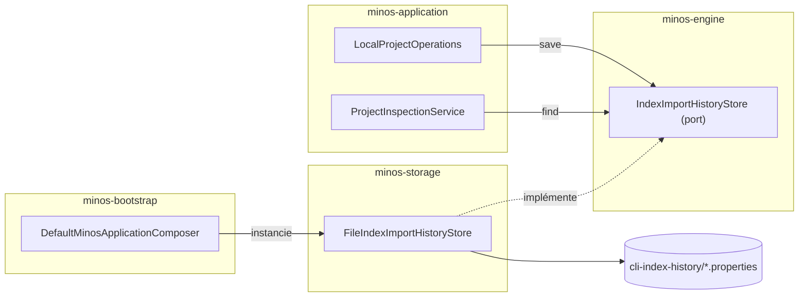

# Design

## Contexte

Motivation : voir `proposal.md` (Why). Modules touchés : `minos-engine` (port), `minos-storage` (implémentation fichier), `minos-application` (`LocalProjectOperations`, `ProjectInspectionService`, `MinosApplicationComposer`), `minos-bootstrap`. Aucune sortie publique ne change. Windows et Linux : mêmes primitives d'E/S privées.

## État vérifié au HEAD

Relu au commit `89be3fb4`.

| Fait | Preuve |
|---|---|
| L'écrivain résout `home.resolve("cli-index-history")` | `minos-application/src/main/java/com/minos/application/LocalProjectOperations.java:63` |
| `writeHistory` : `DurableAtomicFile.ensureDirectory`, `PrivateLocalStorage.createPrivateTempFile`, `Properties.store`, `writePrivateFile`, `DurableAtomicFile.replace`, suppression du temporaire | `LocalProjectOperations.java:213-229` |
| Le lecteur résout le même littéral | `minos-application/src/main/java/com/minos/application/ProjectInspectionService.java:76` |
| `readHistory` : fichier absent → vide ; `BoundedProperties.load(file, MAX_HISTORY_PROPERTIES_BYTES, 16, 64, 8192, …)` ; clés obligatoires `snapshotId`, `providerId`, `completedAt` ; `providerVersion` vide → absent | `ProjectInspectionService.java:241-254` |
| Deux enregistrements `IndexHistory` | `LocalProjectOperations.java:240` ; `ProjectInspectionService.java:279` |
| Appel d'écriture après un import | `LocalProjectOperations.java:147` |
| Tests qui créent ou lisent le dossier | `minos-application/src/test/java/com/minos/application/ProjectInspectionServiceRefusalMessageTest.java:38` ; `minos-bootstrap/src/test/java/com/minos/bootstrap/application/ProjectInventoryToleranceTest.java:82` ; `minos-cli/src/test/java/com/minos/cli/ImportHistoryFailureTest.java:35-64` |
| `ProjectInspectionServiceRefusalMessageTest` écrit le fichier puis construit le service sur le home : il dépend du format | `ProjectInspectionServiceRefusalMessageTest.java:38-45` |
| `LocalProjectOperationsHistoryTest` appelle `LocalProjectOperations.writeHistory` et `LocalProjectOperations.IndexHistory` : écriture ASCII à droits privés, version non ASCII échappée en Latin-1, version absente stockée vide, seconde écriture qui remplace sans temporaire | `minos-application/src/test/java/com/minos/application/LocalProjectOperationsHistoryTest.java:53`, `:66`, `:80`, `:90`, `:93` |
| `minos-application` ne voit `minos-storage` ni en production ni en test | `minos-application/pom.xml:23-38` ; `ALLOWED_DEPENDENCIES` |
| `ImportHistoryFailureTest` affirme le statut `COMMITTED`, l'existence du fichier et l'absence d'avertissement ; il n'affirme ni provider, ni version, ni date | `minos-cli/src/test/java/com/minos/cli/ImportHistoryFailureTest.java:30-65` |
| `minos-storage` porte déjà un magasin du home indépendant du backend, tenu par la règle « home -> backends » | `minos-storage/src/main/java/com/minos/storage/home/ProjectPathMappingStore.java` ; `scripts/architecture/check-module-boundaries.py:997-999` |
| Aucun gate exécuté ne cite `cli-index-history`, `writeHistory`, `readHistory`, `LocalProjectOperations` ni `ProjectInspectionService` ; seuls des scripts retirés de `scripts/history/m15/` (`run-s2.ps1` à `run-s5.ps1`) citent les deux classes | recherche dans `scripts/`, `.github/workflows/`, `.claude/scripts/` |
| Modèle existant d'un magasin de home fourni par la racine pour tout backend | `MinosApplicationComposer.java:79-80` (`semanticProjectionStore`) ; `DefaultMinosApplicationComposer.java:167` |
| `docs/user/` ne cite l'historique qu'à propos de l'inventaire partiel | `docs/user/troubleshooting.md:524` |

Non mesuré : aucun test exécuté ; la page utilisateur des backends n'a pas été relue en entier (son nom exact est à confirmer à l'implémentation).

## Écarts

| Écart | Source A | Source B | Suite proposée |
|---|---|---|---|
| L'audit laisse le choix entre un port et « une seule classe qui détient le littéral » | `findings.json`, AUD-ARC-03, action | Critère de sortie du sprint 7 : l'historique CLI est câblé par `minos-bootstrap` derrière un port | D1 : port |
| L'audit dit que l'historique est « hors du backend sélectionné » avec PostgreSQL | impact du constat | aucune décision ne demande de le porter en base | D2 : le dire dans la documentation, ne pas le déplacer |
| Le nom `cli-index-history` porte le nom d'une surface alors que l'API Java écrit le même historique | `LocalProjectOperations` est appelée par `minos-api` | format persisté | Nom du dossier conservé (compatibilité) ; le port porte un nom neutre |

## Exigences couvertes

- frontieres-de-modules › L'historique d'import est lu et écrit par un port — D1, « Responsabilités ».
- frontieres-de-modules › Le format de l'historique d'import reste lisible — « Persistance et intégrité ».
- frontieres-de-modules › Un historique d'import illisible est refusé sans fuite — « Erreurs et reprise ».

## Objectifs et non-objectifs

Objectif : un seul détenteur du format, derrière un contrat compilé. Non-objectif : changer le format, la tolérance aux pannes ou le lieu de stockage.

## Responsabilités et frontières des composants

- `minos-engine`, package `com.minos.orchestration` (racine déjà possédée, A14) : port `IndexImportHistoryStore` (`Optional<IndexImportHistory> find(UUID)`, `void save(UUID, IndexImportHistory)`, tous deux `throws IOException`) et enregistrement `IndexImportHistory`. [Proposition]
- `minos-storage`, package `com.minos.storage.home` (`STORAGE_PACKAGES`, `check-module-boundaries.py:1003`) : `FileIndexImportHistoryStore`, seul détenteur du littéral, des clés et des bornes. Ce package est celui des magasins du home indépendants du backend (`ProjectPathMappingStore`) ; la règle « home -> backends » (`:997-999`) lui interdit de nommer un backend, ce qui convient à un fichier commun à tous. [Décision D4]
- `minos-bootstrap` : `DefaultMinosApplicationComposer.indexImportHistoryStore(home)`.
- `minos-application` : reçoit le port ; `MinosApplication` le garde en champ sans accesseur public (A11 : la table `MINOS_APPLICATION_ENGINE_ACCESSORS` ne reçoit aucune entrée). Direction ARCH-0068 respectée : moteur ← stockage, moteur ← application, bootstrap → les deux ; aucune dépendance Maven ajoutée.

## Modèle de domaine et invariants

`IndexImportHistory(String snapshotId, String providerId, Optional<String> providerVersion, Instant completedAt)` : `snapshotId` et `providerId` non vides, `completedAt` non nul ; aucune E/S dans le constructeur.

## Traitements et interactions

Import : `LocalProjectOperations` promeut l'instantané, puis appelle `save` ; un échec reste un avertissement (comportement de `ImportHistoryFailureTest`). Inspection : `ProjectInspectionService` appelle `find`.

## États et transitions

Non applicable.

## Contrats d'interface

`MinosApplicationComposer` gagne `IndexImportHistoryStore indexImportHistoryStore(Path home)` (abstraite ; implémentations tierces à adapter, noté dans `docs/user/java-api.md`). Le `Builder` peut recevoir un port substitué pour les tests de `minos-application`.

## Persistance et intégrité

Format inchangé : `MINOS_HOME/cli-index-history/<UUID>.properties`, clés `snapshotId`, `providerId`, `providerVersion` (vide = absent), `completedAt` (ISO-8601), commentaire d'en-tête « MINOS project index history ». Aucune version de schéma n'existe au HEAD ; aucune n'est ajoutée (une clé inconnue reste tolérée par la lecture bornée).

## Transactions, concurrence et idempotence

Écriture par fichier temporaire privé puis `DurableAtomicFile.replace` : inchangé. Deux imports concurrents du même projet : le dernier remplacement gagne, comme au HEAD.

## Sécurité et isolation

E/S par les primitives confinées seulement (`check-private-io.py`) : aucune entrée ajoutée à la liste de tolérance. Messages : feuille du fichier, jamais le chemin absolu (`leafName`, `ProjectInspectionService.java:252`).

## Erreurs et reprise

Mêmes messages qu'au HEAD (« missing index property '<clé>' in <feuille> »). Écriture en échec : avertissement, import réussi.

## Observabilité

Non applicable : aucun journal nouveau.

## Performance et mesure

Non applicable : mêmes E/S.

## Compatibilité, migration et retour arrière

Aucune migration ; retour arrière sans effet sur les données.

## Diagrammes

### Qui connaît le format de l'historique après le changement ?

Type : vue de composants (flowchart) · Portée : cible · Exigences : frontieres-de-modules › L'historique d'import est lu et écrit par un port

## Décisions

### D1 — Un port plutôt qu'une classe commune [Proposition]

Le port met le format derrière un contrat compilé et suit le critère de sortie du sprint. Alternative écartée : une classe partagée dans `minos-application` — elle supprime la duplication mais laisse un format persisté dans la couche application.

### D2 — L'historique reste un fichier de `MINOS_HOME` pour tout backend [Proposition, attend le propriétaire]

Recommandation : ne pas passer par `StorageBackend`. L'historique est une preuve secondaire, reconstruite au prochain import ; le porter en base demanderait un schéma et une migration sans bénéfice identifié. La documentation des backends le dit explicitement. Alternative : méthode `indexImportHistoryStore()` sur `StorageBackend`, à ouvrir par un changement dédié si le propriétaire le veut.

### D4 — Implémentation dans `com.minos.storage.home` [Proposition]

L'historique vit dans `MINOS_HOME` quel que soit le backend : il rejoint `ProjectPathMappingStore` dans `com.minos.storage.home`, pas le backend local (`com.minos.storage.local`), qu'une installation PostgreSQL ne charge pas. La racine de composition l'instancie sans passer par un backend.

### D5 — Les tests du format suivent le format [Proposition]

`minos-application` ne voit pas `minos-storage` : un test de ce module ne peut plus écrire un fichier d'historique et attendre qu'il soit lu. Les quatre cas de `LocalProjectOperationsHistoryTest` et le cas « clé manquante » de `ProjectInspectionServiceRefusalMessageTest` sont portés dans `FileIndexImportHistoryStoreTest` (`minos-storage`) ; `LocalProjectOperationsHistoryTest` est supprimé ; `ProjectInspectionServiceRefusalMessageTest` garde un cas par port substitué (le refus du port est relayé sans chemin). Le parcours complet import puis inspection est affirmé par un test de `minos-bootstrap`, seul module qui voit l'application et le stockage.

### D6 — Ordre de fusion sur le port du composeur [Proposition]

Ce changement ajoute une méthode abstraite à `MinosApplicationComposer` et à `MinosApplicationComposersTest.FirstComposer` (`:90`). Il fusionne avant `cabler-les-adaptateurs-embarques-par-la-racine-de-composition` (trois méthodes) et `injecter-les-collaborateurs-des-cas-d-usage`, qui se rebasent.

### D3 — Aucun ADR propre [Décision de forme]

Un port de plus derrière la racine de composition applique ARCH-0042 ; il est cité par l'ADR commun du sprint (domaine `ARCH`, prochain numéro libre à l'écriture).

## Qualification des capacités

Aucune capacité produit nouvelle. Windows et Linux : qualifié par les tests de l'implémentation fichier dans `minos-storage` (droits privés vérifiés par les aides de test existantes).

## Risques et compromis

- [Risque] SonarCloud : `FileIndexImportHistoryStore` est du code neuf de `minos-storage` → ses tests vivent dans `minos-storage`, cas portés compris.
- [Risque] Perte de couverture en supprimant `LocalProjectOperationsHistoryTest` → chacun de ses quatre cas a son équivalent nommé dans `FileIndexImportHistoryStoreTest` avant la suppression.
- [Risque] Régression de tolérance (`ProjectInventoryToleranceTest`) → test rejoué sans modification de ses attentes.

## Vérification

- Tests : nouveau `FileIndexImportHistoryStoreTest` (`minos-storage`, avec les cas portés) ; nouveau test d'inspection après import dans `minos-bootstrap` ; `ProjectInspectionServiceRefusalMessageTest` (adapté au port substitué), `ProjectInventoryToleranceTest`, `ImportHistoryFailureTest` ; `DefaultMinosApplicationComposerTest`, `MinosApplicationComposersTest` ; `LocalProjectOperationsHistoryTest` supprimé.
- Gates : `check-module-boundaries.py` et auto-test, `check-private-io.py`, `check-comment-language.py`.
- Commandes : `./mvnw -B -ntp -pl minos-storage -am test`, `./mvnw -B -ntp -pl minos-cli -am test`, `./mvnw -B -ntp -pl minos-bootstrap -am test`.

## Documentation durable à mettre à jour

`docs/architecture/diagrams/capacites/frontieres-de-modules.md` ; page des backends de stockage de `docs/user/` ; `docs/developer/indexing-and-storage.md` ; `docs/user/java-api.md` (méthode ajoutée au port du composeur).

## Traçabilité

| Exigence (capacité › titre) | Scénario | Conception ou diagramme | Tâche | Test ou preuve |
|---|---|---|---|---|
| frontieres-de-modules › L'historique d'import est lu et écrit par un port | Littéral absent de l'application ; Un seul détenteur du format | vue de composants | 2.2 | recherche textuelle |
| idem | Import réussi écrit l'historique sans avertissement | Traitements | 2.2 | `ImportHistoryFailureTest` (existant) |
| idem | Inspection après import | D5 | 2.1 | `ImportHistoryInspectionTest` (`minos-bootstrap`) ; `DefaultMinosApplicationComposerTest#theImportHistoryStoreIsTheFileStoreOfTheHomeAndAReadingCreatesNothing` |
| idem | Port non exposé par la façade | Responsabilités | 2.2 | `check-module-boundaries.py` (A11) |
| frontieres-de-modules › Le format de l'historique d'import reste lisible | Fichier d'une version antérieure ; Projet sans historique ; Écriture atomique et privée | Persistance | 1.1 | `FileIndexImportHistoryStoreTest` (format antérieur, projet sans historique, écriture privée, Latin-1, version vide, remplacement sans temporaire) |
| frontieres-de-modules › Un historique d'import illisible est refusé sans fuite | Clé obligatoire manquante | Erreurs, D5 | 1.1 | `FileIndexImportHistoryStoreTest#aHistoryWithoutASnapshotIdIsRefusedByItsLeafName` |
| idem | Refus du port relayé par l'inspection | D5 | 2.2 | `ProjectInspectionServiceRefusalMessageTest#theRefusalOfTheHistoryPortIsRelayedWithoutAPath` |
| idem | Fichier hors bornes | Erreurs | 1.1 | `FileIndexImportHistoryStoreTest#aHistoryBeyondTheByteBoundIsRefused` |
| idem | Dossier d'historique inutilisable | Traitements | 2.2 | `ImportHistoryFailureTest` (existant) |

## Questions ouvertes

- D2 : décision du propriétaire (recommandation : fichier de `MINOS_HOME`, documenté).
