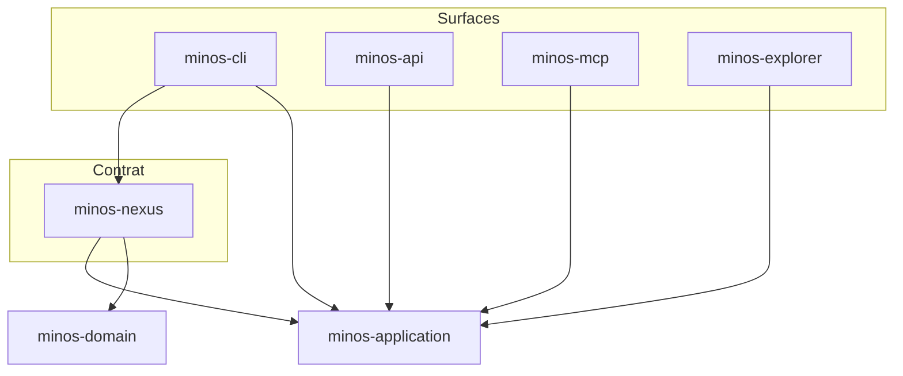

# Design

## Contexte

Motivation : voir `proposal.md` (Why). Le changement touche le garde Python, son auto-test, le test ArchUnit de `minos-app` et des documents. Aucune classe de production, aucune surface publique, aucune plateforme n'est concernée.

## État vérifié au HEAD

Commit relu : `89be3fb4` (`main`).

| Fait | Preuve |
|---|---|
| `SURFACE_MODULES` contient `minos-nexus` | `scripts/architecture/check-module-boundaries.py:51` |
| `ALLOWED_DEPENDENCIES` autorise `minos-cli` → `minos-nexus` et `minos-nexus` → `minos-domain`, `minos-application`, `minos-bootstrap` | `scripts/architecture/check-module-boundaries.py:77-78` |
| `SURFACE_MODULES` sert aux règles hexagonales (portée vers la racine de composition, retour d'un adaptateur vers une surface) et à A11 | `scripts/architecture/check-module-boundaries.py:245`, `:259`, `:270`, `:276`, `:856-866`, `:889` |
| La liste A11 de `minos-nexus` est vide | `scripts/architecture/check-module-boundaries.py:587-589` |
| `NexusSemanticSignalService` figure dans `UNREFERENCED_PRODUCTION_TYPES` avec la raison « not qualified by a client » | `scripts/architecture/check-module-boundaries.py:1222-1223` |
| ArchUnit range `minos-nexus` dans `SURFACES` et lui donne une liste bytecode vide | `minos-app/src/test/java/com/minos/app/architecture/ModuleArchitectureTest.java:83-84`, `:105-106` |
| ArchUnit n'interdit « une autre surface » qu'à `minos-explorer` | `minos-app/src/test/java/com/minos/app/architecture/ModuleArchitectureTest.java:242-249` |
| `minos-cli` déclare `minos-nexus` en portée compile ; aucune autre surface n'en déclare une autre | `minos-cli/pom.xml:32-36` ; POM de `minos-api`, `minos-mcp`, `minos-explorer`, `minos-nexus` relus |
| `minos-nexus` déclare `minos-bootstrap` en portée test | `minos-nexus/pom.xml:27-33` |
| Trois imports de `com.minos.nexus` hors du module en production, tous dans `minos-cli` ; un test de `minos-app` l'importe aussi | `minos-cli/src/main/java/com/minos/cli/MinosCliRunner.java:28`, `minos-cli/src/main/java/com/minos/cli/command/NexusExportCommand.java:7-8` ; `minos-app/src/test/java/com/minos/integration/nexus/NexusExportIntegrationTest.java:7-8` |
| Quatre règles interdisent aujourd'hui d'atteindre `minos-nexus` parce qu'il est une surface : adaptateur ↛ surface et racine de composition ↛ surface (garde), adaptateur ↛ couches hautes et application ↛ surfaces (ArchUnit) | `scripts/architecture/check-module-boundaries.py:270`, `:276` ; `minos-app/src/test/java/com/minos/app/architecture/ModuleArchitectureTest.java:167`, `:180` |
| La règle ArchUnit de l'explorateur range `com.minos.nexus..` parmi les « autres surfaces » interdites | `ModuleArchitectureTest.java:243-250` |
| Aucun cas de l'auto-test ne porte sur `NexusSemanticSignalService` ; les cas A15 utilisent un type fictif | `scripts/architecture/test_check_module_boundaries.py:2125-2139` |
| D'autres textes rangent `minos-nexus` parmi les surfaces | `docs/architecture/SYNTHESE.md:21`, `docs/developer/quality-gates.md:67`, commentaire `scripts/architecture/check-module-boundaries.py:81-82` |
| Deux exigences énumèrent `minos-nexus` parmi les surfaces ; une troisième tient la vue bytecode « par surface » | `openspec/specs/frontieres-de-modules/spec.md:249-250`, `:352-353`, `:621-622` |
| `NexusExportBridgeMain` (`minos-app`) lance `MinosLauncher`, sans importer `com.minos.nexus` | `minos-app/src/main/java/com/minos/integration/nexus/NexusExportBridgeMain.java:30` |
| ARCH-0068 attribue `com.minos.nexus` à `minos-nexus` | `docs/architecture/adr/ARCH-0068-modules-dependances-et-propriete-des-packages.md:94` |
| `com.minos.nexus` et ses quatre types sont documentés comme API Java | `docs/user/java-api.md:363-369`, `:434` |
| Les diagrammes écrits à la main rangent `minos-nexus` parmi les surfaces | `docs/architecture/arc42/05-vue-blocs.md:18`, `docs/architecture/diagrams/c4-container.md:12`, `docs/architecture/diagrams/application/component-modules-et-dependances.md:10-14` |
| La documentation présente le signal sémantique comme fourni | `docs/developer/public-surfaces.md:265` |
| Scope JaCoCo `nexus-export` : préfixes `com/minos/nexus/`, `com/minos/integration/nexus/`, `com/minos/application/export/` | `scripts/quality/check-jacoco.py:275-276` |

Non mesuré : aucun build ni test exécuté pendant la spécification ; l'état « garde vert » est celui que rapporte l'audit.

## Écarts

| Écart | Source A | Source B | Suite proposée |
|---|---|---|---|
| L'audit cite `05-vue-blocs.md:13-25` comme diagramme « les surfaces ne dépendent pas entre elles » ; le diagramme groupe les surfaces dans un nœud unique et ne dit rien de leurs arêtes internes | `findings.json` (AUD-ARC-08) | `docs/architecture/arc42/05-vue-blocs.md:14-37` | Sortir `minos-nexus` du nœud « Surfaces » et l'écrire comme module de contrat |
| L'audit propose « fusionner dans `minos-application` (export) » ; `com.minos.nexus` est une racine de packages attribuée à `minos-nexus` par ARCH-0068 et un nom documenté de l'API Java | `findings.json` (AUD-ARC-08) | `docs/architecture/adr/ARCH-0068-modules-dependances-et-propriete-des-packages.md:94`, `docs/user/java-api.md:434` | D1 : requalifier ; l'absorption demande un ADR |
| Retirer `minos-nexus` de `SURFACE_MODULES` sortirait le module de la règle A11, qu'un scénario existant exige (« le garde échoue en A11 en nommant `minos-nexus` ») | `openspec/specs/frontieres-de-modules/spec.md:775-796` | `scripts/architecture/check-module-boundaries.py:856-866` | A11 parcourt les surfaces et les modules de contrat (D3) |
| Aucune règle n'interdit aujourd'hui une arête surface → surface : seule la table `ALLOWED_DEPENDENCIES` la borne, et elle l'autorise pour la CLI | `scripts/architecture/check-module-boundaries.py:78` | sprint 8, « une surface ne dépend d'aucune autre » | Règle explicite ajoutée |

## Exigences couvertes

- `frontieres-de-modules` › Un module de contrat reste sous les surfaces : D1, D3, « Responsabilités et frontières ».
- `frontieres-de-modules` › Aucune surface ne dépend d'une autre surface : D1, diagramme.
- `frontieres-de-modules` › Le signal sémantique NEXUS est déclaré non qualifié : D2.
- `frontieres-de-modules` › Les surfaces n'assemblent pas le cycle d'indexation, et › Les types du moteur nommés par une surface le sont par liste fermée (modifiées) : D3.

## Objectifs et non-objectifs

Objectifs : une famille de plus dans le garde et dans ArchUnit ; aucune règle existante affaiblie ; le graphe réel conforme au dessin. Non-objectifs : déplacer une classe, renommer un package, toucher au contrat NEXUS, créer un module.

## Responsabilités et frontières des composants

Direction inchangée (ARCH-0068) : `domain → engine → adaptateurs → application → contrat → surfaces`. Un module de contrat traduit un résultat applicatif dans un contrat externe versionné (ARCH-0020) ; il se place entre l'application et les surfaces. Aucun module n'est créé : `minos-nexus` existe et garde son unique package (règle « ne jamais créer un module pour reproduire un package » sans objet ici).

Rôles après changement :

| Famille | Modules | Dépend au plus de |
|---|---|---|
| Contrat | `minos-nexus` | `minos-domain`, `minos-application` ; `minos-bootstrap` en test |
| Surfaces | `minos-cli`, `minos-api`, `minos-mcp`, `minos-explorer` | domaine, moteur (dette A11), application, contrat ; `minos-bootstrap` en runtime ou test ; aucune surface |

## Modèle de domaine et invariants

Non applicable : aucun type de domaine modifié.

## Traitements et interactions

Non applicable : aucun traitement d'exécution modifié.

## États et transitions

Non applicable : aucun cycle de vie.

## Contrats d'interface

Non applicable : la sortie du garde gagne une ligne de résumé pour la famille de contrat ; aucun contrat public (CLI, API Java, MCP, JSON NEXUS) ne change.

## Persistance et intégrité

Non applicable : rien n'est persisté.

## Transactions, concurrence et idempotence

Non applicable.

## Sécurité et isolation

Fail-closed : un module du reactor sans famille connue fait déjà échouer les règles hexagonales (`check-module-boundaries.py:245`) ; la famille de contrat entre dans cet ensemble de rôles, sinon le garde échouerait sur `minos-nexus`. Aucun secret, aucun processus, aucune E/S privée.

## Erreurs et reprise

Non applicable : les messages d'échec du garde nomment le module, la dépendance et la famille.

## Observabilité

La ligne de résumé du garde nomme les familles et leur taille.

## Performance et mesure

Non applicable : contrôle statique de quelques POM.

## Compatibilité, migration et retour arrière

Aucune migration. Retour arrière : remettre `minos-nexus` dans `SURFACE_MODULES` et retirer la famille ; aucun artefact livré n'en dépend.

## Diagrammes

### Où se place le module de contrat par rapport aux surfaces ?

Type : flowchart (vue de composants) · Portée : cible · Exigences : `frontieres-de-modules` › Un module de contrat reste sous les surfaces ; › Aucune surface ne dépend d'une autre surface

La seule arête qui partait d'une surface vers une autre devient une arête surface → contrat. Aucune flèche ne relie deux nœuds du cadre « Surfaces », ce que la règle nouvelle vérifie. Les arêtes vers le moteur (dette A11) et vers la racine de composition ne sont pas tracées.

## Décisions

### D1 — Requalifier `minos-nexus` en module de contrat

Statut : [Décision] du propriétaire, 2026-11-17 : requalifier, sans absorption.

Choix : garder le module, changer sa famille dans le garde, dans ArchUnit et dans la documentation.

Alternatives écartées :

- **Absorber dans `minos-application`** : ajoute la racine `nexus` à `minos-application` (décision A14) et y loge la traduction vers un contrat externe, au moment où le sprint 7 (AUD-ARC-01) en sort les adaptateurs ; contredit la table d'ARCH-0068 (`com.minos.nexus` → `minos-nexus`), donc exige un ADR ; déplace quatre classes et trois classes de test (couverture SonarCloud du nouveau code, scope `nexus-export`).
- **Absorber dans `minos-cli`**, seul consommateur : même coût, et l'API Java documentée `com.minos.nexus` deviendrait livrée par la CLI.

Compromis : un module de 347 lignes subsiste. Il porte un contrat externe versionné avec ses propres tests de contrat (`NexusExportContractTest`, ARCH-0020), ce qui le distingue d'un package reproduit en module.

ADR : note datée dans « Mise en œuvre » d'ARCH-0068 (famille de contrat, règle surface ↛ surface). Aucune décision acceptée n'est réécrite.

### D2 — `NexusSemanticSignalService` reste, déclarée non qualifiée

Statut : [Décision] du propriétaire, 2026-11-17 : garder la classe, déclarée non qualifiée.

Choix : la classe et son contrat v2 restent ; l'entrée A15 reste ; la documentation dit « non qualifié par un client ».

Alternatives écartées : la supprimer (retrait de deux types publics documentés dans `docs/user/java-api.md:434`, donc RUPTURE de l'API Java) ; la brancher sur une commande (capacité nouvelle sans client NEXUS pour la qualifier, contraire au principe capability-honest).

### D3 — A11 couvre les surfaces et les modules de contrat

Statut : [Décision] de conception.

Les fonctions A11 parcourent l'union des deux familles ; la clé `minos-nexus` de `ENGINE_TYPES_NAMED_BY_SURFACE` et celle de la table bytecode restent, vides. Le scénario existant « Un type du moteur réintroduit dans NEXUS » reste vrai.

Deux exigences qui énumèrent `minos-nexus` parmi les surfaces sont modifiées pour le nommer comme module de contrat, sans changer leur portée (`spec.md:249`, `:352`). L'exigence « Les types du moteur utilisés par le bytecode d'une surface le sont par liste fermée » (`spec.md:621`) n'est pas modifiée ici : sa table garde la clé `minos-nexus` et son texte ne nomme aucun module ; `donner-une-source-unique-aux-tables-du-garde-de-frontieres`, fusionné après, la modifie et y écrit « par surface et par module de contrat ». Une même exigence n'est ainsi modifiée que par un changement.

### D4 — Les règles qui protègent les surfaces protègent aussi le module de contrat

Statut : [Décision] de conception. Quatre ensembles passent de « surfaces » à « surfaces et modules de contrat », pour qu'aucune interdiction ne tombe avec la requalification :

| Règle | Site au HEAD | Cas refusé à écrire |
|---|---|---|
| Un adaptateur ne dépend d'aucune surface (POM) | `check-module-boundaries.py:270` | `minos-storage` → `minos-nexus` |
| La racine de composition ne dépend d'aucune surface (POM) | `check-module-boundaries.py:276` | `minos-bootstrap` → `minos-nexus` |
| Un adaptateur n'atteint aucune couche haute (bytecode) | `ModuleArchitectureTest.java:167` | classe d'adaptateur qui utilise `com.minos.nexus` |
| L'application ne connaît que des ports (bytecode) | `ModuleArchitectureTest.java:180` | classe de `minos-application` qui utilise `com.minos.nexus` |

### D5 — L'explorateur reste interdit de contrat NEXUS

Statut : [Décision] de conception. La règle ArchUnit de l'explorateur (`ModuleArchitectureTest.java:243-250`) garde `com.minos.nexus..` dans sa liste interdite ; seule sa raison est réécrite (« aucune autre surface ni module de contrat », ARCH-0082). `minos-explorer` ne déclare pas `minos-nexus`, donc rien ne change dans les faits.

## Qualification des capacités

`frontieres-de-modules` : qualifiée (contrôle statique identique sous Windows et Linux ; ArchUnit dans les jobs `Verify` des deux plateformes). Le signal sémantique NEXUS : **non qualifié**, déclaré comme tel.

## Risques et compromis

- [Risque] L'auto-test du garde (2 146 lignes, 23 mentions de `nexus`) affirme des messages qui nomment les surfaces → relire chaque cas avant de changer la famille ; rouge noté pour chacun.
- [Risque] Le sprint 7 (AUD-ARC-01, AUD-ARC-02) et AUD-ARC-04 éditent les mêmes tables → fusionner ce changement avant AUD-ARC-04 ; en cas de conflit avec le sprint 7, rejouer le garde après rebase.

## Vérification

- `python scripts/architecture/check-module-boundaries.py` et `python scripts/architecture/test_check_module_boundaries.py` (cas refusé et cas accepté par règle nouvelle).
- `./mvnw -B -ntp -pl minos-app -am test "-Dtest=ModuleArchitectureTest" "-Dsurefire.failIfNoSpecifiedTests=false"`.
- `python .claude/scripts/run_gates.py --fast`, `python scripts/docs/check-current-docs.py`, `python scripts/docs/check-capability-dossiers.py`, `archgate check`.
- Non vérifiable localement : rien.

## Documentation durable à mettre à jour

`docs/architecture/arc42/05-vue-blocs.md` (diagramme 5.1 et section `minos-nexus`), `docs/architecture/SYNTHESE.md` (`:21`), le commentaire du garde sur l'explorateur (`check-module-boundaries.py:81-82`), `docs/architecture/diagrams/c4-container.md`, `docs/architecture/diagrams/application/component-modules-et-dependances.md`, `docs/developer/public-surfaces.md`, `docs/developer/quality-gates.md` (A2, A11), ARCH-0068 (« Mise en œuvre »), dossier `docs/architecture/diagrams/capacites/frontieres-de-modules.md`. `docs/architecture/diagrams/module-dependencies.md` est généré : aucune édition à la main, et aucune différence attendue.

## Traçabilité

| Exigence (capacité › titre) | Scénario | Conception ou diagramme | Tâche | Test ou preuve |
|---|---|---|---|---|
| frontieres-de-modules › Un module de contrat reste sous les surfaces | Dépôt réel | D1 | 1.2 | `python scripts/architecture/check-module-boundaries.py` : code 0, ligne « A2 module families: … contract modules=1 (minos-nexus) » ; `minos-app/src/test/java/com/minos/app/architecture/ModuleArchitectureTest.java#contractModulesSitBelowTheSurfaces` |
| idem | Module de contrat qui dépend d'une surface | D1 | 1.1 | `scripts/architecture/test_check_module_boundaries.py#test_a_contract_module_may_not_depend_on_a_surface`, `scripts/architecture/test_check_module_boundaries.py#test_a_contract_module_depends_only_on_the_domain_and_the_application` |
| idem | Racine de composition hors portée test | D1 | 1.1 | `scripts/architecture/test_check_module_boundaries.py#test_a_contract_module_sees_the_composition_root_in_tests_only` |
| idem | Type du moteur réintroduit | D3 | 1.1 | `scripts/architecture/test_check_module_boundaries.py#test_an_engine_type_back_in_nexus_is_refused_against_the_real_list` (rejoué, vert) |
| frontieres-de-modules › Aucune surface ne dépend d'une autre surface | Arête de la CLI vers le contrat NEXUS | diagramme | 1.2 | garde sur le dépôt ; `scripts/architecture/test_check_module_boundaries.py#test_a_surface_may_depend_on_a_contract_module` |
| idem | Surface qui dépend d'une surface | diagramme | 1.1 | `scripts/architecture/test_check_module_boundaries.py#test_no_surface_depends_on_another_surface_in_any_scope`, `minos-app/src/test/java/com/minos/app/architecture/ModuleArchitectureTest.java#noSurfaceUsesAnotherSurface` (rouge : 56 violations `minos-cli` → `minos-nexus` tant que NEXUS était une surface) |
| frontieres-de-modules › Le signal sémantique NEXUS est déclaré non qualifié | Documentation honnête | D2 | 2.2 | recherche de `NexusSemanticSignalService` dans `docs/developer/public-surfaces.md` : « non qualifié » sur ses deux lignes |
| idem | Entrée du cliquet retirée sans appelant | D2 | 2.1 | `scripts/architecture/test_check_module_boundaries.py#test_the_nexus_semantic_signal_stays_declared_as_not_qualified` |
| frontieres-de-modules › Les surfaces n'assemblent pas le cycle d'indexation (modifiée) | les deux scénarios | D3 | 1.2 | `new IndexingLifecycleService` dans les sources de production de `minos-cli`, `minos-api`, `minos-mcp`, `minos-nexus` : 0 ligne ; garde vert |
| frontieres-de-modules › Les types du moteur nommés par une surface le sont par liste fermée (modifiée) | les cinq scénarios | D3 | 1.1, 1.2 | cas A11 existants rejoués sur l'union surfaces et modules de contrat (260 cas verts) |
| — (règles conservées) | adaptateur, racine de composition et application ↛ module de contrat | D4 | 1.1, 1.3 | POM : `scripts/architecture/test_check_module_boundaries.py#test_an_adapter_and_the_composition_root_never_reach_a_contract_module` ; bytecode : `minos-app/src/test/java/com/minos/app/architecture/ModuleArchitectureTest.java#adaptersDoNotReachBackIntoUpperLayers`, `applicationOnlyKnowsPorts` étendues, sans cas refusé exécuté (une classe fautive exigerait d'abord une arête Maven que A2 refuse) |

## Questions ouvertes

Aucune : D1 et D2 sont tranchées (2026-11-17).
