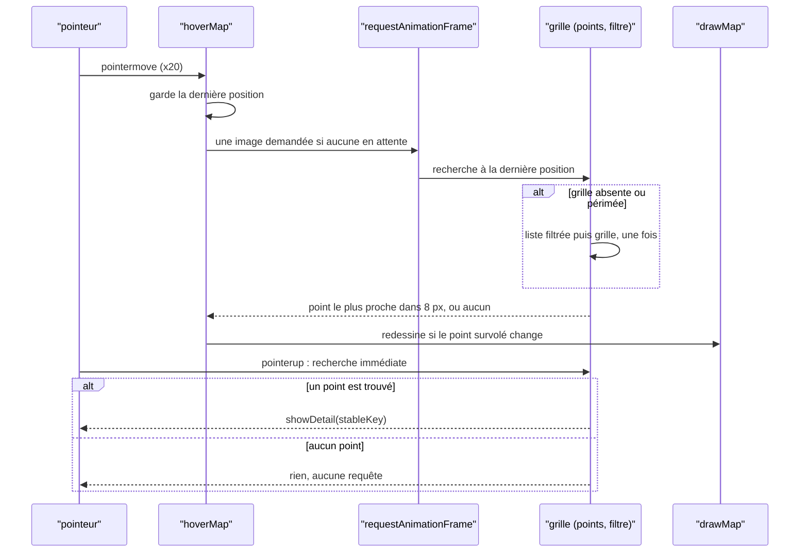

# Design

## Contexte

Motivation : voir `proposal.md` (Why). Le changement porte sur un seul fichier de ressource, `minos-explorer/src/main/resources/com/minos/explorer/web/app.js`, servi tel quel par la surface HTTP locale (ARCH-0082). La carte y tient dans un objet global `map` et une dizaine de fonctions (`visiblePoints`, `drawMap`, `pointAt`, `hoverMap`, `markRowsOnMap`). Aucun code Java n'est touché.

Prérequis non livré au HEAD : AUD-TST-02 (changement `executer-le-front-de-l-explorateur-en-test`), qui charge le vrai `app.js` dans un contexte `node:vm` avec un faux DOM et caractérise la géométrie et la sélection de la carte. Ses tests de caractérisation sont le filet de ce changement : sans eux, il ne démarre pas.

## État vérifié au HEAD

HEAD `89be3fb4`. Lecture du code seulement ; la page n'a pas été ouverte dans un navigateur.

| Fait | Preuve |
|---|---|
| État de la carte : objet global `map` (`points`, `highlights`, `scale`, `offsetX`, `offsetY`, `hover`, `drag`, `frame`) | `minos-explorer/src/main/resources/com/minos/explorer/web/app.js:469-472` |
| `visiblePoints()` : `map.points.filter(point => point.kind === kind)` quand une nature est choisie, sinon `map.points` | même fichier `:483-486` |
| `pointAt(event)` : boucle sur `visiblePoints()`, distance en pixels, rayon de capture de 8 px (`bestDistance = 64`), premier point strictement le plus proche | même fichier `:638-651` |
| `hoverMap` appelle `pointAt` à chaque événement, puis `drawMap` si le point change | même fichier `:690-698` |
| `pointermove` → `hoverMap` hors glissement ; `pointerup` → `pointAt` puis `showDetail` | même fichier `:738-744` |
| `drawMap` est regroupé par `requestAnimationFrame` ; il appelle `visiblePoints()` à chaque image | même fichier `:581-598` |
| `drawPlainPoints` parcourt les points affichés une fois par nature de `KIND_COLOR` | même fichier `:603-616` |
| `markRowsOnMap` construit un `Set` des clés de tous les points affichés à chaque changement de filtre ou de table | même fichier `:665-667` |
| Changement de filtre : `renderMapTexts(); markRowsOnMap();` | même fichier `:728` |
| Chargement : pages de `MAP_PAGE = 5000`, en boucle séquentielle | même fichier `:461`, `:553-563` |
| Coordonnées des points normalisées dans le carré de -1 à 1 | `minos-application/src/main/java/com/minos/application/semantic/PrincipalAxes.java:111-143` |
| Contrôles textuels qui lisent `app.js` | `minos-explorer/src/test/java/com/minos/explorer/WebResourcesContentTest.java:44-46`, `:81-116` |

**Non mesuré** : le temps d'un survol à 100 000, 250 000 et 1 000 000 de points, le poids du JSON des points, le temps de dessin. L'audit donne des estimations.

## Écarts

| Écart | Source A | Source B | Suite proposée |
|---|---|---|---|
| L'audit cite le survol ; le clic (`pointerup`) passe par le même `pointAt` | `findings.json` AUD-PERF-10 | `app.js:739-744` | La grille sert les deux ; exigence « … cherché parmi les points voisins seulement » |
| L'audit cite la réallocation au survol ; `drawMap` réalloue aussi la liste filtrée à chaque image, et `markRowsOnMap` un `Set` de toutes les clés | idem | `app.js:596`, `:667` | La liste mise en cache sert survol, clic et dessin ; le `Set` de `markRowsOnMap` n'est construit qu'au changement (événement rare), noté sans exigence |
| « Envisager un format de points compact » modifie le contrat de la route `projection/points` | `findings.json` AUD-PERF-10, action | exploration-semantique › Les points d'une projection annoncent méthode, sélection et échantillonnage | Hors périmètre (D3) |
| Le banc de AUD-PERF-13 mesure les routes côté serveur, pas le coût dans le navigateur | `mesurer-la-projection-et-l-explorateur-au-banc` | — | La mesure de ce changement se fait par le harnais Node de AUD-TST-02 (compte et durée) et par un parcours manuel |
| L'audit raisonne à 1 000 000 de points ; la synchronisation ne construit pas d'index de plus de 250 000 documents (32 768 à 768 dimensions), donc aucune carte de cette taille | `findings.json` AUD-PERF-10, impact | `minos-application/src/main/java/com/minos/application/semantic/SemanticIndexBudget.java:15-19`, `:59-75` | 1 000 000 de points n'est mesuré que comme jeu synthétique sous Node ; le cas réel le plus lourd est 250 000 points |
| La part de points examinés dépend de la taille du canevas : `half` vaut la demi-hauteur utile multipliée par le zoom, et le rayon de capture de 8 px couvre d'autant plus de carte que `half` est petit | exigence « … parmi les points voisins seulement » | `app.js:576` | Le scénario fixe le canevas (800 × 600) et le zoom (1) ; l'équivalence, elle, est exigée à tous les zooms |
| Le dessin reste linéaire en nombre de points (une passe par nature) | — | `app.js:603-616` | Hors périmètre ; relevé pour la mesure manuelle ; la mesure sous Node confirme qu'il n'a pas bougé |
| Le test de caractérisation de la rafale (`map.test.mjs`, 50 recherches) et le test des puits (`sinks.test.mjs`, texte de survol lu avant l'image) encodent le survol synchrone | `map.test.mjs`, `sinks.test.mjs` | exigence « au plus une fois par image » | Adaptés dans le même commit : table `CURRENT.burst` à une recherche, image vidée avant la lecture du texte de survol ; aucune assertion de sécurité retirée |
| Le gate `check-explorer-front.py --self-test` ancre sa mutation « rayon de capture » sur le littéral `let bestDistance = 64;` | `scripts/quality/check-explorer-front.py` | `app.js` au HEAD | Ancre déplacée sur `const MAP_CAPTURE_PIXELS = 8;` |

## Exigences couvertes

- exploration-semantique › Le point sous le pointeur est cherché parmi les points voisins seulement — D1.
- exploration-semantique › La liste des points d'une nature n'est calculée qu'à son changement — D2.
- exploration-semantique › Le survol de la carte est traité au plus une fois par image — « Traitements et interactions ».

## Objectifs et non-objectifs

Objectif : un coût de survol et de clic qui dépend de la densité locale, pas du nombre total de points. Non-objectifs : accélérer le dessin ou le chargement, changer le contrat des points, introduire une dépendance ou un outil de build.

## Responsabilités et frontières des composants

Un seul fichier statique, sans module ni bundler (contrainte de la surface : aucune ressource externe). Les fonctions ajoutées sont pures quand c'est possible (construction de la grille, recherche dans la grille à partir d'une géométrie donnée), pour être appelées par les tests `node:test` sans DOM. Direction des dépendances ARCH-0068 : sans objet (aucun code Java).

## Modèle de domaine et invariants

- Grille : découpage régulier du carré de -1 à 1 en cellules, en coordonnées de projection (indépendantes du zoom et du décalage) ; chaque cellule liste les indices des points qu'elle contient dans la liste affichée. Construite une fois par couple (points, filtre de nature).
- Invariant d'équivalence : pour toute géométrie et toute position, la recherche par grille rend le point que rend la boucle du HEAD — le plus proche en pixels dans le rayon de 8 px, et, à distance égale, celui de plus petit indice.
- Invariant de couverture : les cellules examinées couvrent le disque de capture converti en coordonnées de projection (rayon de 8 px divisé par `half`), quel que soit le zoom (`scale` de 0,5 à 200).
- Invariant de fraîcheur : la liste filtrée et la grille sont invalidées quand `map.points` est remplacé ou quand le filtre change ; une grille périmée n'est jamais consultée.

## Traitements et interactions

Voir le diagramme. `pointermove` enregistre la dernière position et demande une image si aucune n'est en attente ; à l'image, une recherche a lieu pour cette position. `pointerup` cherche immédiatement à la position du clic, sans passer par l'attente.

## États et transitions

Non applicable : l'attente d'image est un simple drapeau, comme `map.frame` pour le dessin.

## Contrats d'interface

Aucun contrat public ne change : mêmes requêtes (`/projection`, `/projection/points?offset=…&limit=…`), mêmes textes. Les chaînes qu'affirme `WebResourcesContentTest` (`api(projectPath() + "/projection/points?offset="`, `node.textContent = String(text)`, `"use strict"`, messages d'état) restent dans le fichier.

## Persistance et intégrité

Non applicable : aucune donnée persistée ; rien dans `localStorage` (contrôlé par `WebResourcesContentTest.java:86`).

## Transactions, concurrence et idempotence

Un seul fil (navigateur). Une lecture de carte remplacée par une autre (`map.request`) remplace `map.points` et invalide la grille ; un survol en attente à ce moment cherche dans la nouvelle carte ou ne trouve rien.

## Sécurité et isolation

Aucun puits DOM nouveau : la grille ne produit que des indices. Le texte de survol reste écrit par `textContent`. Le contrôle par exécution des puits de AUD-TST-02 est rejoué.

## Erreurs et reprise

Carte vide, filtre sans point, canvas de largeur nulle : la recherche rend « aucun point », comme au HEAD.

## Observabilité

Pour les tests seulement : la recherche rend ou expose le nombre de points examinés, sans l'afficher dans la page.

## Performance et mesure

Aucun objectif chiffré de durée : aucune source. L'exigence se vérifie par un **compte** (points examinés), déterministe. Mesure demandée par le sprint :

1. **Avant** (sur `main` muni du harnais de AUD-TST-02) : pour 100 000 et 250 000 points (tailles qu'une projection peut atteindre), puis 1 000 000 de points comme jeu synthétique qu'aucun index constructible ne produit, nombre de points examinés et durée médiane d'une recherche sous Node, canevas de 800 × 600, avec et sans filtre de nature.
2. **Après** : mêmes jeux, même machine.
3. **(manuelle)** parcours dans un navigateur sur la plus grande projection réellement préparée (32 768 points à 768 dimensions ; davantage seulement à petites dimensions, 250 000 au plus) : fluidité du survol, relevé de l'outil de performance du navigateur.

Les durées sous Node ne valent pas mesure dans un navigateur : elles sont écrites comme telles.

### Relevé du 2026-11-15 (tâches 1.2, 4.1)

Commande : `node minos-explorer/src/test/js/map-bench.mjs --json`. Machine : Windows 10, Node v24.18.0, poste de travail partagé avec d'autres sessions (bruit non maîtrisé). Jeux **synthétiques** (graine fixe, points uniformes sur le carré, un tiers par nature), canevas 800 × 600, zoom 1, 400 positions, médiane de 5 passes. « Avant » : `app.js` de `c388df1b` ; « après » : le correctif, trois exécutions (intervalle). Points examinés : nombre d'abscisses lues par une recherche (points à accesseur), médiane de 50 positions (maximum entre parenthèses).

| Points | Filtre | Affichés | Examinés avant | Examinés après | Recherche avant | Recherche après |
|---|---|---|---|---|---|---|
| 100 000 | aucun | 100 000 | 100 000 | 91 (146) | 1 817 µs | 18 à 31 µs |
| 100 000 | `SYMBOL` | 33 075 | 33 075 | 32 (57) | 2 137 µs | 6 à 15 µs |
| 250 000 | aucun | 250 000 | 250 000 | 214 (276) | 4 524 µs | 41 à 48 µs |
| 250 000 | `SYMBOL` | 83 355 | 83 355 | 70 (114) | 9 212 µs | 18 à 30 µs |
| 1 000 000 (synthétique) | aucun | 1 000 000 | 1 000 000 | 826 (945) | 26 220 µs | 121 à 178 µs |
| 1 000 000 (synthétique) | `SYMBOL` | 334 205 | 334 205 | 281 (351) | 45 103 µs | 56 à 65 µs |

- Le nombre de points examinés suit la densité locale, pas le total : il croît avec le nombre de points parce que la surface du canevas est fixe.
- Le tracé (`drawMap`) n'est pas accéléré : une image sur 100 000 à 1 000 000 de points prend de 4 à 163 ms sous Node avant comme après, dans le bruit des mesures (le faux canevas ne fait rien par point). Seule la réallocation de la liste filtrée à chaque image disparaît ; son gain n'est pas isolé par ces mesures.
- Construction de la liste filtrée et de la grille, une fois par changement de points ou de filtre : 33 ms (100 000 points), 82 ms (250 000), 334 ms (1 000 000) sous `node:vm`, dont les accès aux globaux sont lents ; 7 à 13 ms à 250 000 points dans le Chromium du navigateur intégré (canevas 388 × 261, panneau masqué).
- Contrôle hors harnais, **non** parcours de la tâche 4.2 : la vraie page servie par un faux serveur d'API (250 000 points synthétiques) dans le navigateur intégré de l'application (Chromium 156, Windows, panneau masqué donc sans images d'animation, canevas 388 × 261, appel direct de `pointAt` sur 400 positions, médiane de 5 passes). Avant : 1 636 µs sans filtre, 7 546 µs avec `SYMBOL`. Après : 49 µs et 19 µs. Aucun survol, clic ni zoom réel n'a été parcouru.
- Non mesuré : un survol réel à la souris, le coût du tracé dans un navigateur, la mémoire de la grille (deux `Int32Array` de la taille des points et des cellules), une projection réellement préparée.

## Compatibilité, migration et retour arrière

Aucune migration. Retour arrière : revenir au fichier précédent.

## Diagrammes

### Que se passe-t-il entre un mouvement de souris et la désignation d'un point ?

Type : sequenceDiagram · Portée : cible proposée · Exigences : les trois exigences ajoutées

Au HEAD, chaque `pointermove` parcourt tous les points affichés et, sous filtre, les recopie d'abord.

## Décisions

### D1 — Grille régulière en coordonnées de projection [Proposition]

Choix : grille fixe sur le carré de -1 à 1, construite à la réception des points. Alternatives écartées : arbre (quadtree, k-d) — plus de code pour un gain non mesuré ; grille en pixels — à reconstruire à chaque zoom. Compromis : une projection très concentrée remplit peu de cellules ; le coût suit alors la densité locale, ce que la mesure dira. La taille des cellules est un paramètre interne, fixé à l'implémentation sur la mesure.

### D2 — Une liste filtrée et une grille par filtre courant, invalidées explicitement [Proposition]

Choix : un seul couple en mémoire (filtre courant), recalculé au changement. Alternative écartée : une grille par nature gardée en permanence (mémoire multipliée pour un changement de filtre rare).

### D3 — Contrat des points inchangé [Décision de périmètre, à confirmer par le propriétaire]

Le format compact et le chargement en moins de requêtes changent une surface versionnée ; recommandation : ne les ouvrir qu'avec une mesure du transfert sur la plus grande carte constructible (250 000 points), dans un changement distinct.

## Qualification des capacités

Carte 2D : reste en **qualification partielle** (parcourue dans Chrome sous Windows seulement). Ce changement ne qualifie aucun navigateur ni aucune taille de projection. Tests Node identiques sous Windows et Linux.

## Risques et compromis

- [Risque] régression de sélection (point différent du HEAD) → test d'équivalence contre un parcours de référence, sur des géométries et des zooms variés ; tests de caractérisation de AUD-TST-02 inchangés et verts.
- [Risque] grille périmée après rechargement de la carte → invariant de fraîcheur, test dédié.
- [Risque] une chaîne affirmée par `WebResourcesContentTest` disparaît → test rejoué dans chaque tâche.
- [Risque] gain imperceptible au défaut → dit par l'audit ; la mesure l'écrira.

## Vérification

- Tests `node:test` ajoutés à la suite créée par AUD-TST-02 ; lancés par `python scripts/quality/check-explorer-front.py`.
- `./mvnw -B -ntp -pl minos-explorer -am test` (dont `WebResourcesContentTest`).
- Gates : `python .claude/scripts/run_gates.py --fast`, `scripts/quality/check-comment-language.py`.
- Non vérifiable par commande : la fluidité dans un navigateur (manuelle).

## Documentation durable à mettre à jour

`docs/architecture/diagrams/capacites/exploration-semantique.md` ; `docs/user/semantic-explorer.md` seulement si une limite mesurée est à écrire ; `docs/project/audits/2026-11-15/SUIVI.md` (propriétaire).

## Traçabilité

| Exigence (capacité › titre) | Scénario | Conception ou diagramme | Tâche | Test ou preuve |
|---|---|---|---|---|
| exploration-semantique › Le point sous le pointeur est cherché parmi les points voisins seulement | Même point que le parcours complet | D1, invariants | 2.1, 2.2 | `minos-explorer/src/test/js/map-grid.test.mjs` (« the grid lookup returns the point of the full scan on 100 000 points, at every zoom and offset », « equal distances keep the lowest index… », « at 800 x 600 and zoom 1 a lookup examines less than a hundredth of the displayed points ») |
| idem | Aucun point dans le rayon | Erreurs | 2.1, 2.2 | `map-grid.test.mjs` (« a position with no point in the radius selects nothing and a click there requests no detail ») |
| exploration-semantique › La liste des points d'une nature n'est calculée qu'à son changement | Survols successifs sous un filtre ; Changement de filtre | D2 | 2.1, 2.3 | `map-grid.test.mjs` (« the displayed list is computed once per filter… », « after a change of filter only points of the new kind are examined or selected », « a map read again replaces the points and the lookup follows ») |
| exploration-semantique › Le survol de la carte est traité au plus une fois par image | Rafale de mouvements ; Clic entre deux images | diagramme | 3.1, 3.2 | `map-grid.test.mjs` (« twenty pointer moves before the next frame are looked up once, at the last position », « a click before the next frame requests the detail of the clicked point at once »), `map.test.mjs` (rafale de 50 mouvements) |
| (mesure du sprint) | — | Performance et mesure | 1.2, 4.1, 4.2 | relevé Node et contrôle hors harnais ci-dessus ; parcours manuel d'un navigateur sur une projection préparée (4.2) — manquant |

## Questions ouvertes

- D3 : confirmation du propriétaire (recommandation : contrat inchangé).
- Taille des cellules de la grille : paramètre interne, sur mesure.
