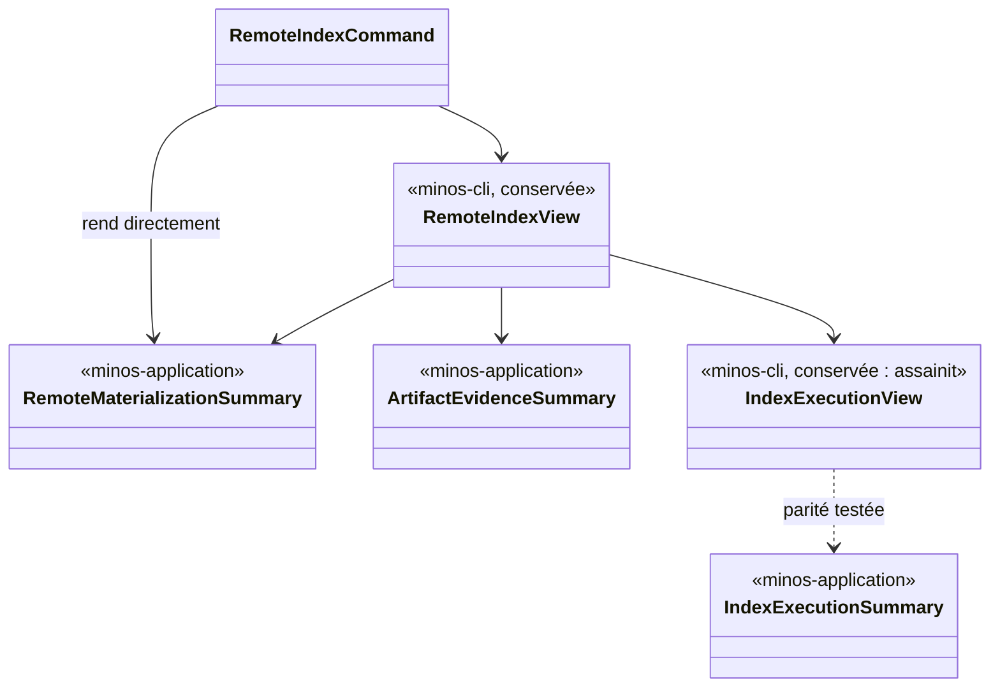

# Design

## Contexte

Motivation : voir `proposal.md` (Why). Seul `minos-cli` est modifié. Aucune sortie publique ne change. Windows et Linux : identique.

## État vérifié au HEAD

Relu au commit `89be3fb4`.

| Fait | Preuve |
|---|---|
| `RemoteMaterializationView` : 9 composantes (`host`, `repository`, `reference`, `commit`, `repositoryRoot`, `projectRoot`, `cacheKey`, `cacheHit`, `materializedAt`), 8 `requireText` | `minos-cli/src/main/java/com/minos/cli/operations/RemoteIndexOperations.java:24-45` |
| `RemoteMaterializationSummary` : mêmes composantes, mêmes contrôles | `minos-application/src/main/java/com/minos/application/remote/RemoteMaterializationSummary.java:8-29` |
| `ArtifactEvidence` : 12 composantes, 9 `requireText` et un `requireNonNull` | `RemoteIndexOperations.java:47-73` |
| `ArtifactEvidenceSummary` : mêmes composantes, mêmes contrôles | `minos-application/src/main/java/com/minos/application/remote/ArtifactEvidenceSummary.java:10-36` |
| Conversions champ à champ | `minos-cli/src/main/java/com/minos/cli/operations/LocalRemoteIndexOperations.java:55-64` |
| Lecteurs des deux miroirs : `RemoteIndexCommand`, `LocalRemoteIndexOperations`, `RemoteIndexOperations` ; un test (`RemoteIndexCommandTest`) | recherche dans `minos-*/src` |
| `ProviderView` assainit `diagnostics` (`CliCommandSupport.publicDiagnostics`), renomme `providerId` en `id`, rend `executable` nullable | `minos-cli/src/main/java/com/minos/cli/operations/AutonomousIndexOperations.java:62-82` ; `minos-application/src/main/java/com/minos/application/ProviderRuntimeSummary.java:17-24` |
| `IndexPlanView` a les 11 composantes d'`IndexPlanSummary`, sauf le type des éléments de `providerRuntimes` (`ProviderView`) | `AutonomousIndexOperations.java:84-108` ; `minos-application/src/main/java/com/minos/application/indexing/IndexPlanSummary.java:15-38` |
| `IndexExecutionView` et `ResumeView` : champs nullables au lieu d'`Optional`, diagnostic et motif de refus assainis | `AutonomousIndexOperations.java:111-135` ; `IndexExecutionSummary.java:13-21` |
| Conversions de ces couples | `minos-cli/src/main/java/com/minos/cli/operations/LocalAutonomousIndexOperations.java:81-103` |
| `IndexPlanView` est nommée par 3 fichiers de production et 11 de test | recherche dans `minos-*/src` |
| Gate qui lit deux tests de ces opérations ; il exige quatre noms dans `RemoteIndexCommandTest.java` (`SecretFree`, `RequiresExplicitWorkerNetworkPolicy`, `token@`, `rendersProjectRelativeRootInJsonAndTextOutput`) | `scripts/quality/check-remote-distributed-consistency.py:181`, `:207-210` |

Non mesuré : le détecteur de duplication de l'audit n'a pas été rejoué ; aucun build exécuté.

## Écarts

| Écart | Source A | Source B | Suite proposée |
|---|---|---|---|
| L'audit propose de faire exposer directement les résumés par toutes les interfaces `*Operations` | `findings.json`, AUD-QUA-04, action | Trois vues assainissent un texte avant affichage et une renomme une composante : ce ne sont pas des miroirs identiques | D1 : suppression des deux miroirs stricts seulement ; parité testée pour les autres |
| L'audit dit le couple `IndexPlanSummary` / `IndexPlanView` identique | preuve du constat | le type des éléments de `providerRuntimes` diffère (`ProviderRuntimeSummary` / `ProviderView`) | Couple conservé, sous test de parité |
| L'audit propose le test par réflexion « si la séparation est voulue pour les doubles de test » | action de l'audit | la séparation tient à l'assainissement, pas aux doubles | La Javadoc des vues conservées donne cette raison |

## Exigences couvertes

- surfaces-publiques › La CLI ne recopie pas à l'identique un résumé applicatif — D1.
- surfaces-publiques › Une vue conservée de la CLI couvre toutes les composantes de son résumé — D2.

## Objectifs et non-objectifs

Objectif : un champ ajouté à un résumé ne peut plus disparaître en silence de la CLI. Non-objectif : retirer l'assainissement de la surface, changer un rendu.

## Responsabilités et frontières des composants

`minos-cli` dépend déjà de `minos-application` (`ALLOWED_DEPENDENCIES`) et importe ces résumés. Aucun type de `minos-engine` n'est ajouté à la CLI (A11 inchangé) : les deux résumés ne portent que des `String` et des `boolean`.

## Modèle de domaine et invariants

Couples sous parité (résumé → vue) : `ProviderRuntimeSummary` → `ProviderView` (correspondance `providerId` → `id`) ; `IndexPlanSummary` → `IndexPlanView` ; `ResumeTraceSummary` → `ResumeView` ; `IndexExecutionSummary` → `IndexExecutionView` ; `RemoteIndexSummary` → `RemoteIndexView`. La parité porte sur les noms de composantes ; les types peuvent différer (assainissement, `Optional` déplié).

## Traitements et interactions

Non applicable : la commande reçoit le résumé au lieu d'une copie.

## États et transitions

Non applicable.

## Contrats d'interface

Port interne `RemoteIndexOperations` : `materialize` rend `RemoteMaterializationSummary` ; `RemoteIndexView.materialization` et `artifacts` portent les résumés applicatifs. Sorties texte et JSON de `minos remote materialize` et `minos remote index` : inchangées (contrat exécutable : `RemoteIndexCommandTest`, `LocalRemoteIndexOperationsIntegrationTest`).

## Persistance et intégrité

Non applicable.

## Transactions, concurrence et idempotence

Non applicable.

## Sécurité et isolation

Les deux résumés exposés tels quels ne passaient par aucun assainissement dans leur miroir (seulement `requireText`) : rien n'est retiré. Les vues qui assainissent sont conservées ; le test de parité ne les contourne pas. `repositoryRoot` et `projectRoot` sont déjà rendus par la commande au HEAD : ce changement n'ajoute ni ne retire aucune valeur de la sortie.

## Erreurs et reprise

Non applicable.

## Observabilité

Non applicable.

## Performance et mesure

Non applicable.

## Compatibilité, migration et retour arrière

Aucune donnée ni contrat publié ; retour arrière par annulation de la PR.

## Diagrammes

### Quelles vues de la CLI restent, et pourquoi ?

Type : classDiagram · Portée : cible · Exigences : surfaces-publiques › La CLI ne recopie pas à l'identique un résumé applicatif ; › Une vue conservée de la CLI couvre toutes les composantes de son résumé

Les deux enregistrements supprimés n'apparaissent plus ; la flèche en pointillé est le test de parité.

## Décisions

### D1 — Ne supprimer que les miroirs stricts [Proposition]

Critère : mêmes composantes, mêmes types, mêmes contrôles, aucune transformation. Deux enregistrements le remplissent. Alternative écartée : exposer tous les résumés (action littérale de l'audit) — elle retirerait l'assainissement des diagnostics fait par la surface.

### D2 — Parité par réflexion, avec tables explicites [Proposition]

`CliViewParityTest` (`minos-cli`) lit `getRecordComponents()` des deux côtés ; une table de correspondances (renommages) et une table d'exclusions avec raison, toutes deux à cliquet (entrée périmée refusée). La comparaison est une fonction testée sur des enregistrements de test pour les cas de refus.

### D3 — Aucun gate, aucun ADR [Décision de forme]

Un test Java suffit ; aucune décision d'architecture durable.

## Qualification des capacités

Aucune capacité nouvelle.

## Risques et compromis

- [Risque] Conflit avec `injecter-les-collaborateurs-des-cas-d-usage`, qui modifie la construction de `LocalRemoteIndexOperations` (`:27-29`) et de `LocalAutonomousIndexOperations` (`:39`, `:66`) → lignes distinctes des conversions (`:55-64`, `:81-103`) ; fusion dans l'ordre que l'on veut, rebase simple.
- [Risque] Gate littéral `check-remote-distributed-consistency.py` sur `LocalRemoteIndexOperationsIntegrationTest` et `RemoteIndexCommandTest` (`:207-210`) → adapter `RemoteIndexCommandTest` sans renommer ses méthodes ni retirer les quatre noms exigés.
- [Compromis] Les vues conservées gardent leur conversion manuelle ; le test en garantit l'exhaustivité, pas l'exactitude de chaque valeur (couverte par les tests de rendu).

## Vérification

- Tests : `CliViewParityTest` (nouveau), `RemoteIndexCommandTest`, `LocalRemoteIndexOperationsIntegrationTest`, `LocalRemoteIndexOperationsRefusalTest`, tests des commandes d'indexation.
- Gates : `check-remote-distributed-consistency.py`, `check-module-boundaries.py`, `check-comment-language.py`.
- JaCoCo : scope citant `com/minos/cli/operations/LocalRemoteIndexOperations` (`check-jacoco.py:152`).
- Commandes : `./mvnw -B -ntp -pl minos-cli -am test` ; `./mvnw -B -ntp -pl minos-app -am verify` puis `git diff --exit-code minos-app/src/test/resources/characterization/`.

## Documentation durable à mettre à jour

`docs/architecture/diagrams/capacites/surfaces-publiques.md`.

## Traçabilité

| Exigence (capacité › titre) | Scénario | Conception ou diagramme | Tâche | Test ou preuve |
|---|---|---|---|---|
| surfaces-publiques › La CLI ne recopie pas à l'identique un résumé applicatif | Miroirs supprimés | D1, classDiagram | 1.2 | `RemoteIndexOperationsShapeTest` ; recherche textuelle |
| idem | Sortie de la commande distante inchangée | Contrats | 1.1, 1.2 | `RemoteIndexCommandTest`, `LocalRemoteIndexOperationsIntegrationTest` (existants) |
| idem | Preuve d'artefact invalide refusée | Sécurité | 1.1 | `RemoteSummaryValidationTest` (`minos-application`) |
| surfaces-publiques › Une vue conservée de la CLI couvre toutes les composantes de son résumé | les quatre scénarios | D2 | 2.1 | `CliViewParityTest` (parité des cinq couples ; composante ajoutée, exclusion sans raison, exclusion et correspondance périmées refusées) |

## Questions ouvertes

Aucune.
