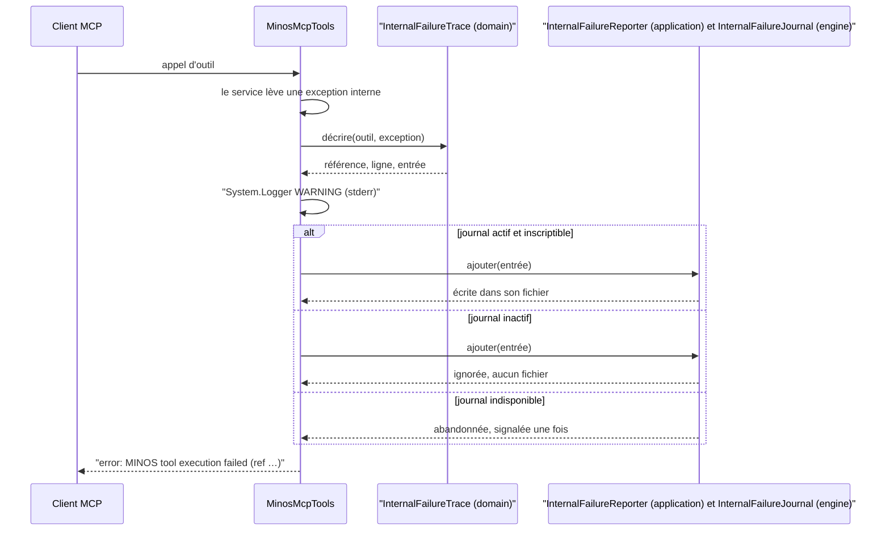
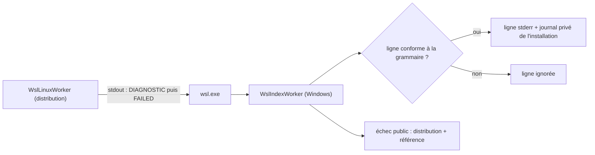

# Design

## Contexte

Motivation : voir `proposal.md` (Why). Le changement livre un composant commun de trace d'échec interne et le branche
sur le MCP, la CLI, l'API Java et la voie WSL. Modules : `minos-domain`, `minos-engine`, `minos-application`,
`minos-mcp`, `minos-cli`, `minos-api`, `minos-runtime-local`. Surfaces publiques : MCP et CLI (additif). Plateformes : Windows et Linux.
L'explorateur est branché par `fiabiliser-la-surface-de-l-explorateur`.

## État vérifié au HEAD

HEAD `89be3fb4`. Vérification par lecture ; aucun build ni test exécuté.

| Fait | Preuve |
|---|---|
| [Existant vérifié] Le MCP rend `error: MINOS tool execution failed` et journalise outil, classe et classe de la cause racine, sans pile | `minos-mcp/src/main/java/com/minos/mcp/MinosMcpTools.java:52`, `:207-208`, `:259-263` |
| [Existant vérifié] Le journal du MCP est un `System.Logger` (stderr par le fournisseur JUL du livrable) | `MinosMcpTools.java:60` ; `openspec/specs/journalisation/spec.md` (« Les erreurs des bibliothèques atteignent stderr dans le livrable ») |
| [Existant vérifié] Le worker WSL rend `FAILED <provider>: <message ou nom simple de classe>` ; la pile est perdue | `minos-runtime-local/src/main/java/com/minos/runtime/local/wsl/WslLinuxWorker.java:115-116`, `:180-186` |
| [Existant vérifié] Le stderr de `wsl.exe` est jeté ; seul stdout revient | `ProcessWslCommandRunner.java:36` ; `WslCommandResult.java:12` |
| [Existant vérifié] L'installation Windows retient la **dernière** ligne préfixée par le protocole | `WslIndexWorker.java:233-241` |
| [Existant vérifié] La requête du worker a un jeu de clés fermé et une version de protocole stricte | `WslWorkerRequest.java:42`, `:62`, `:110-114` |
| [Existant vérifié] La CLI rend une exception de commande en une ligne `error:` et le code 1 ; une erreur d'analyse d'options en code 2 | `minos-cli/src/main/java/com/minos/cli/support/CliCommandSupport.java:93-107` ; `MinosLauncher.java:78-87` |
| [Existant vérifié] L'API Java republie tout échec en `MinosApiException` sans cause | `minos-api/src/main/java/com/minos/api/MinosApiSupport.java:59-78` |
| [Existant vérifié] `PublicErrorMessages` (politique de redaction) vit dans `minos-domain`, sans E/S | `minos-domain/src/main/java/com/minos/diagnostics/PublicErrorMessages.java` ; `scripts/architecture/check-module-boundaries.py:677` |
| [Existant vérifié] `PrivateLocalStorage` crée un dossier privé et écrit le contenu entier d'un fichier privé (créé ou tronqué, jamais par un lien) ; aucune primitive n'ouvre en ajout | `minos-engine/src/main/java/com/minos/io/PrivateLocalStorage.java:126`, `:261-268`, `:278`, `:409`, `:434`, `:446` |
| [Existant vérifié] Le garde d'E/S privées n'admet les appels bruts (`Files.newOutputStream`, `Files.move`, `FileChannel.open`, `FileChannel.lock`…) que dans quatre primitives ; `PrivateLocalStorage` n'en est pas une et ses appels sont plafonnés par la liste nominative | `scripts/architecture/check-private-io.py:8-10`, `:73-78`, `:82-103` ; `scripts/architecture/private-io-allowlist.json:129-131` |
| [Existant vérifié] `DurableAtomicFile.deleteIfExists` supprime un fichier par une primitive | `minos-engine/src/main/java/com/minos/io/DurableAtomicFile.java:86` |
| [Existant vérifié] Cliquet A11 : tout type de `minos-engine` nommé par une surface doit figurer, avec son décompte, dans deux tables ; `minos-explorer` y est vide | `scripts/architecture/check-module-boundaries.py:554-592`, `:862-865` ; `minos-app/src/test/java/com/minos/app/architecture/ModuleArchitectureTest.java:93` |
| [Existant vérifié] D'autres commandes de la CLI rendent elles-mêmes le code d'erreur d'exécution, hors du cadre commun | `minos-cli/src/main/java/com/minos/cli/DockerRuntimeBootstrap.java:64`, `:101`, `:112`, `:235`, `:240` |
| [Existant vérifié] Dix assertions de test citent l'erreur générique du MCP (six égalités, deux constantes, deux absences), dont une dans `minos-app` | `minos-app/src/test/java/com/minos/app/mcp/MinosMcpServerIntegrationTest.java:131` ; `minos-mcp/src/test/java/com/minos/mcp/` (neuf occurrences) |
| [Existant vérifié] La réponse générique exacte est citée par la documentation | `docs/user/mcp.md:489` ; `docs/architecture/diagrams/capacites/surfaces-publiques.md:76` |
| [Existant vérifié] Aucun réglage de diagnostic | recherche `MINOS_DEBUG\|--debug\|--verbose\|stackTrace\|printStackTrace` dans `minos-*/src/main` : 0 résultat |
| [Existant vérifié] Les plans de requête Docker montent `MINOS_HOME` en lecture seule | `docker/compose-mcp.connected.yaml:71-72`, `:139-140` |
| [Existant vérifié] Le gate P0-P2 exige la chaîne `error: MINOS tool execution failed` dans `MinosMcpTools.java` | `scripts/remediation/check-p0-p2.py:313` |
| Non mesuré : coût d'une entrée de journal | — |

## Écarts

| Écart | Source A | Source B | Suite proposée |
|---|---|---|---|
| L'audit place le journal « sous MINOS_HOME/logs » pour les trois surfaces et le worker ; en Docker ce répertoire est en lecture seule pour le MCP et l'explorateur | `findings.json`, AUD-QUA-02, action | `compose-mcp.connected.yaml:71-72`, `:139-140` | Journal privé déclaré **non supporté en Docker** ; la ligne stderr enrichie (origine, référence) y reste ; volume dédié en D6 |
| L'audit demande la « pile complète » ; le critère de sortie exige un journal « sans chemin absolu ni jeton » | AUD-QUA-02, action | `sprints.md:75` ; règle 7 | Trames complètes (elles ne portent pas de chemin) ; message filtré par la politique publique (D3) |
| Le worker ne peut pas recevoir le réglage : `MINOS_*` est exclu de l'environnement de `wsl.exe` et la requête a des clés fermées | AUD-QUA-02, action (« et du worker ») | `.claude/rules/securite.md`, règle 3 ; `WslWorkerRequest.java:62` | Diagnostic structuré sur stdout, journalisé côté Windows (D7) ; pas de journal dans la distribution |
| L'audit ne cite ni la CLI ni l'API Java ; le critère de sortie les nomme | AUD-QUA-02, preuve | `sprints.md:75` ; `CliCommandSupport.java:104-107` ; `MinosApiSupport.java:59-78` | CLI et API branchées (groupes 4 et 5) |
| Aucune primitive n'ouvre en ajout, et en ajouter une demanderait des appels bruts interdits hors primitives | AUD-QUA-02, action (« primitives confinées ») | `check-private-io.py:73-103` ; `private-io-allowlist.json:129-131` | Un fichier privé par échec, écrit en entier par les primitives existantes : ni ajout, ni verrou, ni renommage, liste nominative inchangée (D4) |
| Un journal dans `minos-engine` appelé par les surfaces ferait échouer le cliquet A11 | AUD-QUA-02, action | `check-module-boundaries.py:566-592` ; `ModuleArchitectureTest.java:93` | Façade dans `minos-application` ; les deux tables A11 restent inchangées (D8) |
| Le critère de sortie vise « tout échec interne » de la CLI ; le cadre commun rend aussi en code 1 des échecs attendus, et six commandes rendent ce code hors du cadre | `sprints.md:75` | `CliCommandSupport.java:104-107` ; `DockerRuntimeBootstrap.java:64-240` | Exigence bornée au cadre commun et au lanceur, erreurs publiques connues exclues ; autres commandes hors périmètre (proposal) |
| Journal privé actif et scénario en vigueur « Données inchangées après consultation » de l'explorateur | `openspec/specs/exploration-semantique/spec.md:48-54` | AUD-QUA-02, action | Tranché en D9 : le scénario porte sur le réglage par défaut ; actif, seul le dossier du journal change, sur échec interne |
| Le journal privé écrit dans le répertoire de données depuis un MCP « lecture seule » | ARCH-0017 ; « surfaces-publiques › Tout outil MCP répond sur un répertoire de données qu'il ne peut pas écrire » | AUD-QUA-02, action | Opt-in, hors des données de requête, sans effet sur la réponse ; tranché par l'ADR `SEC-<prochain numéro libre>` (D1) |

## Exigences couvertes

| Exigence | Section |
|---|---|
| journalisation › La ligne de diagnostic d'un échec interne nomme son origine et une référence | D1, « Traitements » |
| journalisation › Le journal de diagnostic privé est désactivé par défaut | D2 |
| journalisation › Le journal privé reçoit la pile d'un échec interne sans chemin absolu ni secret | D3, « Sécurité » |
| journalisation › Le journal privé est borné en nombre d'entrées et en profondeur | D4 |
| journalisation › Le journal privé est écrit par les primitives d'E/S privées | D4, « Persistance », « Transactions » |
| journalisation › Un journal privé indisponible ne change pas la réponse de la surface | « Erreurs et reprise » |
| surfaces-publiques › L'erreur opaque d'un outil MCP porte la référence de sa trace | D5 |
| surfaces-publiques › Un échec d'exécution de la CLI est tracé quand le journal privé est actif | D5 |
| surfaces-publiques › Un échec interne de l'API Java est tracé sans changer l'exception publique | « Contrats d'interface » |
| indexation-java-via-wsl › Un échec interne du worker WSL transmet un diagnostic structuré et vérifié | D7 |

## Objectifs et non-objectifs

Objectif : une seule façon de décrire un échec interne, partagée par toutes les surfaces. Non-objectifs : un cadre de
journalisation général, des niveaux de verbosité, une trace des erreurs d'usage, une télémétrie.

## Responsabilités et frontières des composants

| Composant (nom proposé) | Module, package | Rôle |
|---|---|---|
| `InternalFailureTrace` | `minos-domain`, `com.minos.diagnostics` | Rendu **pur** : référence, ligne stderr, entrée de journal, bornes ; applique `PublicErrorMessages`. Aucune E/S |
| `InternalFailureJournal` | `minos-engine`, `com.minos.io` | Lit le réglage depuis `(Map env, Properties)`, écrit un fichier par entrée par `PrivateLocalStorage`, purge les plus anciennes par `DurableAtomicFile.deleteIfExists`, signale l'indisponibilité une fois |
| `InternalFailureReporter` | `minos-application`, `com.minos.application.diagnostics` | Façade des surfaces : construite depuis `(home, env, propriétés)`, elle rend la référence et la ligne et confie l'entrée au journal ; son API ne nomme aucun type du moteur |
| surfaces | `minos-mcp`, `minos-cli`, `minos-api` | Appellent la façade ; ne formatent rien elles-mêmes et n'importent rien de `com.minos.io` |
| voie WSL | `minos-runtime-local` | Module d'exécution, pas une surface : appelle le rendu (`minos-domain`) et le journal (`minos-engine`) directement |

Direction respectée (`domain → engine → runtime/storage → adapters → application → surfaces`, ARCH-0068) :
`minos-application` dépend déjà de `minos-engine`, les surfaces de `minos-application` et de `minos-domain`.
`com.minos.diagnostics` reste propriété de `minos-domain`, `com.minos.io` de `minos-engine`,
`com.minos.application.diagnostics` est un package nouveau de `minos-application` : aucun package partagé, aucun
module nouveau, aucune dépendance Maven nouvelle, tables A11 inchangées.

## Modèle de domaine et invariants

- Référence : 8 chiffres hexadécimaux tirés d'un générateur sûr ; unique par échec, sans lien avec l'entrée.
- Origine : première trame de la cause racine dont la classe commence par `com.minos.` ; `unknown` sinon.
- Invariant : rien de ce que rend `InternalFailureTrace` ne provient d'un argument de l'appelant ; un message
  d'exception n'entre que dans l'entrée de journal, jamais dans la ligne stderr, et seulement s'il n'est pas jugé
  sensible.
- Bornes [Proposition] : 8 causes, 64 trames par cause, 300 caractères par message, caractères de contrôle remplacés.

## Traitements et interactions

Voir le diagramme « Que devient un échec interne d'un outil MCP ? ». Chaque surface : (1) reconnaît l'échec interne
(branche existante), (2) demande au rendu la référence et la ligne, (3) écrit la ligne par son journal existant,
(4) propose l'entrée au journal privé, (5) rend l'erreur opaque avec la référence. Les étapes 2 et 4 passent par
`InternalFailureReporter`.

## États et transitions

Journal privé, par processus : `INACTIF` (réglage absent ou non reconnu) ; `ACTIF` ; `INDISPONIBLE` (première
ouverture ou écriture en échec : signalé une fois, plus aucune tentative jusqu'à la fin du processus). Aucun retour
de `INDISPONIBLE` vers `ACTIF` : un échec d'E/S répété ne doit pas ralentir chaque requête.

## Contrats d'interface

- **Réglage** : `MINOS_DIAGNOSTIC_LOG=enabled` ou `-Dminos.diagnostic.log=enabled` (la propriété prime, comme les
  autres réglages). Toute autre valeur : inactif.
- **Ligne stderr du MCP** (ajout des deux derniers champs) :
  `MCP tool execution failed (tool=<outil>, type=<classe>, rootCause=<classe>, at=<Classe.méthode:ligne|unknown>, ref=<8 hex>)`.
- **Réponse MCP** : `error: MINOS tool execution failed (ref <8 hex>)` — même préfixe, suffixe ajouté.
- **CLI**, journal actif seulement, cadre commun (`CliCommandSupport.run`) et lanceur (`MinosLauncher`) : ligne
  supplémentaire `diagnostic reference: <8 hex>` sur stderr après la ligne `error:`, sauf pour une erreur publique
  connue (`ResolutionException`, `UnreadableRegistryException`, `SnapshotMemoryExhaustedException`) ; codes de sortie
  inchangés.
- **API Java** : `MinosApiException` inchangée (code, message, pas de cause) ; ligne de diagnostic par
  `System.Logger`, pour les codes `EXECUTION_FAILURE` et `IO_FAILURE` seulement.
- **Entrée de journal** : fichier texte UTF-8, première ligne `<instant UTC> surface=<mcp|cli|api|wsl-worker|explorer>
  operation=<nom> ref=<8 hex>`, puis une ligne par cause (classe, message filtré), puis les trames
  `at <classe>.<méthode>(<Fichier.java>:<ligne>)`.
- **Diagnostic du worker** : ligne `minos-wsl-worker-v1 DIAGNOSTIC ref=<8 hex> types=<c1>,<c2> at=<…> frames=<…>`,
  émise avant le statut. Grammaire acceptée côté Windows : lettres, chiffres, `.`, `$`, `_`, `:`, `,`, `=`, espaces ;
  longueur bornée ; tout autre caractère (dont `/` et `\`) fait ignorer la ligne.

## Persistance et intégrité

Dossier `MINOS_HOME/logs/internal-failures/`, créé par `PrivateLocalStorage.ensurePrivateDirectory` ; une entrée =
un fichier `<instant UTC compact>-<référence>.txt`, écrit en entier par `PrivateLocalStorage.writePrivateFile` sur un
nom neuf. Texte seul, sans version de schéma : le journal est lu par une personne, pas par MINOS. Aucune autre
donnée de `MINOS_HOME` n'est touchée.

## Transactions, concurrence et idempotence

Une entrée est construite en mémoire puis écrite dans son propre fichier : aucun fichier n'est partagé entre deux
écritures, donc ni verrou, ni ajout, ni renommage. Plusieurs JVM (un MCP par client, la CLI) écrivent dans le même
dossier sans se gêner ; le nom porte l'instant et la référence aléatoire. La purge supprime les entrées les plus
anciennes au-delà de la borne ; deux purges simultanées suppriment au pire le même fichier (suppression « si
présent »). Écriture en échec : l'entrée est abandonnée et le journal passe `INDISPONIBLE`.

## Sécurité et isolation

- Règle 7 : ligne stderr sans message ni chemin ; entrée de journal sans chemin absolu (trames = noms de classes et de
  fichiers source ; message filtré par `PublicErrorMessages.looksSensitive`).
- Règle 2 : aucun argument d'appelant, aucun environnement, aucun en-tête n'est écrit ; la valeur du réglage n'est
  jamais recopiée.
- Règle 6 : écriture par les primitives privées existantes seulement ; `check-private-io.py` reste vert sans édition
  de `private-io-allowlist.json`.
- MCP : stdout réservé au protocole ; la trace va au `System.Logger` et au fichier, jamais à `System.out`.
- Fail-closed : en cas de doute (message sensible, journal illisible, diagnostic du worker non conforme), on écrit
  moins, jamais plus.
- Le journal n'entre dans l'environnement d'aucun processus externe ; `MINOS_DIAGNOSTIC_LOG` est déjà exclu de
  l'environnement des providers par le motif `MINOS_*`.

## Erreurs et reprise

Le journal ne lève jamais vers l'appelant. Écriture impossible (lecture seule, dossier non privé, lien) :
une ligne `diagnostic journal unavailable (<classe>)` par processus, puis silence. La réponse de la surface est celle
d'un processus sans journal.

## Observabilité

C'est l'objet du changement : ligne stderr corrélée (toujours) et pile privée (opt-in). La page utilisateur et le
skill d'incident disent où lire l'une et l'autre.

## Performance et mesure

Chemin d'échec seulement ; aucun coût sur un appel réussi (le réglage est lu une fois par processus). Pas d'objectif
chiffré. [Question] non bloquante : faut-il mesurer le coût d'une entrée (écriture d'un fichier, purge) ;
proposition : non, l'échec interne est rare par construction.

## Compatibilité, migration et retour arrière

Additif. Un client MCP qui compare l'erreur générique à l'égalité voit un suffixe (D5). Les sorties de la CLI sont
identiques sans le réglage. Retour arrière : retirer le réglage ; les fichiers de `logs/` restent et peuvent être
supprimés à la main. Une installation Windows antérieure qui lit la sortie d'un worker récent retient la dernière
ligne de statut : la ligne de diagnostic, émise avant, est sans effet.

## Diagrammes

### Que devient un échec interne d'un outil MCP ?

Type : sequenceDiagram · Portée : cible · Exigences : journalisation › La ligne de diagnostic d'un échec interne nomme
son origine et une référence ; journalisation › Un journal privé indisponible ne change pas la réponse de la surface ;
surfaces-publiques › L'erreur opaque d'un outil MCP porte la référence de sa trace

La réponse ne dépend d'aucune branche du journal. La référence relie la réponse, la ligne stderr et l'entrée privée.

### Par où passe le diagnostic d'un échec du worker WSL ?

Type : flowchart · Portée : cible · Exigences : indexation-java-via-wsl › Un échec interne du worker WSL transmet un
diagnostic structuré et vérifié

Le stderr du worker reste jeté ; le diagnostic voyage par le canal déjà lu, après validation stricte.

## Décisions

D1 à D7 puis D8 et D9 ; D3, D5 et D6 attendent le propriétaire.

### D1 — Deux niveaux : ligne stderr toujours, pile privée sur demande

[Proposition] La ligne stderr gagne l'origine et la référence sur toutes les surfaces ; la pile ne va que dans un
journal privé opt-in. Alternative écartée : pile sur stderr (un message peut porter un chemin ; en Docker stderr est
conservé par le démon). Décision structurante (modèle de confiance d'un fichier écrit par un processus de lecture
seule) : ADR **`SEC-<prochain numéro libre>` — Journal de diagnostic privé et opt-in des échecs internes**, à écrire (tâche 6.1) ; numéro
suivant lu dans `docs/architecture/adr/README.md` (dernier : 0082), non réservé.

### D2 — Réglage et emplacement

[Proposition] `MINOS_DIAGNOSTIC_LOG=enabled` / `minos.diagnostic.log`, dossier `MINOS_HOME/logs/internal-failures/`.
Alternative écartée : option `--debug` par commande (le MCP et l'API n'ont pas de ligne de commande par appel).

### D3 — Messages d'exception dans le journal privé (en attente du propriétaire)

Options : (a) message conservé s'il passe la politique publique, sinon texte fixe ; (b) aucun message.
**Recommandation : (a)** — le message d'un `NullPointerException` ou d'une précondition est souvent la moitié du
diagnostic, et la politique publique est déjà celle qui autorise un message vers un client.

### D4 — Un fichier par échec, borné en nombre

[Proposition] Une entrée par fichier, 200 entrées au plus (valeur de confort, sans source mesurée ; constante unique,
borne injectée dans les scénarios). Ce choix n'exige que des primitives existantes : `ensurePrivateDirectory`,
`writePrivateFile`, `DurableAtomicFile.deleteIfExists`. Alternatives écartées : un fichier en ajout sous verrou avec
rotation (ouverture en ajout, `FileChannel.lock` et `Files.move` sont interdits hors des quatre primitives du garde,
`PrivateLocalStorage` est plafonnée à un `Files.newOutputStream` : il faudrait étendre une primitive et la liste
nominative) ; réécriture du fichier entier à chaque entrée (coût et fenêtre de perte entre processus). Si
l'implémentation révèle un appel brut indispensable (lister le dossier pour la purge), il passe par une entrée
nominative justifiée, relue dans la même PR et citée par l'ADR ; ce n'est pas le chemin attendu.

### D5 — Référence dans l'erreur opaque du MCP (en attente du propriétaire)

Options : (a) suffixe ` (ref <8 hex>)` après l'erreur générique ; (b) réponse inchangée, référence sur stderr seule.
**Recommandation : (a)** — sans elle, l'utilisateur ne peut pas dire à l'opérateur quelle ligne lire quand plusieurs
appels échouent. Coût : les dix assertions de test qui comparent la chaîne exacte passent à `startsWith` ; le gate
`check-p0-p2.py:313` reste vert (la chaîne littérale demeure).

### D6 — Journal privé en Docker (en attente du propriétaire)

Options : (a) non supporté dans ce lot, la ligne stderr enrichie suffit ; (b) volume dédié monté en écriture sur
`/var/lib/minos/logs` pour `minos-mcp` et `minos-explorer`. **Recommandation : (a)** — (b) ouvre une écriture dans
des conteneurs dont la racine et les données sont en lecture seule, et relève d'un changement de `distribution-docker`.

### D7 — Le diagnostic du worker voyage sur stdout

[Proposition] Ligne préfixée par le protocole, avant le statut, validée par grammaire côté Windows. Alternatives
écartées : capter stderr (il porte la sortie brute du provider, donc des chemins) ; champ dans la requête (jeu de clés
fermé, changement de version du protocole).

### D8 — Les surfaces passent par une façade de `minos-application`

[Proposition] `InternalFailureReporter` (`com.minos.application.diagnostics`) est le seul type que les surfaces
nomment, avec `InternalFailureTrace` du domaine. Alternative écartée : importer `com.minos.io.InternalFailureJournal`
depuis les surfaces et l'inscrire dans `ENGINE_TYPES_NAMED_BY_SURFACE` et `ENGINE_TYPES_USED_BY_SURFACE_BYTECODE`
(le cliquet A11 ne fait que décroître, ADR 0058 § 3 ; `minos-explorer` devrait en plus déclarer `minos-engine` en
portée de compilation).

### D9 — Le journal privé n'est pas un état de la consultation

[Proposition, portée par l'ADR `SEC-<prochain numéro libre>`] Le journal n'est écrit que sur échec interne et réglage actif, dans un
dossier à lui. Les scénarios en vigueur qui comparent l'arborescence de `MINOS_HOME` (« exploration-semantique › La
surface d'exploration ne modifie aucun état », « surfaces-publiques › Tout outil MCP répond sur un répertoire de
données qu'il ne peut pas écrire ») s'entendent réglage absent, et restent vrais réglage actif tant qu'aucun échec
interne ne survient ; sur échec interne, seul `logs/internal-failures/` change. Les changements de ce sprint ajoutent
les scénarios qui le disent ; aucune exigence existante n'est modifiée.

## Qualification des capacités

| Capacité | Qualification |
|---|---|
| Ligne stderr enrichie (MCP, API, worker côté Windows) | visée **qualifiée** sous Windows et Linux, par tests |
| Journal privé (MCP, CLI, API, worker côté Windows) | visé **qualifié** en installation native Windows et Linux |
| Journal privé en Docker | **non supporté** (données en lecture seule) |
| Journal privé dans la distribution WSL | **non supporté** (trace tenue côté Windows) |
| Diagnostic du worker de bout en bout sur une vraie distribution | **partiel** : tests unitaires des deux côtés ; preuve réelle en tâche manuelle 5.4 |

## Risques et compromis

- [Risque] Un message non sensible selon la politique publique porte quand même une donnée de projet → le journal est
  privé, opt-in, borné ; D3 (b) reste possible sans changer le format.
- [Risque] Une rafale d'échecs remplit la borne et chasse une entrée utile → borne en nombre, ligne stderr conservée.
- [Risque] La ligne de diagnostic du worker sert de canal vers le journal Windows → grammaire fermée, longueur bornée.
- [Compromis] La trace d'un échec en Docker reste sans pile.

## Vérification

- Tests à écrire : `InternalFailureTraceTest` (`minos-domain`), `InternalFailureJournalTest` (`minos-engine`, dont
  deux JVM filles), `InternalFailureReporterTest` (`minos-application`), `MinosMcpInternalFailureTraceTest`, `CliInternalFailureTraceTest`,
  `MinosApiInternalFailureTraceTest`, `WslLinuxWorkerDiagnosticTest`, `WslIndexWorkerDiagnosticTest`.
- Tests existants à rejouer : `MinosMcpToolsTest`, `MinosMcpWriteProtectedHomeTest`, `MinosMcpServerIntegrationTest`
  et `ModuleArchitectureTest` (`minos-app`), goldens de
  `minos-app/src/test/resources/characterization/`.
- Gates : `check-private-io.py` (liste nominative inchangée), `check-module-boundaries.py` (tables A11 inchangées), `check-p0-p2.py`,
  `check-comment-language.py`, `check-runtime-dynamic-consistency.py`, `check-hosted-control-plane-consistency.py`,
  `product-facts.py --check` ; JaCoCo `mcp-mapping`, `m19-m20-mcp-catalogue`.
- Non vérifiable localement : la voie WSL réelle hors d'un poste Windows avec distribution préparée (tâche manuelle).

## Documentation durable à mettre à jour

`docs/architecture/diagrams/capacites/journalisation.md`, `surfaces-publiques.md` (réponse générique citée à la
ligne 76), `indexation-java-via-wsl.md` ; `docs/user/mcp.md` (réponse générique citée à la ligne 489) ;
une page `docs/user/` sur le diagnostic d'un échec interne (réglage, emplacement, contenu, limites Docker et WSL) et
son index ; `docs/developer/` (composant de trace) ; `.claude/skills/minos-incident-triage/SKILL.md` ; ADR `SEC-<prochain numéro libre>`,
son entrée dans `docs/architecture/adr/README.md` et `docs/architecture/arc42/09-decisions.md`.

## Traçabilité

| Exigence (capacité › titre) | Scénario | Conception ou diagramme | Tâche | Test ou preuve |
|---|---|---|---|---|
| journalisation › La ligne de diagnostic d'un échec interne nomme son origine et une référence | Cause racine dans le code MINOS | D1, diagramme 1 | 1.1, 3.1 | `InternalFailureTraceTest`, `MinosMcpInternalFailureTraceTest`, `MinosApiInternalFailureTraceTest` |
| idem | Message porteur d'un chemin et d'un jeton | « Sécurité » | 1.1 | `InternalFailureTraceTest`, `MinosMcpInternalFailureTraceTest` |
| idem | Aucune trame MINOS | « Modèle » | 1.1 | `InternalFailureTraceTest`, `MinosMcpInternalFailureTraceTest` |
| journalisation › Le journal de diagnostic privé est désactivé par défaut | Réglage absent ; Valeur non reconnue | D2 | 2.1 | `InternalFailureJournalTest` |
| journalisation › Le journal privé reçoit la pile d'un échec interne sans chemin absolu ni secret | les trois scénarios | D3 | 1.1, 2.1, 3.1 | `InternalFailureTraceTest`, `InternalFailureJournalTest`, `MinosMcpInternalFailureTraceTest` |
| journalisation › Le journal privé est borné en nombre d'entrées et en profondeur | Purge ; Pile très profonde | D4 | 1.1, 2.1 | `InternalFailureJournalTest`, `InternalFailureTraceTest` |
| journalisation › Le journal privé est écrit par les primitives d'E/S privées | Permissions ; Deux processus | D4, « Persistance », « Transactions » | 2.1 | `InternalFailureJournalTest` (deux JVM filles, cent entrées) |
| idem | Le garde reste vert sans édition de sa liste | D4 | 2.1 | `check-private-io.py` vert, `private-io-allowlist.json` inchangé |
| journalisation › Un journal privé indisponible ne change pas la réponse de la surface | Répertoire en lecture seule | « États », diagramme 1 | 2.1, 3.2 | `InternalFailureJournalTest`, `MinosMcpInternalFailureTraceTest`, `MinosMcpWriteProtectedHomeTest` ; le dossier est rendu indisponible par un fichier à la place de `logs` (une protection d'écriture n'arrête pas son propriétaire sous POSIX) |
| surfaces-publiques › L'erreur opaque d'un outil MCP porte la référence de sa trace | les deux scénarios | D5 | 3.1 | `MinosMcpInternalFailureTraceTest` ; dix assertions existantes adaptées |
| surfaces-publiques › Un échec d'exécution de la CLI est tracé quand le journal privé est actif | les quatre scénarios | « Contrats » | 4.1 | `CliInternalFailureTraceTest` ; goldens de caractérisation inchangés |
| surfaces-publiques › Un échec interne de l'API Java est tracé sans changer l'exception publique | les deux scénarios | « Contrats » | 4.2 | `MinosApiInternalFailureTraceTest` |
| indexation-java-via-wsl › Un échec interne du worker WSL transmet un diagnostic structuré et vérifié | les quatre scénarios | D7, diagramme 2 | 5.1, 5.2 | `WslLinuxWorkerDiagnosticTest`, `WslIndexWorkerDiagnosticTest`, `WorkerDiagnosticTest` ; **preuve manquante** : aucune vraie distribution WSL (tâche 5.4, manuelle) |

## Questions ouvertes

- D3, D5, D6 : décisions du propriétaire, recommandations ci-dessus. Aucune ne change le découpage ; D5 (b) retirerait
  l'exigence « surfaces-publiques › L'erreur opaque d'un outil MCP porte la référence de sa trace ».
- [Question] non bloquante : la référence doit-elle aussi figurer dans le message de `MinosApiException` ?
  Proposition : non dans ce lot (contrat de l'API inchangé).
