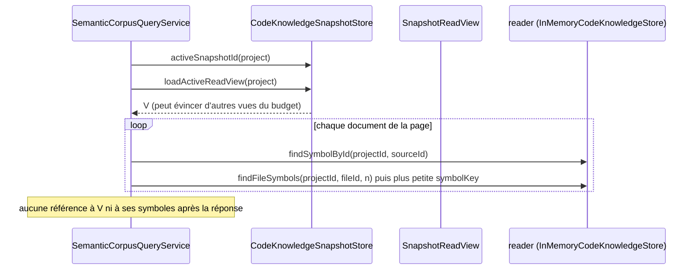

# Design

## Contexte

Motivation : voir `proposal.md` (Why). Le changement touche `SemanticCorpusQueryService` (`minos-application`, paquet `com.minos.application.semantic`) et son test. Il ne change aucune dépendance entre modules : le service lit déjà `SnapshotReadView` et `CodeKnowledgeReader` (`minos-engine`), direction ARCH-0068 respectée. Windows et Linux se comportent de la même façon.

## État vérifié au HEAD

Relu au commit `acd79cb86` (PR #795).

| Fait | Preuve |
|---|---|
| `lookups` est une `WeakHashMap<SnapshotReadView, SymbolLookup>` ; le commentaire affirme que la table « est collectée avec sa vue » | `minos-application/src/main/java/com/minos/application/semantic/SemanticCorpusQueryService.java:75-79` |
| `lookup` vérifie le snapshot actif, charge la vue (`snapshots.loadActiveReadView`, `:411`), puis seulement lit la map (`:417`) et y écrit (`:422`) ; aucun autre site ne touche `lookups` | `SemanticCorpusQueryService.java:405-425` ; recherche de `lookups` |
| `SymbolLookup.of` remplit deux `HashMap` avec les objets `Symbol` du snapshot : par identifiant, et le symbole de plus petite `symbolKey` par fichier (fichier pris dans `location().fileId()`, ou `fileId()` sans emplacement) | `SemanticCorpusQueryService.java:727-739` |
| La table ne sert qu'à `summarize` : symbole par `sourceId` pour un document non fichier, symbole de fichier sinon ou à défaut ; seuls `language` et `moduleId` du symbole de fichier sont rendus | `SemanticCorpusQueryService.java:749-761` |
| Quatre appels à `lookup` : `:188`, `:232`, `:265`, `:314` | lecture du fichier |
| `CodeKnowledgeReader` offre `findSymbolById` et `findFileSymbols(projectId, fileId, limit)` | `minos-engine/src/main/java/com/minos/store/CodeKnowledgeReader.java:19`, `:35` |
| En mémoire, `findSymbolById` est une lecture de table ; `findFileSymbols` lit l'index par fichier puis trie par position (`startLine`, `startColumn`, …), sans plafond de `limit` autre que `>= 1` | `minos-engine/src/main/java/com/minos/store/InMemoryCodeKnowledgeStore.java:177-181`, `:225-240`, `:508-512` |
| Toute vue de production est construite par `SnapshotReadView.indexed`, qui bâtit un `InMemoryCodeKnowledgeStore` | `minos-engine/src/main/java/com/minos/store/SnapshotReadView.java:41-47` ; `FileSymbolSnapshotStore.java:353` ; `PostgresCodeKnowledgeSnapshotStore.java:232` |
| Le budget évince les vues en cache quand une réservation manque de place | `minos-storage/src/main/java/com/minos/storage/codec/QueryViewMemoryBudget.java:172`, `:252` |
| Le test d'éviction suit une `WeakReference` vers la vue seulement | `minos-application/src/test/java/com/minos/application/semantic/SemanticCorpusQueryServiceTest.java:691-702` |
| La spec et le dossier de capacité affirment que la table « ne survit pas à une vue évincée » | `openspec/specs/exploration-semantique/spec.md:489-502` ; `docs/architecture/diagrams/capacites/exploration-semantique.md:260` |
| DATA-0085 point 19 fait la même affirmation ; statut `Proposed` | `docs/architecture/adr/DATA-0085-port-de-connaissance-et-persistance-des-snapshots-vues-comptees.md:10`, `:56` |
| Le scope JaCoCo `explorer-surface` couvre le service | `scripts/quality/check-jacoco.py:60-66` |

Non reproduit ici : la sonde de l'audit sur la sémantique de `WeakHashMap` (`findings.json`, AUD-PERF-14, preuve) ; elle est conforme à la Javadoc du JDK. Vérifié à la tâche 1.2 : la clé par fichier de l'index en mémoire (`symbolIndexes.byFileId`) ne dérive pas le fichier comme `SymbolLookup.of` : elle range un symbole sous `fileId()` et, s'il diffère, sous `location().fileId()` (`minos-engine/src/main/java/com/minos/store/InMemoryCodeKnowledgeStore.java:672-677`). La correction filtre donc les symboles rendus par `findFileSymbols` sur la dérivation d'origine.

## Écarts

| Écart | Source A | Source B | Suite proposée |
|---|---|---|---|
| 1. L'audit propose de purger la map en tête de `lookup` (`lookups.size()`) | `findings.json`, AUD-PERF-14, action | une purge n'expulse que les entrées dont la clé est déjà collectée ; sous pression, c'est la collecte déclenchée par le chargement suivant qui collecte la vue évincée, et la valeur reste alors retenue jusqu'à l'accès suivant à la map | D1 : supprimer la table hors de la vue |
| 2. L'audit propose aussi « une table par projet, remplacée quand la vue diffère » | même action | l'éviction se produit au chargement d'un autre projet : la table du projet évincé reste retenue jusqu'à sa prochaine requête | écartée (D1) |
| 3. La spec, le dossier et DATA-0085 affirment une libération que le code ne garantit pas | spec `:489-502`, dossier `:260`, DATA-0085 `:56` | code `:79`, `:411-422` | exigence modifiée, phrase du dossier et point 19 réécrits |

## Exigences couvertes

- exploration-semantique › La table de symboles de l'explorateur ne survit pas à sa vue — D1, « Vérification ».

## Objectifs et non-objectifs

Objectif : aucun objet du service ne retient les symboles d'une vue que le store a évincée, sans dépendre d'un appel ultérieur. Non-objectif : changer le budget des vues, une sortie, ou le coût d'une page au-delà de lectures indexées.

## Responsabilités et frontières des composants

- `SnapshotReadView` et son lecteur en mémoire (`minos-engine`) portent seuls les index de symboles d'un snapshot. [Existant vérifié]
- `SemanticCorpusQueryService` lit ces index pour décrire les documents d'une page et ne garde, entre deux requêtes, que le cache `fingerprints` (quelques octets par projet). [Proposition]

## Modèle de domaine et invariants

Invariant : le symbole qui décrit un fichier est celui de plus petite `symbolKey` parmi les symboles de ce fichier ; il ne dépend pas de l'ordre des lectures.

## Traitements et interactions

Question à laquelle répond le diagramme : qui retient les symboles pendant et après une page ? La vue seule, le temps de la requête.

## États et transitions

Non applicable : le service n'a plus d'état lié à une vue.

## Contrats d'interface

Aucune méthode publique ne change. `SymbolLookup` est une classe interne privée.

## Persistance et intégrité

Non applicable.

## Transactions, concurrence et idempotence

Le verrou `cacheLock` ne protège plus que `fingerprints`. Les lectures de la vue sont sans état et partagées par toutes les requêtes (`SnapshotReadView.reader`, Javadoc).

## Sécurité et isolation

Inchangé : aucun chemin ni contenu nouveau dans une réponse.

## Erreurs et reprise

Inchangé : un snapshot actif différent de celui de l'index rend les symboles non résolus sans charger de vue (`:407-409`).

## Observabilité

Non applicable.

## Performance et mesure

Coût par page (taille de page bornée par le service) : une lecture de table par document symbole ; pour un document fichier, la lecture de l'index du fichier et un parcours de ses symboles pour la plus petite clé. La table actuelle coûte en contrepartie deux `HashMap` sur tous les symboles du snapshot, bâties à la première page de chaque vue. Non mesuré : le tas retenu par la table sur un vrai snapshot et le temps d'une page avant et après. La tâche 1.4 (temps d'une page sur la fixture du test) n'est pas faite : la fixture ne porte que quelques symboles, une mesure n'y dirait rien de la différence de coût ; elle reste ouverte.

## Compatibilité, migration et retour arrière

Aucune donnée ni sortie ne change ; retour arrière par revert.

## Décisions

### D1 — Le service lit les symboles par la vue, sans table propre [Proposition, recommandation]

Options :

- (A) purger la `WeakHashMap` avant le chargement : insuffisant (écart 1) ;
- (B) attacher la table à la vue par un emplacement dérivé générique de `SnapshotReadView`, comme l'index des relations entrantes (`SnapshotReadView.java:75-87`) : durée de vie exacte, mais une méthode publique nouvelle dans `minos-engine` et une table non pesée par le budget, à charger d'avance comme `incomingRelationshipsWeightBytes` ;
- (C) **recommandée** : lire `findSymbolById` et `findFileSymbols` sur `view.reader()`, puis retenir la plus petite `symbolKey` : aucun état, aucun tas en plus, aucun module touché hors de `minos-application`.

C préserve les pages à l'identique si la clé par fichier de l'index en mémoire est celle de `SymbolLookup.of` ; sinon la tâche 1.1 le montre et la correction dérive le fichier comme aujourd'hui.

### D2 — DATA-0085 amendé au point 19 [Décision de forme]

DATA-0085 est `Proposed` : la phrase du point 19 se réécrit au présent pour dire que l'explorateur lit les symboles par la vue et ne garde aucune table hors d'elle.

## Qualification des capacités

- Libération des symboles d'une vue évincée sans nouvelle requête : qualifiée par le test d'éviction étendu, Windows et Linux (CI `Verify`).
- Ampleur du tas libéré : non qualifiée (non mesurée).

## Risques et compromis

- Un symbole sans emplacement indexé autrement que par `fileId()` : couvert par la tâche 1.1.
- Un test de collecte dépend du ramasse-miettes : la boucle existante (50 essais de `System.gc()`) est reprise ; pas de temporisation nouvelle.

## Vérification

- Rouge : test d'éviction étendu (`WeakReference` vers un `Symbol`) en échec au HEAD, sans nouvel appel au service.
- Correction : tests de `SemanticCorpusQueryServiceTest` verts, pages identiques (`twoPagesReadTheViewOfTheStoreAndKeepTheSameSymbols` et un cas de fichier à plusieurs symboles).
- Preuve : `./mvnw -B -ntp -pl minos-application -am test` ; scope JaCoCo `explorer-surface` ; CI `Verify` Windows et Linux.

## Documentation durable à mettre à jour

- `docs/architecture/diagrams/capacites/exploration-semantique.md:260` (phrase) et `:298` (ligne de traçabilité, scénarios et tests).
- `docs/architecture/adr/DATA-0085-port-de-connaissance-et-persistance-des-snapshots-vues-comptees.md:56`, point 19.

## Traçabilité

| Constat | Exigence | Scénario | Décision | Tâches | Preuve attendue |
|---|---|---|---|---|---|
| AUD-PERF-14 | exploration-semantique › La table de symboles de l'explorateur ne survit pas à sa vue | Vue évincée du store | D1 | 1.1-1.3 | `SemanticCorpusQueryServiceTest#anEvictedViewIsNoLongerReachableFromTheService` étendu : rouge au HEAD, vert après correction (poste Windows) ; CI Linux et Windows : preuve manquante tant que la PR n'a pas tourné |
| AUD-PERF-14 | idem | Fichier décrit par le symbole de plus petite clé | D1 | 1.1-1.2 | `SemanticCorpusQueryServiceTest#aFileIsDescribedByItsSymbolOfSmallestKeyWhateverItsPosition`, `#aSymbolWithoutLocationDescribesTheFileOfItsFileId` (verts avant et après) |
| AUD-PERF-14 | idem | Deux pages consécutives ; snapshot actif différent | D1 | 1.2 | tests existants verts |
| AUD-PERF-14 | — | — | D1 | 2.1 | recommandation C appliquée ; confirmation du propriétaire : preuve manquante (demandée dans la PR) |
| AUD-PERF-14 | — | — | D2 | 2.2 | DATA-0085 point 19 réécrit ; `archgate check` vert |
| AUD-PERF-14 | — | — | — | 1.4 | mesure du temps d'une page : non faite (preuve manquante) |

## Questions ouvertes

Aucune bloquante.
