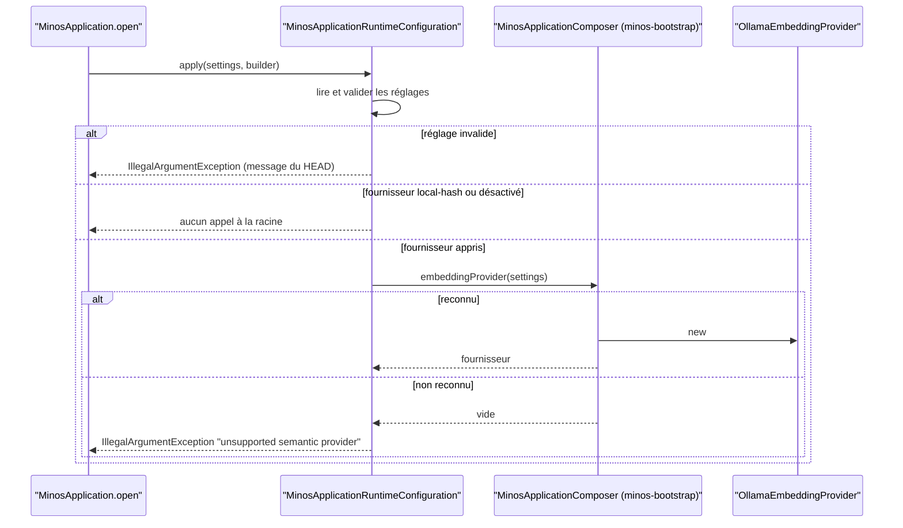
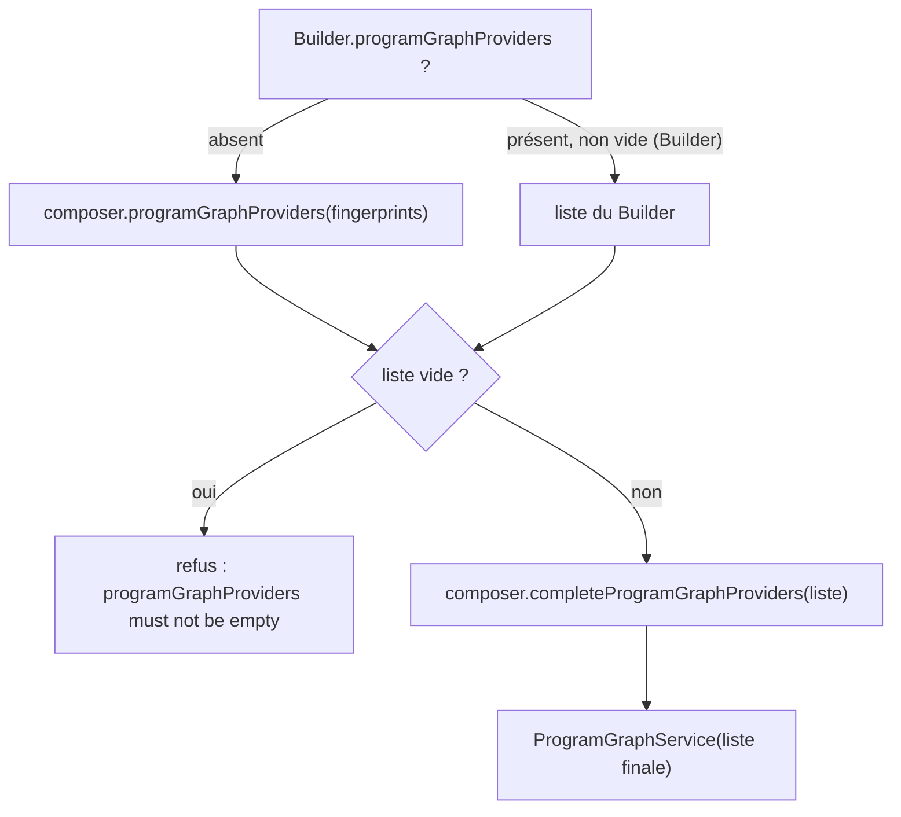

# Design

## Contexte

Motivation : voir `proposal.md` (Why). Le changement touche `minos-application` (port `MinosApplicationComposer`, `MinosApplicationRuntimeConfiguration`, `MinosApplicationAssembler`, `ProgramGraphService`) et `minos-bootstrap` (`DefaultMinosApplicationComposer`), plus le garde `scripts/architecture/check-module-boundaries.py`. Aucune surface publique ne change de sortie. Windows et Linux se comportent de la même façon.

## État vérifié au HEAD

Relu au commit `89be3fb4`.

| Fait | Preuve |
|---|---|
| Le client Ollama importe `java.net.HttpURLConnection`, `Proxy`, `URI` et Jackson ; 227 lignes | `minos-application/src/main/java/com/minos/application/semantic/OllamaEmbeddingProvider.java:3-15` |
| La configuration d'exécution choisit et instancie le fournisseur, et lit ses valeurs par défaut (`DEFAULT_ENDPOINT`, `DEFAULT_TIMEOUT`) | `minos-application/src/main/java/com/minos/application/MinosApplicationRuntimeConfiguration.java:31`, `:44`, `:51`, `:53` |
| `ProgramGraphService` instancie les fournisseurs de production, fournisseur de relations compris ; ce sont les seuls sites d'instanciation de `RelationshipProgramGraphProvider` en production | `minos-application/src/main/java/com/minos/program/analysis/ProgramGraphService.java:93`, `:97` |
| Le constructeur à deux arguments et les deux `productionProviders` sont publics | `ProgramGraphService.java:68`, `:92`, `:96` |
| `normalizeProviders` refuse la liste vide avant toute complétion (« at least one program graph provider is required ») | `ProgramGraphService.java:308` |
| Complétion : `JavaSourceProgramGraphProvider` ajouté seulement si le fournisseur de relations est présent et l'identifiant Java absent ; `FileProgramGraphProvider` ajouté s'il est absent, dans tous les cas | `ProgramGraphService.java:317-321` |
| Le `Builder` et le constructeur de l'application refusent une liste vide (« programGraphProviders must not be empty ») | `MinosApplication.java:183`, `:504` |
| `SourceStateKeyMemo` nomme `JavaProgramGraphEngine.SourceStateKey` ; il est utilisé par `FingerprintConstrainedJavaProgramGraphProvider` seulement | `minos-application/src/main/java/com/minos/program/analysis/SourceStateKeyMemo.java:30`, `:52`, `:57`, `:65`, `:80`, `:89`, `:104` |
| Famille des adaptateurs embarqués : 17 classes (`OllamaEmbeddingProvider`, 13 `Java*`, `FingerprintConstrainedJavaProgramGraphProvider`, `FileProgramGraphProvider`, `SourceStateKeyMemo`) | lecture de `com.minos.program.analysis` et de `com.minos.application.semantic` |
| L'assembleur passe par `MinosApplication.productionProgramGraphProviders` | `minos-application/src/main/java/com/minos/application/MinosApplicationAssembler.java:110-112`, `MinosApplication.java:247-251` |
| `JavaAstParser` importe `com.sun.source.*` et `javax.tools.*` ; 13 classes `Java*`, 1 805 lignes | `minos-application/src/main/java/com/minos/program/analysis/JavaAstParser.java:3-13` ; décompte `wc -l Java*.java` |
| 10 fichiers de production de `minos-application` importent une API surveillée (`OllamaEmbeddingProvider`, `JavaAstParser`, `JavaAstSupport`, `JavaControlFlowAnalyzer`, `JavaDefUseAnalyzer`, `JavaProgramGraphAssembler`, `JavaProgramGraphContext`, `JavaProgramModel`, `JavaSecurityRules`, `JavaTaintAnalyzer`) ; aucun dans `minos-domain` ni `minos-engine` | recherche des imports `java.net.HttpURLConnection`, `java.net.http.`, `javax.tools.`, `com.sun.source.` |
| Les analyseurs Java ne dépendent que du domaine, du moteur et du port `ProgramGraphProvider` / `ProgramGraphBudget` | imports `com.minos.*` des fichiers `Java*`, `FileProgramGraphProvider`, `FingerprintConstrainedJavaProgramGraphProvider` |
| Le composeur fournit déjà `semanticProjectionStore(home)` selon le modèle visé | `MinosApplicationComposer.java:80`, `minos-bootstrap/src/main/java/com/minos/bootstrap/DefaultMinosApplicationComposer.java:167` |
| ARCH-0042 : `minos-bootstrap` est le seul module non adaptateur qui connaît une classe concrète d'adaptateur | `docs/architecture/adr/ARCH-0042-racine-de-composition.md:25` |
| Quatre gates affirment l'instanciation à son emplacement actuel, dont `new RelationshipProgramGraphProvider()` dans `ProgramGraphService` | `scripts/quality/check-semantic-retrieval-consistency.py:85`, `scripts/remediation/check-p0-p2.py:218-220`, `scripts/quality/check-advanced-provider-consistency.py:98`, `scripts/quality/check-java-ast-provider-consistency.py:104-106` (`:105`) |
| Les scopes JaCoCo citent les classes par chemin de package | `scripts/quality/check-jacoco.py:76-93`, `:97` |
| Appelants de `productionProviders` hors production : `LocalProjectOperationsRetentionTest.java:163`, `WslIndexingRouteWiringTest.java:86`, `ProgramGraphSourceStateLimitationTest.java:72` | recherche dans `minos-*/src/test` |
| Tests qui construisent `ProgramGraphService` : `AdvancedImpactReferenceReportsTest.java:139`, `ProgramGraphSourceFixture.java:99` (`minos-application`) ; `ProgramGraphPerformanceQualificationTest`, `FileProgramGraphProviderTest`, `ProgramGraphAnalysisTest`, `ProgramGraphServiceConcurrencyTest` (`minos-bootstrap`) | recherche `new ProgramGraphService(` |
| Un test de `minos-bootstrap` affirme la présence de l'identifiant de l'analyseur Java dans l'application par défaut | `minos-bootstrap/src/test/java/com/minos/bootstrap/application/MinosApplicationTest.java:92` |

Non mesuré : aucun build ni test n'a été exécuté ; les sorties caractérisées n'ont pas été rejouées.

## Écarts

| Écart | Source A | Source B | Suite proposée |
|---|---|---|---|
| L'audit demande de déplacer les classes dans un module adaptateur « ou au minimum un package adaptateur gardé » | `findings.json`, AUD-ARC-01, action | Un adaptateur ne peut pas dépendre de `minos-application` : les ports `EmbeddingProvider`, `ProgramGraphProvider`, `ProgramGraphBudget` et `DeterministicJson` devraient descendre dans le moteur, qui n'a pas de racine `program` (A14) ; 9 gates citent ces fichiers par chemin littéral | D1 : ce changement câble sans déplacer ; l'emplacement final est la décision de l'ADR |
| L'audit propose `programGraphProviders(fingerprints)` seul | action de l'audit | `ProgramGraphService.normalizeProviders` ajoute d'office deux fournisseurs à toute liste, y compris celle d'un `Builder` | Une fabrique de complétion s'ajoute à celle de la liste de production ; la règle de complétion, qui nomme deux classes d'adaptateur, vit dans `minos-bootstrap` (D3) |
| L'audit interdit `java.net.HttpURLConnection`, `java.net.http` et `javax.tools` | action de l'audit | `com.sun.source` est importé par 9 fichiers et n'est pas dans la liste | La règle surveille aussi `com.sun.source` |
| arc42 annonce « ports seulement vers les adaptateurs » | `docs/architecture/arc42/05-vue-blocs.md:90` | le code embarque trois adaptateurs | Phrase corrigée par ce changement pour dire ce qui reste embarqué ; refonte de la prose : AUD-ARC-07 (sprint 8) |

## Exigences couvertes

- frontieres-de-modules › Le fournisseur d'embeddings appris est fourni par la racine de composition — « Traitements et interactions », D2.
- frontieres-de-modules › Les fournisseurs du graphe de programme sont fournis par la racine de composition — D3.
- frontieres-de-modules › Les API d'infrastructure du JDK nommées par l'application le sont par liste fermée — D4.
- frontieres-de-modules › Une classe d'adaptateur embarquée n'est nommée que par sa famille — D4.
- frontieres-de-modules › Le câblage des fournisseurs par la racine ne change aucune sortie publique — « Vérification ».

## Objectifs et non-objectifs

Objectif : plus aucune instanciation d'adaptateur d'infrastructure par le code de `minos-application` hors de la famille de l'adaptateur ; un garde qui voit ces dépendances. Non-objectif : changer le comportement d'un analyseur, d'un cache ou du client Ollama ; créer un module.

## Responsabilités et frontières des composants

- `minos-application` : lit et valide les réglages (`MinosApplicationRuntimeConfiguration`), porte les ports `EmbeddingProvider` et `ProgramGraphProvider`, les services, et les classes embarquées listées par le garde. [Proposition]
- `minos-bootstrap` : instancie `OllamaEmbeddingProvider` et toute la liste de production du graphe de programme (`RelationshipProgramGraphProvider`, `FingerprintConstrainedJavaProgramGraphProvider`), ainsi que `JavaSourceProgramGraphProvider` et `FileProgramGraphProvider` pour la complétion. Il dépend déjà de `minos-application` en portée `compile` (`ALLOWED_DEPENDENCIES`, `check-module-boundaries.py:73-76`) : aucune arête nouvelle, direction ARCH-0068 respectée.
- `LocalHashEmbeddingProvider` est un calcul sans E/S ni API d'infrastructure : il reste instancié par l'application. `RelationshipProgramGraphProvider` est aussi un calcul sans E/S et n'entre pas dans la liste des adaptateurs embarqués, mais l'application ne l'instancie plus : la liste de production entière vient de la racine. [Proposition]

## Modèle de domaine et invariants

Un enregistrement de réglages validés (nom proposé : `EmbeddingProviderSettings` — identifiant de fournisseur normalisé, modèle, dimensions, point d'accès facultatif, délai facultatif, emplacement d'exécution) passe de la configuration à la fabrique. Invariants : dimensions strictement positives, modèle non vide, vérifiés avant l'appel. Les valeurs par défaut du point d'accès et du délai sont appliquées par l'adaptateur.

## Traitements et interactions

Voir le diagramme de séquence. Ordre d'initialisation inchangé (ARCH-0042 § 2) : `ensurePrivateDirectory` → `MinosRuntimeSettings.load` → `openStorageBackend` → `builder` → `MinosApplicationRuntimeConfiguration.apply` → `build`.

## États et transitions

Non applicable : aucun cycle de vie nouveau.

## Contrats d'interface

`MinosApplicationComposer` (API Java interne, publique) gagne, sous des noms à confirmer à l'implémentation :

- `Optional<EmbeddingProvider> embeddingProvider(EmbeddingProviderSettings settings)` — vide quand l'identifiant n'est pas reconnu ; l'application transforme le vide en `IllegalArgumentException("unsupported semantic provider: …")`, message du HEAD.
- `List<ProgramGraphProvider> programGraphProviders(ProjectFingerprintSnapshotStore fingerprints)` — liste de production, non vide.
- `List<ProgramGraphProvider> completeProgramGraphProviders(List<ProgramGraphProvider> requested)` — rend `requested` complétée selon la règle du HEAD : analyseur de sources Java ajouté si le fournisseur de relations est présent et l'identifiant Java absent, lecteur de sidecar ajouté s'il est absent ; l'ordre et les fournisseurs reçus sont conservés.

`ProgramGraphService` (classe interne publique) : le constructeur `(ProjectRegistry, CodeKnowledgeSnapshotStore)` et les deux `productionProviders` sont retirés — **RUPTURE** de source et binaire d'une classe interne, sous le régime de `docs/user/java-api.md:373` ; remplacement : `MinosApplication.open(home).programGraphService()`, ou le constructeur à liste explicite.

Compatibilité du port : additif pour les appelants ; une implémentation tierce doit implémenter les trois méthodes (rupture de source documentée dans `docs/user/java-api.md`, comme les entrées existantes `:373-399`).

## Persistance et intégrité

Non applicable : aucune donnée écrite.

## Transactions, concurrence et idempotence

Non applicable : les fabriques sont appelées une fois par construction d'application, là où l'instanciation avait lieu.

## Sécurité et isolation

Le client Ollama garde ses refus (hôte géré hors Docker, hôtes distants) : recherche-semantique › exigences existantes, inchangées. Fail-closed : un fournisseur configuré que la racine ne fournit pas fait échouer l'ouverture (jamais un repli sur « désactivé »). Aucun chemin absolu dans les messages.

## Erreurs et reprise

Messages d'erreur d'usage identiques au HEAD (`unsupported semantic provider`, `missing required semantic setting`, `… must be a positive integer`).

## Observabilité

Non applicable : aucun journal nouveau.

## Performance et mesure

Non applicable : aucun chemin d'exécution ajouté ; une indirection à la construction.

## Compatibilité, migration et retour arrière

Aucune migration. Retour arrière : annuler la PR ; aucune donnée n'est concernée.

## Diagrammes

### Qui instancie le fournisseur d'embeddings après le changement ?

Type : sequenceDiagram · Portée : cible · Exigences : frontieres-de-modules › Le fournisseur d'embeddings appris est fourni par la racine de composition

La configuration ne connaît plus que le port ; l'échec d'un fournisseur inconnu reste une erreur d'usage à l'ouverture.

### Où se fait la complétion des fournisseurs de graphe ?

Type : flowchart · Portée : cible · Exigences : frontieres-de-modules › Les fournisseurs du graphe de programme sont fournis par la racine de composition

Le vide est refusé avant la complétion : celle-ci ajoute toujours le lecteur de sidecar, un contrôle placé après elle ne verrait jamais une liste vide. Message : celui de l'application (`MinosApplication.java:183`, `:504`). `ProgramGraphService` garde son propre refus (« at least one program graph provider is required », `:308`) pour une construction directe, et la détection des identifiants en conflit ; il ne crée plus rien.

## Décisions

### D1 — Emplacement physique des adaptateurs embarqués [Proposition, attend le propriétaire ; objet de l'ADR]

Options : (a) laisser les 17 classes à leur chemin, tenues par les deux tables du garde ; (b) les regrouper dans des packages gardés de `minos-application` ; (c) les déplacer dans un ou deux modules adaptateurs.
Recommandation : **(a) dans ce changement**, (c) consigné dans l'ADR comme cible conditionnelle (à ouvrir quand un second langage de graphe de programme ou un second fournisseur appris arrive, ARCH-0064 § 5). Raisons : (c) exige de descendre trois ports et `DeterministicJson` dans le moteur, d'ouvrir une racine `program` au moteur (A14), de porter le reactor à 15 ou 16 modules (nombre affirmé par des specs, la documentation et `product-facts`), et de déplacer tests et scopes JaCoCo (code neuf pour SonarCloud) ; (b) casse les mêmes 9 gates à chemin littéral sans renforcer le garde par rapport à (a). Le critère de sortie du sprint (« câblés par minos-bootstrap derrière un port ») est atteint par (a).

### D2 — Fabriques abstraites, sans valeur par défaut [Proposition]

Une méthode `default` qui rendrait « vide » désactiverait la sémantique en silence si l'implémentation oubliait de la redéfinir. Les trois méthodes sont abstraites ; `MinosApplicationComposersTest` et tout composeur de test les implémentent.

### D3 — La complétion est une fabrique de la racine, appelée par l'assembleur [Proposition]

La règle nomme `JavaSourceProgramGraphProvider.PROVIDER_ID` et `FileProgramGraphProvider.PROVIDER_ID`, deux classes de la liste fermée : elle ne peut rester ni dans `ProgramGraphService` ni dans l'assembleur. Elle quitte `ProgramGraphService.normalizeProviders` (`:317-321`) pour `DefaultMinosApplicationComposer.completeProgramGraphProviders`, à règle identique (analyseur Java conditionné au fournisseur de relations, sidecar inconditionnel). L'assembleur refuse d'abord la liste vide, puis demande la complétion. Conséquences : `new ProgramGraphService(registry, store, providers)` ne complète plus ; les 6 fichiers de test qui l'appellent passent la liste voulue (ceux de `minos-bootstrap` par le composeur, les deux de `minos-application` par instanciation directe, permise aux tests). Le constructeur à deux arguments (`ProgramGraphService.java:68`), les deux `productionProviders` (`:92`, `:96`) et `MinosApplication.productionProgramGraphProviders` disparaissent : rupture de classe interne documentée (« Contrats d'interface »).

### D4 — Deux tables à cliquet dans le garde [Proposition]

Noms proposés : `INFRASTRUCTURE_API_USERS` (10 fichiers au HEAD ; présence seule, sans compte) et `EMBEDDED_ADAPTER_CLASSES` (classe → justification ; 17 entrées au HEAD, `SourceStateKeyMemo` comprise parce qu'il nomme `JavaProgramGraphEngine.SourceStateKey`). Numéro de règle : prochain libre dans le script à l'implémentation. Les tables suivent le patron d'A12 (`check-module-boundaries.py:924-959`). AUD-ARC-04 (sprint 8) les fera lire depuis la source unique ; d'ici là, aucune copie dans `ModuleArchitectureTest` n'est ajoutée.

### D5 — ADR à écrire [Décision de forme]

Domaine `ARCH`, prochain numéro libre à l'écriture (lu dans `docs/architecture/adr/README.md`, non réservé). Titre proposé : « Adaptateurs embarqués par l'application et façade réduite : câblage par la racine de composition ». Il couvre D1 de ce changement et les décisions D1-D2 du changement `injecter-les-collaborateurs-des-cas-d-usage` ; ARCH-0042 reçoit une entrée « Mise en œuvre ». La tâche 1.2 de ce changement l'écrit au statut `Proposed` ; la tâche 4.1 d'`injecter-les-collaborateurs-des-cas-d-usage` le complète et le fait passer `Accepted` par le propriétaire.

### D6 — Ordre de fusion sur le port du composeur [Proposition]

Trois changements du sprint touchent `MinosApplicationComposer` et le composeur factice `MinosApplicationComposersTest.FirstComposer` (`:90`) : `porter-l-historique-d-import-derriere-un-port` (une méthode ajoutée), celui-ci (trois méthodes ajoutées), `injecter-les-collaborateurs-des-cas-d-usage` (aucune méthode ajoutée ; il change les appelants du port). Ordre : `porter`, puis `cabler`, puis `injecter` ; chaque suivant se rebase en ajoutant ses méthodes à `FirstComposer`.

## Qualification des capacités

Aucune capacité produit nouvelle. Le garde ajouté est qualifié sur Windows et Linux par son auto-test (bibliothèque standard, chemins normalisés).

## Risques et compromis

- [Risque] Changement d'ordre ou de contenu de la liste des fournisseurs → test de `minos-bootstrap` qui compare les identifiants à ceux du HEAD, goldens de caractérisation.
- [Risque] Un gate littéral oublié → liste nominative en « Vérification » ; `run_gates.py` complet.
- [Compromis] Avec D1 (a), le jar de `minos-application` porte toujours les classes ; le garde empêche seulement leur usage hors famille.

## Vérification

- Tests : `M23SemanticProviderConfigurationTest`, `DefaultMinosApplicationComposerTest` (nouveaux cas), `MinosApplicationComposersTest`, `MinosApplicationTest` (`:92`), `ProgramGraphSourceStateLimitationTest`, `LocalProjectOperationsRetentionTest`, `WslIndexingRouteWiringTest`, `AdvancedImpactReferenceReportsTest`, `ProgramGraphSourceFixture`, `ProgramGraphPerformanceQualificationTest`, `FileProgramGraphProviderTest`, `ProgramGraphAnalysisTest`, `ProgramGraphServiceConcurrencyTest`, `A2CompositionCharacterizationTest`, `A2SurfaceCharacterizationTest`, `ShadedJarCompositionRootIT`.
- Gates : `check-module-boundaries.py`, `test_check_module_boundaries.py`, `check-semantic-retrieval-consistency.py`, `check-p0-p2.py`, `check-advanced-provider-consistency.py`, `check-java-ast-provider-consistency.py`, `check-vertical-decomposition-consistency.py`, `check-mnd.py`, `check-mne.py`, `check-ci-wiring.py`, `check-single-execution.py`.
- JaCoCo : scopes `semantic-learned-provider` et ceux de `check-jacoco.py:76-93` (les classes ne bougent pas : préfixes inchangés).
- Commandes : `./mvnw -B -ntp -pl minos-bootstrap -am test`, `./mvnw -B -ntp -pl minos-app -am verify`, `python .claude/scripts/run_gates.py`.

## Documentation durable à mettre à jour

`docs/architecture/diagrams/capacites/frontieres-de-modules.md` ; `docs/architecture/arc42/05-vue-blocs.md` ; `docs/user/java-api.md` ; nouvel ADR, `docs/architecture/adr/README.md`, `docs/architecture/arc42/09-decisions.md` ; ARCH-0042 (« Mise en œuvre »).

## Traçabilité

| Exigence (capacité › titre) | Scénario | Conception ou diagramme | Tâche | Test ou preuve |
|---|---|---|---|---|
| frontieres-de-modules › Le fournisseur d'embeddings appris est fourni par la racine de composition | Fournisseur Ollama configuré | séquence | 2.2 | `M23SemanticProviderConfigurationTest` (existant, à étendre) |
| idem | Aucune instanciation dans l'application | D4 | 2.2 | recherche textuelle ; garde |
| idem | Fournisseur que la racine ne fournit pas | séquence, D2 | 2.1 | à écrire |
| idem | Réglage sémantique invalide | séquence | 2.1 | à écrire |
| frontieres-de-modules › Les fournisseurs du graphe de programme sont fournis par la racine de composition | Liste de production | D3 | 3.1 | à écrire |
| idem | Liste surchargée par le Builder | D3, flowchart | 3.1 | à écrire |
| idem | Liste surchargée sans le fournisseur de relations | D3 | 3.1 | à écrire |
| idem | Service sans instanciation | D3 | 3.2 | recherche textuelle ; garde |
| idem | Liste vide refusée | flowchart | 3.1 | à écrire |
| frontieres-de-modules › Les API d'infrastructure du JDK nommées par l'application le sont par liste fermée | les quatre scénarios | D4 | 4.1, 4.2 | `test_check_module_boundaries.py`, à écrire |
| frontieres-de-modules › Une classe d'adaptateur embarquée n'est nommée que par sa famille | les trois scénarios | D4 | 4.1, 4.2 | `test_check_module_boundaries.py`, à écrire |
| frontieres-de-modules › Le câblage des fournisseurs par la racine ne change aucune sortie publique | Goldens inchangés ; Ordre de composition | Vérification | 3.3 | `A2CompositionCharacterizationTest`, `git diff --exit-code` |

## Questions ouvertes

- D1 : décision du propriétaire attendue avant l'écriture de l'ADR (recommandation : option a, cible c conditionnelle).
- Noms définitifs des méthodes et des tables : fixés à l'implémentation, sans effet sur les specs.
