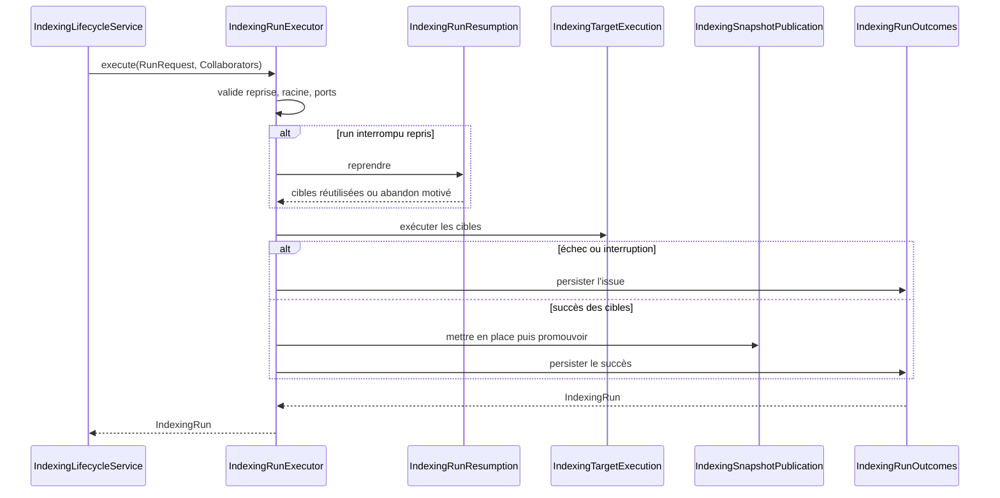

# Design

## Contexte

Motivation : voir `proposal.md` (Why). Remaniement interne de deux packages (`com.minos.orchestration` dans `minos-engine`, `com.minos.storage.codec` dans `minos-storage`), sans changement de comportement. Précédent de forme et de méthode : `openspec/changes/archive/2026-10-29-decouper-les-classes-de-plus-de-800-lignes/` (caractérisation comme preuve, gates littéraux retargetés dans la même PR, planchers JaCoCo par classe nouvelle, une PR par module).

## État vérifié au HEAD

Commit relu : `89be3fb4` (`main`).

### `IndexingRunExecutor` (`minos-engine/src/main/java/com/minos/orchestration/IndexingRunExecutor.java`)

| Fait | Preuve |
|---|---|
| 1 025 lignes, 33 imports, `final class` de visibilité package, constructeur privé | `:44-47` ; `wc -l` |
| 37 commits sur le fichier, renommages suivis | `git log --oneline --follow -- minos-engine/src/main/java/com/minos/orchestration/IndexingRunExecutor.java \| wc -l` |
| Point d'entrée unique `static IndexingRun execute(RunRequest, Collaborators)` ; il valide la politique de reprise, puis la racine, puis les ports dans l'ordre de `Ports` | `:49-54` |
| Reprise : `executeResumed`, `reverifyReusedArtifacts`, `existingRunDirectory`, `ResumedAttempt`, `ResumeAborted` | `:135-250`, `:924-944` |
| Racine et état précédent : `validateExecutionRoot`, `reconcilePreviousState`, `ValidatedProjectRoot` | `:252-288`, `:858` |
| Exécution des cibles et points de reprise : `executeProviders`, `executeProvider`, `captureScopeFingerprint`, `checkpoint`, `requireExecutor`, `requireExecutionRoot`, `requireInsideRunDirectory` | `:300-462`, `:783-811` |
| Publication : `stageSnapshot`, `promoteSnapshot`, `recoverUncertainPromotion` | `:463-498` |
| Issues du run : `persistSuccess`, `persistTerminalFailure`, `persistInterruption`, `persistFailure`, `persistCommittedFailure`, `persistUncommittedFailure`, `holdAgainstRetention` | `:499-750` |
| Enregistrements `RunRequest`, `Collaborators` (8 champs), `Ports` (9 champs), état mutable `RunContext` | `:870-880`, `:887-897`, `:899-921`, `:947` |
| Quatorze méthodes hors des blocs ci-dessus, à affecter à une phase : `holdRunDirectory` (`:120`), `resumeStagedPromotion` (`:236`), `publishInProgress` (`:289`), `resumeSuffix` (`:539`), `isInterruption` (`:579`), `interruptedRun` (`:588`), `failedRun` (`:669`), `authoritativeTargetIsActive` (`:734`), `validateArtifact` (`:766`), `requireArtifactsStillInsideRunDirectory` (`:800`), `running` (`:821`), `persist` (`:834`), `portable` (`:851`), `failureMessage` (`:853`) | fichier relu |
| Un test d'un autre module recopie `isInterruption` et cite `IndexingRunExecutor.isInterruption` dans sa Javadoc | `minos-runtime-local/src/test/java/com/minos/runtime/local/sandbox/LinuxCgroupJobFailClosedTest.java:195-196` |
| Membres de visibilité package appelés par les tests : `scopedChangedFiles`, `awaitReadable` | `:751`, `:812` |
| Appelants de production : `IndexingLifecycleService`, `IndexingResumePlanner` | recherche de `IndexingRunExecutor` dans `minos-*/src/main` |
| Tests qui nomment la classe : `IndexingRunExecutorTest`, `IndexingRunExecutorCheckpointTest`, `IndexingRunExecutorValidationTest`, `StagedSnapshotIdValidationTest` (`minos-engine`), `LinuxCgroupJobFailClosedTest` (`minos-runtime-local`) | recherche dans `minos-*/src/test` |
| Scopes JaCoCo par préfixe `com/minos/orchestration/IndexingRunExecutor` : `critical-orchestration` (ligne 0,75, branche 0,55) et `resume-orchestration` | `scripts/quality/check-jacoco.py:281-298` |
| Documents qui citent le nom | `docs/architecture/arc42/05-vue-blocs.md:55`, `docs/architecture/arc42/06-vue-execution.md:53`, `docs/developer/architecture.md:100`, `docs/architecture/diagrams/capacites/decouverte-et-negociation.md:89`, `:105`, `docs/architecture/diagrams/capacites/persistance-snapshots.md:31`, `docs/architecture/diagrams/seq-indexation-nominale.md:47`, `docs/architecture/adr/BE-0039-reprise-indexation-apres-interruption.md:21`, `:27`, `:87`, `:168`, `:181`, `:189` |

### `SnapshotBinaryCodecSupport` (`minos-storage/src/main/java/com/minos/storage/codec/SnapshotBinaryCodecSupport.java`)

| Fait | Preuve |
|---|---|
| 1 106 lignes, 57 imports, `final class` de visibilité package | `:70` ; `wc -l` |
| 20 commits sur le fichier, renommages suivis | `git log --oneline --follow -- minos-storage/src/main/java/com/minos/storage/codec/SnapshotBinaryCodecSupport.java \| wc -l` |
| Cadre des formats : écriture et lecture V1, écritures V2 bornées (`BoundedOutputStream` en `:328`, `:333`, `:340`), lecture V2 et V3, tailles encodées, version d'en-tête, plafond persistable | `:104-311`, `:322-444` |
| Conversion de l'ancien format : `fromLegacy` | `:313-321` |
| Codage des entités : symbole, occurrence, référence, relation, preuve, référence d'entité, localisation, origine | `:445-872` |
| Encodage des chaînes : `EncodingSink`, `StreamSink`, `CountingSink`, `StringEncoding`, `UnpairedSurrogateException`, `utf8Length`, `utf8` | `:877-997` |
| Lecteur borné `SnapshotInput` et lectures de chaînes et de compteurs | `:998-1106` |
| Les primitives de cadre partagées avec le pointeur actif sont déjà dans `SnapshotBinaryPrimitives`, l'intégrité dans `SnapshotIntegrityService` | `:62-69` ; fichiers du package `codec` |
| Appelants de production : `SnapshotCodec`, `SnapshotCodecV1`, `SnapshotCodecV2`, `SnapshotCodecV3`, `SnapshotLimits`, `KnowledgeSnapshotCodecs` | recherche dans `minos-storage/src/main` |
| Tests qui nomment la classe : `SnapshotBinaryCodecSupportLinkTest`, `SnapshotVerifiedReadTest` (`minos-storage`), `SnapshotScalabilityBenchmark` (`minos-bootstrap`) | recherche dans `minos-*/src/test` |
| `check-mne.py` exige dans ce fichier `MAX_PERSISTED_SNAPSHOT_BYTES = 400L * 1024L * 1024L` et `requireSnapshotFileSize` | `scripts/remediation/check-mne.py:37`, `:84-85` |
| `check-audit-remediation-v2.py` y exige `BoundedInputStream`, `BoundedOutputStream`, `MAX_PERSISTED_SNAPSHOT_BYTES`, `ConfinedFileOpener.openRegularFileNoFollow(file)` | `scripts/remediation/check-audit-remediation-v2.py:138-144` |
| Scope JaCoCo `storage-codec-and-state` : préfixe `com/minos/storage/codec/SnapshotBinaryCodecSupport` ; le scope `persistence-cache-indexes` prend tout nom commençant par `com/minos/storage/codec/SnapshotCodec` | `scripts/quality/check-jacoco.py:27-29`, `:66` |
| Un script d'historique affirme des appels `SnapshotBinaryCodecSupport.writeSymbolSnapshotV1` dans `SnapshotCodecV1` ; aucun workflow ne l'exécute (seul un filtre de chemins le cite) | `scripts/history/m15/run-s6.ps1:127-139` ; `.github/workflows/docker-release-validation.yml:9`, `:15` |

Relu au `72c8d91c` (`main`, 2026-11-17) : 1 106 lignes, aucun numéro de ligne n'a bougé.

### Mesures du lot `minos-storage`

Poste Windows 10, JDK Microsoft 21.0.12, `./mvnw -B -ntp -pl minos-storage -am verify "-Dtest=com/minos/storage/**/*Test" "-Dsurefire.failIfNoSpecifiedTests=false"`, rapport `minos-storage/target/site/jacoco/jacoco.xml` (classes imbriquées comprises) :

| Classe | Avant (`72c8d91c`) lignes / branches | Après lignes / branches |
|---|---|---|
| `SnapshotBinaryCodecSupport` | 505/541 / 123/143 | 169/188 / 35/42 |
| `SnapshotEntityCodec` | — | 231/243 / 45/53 |
| `SnapshotInput` | — | 44/47 / 22/26 |
| `SnapshotEncodingSink` (deux implémentations comprises) | — | 31/31 / 8/8 |
| `SnapshotStringEncoding` | — | 22/23 / 13/14 |
| Total des cinq classes | 505/541 / 123/143 | 497/532 / 123/143 |

Longueurs : `SnapshotBinaryCodecSupport.java` passe de 1 106 à 427 lignes (cible 500). Scope `storage-codec-and-state` après découpage, sur le rapport du module : ligne 0,924, branche 0,797. Les neuf lignes de moins sont les délégations de cadre retirées. Chaque classe nouvelle a son préfixe et un plancher de classe (mesure moins environ 5 points) dans `check-jacoco.py`.

La couverture se mesure par classe, non par plage de lignes : le rapport JaCoCo ne donne pas de compteur par bloc, et la somme des classes du lot se compare à la classe d'origine.

## Écarts

| Écart | Source A | Source B | Suite proposée |
|---|---|---|---|
| L'audit compte « 81 méthodes » pour `IndexingRunExecutor` ; un décompte par expression régulière en relève 49, classes internes comprises, plus 4 constructeurs | `findings.json` (AUD-ARC-09) | fichier relu | Sans effet sur le découpage ; le chiffre n'est pas repris |
| L'audit demande de découper le codec « par primitive (pointeur actif, intégrité) » : ces deux parts sont déjà dans `SnapshotBinaryPrimitives` et `SnapshotIntegrityService` | `findings.json` (AUD-ARC-09) | `SnapshotBinaryCodecSupport.java:62-69` | Rien à faire pour elles |
| L'audit demande un découpage « par format (V1, V2, V3) » : `SnapshotCodecV1`, `V2`, `V3` existent et délèguent ; V2 et V3 partagent un même corps de lecture paramétré par la version (`readKnowledgeSnapshotBody`), et le codage des entités est commun | `findings.json` (AUD-ARC-09) | `SnapshotBinaryCodecSupport.java:402-436` | D3 : découper par responsabilité (cadre des formats, entités, chaînes, lecteur borné), pas en dupliquant le corps commun par version |
| L'audit décrit l'exécuteur comme « classe statique de 81 méthodes » à remplacer par des « objets à collaborateurs injectés » : l'état d'un run est déjà porté par `RunContext` et les collaborateurs par `Ports` | `findings.json` (AUD-ARC-09) | `IndexingRunExecutor.java:899-921`, `:947` | D2, D5 : les phases reçoivent `RunContext` ; pas de conteneur d'injection |

## Exigences couvertes

Non applicable : aucun delta de spec (`skip_specs: true`). Exigences existantes à tenir sans modification : `frontieres-de-modules` › Le code de production ne contient aucun cycle de packages ; `frontieres-de-modules` › Un module ne crée pas de nouvelle racine de packages ; les exigences de `persistance-snapshots` sur le format, les plafonds et la lecture des formats antérieurs.

## Objectifs et non-objectifs

Objectifs : chaque classe issue du découpage a une seule raison de changer, ses tests dans son module et son entrée dans les gates ; `IndexingRunExecutor.java` et `SnapshotBinaryCodecSupport.java` passent sous 500 lignes chacun (estimation à confirmer en 1.1) ; zéro différence observable ; aucun compteur de cliquet qui monte. Non-objectifs : seuil de taille dans un gate, nouveau package, type public, changement de format ou de message.

## Responsabilités et frontières des composants

Direction des dépendances (ARCH-0068) inchangée : toutes les classes nouvelles restent dans le package de leur origine, en visibilité package. Aucune arête de module, aucun cycle de packages possible (même package). A15 ne s'applique pas (types non publics).

Cible [Proposition] pour `com.minos.orchestration` :

| Classe | Responsabilité | Reçoit |
|---|---|---|
| `IndexingRunExecutor` | entrée `execute`, ordre de validation, enchaînement des phases, `RunRequest`, `Collaborators`, `publishInProgress`, `running` | — |
| `IndexingRunContext` (extrait de `RunContext`, avec `Ports`) | état d'un run, dans l'ordre du plan | ports validés |
| `IndexingRunResumption` | reprise d'un run interrompu, revérification des artefacts réutilisés ; `holdRunDirectory`, `resumeStagedPromotion`, `resumeSuffix` | contexte |
| `IndexingTargetExecution` | exécution des providers, points de reprise, confinement des artefacts au dossier du run ; `validateArtifact`, `requireArtifactsStillInsideRunDirectory`, `portable` | contexte |
| `IndexingSnapshotPublication` | mise en place, promotion, reprise d'une promotion incertaine | contexte |
| `IndexingRunOutcomes` | persistance du succès, de l'échec, de l'interruption ; retenue contre la rétention ; `isInterruption`, `interruptedRun`, `failedRun`, `authoritativeTargetIsActive`, `persist`, `failureMessage` | contexte |

L'affectation des quatorze méthodes hors bloc est une proposition ; elle est arrêtée en tâche 1.1, chaque méthode ayant une seule classe d'accueil. Une méthode appelée par deux phases va dans la phase qui en porte la règle, l'autre l'appelle.

Découpage arrêté pour `com.minos.storage.codec` (tâche 1.1) :

| Classe | Responsabilité | Lignes |
|---|---|---|
| `SnapshotBinaryCodecSupport` | constantes de format et plafonds des comptes de premier niveau, cadre V1/V2/V3 (en-tête, taille de fichier, ouverture confinée et bornée, lecture authentifiée en une passe), tailles encodées, `fromLegacy` | 427 |
| `SnapshotEntityCodec` | écriture et lecture de chaque entité du snapshot (symbole, occurrence, relation, référence de symbole, preuve, référence d'entité, localisation, origine, références de provider) et leurs plafonds | 438 |
| `SnapshotStringEncoding` | encodage des chaînes d'un format (UTF-16 ou UTF-8), longueur UTF-8 exacte, refus du substitut isolé | 50 |
| `SnapshotEncodingSink`, `SnapshotEncodingSinkCounter` | puits d'une passe d'encodage : flux réel (`StreamSink`) ou compteur | 70 |
| `SnapshotInput` | lecteur borné d'une passe de décodage : chaînes partagées (ADR 0047), chaînes requises, compteurs, énumérations | 114 |

Le codage des entités ne reçoit pas la version : la disposition des champs est la même dans les trois formats, seule l'encodage des chaînes change, porté par le puits et le lecteur. Les quatre délégations statiques de cadre (`readHeaderVersion`, `writeString`, `readString`, `readRequiredString`, `readCount` sur `DataInputStream` ou `DataOutputStream`) n'avaient d'appelant que dans la classe : les classes extraites appellent `SnapshotBinaryPrimitives` directement.

Les chaînes exigées par `check-mne.py` et `check-audit-remediation-v2.py` restent dans `SnapshotBinaryCodecSupport.java` : l'ouverture du fichier, les deux flux bornés et le plafond persisté y demeurent (D4).

## Modèle de domaine et invariants

Non applicable : aucun type de domaine modifié.

## Traitements et interactions

Voir le diagramme de séquence. L'ordre des phases, l'ordre des refus de validation et les points où l'état du run est persisté ne changent pas.

## États et transitions

Non applicable : la machine à états d'un run (BE-0039) est inchangée.

## Contrats d'interface

Non applicable : aucune interface publique. Contrat interne conservé : signature de `IndexingRunExecutor.execute`, enregistrements `RunRequest` et `Collaborators`, méthodes statiques de `SnapshotBinaryCodecSupport` appelées par les six classes du package.

## Persistance et intégrité

Le format binaire des snapshots V1, V2 et V3 est inchangé à l'octet. Preuves existantes à rejouer sans modification d'attente : `SnapshotReencodingTest`, `SnapshotCodecV3Test`, `SnapshotEncodedSizeTest`, `SnapshotEncodingTest`, `SnapshotVerifiedReadTest`, `SnapshotReadCeilingTest`, `SnapshotDecodeStringSharingTest`, `SnapshotCodecAllocationGuardTest`, `LegacySnapshotContent`, et les goldens de `minos-app/src/test/resources/characterization/`.

## Transactions, concurrence et idempotence

Inchangés : bail exclusif, promotion atomique, reprise. Les classes de phase ne gardent aucun état hors du contexte du run ; une instance par run, jamais partagée entre fils.

## Sécurité et isolation

Les contrôles fail-closed sont déplacés sans être réordonnés : validation de la racine avant tout effet, artefact confiné au dossier du run avant mise en place, revérification des artefacts réutilisés avant publication, ouverture `ConfinedFileOpener.openRegularFileNoFollow`, plafonds de lecture et d'écriture. `scripts/architecture/check-private-io.py` est rejoué ; `scripts/architecture/private-io-allowlist.json` ne cite aucune des deux classes, et aucune entrée n'y est ajoutée.

## Erreurs et reprise

Messages et ordre des refus identiques (caractérisés par `IndexingRunExecutorValidationTest` et les tests du codec).

## Observabilité

Le nom du journal `System.Logger` de l'exécuteur reste celui de `IndexingRunExecutor` pour toutes les phases : les lignes de journal et les tests `LogCapture` ne changent pas.

## Performance et mesure

Aucun objectif chiffré. Risque : un découpage qui ferait allouer par entité. Mesure : `SnapshotCodecAllocationGuardTest` et `SnapshotScalabilityBenchmark` (hors `verify`) rejoués avant et après sur le même poste ; écart consigné, sans seuil.

## Compatibilité, migration et retour arrière

Aucune migration. Retour arrière par revert de la PR du module concerné.

## Diagrammes

### Qui fait quoi pendant un run après le découpage ?

Type : sequenceDiagram · Portée : cible (noms proposés) · Exigences : aucune (remaniement)

L'exécuteur ne garde que l'ordre ; chaque participant correspond à un bloc de méthodes aujourd'hui contigu dans le fichier unique.

## Décisions

### D1 — La preuve d'un remaniement est une caractérisation

Statut : [Décision], reprise du précédent du 2026-10-29. Les tests existants passent avant et après sans modification d'attente ; seul le nom de la classe visée par un test change quand un membre de visibilité package se déplace. Chaque gate dont une liste change a un vrai rouge, noté avant l'édition.

### D2 — L'exécuteur est découpé par phase, dans son package

Statut : [Proposition] pour les noms, [Décision] pour le principe. Tableau ci-dessus. `scopedChangedFiles` et `awaitReadable` suivent leur phase ; les tests qui les appellent sont retargetés.

### D3 — Le codec est découpé par responsabilité, pas par version

Statut : [Proposition]. Voir « Écarts ». Dupliquer le corps commun à V2 et V3 par version créerait deux implémentations d'un même format à tenir identiques, ce que la Javadoc de la classe interdit déjà pour les primitives de cadre.

### D4 — Les chaînes affirmées par les gates restent dans le fichier qu'ils lisent

Statut : [Décision] de conception. Le cadre des formats reste dans `SnapshotBinaryCodecSupport.java`, donc `check-mne.py` et `check-audit-remediation-v2.py` passent sans édition. Si l'implémentation doit déplacer l'une de ces chaînes, l'attente du gate est retargetée dans la même PR, rouge noté.

### D5 — Des objets de phase construits par run, sans conteneur

Statut : [Proposition], recommandation pour le propriétaire. Chaque phase est une classe finale de visibilité package, construite avec le contexte du run. Alternative : garder des classes à méthodes statiques par phase (moins de changement, mais le critère de sortie du sprint demande que l'exécuteur ne soit plus une procédure statique unique). `IndexingRunExecutor.execute` reste statique : c'est le contrat de ses deux appelants.

### D6 — Couverture : un déplacement est du code neuf

Statut : [Décision], reprise du précédent. Les scopes `critical-orchestration`, `resume-orchestration` et `storage-codec-and-state` reçoivent un préfixe par classe nouvelle, avec un plancher par préfixe égal à la plus basse mesure Linux ou Windows moins la marge du scope ; la couverture agrégée du scope ne baisse pas. Une classe nommée `SnapshotCodec…` tomberait dans `persistence-cache-indexes` : les noms proposés l'évitent. SonarCloud juge chaque fichier nouveau à 80 % dans son module : les tests manquants s'ajoutent dans le module, jamais par exclusion.

## Qualification des capacités

Non applicable : aucune capacité nouvelle ni modifiée. Comportement identique sous Windows et Linux.

## Risques et compromis

- [Risque] Régression silencieuse de l'ordre des refus ou des persistances → caractérisation D1 ; relecture par l'agent `minos-architecture-reviewer`.
- [Risque] Conflit avec `reduire-les-lectures-de-la-voie-wsl` (AUD-PERF-07, sprint 6), qui édite `IndexingRunExecutor.java` → ce changement se fait après sa fusion ; les numéros de ligne et l'affectation des méthodes se relisent alors (tâche 1.1).
- [Risque] `LinuxCgroupJobFailClosedTest` recopie `isInterruption` et nomme sa classe d'origine dans sa Javadoc → la Javadoc suit si la méthode change de classe.
- [Risque] Seuil SonarCloud du nouveau code sur des fichiers extraits peu couverts directement → mesure par plage de lignes avant extraction (1.2).
- [Risque] Baseline SpotBugs indexée par nom de classe → rafraîchie dans la PR du module.

## Vérification

- `./mvnw -B -ntp -pl minos-engine -am verify`, puis séparément `./mvnw -B -ntp -pl minos-storage -am verify` (jamais deux builds Maven en parallèle sur le poste).
- `python scripts/quality/check-jacoco.py` et `--self-test` ; `python scripts/remediation/check-mne.py` ; `python scripts/remediation/check-audit-remediation-v2.py` ; `python scripts/architecture/check-module-boundaries.py` ; `python scripts/architecture/check-private-io.py` ; `python scripts/quality/check-comment-language.py` ; `python .claude/scripts/run_gates.py`.
- Goldens : `./mvnw -B -ntp -pl minos-app -am test "-Dtest=A2SurfaceCharacterizationTest" "-Dsurefire.failIfNoSpecifiedTests=false"`.
- Non vérifiable localement : la couverture Linux des scopes (job `Verify (ubuntu-24.04)`) et la mesure SonarCloud.

## Documentation durable à mettre à jour

`docs/architecture/arc42/05-vue-blocs.md:55`, `docs/architecture/arc42/06-vue-execution.md:53`, `docs/developer/architecture.md:100`, `docs/developer/indexing-and-storage.md`, `docs/developer/quality-gates.md` (scopes JaCoCo), `docs/architecture/diagrams/capacites/decouverte-et-negociation.md:89`, `:105`, `docs/architecture/diagrams/capacites/persistance-snapshots.md:31`, `docs/architecture/diagrams/seq-indexation-nominale.md:47` : relecture, mise à jour si un nom cité bouge. BE-0039 (`:21`, `:27`, `:87`, `:168`, `:181`, `:189`) : aucun changement, `IndexingRunExecutor` reste l'entrée et les deux scopes JaCoCo gardent leurs noms.

## Traçabilité

| Exigence (capacité › titre) | Scénario | Conception ou diagramme | Tâche | Test ou preuve |
|---|---|---|---|---|
| aucune (remaniement) — comportement de l'exécuteur constant | — | D1, D2, D5, diagramme | 2.1 à 2.5 | tests `IndexingRunExecutor*Test`, `IndexingLifecycleService*Test` : à rejouer |
| aucune (remaniement) — octets persistés constants | — | D1, D3, D4 | 3.1 à 3.4 | tests du package `codec`, goldens : à rejouer |
| aucune — couverture non érodée | — | D6 | 2.5, 3.4, 3.5 | `check-jacoco.py` : à exécuter ; SonarCloud : manuelle |

## Questions ouvertes

- D5 : objets de phase (recommandé) ou classes statiques par phase.
- Les noms exacts et les longueurs cibles se confirment en 1.1, sans changer l'approche.
