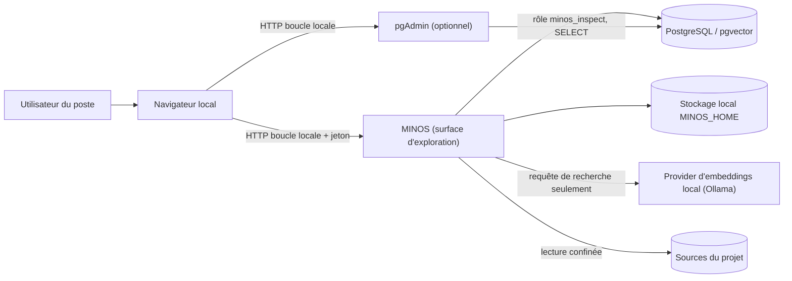
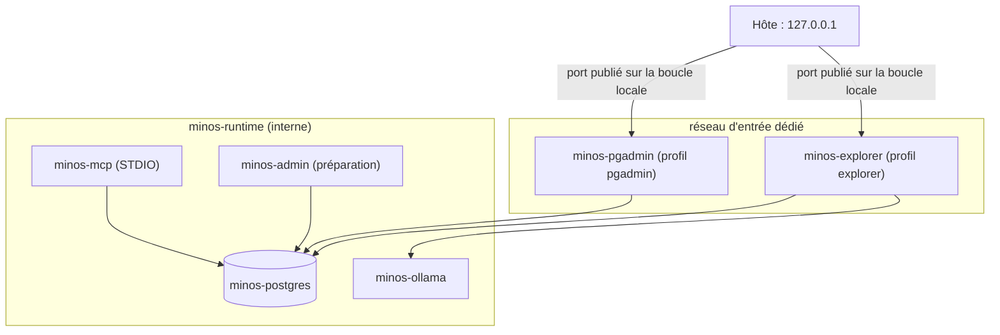
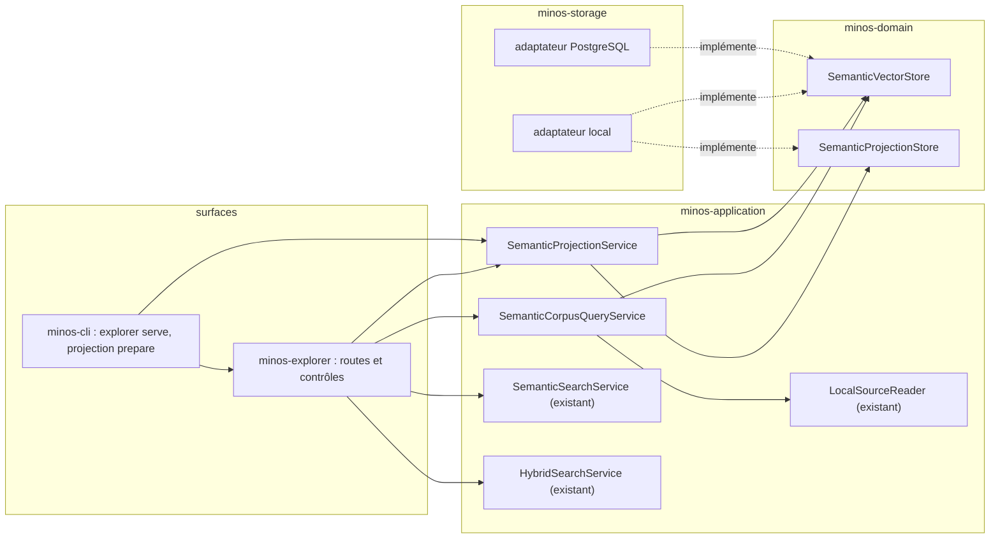
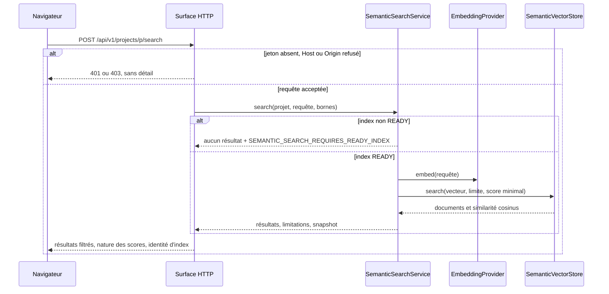
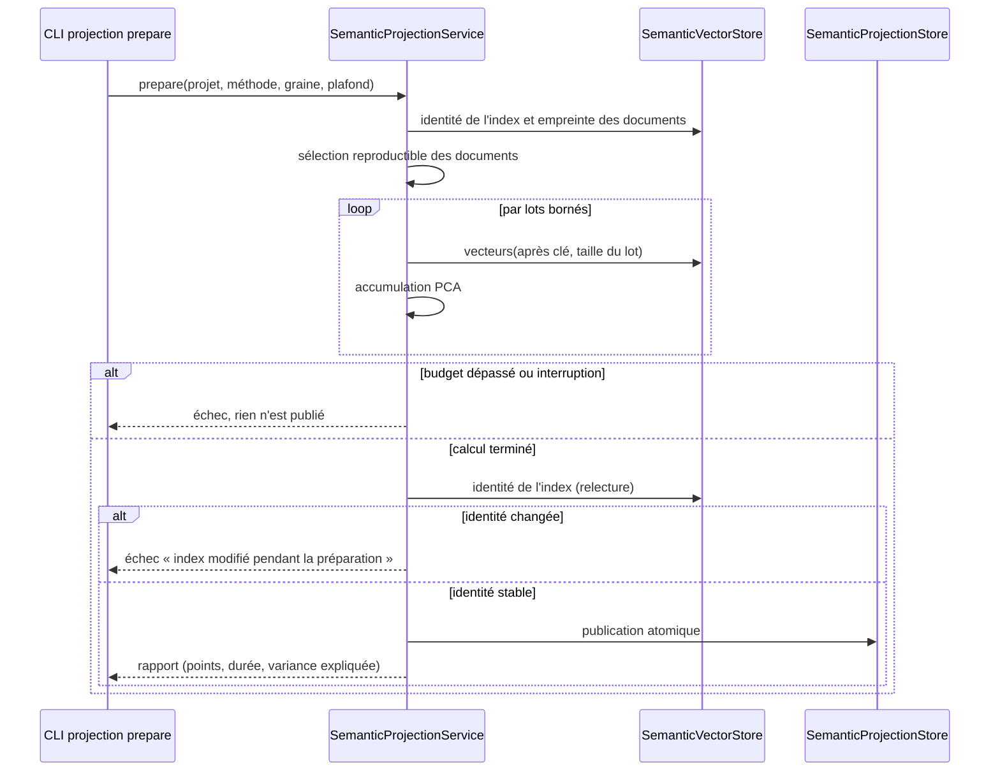
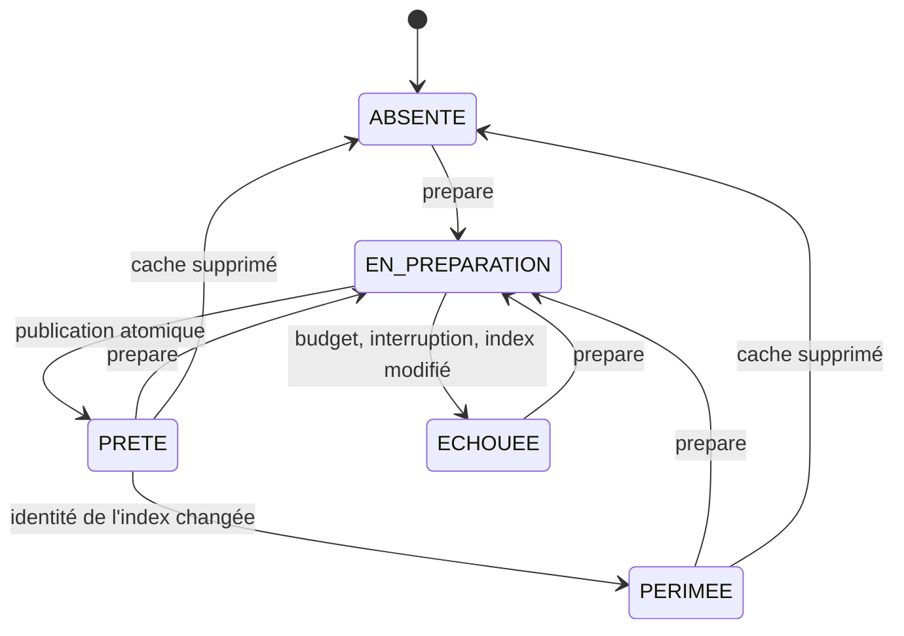
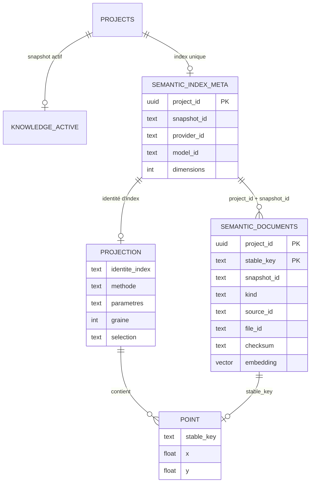

# Design

## Contexte

Motivation : voir `proposal.md` (Why). Étude complète, options écartées et sources : `docs/project/research/explorateur-vectoriel-2026-11/README.md` ; écrans : `CONCEPTION-FONCTIONNELLE.md` ; pgAdmin et SQL : `PGADMIN.md` ; maquette : `maquette/index.html` (même dossier).

Le changement ajoute une surface de consultation (HTTP locale) et un cache dérivé (projection) au-dessus de la couche sémantique existante, sans en modifier le classement. Il touche le port vectoriel du domaine, ses deux adaptateurs, les services applicatifs, la CLI, l'assemblage et le runtime Docker. Plateformes : Windows et Linux, runtimes natif et Docker.

**Périmètre après décision du 2026-11-13.** La spécification initiale est répartie en trois changements : `inspecter-postgresql-avec-pgadmin` (pgAdmin, D6), ce changement (lectures, surface HTTP, interface, runtime Docker) et `projeter-l-index-semantique-en-2d` (projection, D5 et D7). Ce document reste la conception commune : les sections et diagrammes sur pgAdmin et sur la projection y sont conservés et sont référencés par les deux autres designs ; leurs exigences et leurs tâches n'appartiennent plus à ce changement.

## État vérifié au HEAD

Commit `63e0c4ac5288ebd6d52b3462e40e7067d06b36ce` (`develop`, 2026-11-11). Aucun test n'a été exécuté pour cette étude : les faits ci-dessous sont des lectures de source.

| Fait | Preuve |
|---|---|
| Schéma créé par code, version 5 ; tables sémantiques en v1 | `minos-storage/src/main/java/com/minos/storage/postgresql/support/PostgresSchemaMigrator.java:10`, `:96-98` |
| `embedding vector` sans dimension déclarée ; aucun index vectoriel | `PostgresSchemaMigrator.java:97-98` |
| Lecture de tous les documents sans vecteurs, ordonnée par `stable_key`, non paginée | `minos-storage/src/main/java/com/minos/storage/postgresql/semantic/PostgresSemanticReadQueries.java:64-69` |
| Lecture des vecteurs seulement par chargement complet de l'index | `PostgresSemanticReadQueries.java:121-147` |
| Classement cosinus exact, départage par `stable_key` | `PostgresSemanticReadQueries.java:153-159` |
| Lectures additives du port à défaut dérivé de `load()` | `minos-domain/src/main/java/com/minos/semantic/SemanticVectorStore.java:51-71` |
| Écriture conditionnelle sous verrou de mutation du projet | `minos-storage/src/main/java/com/minos/storage/postgresql/semantic/PostgresSemanticVectorStore.java:82-110` |
| Construction des documents `SYMBOL`, `CHUNK`, `FILE` et de leurs identités | `minos-application/src/main/java/com/minos/application/semantic/SemanticDocumentFactory.java:78-113`, `:146-147` |
| États de l'index et limites `SNAPSHOT_STALE` / `MODEL_STALE` | `minos-application/src/main/java/com/minos/application/semantic/SemanticIndexService.java:106-109`, `:266` |
| Recherche refusée hors `READY` ; changement d'index détecté | `minos-application/src/main/java/com/minos/application/semantic/SemanticSearchService.java:38-69` |
| Score hybride `0,50/0,35/0,15` | `minos-application/src/main/java/com/minos/application/semantic/HybridSearchService.java:85` |
| Lecteur de sources confiné à la racine du projet | `minos-application/src/main/java/com/minos/context/LocalSourceReader.java:235-253` |
| Magasin local : `index-v2.bin`, plafond de 192 Mio de vecteurs décodés | `minos-storage/src/main/java/com/minos/storage/local/store/FileSemanticVectorStore.java:50`, `:56` |
| Services sémantiques assemblés dans `MinosApplication` | `minos-application/src/main/java/com/minos/application/MinosApplication.java:192-195` |
| Le MCP appelle la recherche sans contrôle de permission | `minos-mcp/src/main/java/com/minos/mcp/MinosApplicationMcpBackend.java:250-251` |
| `minos-mcp` monte les données en lecture seule ; `minos-postgres` sur réseau interne, sans port publié | `docker/compose-mcp.connected.yaml:63-67`, `:281-300`, `:393-394` |

Non mesuré : coût d'une PCA sur un index réel, latence d'une page de liste, fluidité du rendu, comportement de publication de port sur un réseau Docker interne.

## Écarts

| Écart | Source A | Source B | Suite proposée |
|---|---|---|---|
| La demande cite des contrôles « de permissions et d'isolation projet/tenant » à réutiliser | demande du 2026-11-12 | aucune permission de lecture par projet (`HostedPermission.java:4-14`) | MVP local seulement ; accès distant hors périmètre, décision séparée |
| La maquette d'origine suppose une table `code_chunks` et des colonnes module/langage | maquette jointe à la demande | schéma réel (`PostgresSchemaMigrator.java:97`) | module et langage résolus par le snapshot ; maquette refaite sur les champs réels |
| La demande cite un « score de reranking » | demande | aucun reranker au HEAD | la colonne n'existe pas dans l'interface |
| `.claude/rules/openspec.md` planifie un ADR en tâche ; la demande veut l'ADR proposé dès l'étude | règle OpenSpec | demande, et `.claude/rules/adr.md` (proposition portée par un changement en cours) | ADR créé `Proposed` le 2026-11-13, accepté et gardé au registre par le propriétaire le même jour |

## Exigences couvertes

| Exigence | Section |
|---|---|
| `exploration-semantique` › La surface d'exploration est optionnelle et n'écoute que sur la boucle locale | Sécurité et isolation ; D1 |
| `exploration-semantique` › Toute requête d'API exige le jeton de session et une origine locale | Sécurité et isolation |
| `exploration-semantique` › La surface d'exploration ne modifie aucun état | Responsabilités ; D4 |
| `exploration-semantique` › La liste des documents est paginée et lue sur un seul index | Contrats d'interface ; Transactions |
| `exploration-semantique` › Le détail distingue le contenu indexé de la source actuelle | Modèle de domaine ; Contrats |
| `exploration-semantique` › La recherche de l'explorateur rend le classement des services existants et nomme chaque score | Traitements ; Contrats |
| `exploration-semantique` › Les voisins d'un document sont classés depuis son vecteur stocké | Contrats ; D3 |
| `exploration-semantique` › Aucune réponse de l'explorateur n'expose de chemin absolu ni de secret | Sécurité et isolation |
| `exploration-semantique` › Le provider local-hash est signalé comme référence déterministe | Contrats |

## Objectifs et non-objectifs

Objectifs : consulter sans modifier ; réutiliser les services de recherche tels quels ; séparer consultation et préparation ; rester sans dépendance serveur nouvelle. Non-objectifs : remplacer le MCP, accélérer la recherche, offrir un accès distant.

## Responsabilités et frontières des composants

| Composant | Module | Responsabilité | Dépend de |
|---|---|---|---|
| `SemanticVectorStore` (lectures additives) | `minos-domain` | page de documents, vecteur d'un document, lots de vecteurs | — |
| `SemanticProjectionStore` (port nouveau) | `minos-domain` | lire et publier une projection dérivée | — |
| Adaptateurs local et PostgreSQL | `minos-storage` | implémenter les lectures sans charger l'index entier | domaine |
| `SemanticCorpusQueryService` | `minos-application` (`com.minos.application.semantic`) | liste, détail, voisins ; jointure document → symbole ; comparaison contenu/source | domaine, ports de lecture |
| `SemanticProjectionService` | `minos-application` | statut, points, préparation (PCA) | domaine |
| `SemanticExplorationApi` | `minos-api` | contrat Java public additif, DTO propres | application |
| Commandes `explorer serve`, `semantic projection …` | `minos-cli` | lancement, options, codes de sortie | application, surface |
| Surface HTTP | `minos-explorer` [Proposition] | routes, contrôles `Host`/`Origin`/jeton, ressources web | application (jamais un adaptateur) |

Direction respectée : `domain → storage → application → surfaces → minos-app` (ARCH-0068). Aucune exception. La surface ne lance aucun processus et ne lit aucun fichier hors `LocalSourceReader`. L'arête `minos-cli → minos-explorer` suit le précédent de la commande `mcp` (`minos-cli/src/main/java/com/minos/cli/MinosCliRunner.java:44`) ; sa conformité à `ALLOWED_DEPENDENCIES` (`scripts/architecture/check-module-boundaries.py:59`) est à vérifier par la tâche 2.1.

## Modèle de domaine et invariants

- **Identité d'index** : `(projectId, snapshotId, providerId, modelId, dimensions, empreinteDocuments)`, où `empreinteDocuments = sha256` des couples `stableKey`/`checksum` triés. Deux lectures portant la même identité lisent le même index.
- **Curseur de liste** : `(identité d'index, dernier stableKey)`. Invariant : un curseur n'est valide que pour son identité.
- **Projection** : identité d'index + `(méthode, versionMéthode, paramètres, graine, sélection)` ; contenu : pour chaque point `stableKey`, `x`, `y`. Invariants : tous les points viennent d'un seul index ; le nombre de points ≤ plafond ; les coordonnées sont finies.
- **Sélection** : natures retenues, plafond de points, graine d'échantillonnage. Rang d'un document : `sha256(graine ␟ stableKey)` ; sont retenus les `plafond` premiers rangs.
- **Détail** : `contenuIndexé` (toujours), `sourceActuelle` (optionnelle), `divergence ∈ {IDENTIQUE, DIFFERENTE, SOURCE_INTROUVABLE, NON_COMPARABLE}`. `NON_COMPARABLE` pour `SYMBOL` et `FILE`, dont le contenu est une synthèse.

## Traitements et interactions

Recherche : la surface valide jeton, hôte et origine, puis délègue au service existant ; les filtres s'appliquent aux résultats rendus, après classement. Préparation : la commande lit l'identité de l'index, tire la sélection, ajuste la PCA par lots, projette, revérifie l'identité, publie. Diagrammes en section « Diagrammes ».

## États et transitions

États d'une projection : `ABSENTE`, `EN_PREPARATION`, `PRETE`, `ECHOUEE`, `PERIMEE`. `PERIMEE` est calculé à la lecture (identité de l'index ≠ identité de la projection), jamais stocké. Diagramme en section « Diagrammes ».

## Contrats d'interface

Tous additifs. Autorisation de toutes les routes : jeton de session, `Host` et `Origin` locaux. Erreurs communes : `400` usage (message actionnable), `401` jeton, `403` hôte ou origine, `404` projet ou document, `409` identité d'index changée, `500` opaque.

| Opération | Route `/api/v1` | Entrées et bornes | Sortie | Cohérence |
|---|---|---|---|---|
| Projets | `GET /projects` | — | id, nom, état d'index, provider, modèle, dimensions, snapshots actif et indexé, nombre de documents, limitations | lecture du statut existant ; pas de racine absolue |
| Documents paginés | `GET /projects/{p}/documents` | `cursor`, `limit` 1–200 (défaut 50), `kind`, `module`, `language`, `filePrefix` | page, curseur suivant, identité d'index, total | `409` si l'identité du curseur diffère |
| Détail | `GET /projects/{p}/documents/{stableKey}` | — | champs du document, contenu indexé, source actuelle, divergence, symbole résolu | source lue par le lecteur confiné |
| Recherche | `POST /projects/{p}/search` | `query` ≤ 64 Kio, `mode` `semantic`\|`hybrid`, `limit` ≤ 1 000 / 500, `minimumScore`, filtres | résultats, nature de chaque score, limitations, identité d'index | bornes et détection de changement des services existants |
| Voisins | `GET /projects/{p}/documents/{stableKey}/neighbors` | `limit` 1–200 | voisins, similarité cosinus, identité d'index | même index que le document ; aucun appel provider |
| Statut de projection | `GET /projects/{p}/projection` | — | état, méthode, paramètres, graine, sélection, variance expliquée, nombre de points et de documents | `PERIMEE` calculé |
| Points projetés | `GET /projects/{p}/projection/points` | — | binaire : en-tête, puis `float32 x, y` et index de document ; table des `stableKey` paginée à part | refus si l'état n'est ni `PRETE` ni `PERIMEE` |

CLI : `minos explorer serve [--port N]` (code 0 à l'arrêt demandé, 2 erreur d'usage) ; `minos semantic projection prepare <projet> [--max-points N] [--seed N] [--kinds …]` ; `minos semantic projection status <projet>`. API Java : `SemanticExplorationApi`, contrat `1`, mêmes opérations ; `SemanticCodeIntelligenceApi` inchangée. MCP : aucun outil ajouté.

## Persistance et intégrité

- **Tables existantes** : inchangées. Aucune migration de schéma dans ce changement.
- **Cache de projection** [Proposition] : un fichier par projet sous `MINOS_HOME` (`semantic-projections/<projet>/projection-v1.bin`), pour les deux backends ; en-tête : magie, version de format, identité complète, méthode, paramètres, sélection, nombre de points ; corps : clés stables puis coordonnées `float32` ; empreinte SHA-256 en fin de fichier, vérifiée à la lecture. Dérivé et supprimable.
- En Docker, le fichier est écrit par `minos-admin` (données montées en écriture) et lu par le service d'exploration (lecture seule).

## Transactions, concurrence et idempotence

- Lectures de liste : une requête par page, chacune jointe à `semantic_index_meta` ; l'identité rendue avec la page permet de détecter un remplacement entre deux pages.
- Préparation : exclusive par projet (verrou de fichier) ; identité relue avant publication, échec si elle a changé ; publication par remplacement atomique d'un fichier temporaire. Relance : remplace la projection ; une préparation identique rend un fichier identique.
- Interruption : le fichier temporaire est abandonné ; la projection précédente reste lisible.

## Sécurité et isolation

Contrôles détaillés : étude § 6 et ADR ARCH-0082. Points de conception : jeton de 256 bits comparé en temps constant ; `Host` contre une liste fermée ; refus de tout `Origin` étranger ; aucune en-tête CORS, aucun cookie ; CSP `default-src 'self'` ; réponses JSON avec `nosniff` ; identifiants de document uniquement, jamais de chemin fourni par le client ; aucune racine absolue en sortie ; délai par requête et nombre de requêtes simultanées plafonnés ; refus de démarrage en mode équipe. Les E/S du cache passent par les primitives privées (`check-private-io.py`).

## Erreurs et reprise

Erreurs d'usage actionnables (borne nommée, commande à lancer) ; erreurs internes opaques, cause sur `stderr` sans chemin absolu. Une préparation en échec laisse l'état `ECHOUEE` avec une cause publique et n'altère pas la projection précédente.

## Observabilité

Journaux sur `stderr` : démarrage (adresse, port, sans jeton), requêtes refusées (motif, sans valeur d'en-tête), préparation (progression par lots, durée, mémoire). Aucune métrique exportée.

## Performance et mesure

Aucun seuil n'est fixé : [Question]. Stratégie : corpus synthétiques `local-hash` de 1 000 et 10 000 documents (256 dimensions), index réel d'environ 25 000 documents (`docs/project/governance/STATUS.md:61`), corpus de 100 000 documents sur PostgreSQL (à 768 dimensions, il dépasse le plafond du magasin local, `FileSemanticVectorStore.java:56`). Relevés : durée et tas de la préparation, taille du cache, latence d'une page, taille de la charge des points, délai du premier rendu. Windows et Linux. Cibles provisoires : étude § 5.4.

## Compatibilité, migration et retour arrière

Tout est additif ; aucune donnée existante n'est migrée. Retour arrière : retirer les commandes et le module ; supprimer le dossier `semantic-projections` ; retirer le profil `pgadmin` et le rôle d'inspection. Rien d'autre ne reste.

## Diagrammes

### Qui parle à quoi, vu de l'extérieur ?

Type : vue C4 de contexte (flowchart) · Portée : cible proposée · Exigences : `exploration-semantique` › La surface d'exploration est optionnelle et n'écoute que sur la boucle locale

Le navigateur ne joint ni PostgreSQL ni le provider. pgAdmin lit la base sans passer par MINOS : ses accès ne reproduisent pas les règles applicatives.

### Quels conteneurs et quels réseaux en runtime Docker ?

Type : vue C4 de conteneurs (flowchart) · Portée : cible proposée · Exigences : `distribution-docker` › pgAdmin est un service optionnel publié sur la seule boucle locale

`minos-explorer` et `minos-pgadmin` sont les seuls services à deux réseaux ; `minos-postgres` reste sans port publié. La préparation de projection s'exécute dans `minos-admin`, seul plan à écrire les données.

### Quels composants et quelles dépendances ?

Type : vue de composants (flowchart) · Portée : cible proposée · Exigences : `exploration-semantique` › La surface d'exploration ne modifie aucun état

Les surfaces ne voient que les services ; les adaptateurs implémentent les ports du domaine et sont choisis par la racine de composition.

### Comment se déroule une recherche, refus compris ?

Type : sequenceDiagram · Portée : cible proposée · Exigences : `exploration-semantique` › Toute requête d'API exige le jeton de session et une origine locale ; › La recherche de l'explorateur rend le classement des services existants et nomme chaque score

La surface n'ajoute ni classement ni cache : elle filtre les résultats rendus et nomme les scores.

### Comment une projection est-elle préparée sans toucher au chemin de recherche ?

Type : sequenceDiagram · Portée : cible proposée · Exigences : `exploration-semantique` › La préparation d'une projection est une commande explicite et bornée ; › Une projection est publiée atomiquement et liée à l'identité de son index

Aucun service de recherche n'est appelé ; la commande ne vectorise rien.

### Par quels états passe une projection ?

Type : stateDiagram-v2 · Portée : cible proposée · Exigences : `exploration-semantique` › Une projection est publiée atomiquement et liée à l'identité de son index

`PERIMEE` est constaté à la lecture. Pendant une nouvelle préparation, la projection précédente reste lisible avec son état.

### Quelles identités relient document, index, snapshot et projection ?

Type : erDiagram · Portée : tables existantes vérifiées, `PROJECTION` proposée · Exigences : `exploration-semantique` › La liste des documents est paginée et lue sur un seul index

Les relations entre tables existantes sont logiques : aucune clé étrangère ne les porte (`PostgresSchemaMigrator.java:80-98`). `source_id` et `file_id` renvoient au snapshot structurel, hors SQL.

## Décisions

### D1 — Surface HTTP locale, optionnelle, en lecture seule
[Décision — propriétaire, 2026-11-13] ADR ARCH-0082 (Accepted). Écartés : application web séparée, export statique, framework serveur (étude § 4).

### D2 — Module `minos-explorer`
[Décision — propriétaire, 2026-11-13] Une surface par module, comme `minos-mcp`. Écarté : package dans `minos-cli` (deux transports dans un module). Compromis : un module de plus dans le reactor et dans `ALLOWED_DEPENDENCIES`.

### D3 — Lectures additives à défaut dérivé sur `SemanticVectorStore`
[Décision — propriétaire, 2026-11-13] Même procédé que `documents` et `checksums`. Écarté : requêtes SQL dans le service (surface ↛ adaptateur, stockage local non couvert).

### D4 — Préparation séparée de la consultation
[Décision — propriétaire, 2026-11-13] Aligné sur BE-0029 et sur le montage en lecture seule du plan de requête Docker.

### D5 — PCA en Java pour le premier incrément
[Décision — propriétaire, 2026-11-13] Déterministe, bornée, sans dépendance, projette de nouveaux points. Écartés à ce stade : UMAP (dépendance et licence à décider), t-SNE (pas de projection de nouveaux points). Compromis : lisibilité de la carte non garantie ; variance expliquée affichée.

### D6 — pgAdmin en service Compose optionnel, rôle `minos_inspect`
[Décision — propriétaire, 2026-11-13] Détail : `PGADMIN.md`. Le rôle est créé par une action d'administration explicite, jamais par `PostgresSchemaMigrator`.

### D7 — Cache de projection en fichier
[Décision — propriétaire, 2026-11-13] Aucune migration de schéma. Écarté à ce stade : tables PostgreSQL (schéma v6).

## Qualification des capacités

| Capacité | Qualification | Limite |
|---|---|---|
| Liste, détail, voisins, recherche — natif, stockage local | **non supportée** (à qualifier au lot 2) | — |
| Idem — natif, PostgreSQL externe | non supportée (lot 2) | — |
| Idem — runtime Docker | non supportée (lot 2b) | service et réseau d'entrée à qualifier |
| Natif vers PostgreSQL géré | **non supportée, sans cible** | base non joignable de l'hôte |
| Carte 2D (PCA) | non supportée (lot 3) | qualité exploratoire à mesurer |
| UMAP, 3D, WebGL | non supportées, sans engagement | décision mesurée |
| Accès distant | non supportée, sans cible | décision séparée |
| pgAdmin — PostgreSQL géré | non supportée (lot 1) | — |
| pgAdmin — PostgreSQL externe | non supportée, hors périmètre | — |

Windows : `jdk.httpserver` dans le runtime embarqué à vérifier. Linux : aucun comportement propre identifié.

## Risques et compromis

- [Risque] Contrôle `Host`/`Origin` incomplet → tests de refus exigés par les scénarios, revue de sécurité dédiée.
- [Risque] Carte PCA peu lisible → variance affichée, lot 4 mesuré.
- [Risque] Module `jdk.httpserver` absent du runtime Windows → test de démarrage sur la distribution.
- [Risque] pgAdmin avec accès sortant par le réseau d'entrée → service hors profil par défaut, vérification de mises à jour désactivée.
- [Risque] Jointure document → symbole coûteuse sur un grand snapshot → réutiliser la vue de snapshot en cache (DATA-0024), mesurer.

## Vérification

À écrire avec l'implémentation : tests de contrat des lectures additives sur les deux adaptateurs ; tests de la surface (refus, bornes, absence d'écriture) ; test d'égalité de classement avec la CLI ; test de reproductibilité de la préparation ; tests PostgreSQL des droits du rôle. Gates : `check-module-boundaries.py`, `check-private-io.py`, `check-compose-limits.py`, `check-image-pins.py`, `check-comment-language.py`, `check-capability-dossiers.py`. Non vérifiable localement : comportement dans un navigateur réel (test manuel), publication de port Docker (test sur un poste avec Docker).

Vérifié pour cette spécification : `openspec validate --all --strict` ; script de la maquette exécuté sous Node avec un DOM factice, sur les 17 états.

## Documentation durable à mettre à jour

À la livraison de chaque lot : `docs/architecture/diagrams/capacites/exploration-semantique.md` (nouveau), `docs/architecture/diagrams/capacites/distribution-docker.md`, `docs/user/` (explorateur, pgAdmin, `docker-runtime.md`), `docs/developer/` (surface, contrats), `docs/architecture/diagrams/module-dependencies.md` (généré), ADR ARCH-0082 (« Mise en œuvre »), `STATUS.md`, `ROADMAP.md`.

## Traçabilité

Aucun test n'existe : chaque ligne est « à écrire ».

| Exigence (capacité › titre) | Scénario | Conception ou diagramme | Tâche | Test ou preuve |
|---|---|---|---|---|
| exploration › surface optionnelle, boucle locale | Aucune écoute sans la commande | D1 ; contexte | 4.1–4.2 | à écrire |
| idem | Écoute limitée à la boucle locale | D1 | 4.1–4.2 | à écrire |
| idem | Refus en mode équipe | Sécurité | 4.1–4.2 | à écrire |
| exploration › jeton et origine locale | Requête sans jeton | séquence de recherche | 4.3–4.4 | à écrire |
| idem | Hôte détourné | Sécurité | 4.3–4.4 | à écrire |
| idem | Page tierce | Sécurité | 4.3–4.4 | à écrire |
| exploration › aucun état modifié | Données inchangées après consultation | composants | 4.5–4.6 | à écrire |
| exploration › liste paginée | Parcours complet | Contrats | 3.1–3.2 | à écrire |
| idem | Taille de page hors bornes | Contrats | 3.1–3.2 | à écrire |
| idem | Index remplacé entre deux pages | Transactions | 3.1–3.2 | à écrire |
| exploration › contenu indexé et source | Source modifiée depuis l'indexation | Modèle | 3.5–3.6 | à écrire |
| idem | Source introuvable | Modèle | 3.5–3.6 | à écrire |
| exploration › classement et scores | Même classement que la CLI | séquence de recherche | 5.1–5.2 | à écrire |
| idem | Index non prêt | séquence de recherche | 5.1–5.2 | à écrire |
| exploration › voisins | Provider indisponible | D3 | 3.3–3.4 | à écrire |
| idem | Document inconnu | Contrats | 3.3–3.4 | à écrire |
| exploration › aucun chemin ni secret | Fiche de projet | Sécurité | 4.7–4.8 | à écrire |
| idem | Contenu indexé contenant du HTML | Sécurité | 4.7–4.8 | à écrire |
| exploration › local-hash | Index local-hash | Contrats | 5.3–5.4 | à écrire |

## Questions ouvertes

Tranchées par le propriétaire le 2026-11-13 (« oui pour toutes les recommandations ») : ARCH-0082 acceptée et gardée au registre ; module `minos-explorer` ; cache de projection en fichier ; aucun accès de `minos_inspect` à `knowledge_snapshots` ni à `indexing_runs` ; lot Docker (tâche 5.7) avant la carte.

| # | Question | Recommandation |
|---|---|---|
| 1 | Seuils de performance | à fixer après la première mesure (changement `projeter-l-index-semantique-en-2d`, tâche 6.8) |
| 2 | Port par défaut et ouverture du navigateur | port éphémère, URL sur `stderr`, pas d'ouverture automatique |
