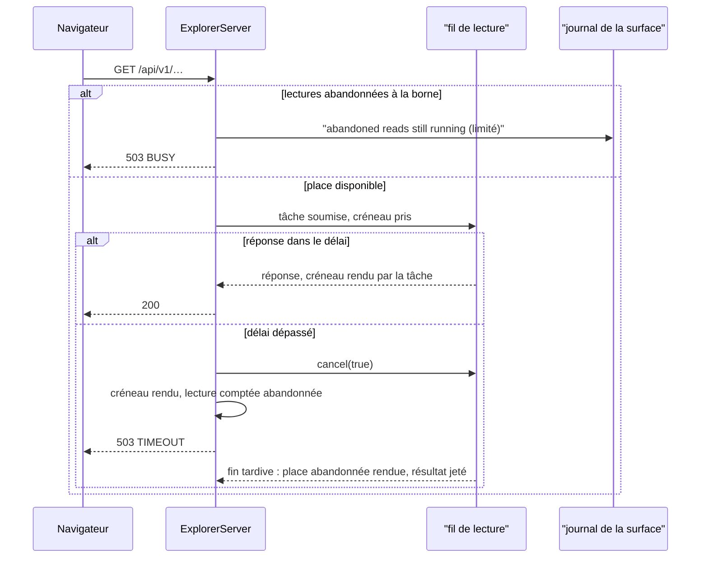
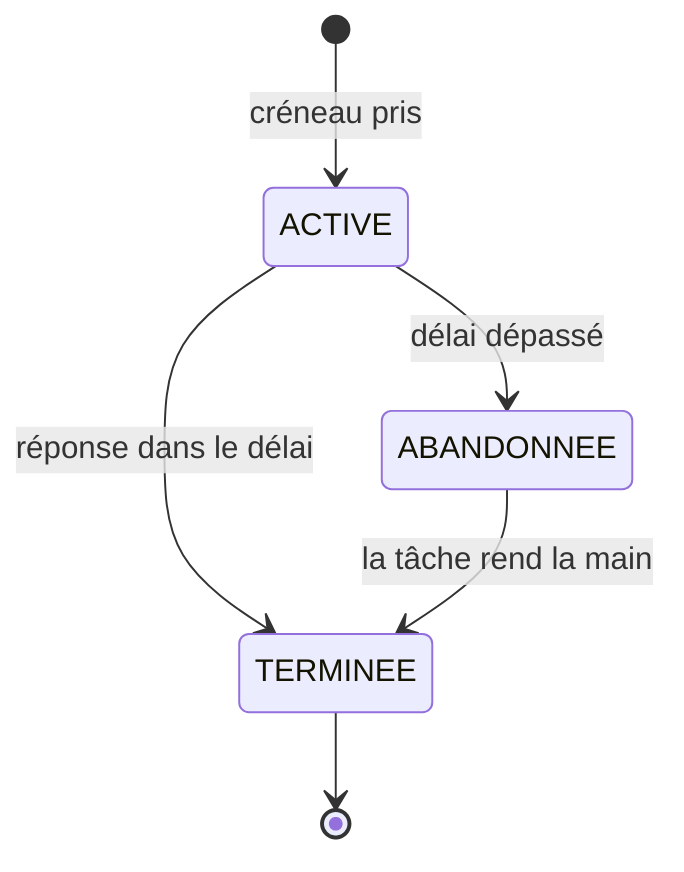

# Design

## Contexte

Motivation : voir `proposal.md` (Why). Le changement traite d'un bloc `ExplorerServer` et `ExplorerApi`
(`minos-explorer`), plus la rotation du journal dans le Compose connecté. Il consomme deux prérequis du même sprint :
le composant de trace (`tracer-les-echecs-internes-des-surfaces`) et `UsageException`
(`distinguer-l-erreur-d-usage-de-l-echec-interne`). Surface publique : l'API HTTP locale de l'explorateur (contrat v1).

## État vérifié au HEAD

HEAD `89be3fb4`. Vérification par lecture ; aucun build ni test exécuté.

| Fait | Preuve |
|---|---|
| [Existant vérifié] `serve` journalise chaque refus (`refused request: <raison>`) avant de répondre | `minos-explorer/src/main/java/com/minos/explorer/ExplorerServer.java:193-197` |
| [Existant vérifié] Trois raisons de refus : `HOST` (403), `ORIGIN` (403), `TOKEN` (401) | `RequestGuard.java:30-31` |
| [Existant vérifié] Trois sites écrivent `request failed: <nom simple de classe>` ; pour une `ExecutionException`, la classe de la cause directe, jamais la cause racine | `ExplorerServer.java:203-206`, `:275-276`, `:294-296` |
| [Existant vérifié] Le journal est un `Consumer<String>` branché sur stderr avec le préfixe `explorer: ` | `ExplorerServer.java:76` ; `ExplorerSession.java:82-84`, `:102-108` |
| [Existant vérifié] `ExplorerApi.answer` rend toute IAE en `400 INVALID_REQUEST` (message assaini) sans appeler `failures` | `ExplorerApi.java:133-135` |
| [Existant vérifié] Les validations de `ExplorerApi` et de `JsonObjectReader` lèvent des IAE simples | `ExplorerApi.java:219`, `:336`, `:345`, `:353`, `:361` ; `JsonObjectReader.java:25-134` |
| [Existant vérifié] Les validations de requête du service lèvent des IAE simples (clé vide ou trop longue) | `minos-application/src/main/java/com/minos/application/semantic/SemanticCorpusQueryService.java:421-426` |
| [Existant vérifié] `call` rend `400` pour une adresse mal formée en attrapant toute IAE, y compris celle que `URLDecoder.decode` lève sur un échappement cassé (`%zz`) | `ExplorerServer.java:253-261`, `:314`, `:329-330` ; `ExplorerServerTest.java:275`, `:285` |
| [Existant vérifié] Le corps est lu à la demande par `ExplorerApi` ; l'IAE du corps trop gros est donc rendue `400` par `ExplorerApi.answer`, pas par `call` | `ExplorerServer.java:275`, `:300-308` ; `ExplorerApi.java:217`, `:133-135` |
| [Existant vérifié] `minos-explorer` ne déclare `minos-engine` qu'en portée de test, et sa table A11 est vide | `minos-explorer/pom.xml:34-47` ; `scripts/architecture/check-module-boundaries.py:590-591` |
| [Existant vérifié] Une clé de document contient `/` et voyage encodée (`file%3Asrc%2FA%2Bb.java`) | `ExplorerServerTest.java:271-272` ; `app.js:367`, `:431` |
| [Existant vérifié] Le scénario en vigueur « Données inchangées après consultation » compare l'arborescence de `MINOS_HOME` | `openspec/specs/exploration-semantique/spec.md:48-54` |
| [Existant vérifié] Un test de contrat lit le service Compose de l'explorateur | `minos-app/src/test/java/com/minos/packaging/ExplorerComposeServiceContractTest.java` |
| [Existant vérifié] 4 créneaux (`Semaphore`), 4 fils de lecture, file de 4 ; créneau rendu dans le `finally` de la tâche ; au délai, `cancel(true)` puis `503 TIMEOUT` sans libération | `ExplorerServer.java:45`, `:71`, `:98-100`, `:268-289` |
| [Existant vérifié] Le test du délai utilise un traitement **interruptible** | `minos-explorer/src/test/java/com/minos/explorer/ExplorerServerTest.java:322-341` |
| [Existant vérifié] `segments` ne refuse que le segment vide et le caractère nul ; la javadoc annonce aussi le segment point | `ExplorerServer.java:310-321` |
| [Existant vérifié] La page encode la clé de document dans un segment (`encodeURIComponent`) | `minos-explorer/src/main/resources/com/minos/explorer/web/app.js:367`, `:431` |
| [Existant vérifié] Délais finis des lectures : socket PostgreSQL 120 s ; embeddings 30 s par défaut, réglable | `PostgresConnectionFactory.java:25`, `:572` ; `OllamaEmbeddingProvider.java:42` ; `MinosApplication.java:69-70` |
| [Existant vérifié] `minos-explorer` et `minos-pgadmin` n'ont pas de clé `logging` ; aucune occurrence de `logging` ni `max-size` dans `docker/*.yaml` | `docker/compose-mcp.connected.yaml:108-163`, `:469` |
| [Existant vérifié] Tests existants qui lisent les lignes de journal actuelles | `ExplorerServerTest.java:103`, `:219`, `:393` |
| Non vérifié : le comportement réel d'une lecture PostgreSQL face à l'interruption | — |

## Écarts

| Écart | Source A | Source B | Suite proposée |
|---|---|---|---|
| AUD-SEC-03 propose un `statement_timeout` ou un délai réseau sous le délai de requête ; ces réglages sont ceux de la fabrique de connexions partagée par toutes les surfaces, et le critère de sortie demande que la requête abandonnée « libère son créneau » | `findings.json`, AUD-SEC-03, action | `PostgresConnectionFactory.java:25` ; `sprints.md:75` | Libération du créneau à l'abandon + borne des lectures abandonnées (D3) ; délai de lecture propre à l'explorateur laissé au propriétaire (D4) |
| Libérer le créneau ne suffit pas : les 4 fils restent occupés par les lectures abandonnées, la requête suivante attendrait en file jusqu'à son propre délai | AUD-SEC-03, impact | `ExplorerServer.java:98-100` | Fils dimensionnés pour créneaux + lectures abandonnées, borne commune (D3) |
| AUD-SEC-04 propose de refuser aussi un `%2F` décodé ; une clé de document contient `/` et voyage encodée dans un segment | AUD-SEC-04, action | `ExplorerServerTest.java:271-272` ; `app.js:367`, `:431` | « . » et « .. » refusés ; `/` décodé laissé accepté et dit par la javadoc (D5) |
| AUD-SEC-02 ne nomme que `minos-explorer` et pgAdmin ; `minos-mcp`, `minos-postgres` et `minos-ollama` n'ont pas non plus de rotation | AUD-SEC-02, action | `docker/compose-mcp.connected.yaml` (aucune clé `logging`) | Périmètre de l'audit tenu ; extension en D6 |
| La rotation peut faire sortir du journal la ligne de l'adresse à jeton, seule source de l'adresse en Docker | AUD-SEC-02, action | `docs/user/docker-runtime.md:381-383` | Limitation des refus avant la rotation ; conséquence documentée (redémarrer le service pour une nouvelle adresse) |
| AUD-QUA-02 propose un journal sous `MINOS_HOME/logs` ; en Docker, `minos-explorer` monte `MINOS_HOME` en lecture seule | AUD-QUA-02, action | `compose-mcp.connected.yaml:139-140` | Ligne stderr enrichie partout ; journal privé en installation native seulement (qualification) |
| AUD-QUA-01 : le `400` de `ExplorerServer.call` (adresse) attrape aussi toute IAE, dont celle du JDK sur un échappement cassé | AUD-QUA-01, preuve (`ExplorerApi` seul) | `ExplorerServer.java:259-261`, `:314` | Validations converties en erreur d'usage, IAE de `URLDecoder` enveloppée, avant la bascule (tâche 2.2) |
| Brancher la surface sur un journal de `minos-engine` exigerait une dépendance de compilation nouvelle et une entrée au cliquet A11 | AUD-QUA-02, action | `minos-explorer/pom.xml:34-47` ; `check-module-boundaries.py:590-591` | Façade `InternalFailureReporter` de `minos-application` (D1) |
| Journal privé actif et scénario en vigueur « Données inchangées après consultation » | `openspec/specs/exploration-semantique/spec.md:48-54` | AUD-QUA-02, action | Tranché en D7 : scénarios ajoutés, exigence existante inchangée |

## Exigences couvertes

| Exigence | Section |
|---|---|
| exploration-semantique › Un échec interne de l'explorateur laisse une ligne de diagnostic avec sa cause racine | D1 |
| exploration-semantique › L'explorateur ne rend 400 que pour une erreur d'usage explicite | « Erreurs et reprise » |
| exploration-semantique › Les refus de l'explorateur sont journalisés avec limitation | D2 |
| exploration-semantique › Une requête de l'explorateur abandonnée au délai libère son créneau | D3 |
| exploration-semantique › Les lectures abandonnées encore en cours sont bornées et dites | D3 |
| exploration-semantique › Un segment de chemin point ou point-point est refusé | D5 |
| distribution-docker › Le journal des services Docker publiés sur la boucle locale est borné | D6 |

## Objectifs et non-objectifs

Objectif : une surface qui dit ce qui échoue, ne se laisse ni saturer ni noyer. Non-objectifs : accélérer les
lectures (sprint 4), changer le contrat des routes, journaliser les requêtes réussies.

## Responsabilités et frontières des composants

| Composant | Rôle |
|---|---|
| `ExplorerServer` | Garde, bornes, délai, comptage des lectures abandonnées ; délègue toute ligne de journal au composant ci-dessous |
| journal de la surface (classe interne au package `com.minos.explorer`, nom proposé `ExplorerDiagnostics`) | **Seul** point d'écriture : démarrage, échec interne (par la façade `InternalFailureReporter`), refus et saturations agrégés ; horloge injectable |
| `ExplorerApi` | Classification : erreurs métier connues, `UsageException` → `400`, reste → `failures` et `500` |
| `SemanticCorpusQueryService` (`minos-application`) | Validations de requête levées en `UsageException` |

`minos-explorer` compile contre `minos-domain` et `minos-application` ; `minos-engine` n'y est déclaré qu'en portée
de test (`minos-explorer/pom.xml:34-47`). La surface n'importe donc que `InternalFailureTrace` (`minos-domain`) et la
façade `InternalFailureReporter` (`minos-application`, `com.minos.application.diagnostics`), livrées par
`tracer-les-echecs-internes-des-surfaces` : le pom n'est pas modifié, la table A11 de `minos-explorer` reste vide
(`check-module-boundaries.py:590-591`), direction ARCH-0068 respectée.

## Modèle de domaine et invariants

- Créneaux : `actives + abandonnées ≤ MAX_CONCURRENT_API_CALLS + MAX_ABANDONED_READS`, et `actives ≤
  MAX_CONCURRENT_API_CALLS`. Une lecture est « abandonnée » de l'expiration de son délai à la fin de sa tâche.
- Journal : pour chaque raison (trois refus, « saturé »), au plus une ligne par fenêtre ; un compteur des événements
  tus, vidé dans la ligne suivante.
- Aucune ligne ne contient d'adresse, de paramètre, d'en-tête ni de jeton ; la route est nommée par son motif
  (`projects/{project}/documents/{key}`), tiré de l'énumération des routes.

## Traitements et interactions

Voir le diagramme « Que devient une requête d'API qui dépasse le délai ? ». Pour un échec interne : `ExplorerApi`
passe l'exception à `failures` ; le journal de la surface demande à `InternalFailureReporter` la référence et la
ligne, qui propose la pile au journal privé, et `ExplorerApi` rend `500` avec la référence.

## États et transitions

Voir le diagramme « Par quels états passe une lecture ? » : `EN_FILE → ACTIVE → TERMINÉE` ou
`ACTIVE → ABANDONNÉE → TERMINÉE`. Une lecture abandonnée dont la tâche finit rend sa place ; son résultat est jeté.

## Contrats d'interface

API HTTP v1 (`ExplorerContract`), changements additifs :

| Cas | Avant | Après |
|---|---|---|
| Échec interne | `500 INTERNAL_ERROR`, message fixe | idem, message suivi de ` (ref <8 hex>)` |
| Erreur d'argument interne | `400 INVALID_REQUEST`, message de l'exception assaini | `500 INTERNAL_ERROR` |
| Segment `.` ou `..` | route inconnue (`404`) ou appel de service | `400 INVALID_REQUEST`, message fixe |
| Délai dépassé | `503 TIMEOUT`, créneau tenu | `503 TIMEOUT`, créneau libéré |
| Lectures abandonnées à la borne | `503 BUSY` (créneaux pleins) | `503 BUSY` (même code, même message) |

Lignes stderr (préfixe `explorer: ` inchangé) : `request failed (route=…, type=…, rootCause=…, at=…, ref=…)` ;
`refused requests: <raison> (<n> since the previous line)` ; `abandoned reads still running: <n> (limit <m>)`.
Les tests existants qui lisent `refused request: token` et `request failed: IllegalStateException` sont adaptés.

Compose : `logging: { driver: json-file, options: { max-size: …, max-file: … } }` sur les deux services.

## Persistance et intégrité

Non applicable : la surface n'écrit aucune donnée ; le journal privé, quand il est actif en installation native, est
celui de `tracer-les-echecs-internes-des-surfaces`.

## Transactions, concurrence et idempotence

Le créneau est rendu **une seule fois** par requête : soit par la tâche à sa fin, soit par le fil d'échange à
l'expiration du délai, arbitrés par un indicateur atomique porté par la requête ; la place « abandonnée » est prise
dans la même transition et rendue par la fin de la tâche. Les compteurs du journal sont atomiques ; l'écriture d'une
ligne de résumé est exclusive par raison. À l'arrêt, `shutdownNow` n'attend aucune lecture.

## Sécurité et isolation

- Règle 7 : aucune adresse, valeur ni cause interne dans une réponse ; lignes stderr sans chemin ni jeton.
- AUD-SEC-02 : une page tierce ne peut plus faire croître le journal qu'à un rythme borné par la fenêtre.
- AUD-SEC-03 : la surface reste disponible tant que les lectures bloquées sont sous la borne ; à la borne elle refuse
  (fail-closed) au lieu d'empiler des fils. Le déni de service exige le jeton : il reste local.
- AUD-SEC-04 : la garantie annoncée par la javadoc devient vraie et testée.
- La surface reste en lecture seule ; l'exigence « La surface d'exploration ne modifie aucun état » est inchangée et
  son rapport au journal privé est tranché en D7.

## Erreurs et reprise

`ExplorerApi` : `DocumentNotFoundException` → 404, `IndexChangedException` → 409, `ResolutionException` → 400/404
(inchangés ; `DocumentNotFoundException` hérite de `UsageException` et garde sa branche, placée avant) ;
`UsageException` → 400, corps trop gros compris (levé par la lecture du corps, attrapé ici) ; toute autre exception
→ `failures` + 500. `ExplorerServer.call` : adresse mal formée → `UsageException` → 400 ; l'IAE que
`URLDecoder.decode` lève sur un échappement cassé est enveloppée en `UsageException` dans `segments` et `parameters`.
Aucune reprise : chaque requête est indépendante.

## Observabilité

Critère unique de journalisation de la surface : trois familles de lignes (démarrage, échec interne, événements
agrégés), toutes écrites par le même composant, toutes sans donnée de requête. Les compteurs de refus et de lectures
abandonnées n'existent que dans ces lignes (pas de route de métriques).

## Performance et mesure

Aucun objectif chiffré. Les lectures abandonnées s'ajoutent aux lectures actives : sur stockage local, chacune peut
charger l'index vectoriel entier (AUD-PERF-03, sprint 4). La borne est donc petite ; sa valeur est une [Proposition]
(D3) à confirmer sur le banc du sprint 1 (AUD-PERF-13) quand il existe.

## Compatibilité, migration et retour arrière

Contrat v1 conservé (mêmes routes, mêmes codes). Un client qui affichait le message d'un `400` d'origine interne voit
un `500` opaque : c'est le correctif. Retour arrière : par fichier, sans donnée à migrer. La rotation Compose
s'applique à la recréation du conteneur.

## Diagrammes

### Que devient une requête d'API qui dépasse le délai ?

Type : sequenceDiagram · Portée : cible · Exigences : exploration-semantique › Une requête de l'explorateur abandonnée
au délai libère son créneau ; exploration-semantique › Les lectures abandonnées encore en cours sont bornées et dites

Existant : la branche « délai dépassé » ne rend pas le créneau. Cible : le créneau est rendu par celui qui constate
l'abandon, et la lecture qui traîne ne compte plus que dans la borne des abandonnées.

### Par quels états passe une lecture ?

Type : stateDiagram-v2 · Portée : cible · Exigences : idem

`ABANDONNEE` est le seul état nouveau ; il est borné et visible dans le journal.

## Décisions

### D1 — Un seul point d'écriture du journal de la surface

[Proposition] Les trois sites `request failed` et le site `refused request` passent par un composant unique, qui
utilise la façade `InternalFailureReporter` de `minos-application` pour l'échec interne (aucun type de `minos-engine`
nommé, pom inchangé). Alternative écartée : aligner seulement l'explorateur sur le MCP
(« à défaut » de l'audit) sans composant commun — trois formats de ligne à maintenir.

### D2 — Limitation des refus

[Proposition] Première occurrence immédiate par raison, puis une ligne de résumé par raison et par fenêtre de 60 s
(valeur de confort, injectée dans les tests). Alternative écartée : ne plus journaliser les refus (on perd le signal
d'une page hostile ou d'un jeton périmé).

### D3 — Créneau rendu à l'abandon, lectures abandonnées bornées

[Proposition] `MAX_ABANDONED_READS = 4` ; fils de lecture = créneaux + borne. Alternatives écartées : rendre le
créneau sans borne (les fils s'empilent sans limite) ; fils virtuels (une lecture bloquée sur un verrou ou du calcul
n'est pas libérée pour autant, et la mémoire n'est pas bornée).

### D4 — Délai de lecture propre à l'explorateur (en attente du propriétaire)

Options : (a) aucun dans ce lot : les délais finis existants (120 s, 30 s) vident les lectures abandonnées ;
(b) délai de requête PostgreSQL et d'embeddings inférieur à 30 s pour les lectures de l'explorateur.
**Recommandation : (a)**, et reprendre (b) avec AUD-PERF-03 (sprint 4), qui touche les mêmes lectures : (b) change la
fabrique de connexions partagée et demande une mesure.

### D5 — Segments : « . » et « .. » refusés, `/` décodé accepté (en attente du propriétaire)

Options : (a) refuser `.` et `..` seulement ; (b) refuser aussi un `/` ou un `\` décodé. **Recommandation : (a)** —
une clé de document contient `/` et voyage encodée dans un segment (`ExplorerServerTest.java:271-272`) ; (b) rendrait
ces documents inaccessibles. La javadoc dit exactement ce qui est refusé. À revoir si une route mappe un jour
un segment sur un chemin.

### D6 — Rotation du journal Docker : périmètre (en attente du propriétaire)

[Proposition] `max-size: 1m`, `max-file: "2"` (valeurs de l'audit) sur `minos-explorer` et `minos-pgadmin`.
Options de périmètre : (a) ces deux services ; (b) tous les services de longue durée des deux fichiers Compose, par
une ancre commune. **Recommandation : (a) dans ce lot**, (b) dans un changement de `distribution-docker` : le journal
de `minos-mcp` porte les lignes de diagnostic et mérite une taille choisie, pas héritée.

### D7 — Le journal privé face à « Données inchangées après consultation »

[Proposition, alignée sur la décision D9 de `tracer-les-echecs-internes-des-surfaces` et portée par son ADR] Le
scénario en vigueur relève une arborescence de `MINOS_HOME` identique après des consultations ; il reste vrai tel
quel : réglage de diagnostic absent, la surface n'écrit rien, même sur échec interne. Réglage actif, une consultation
qui réussit n'écrit rien non plus ; seule une requête qui échoue en interne ajoute un fichier sous
`logs/internal-failures/`, hors de l'index et des données de requête. L'exigence ajoutée sur l'échec interne porte les
deux scénarios qui le fixent ; aucune exigence existante n'est modifiée. En Docker la question ne se pose pas
(données en lecture seule : journal indisponible).

## Qualification des capacités

| Capacité | Qualification |
|---|---|
| Ligne d'échec interne, limitation des refus, créneau libéré, segments | visées **qualifiées** sous Windows et Linux, par tests |
| Pile au journal privé depuis l'explorateur | **qualifiée** en installation native ; **non supportée** en Docker (données en lecture seule) |
| Rotation du journal | **qualifiée** par le gate statique ; effet réel sur un conteneur : tâche manuelle 4.3 |
| Disponibilité face à une lecture PostgreSQL réellement bloquée | **partielle** : prouvée avec un traitement simulé, non mesurée sur PostgreSQL |

## Risques et compromis

- [Risque] Plus de lectures simultanées (créneaux + abandonnées) → mémoire sur stockage local → borne petite, citée à
  AUD-PERF-03.
- [Risque] La rotation fait disparaître l'adresse à jeton → refus limités d'abord, conséquence documentée.
- [Risque] Une erreur d'usage oubliée devient `500` → table des entrées invalides dans `ExplorerRoutesTest`,
  conversion avant bascule.
- [Compromis] Une lecture réellement bloquée sans fin occupe une place abandonnée jusqu'à l'arrêt du processus.

## Vérification

- Tests à écrire : `ExplorerDiagnosticsTest` (ligne d'échec interne, limitation, horloge injectée).
- Tests à étendre : `ExplorerServerTest` (lecture qui ignore l'interruption, borne, retour à la normale, arrêt ;
  lignes `:103`, `:219`, `:393` adaptées), `ExplorerRoutesTest` et `ExplorerProjectionRoutesTest` (table des entrées
  invalides, IAE interne → 500), `ExplorerUnitsTest` (segments).
- Gates : `check-compose-limits.py` et `test_check_compose_limits.py`, `check-image-pins.py`,
  `scripts/install/test_mcp_lifecycle_pgadmin.py`, `check-module-boundaries.py` (A11 : table de `minos-explorer`
  toujours vide), `check-private-io.py`, `check-comment-language.py` ; `M29Docker*ContractTest`,
  `ExplorerComposeServiceContractTest` et `ModuleArchitectureTest` (`minos-app`).
- Non vérifiable localement sans Docker : la rotation effective (tâche manuelle).

## Documentation durable à mettre à jour

`docs/architecture/diagrams/capacites/exploration-semantique.md` (diagrammes ci-dessus) et `distribution-docker.md` ;
`docs/user/semantic-explorer.md` ; `docs/user/docker-runtime.md` (« Service optionnel `minos-explorer` ») ;
skill `minos-incident-triage` (lire les lignes de la surface).

## Traçabilité

| Exigence (capacité › titre) | Scénario | Conception ou diagramme | Tâche | Test ou preuve |
|---|---|---|---|---|
| exploration-semantique › Un échec interne de l'explorateur laisse une ligne de diagnostic avec sa cause racine | Exception enveloppée ; Aucune donnée de requête ; Échec hors d'une route | D1 | 1.1, 1.2 | à écrire : `ExplorerDiagnosticsTest` |
| idem | Journal privé inactif ; Journal privé actif | D7 | 1.1, 1.2 | à écrire : `ExplorerDiagnosticsTest` |
| exploration-semantique › L'explorateur ne rend 400 que pour une erreur d'usage explicite | Paramètre invalide ; Erreur d'argument levée par un service ; Les erreurs d'usage du contrat restent des 400 | « Erreurs et reprise » | 2.1, 2.2, 2.3 | à étendre : `ExplorerRoutesTest`, `ExplorerProjectionRoutesTest` |
| exploration-semantique › Les refus de l'explorateur sont journalisés avec limitation | les trois scénarios | D2 | 1.1, 1.3 | à écrire : `ExplorerDiagnosticsTest` |
| exploration-semantique › Une requête de l'explorateur abandonnée au délai libère son créneau | Lectures qui ignorent l'interruption | D3, diagramme 1 | 3.1, 3.2 | à étendre : `ExplorerServerTest` |
| exploration-semantique › Les lectures abandonnées encore en cours sont bornées et dites | les trois scénarios | D3, diagramme 2 | 3.1, 3.2 | à étendre : `ExplorerServerTest` |
| exploration-semantique › Un segment de chemin point ou point-point est refusé | les deux scénarios | D5 | 2.4 | à étendre : `ExplorerUnitsTest` |
| distribution-docker › Le journal des services Docker publiés sur la boucle locale est borné | les trois scénarios | D6 | 4.1, 4.2 | à étendre : `test_check_compose_limits.py` ; effet réel manquant jusqu'à 4.3 |

## Questions ouvertes

- D4, D5, D6 : décisions du propriétaire, recommandations ci-dessus ; aucune ne change le découpage. D7 suit la
  décision D9 de `tracer-les-echecs-internes-des-surfaces`.
- [Question] non bloquante : valeur de `MAX_ABANDONED_READS` à confirmer par mesure (banc du sprint 1).
