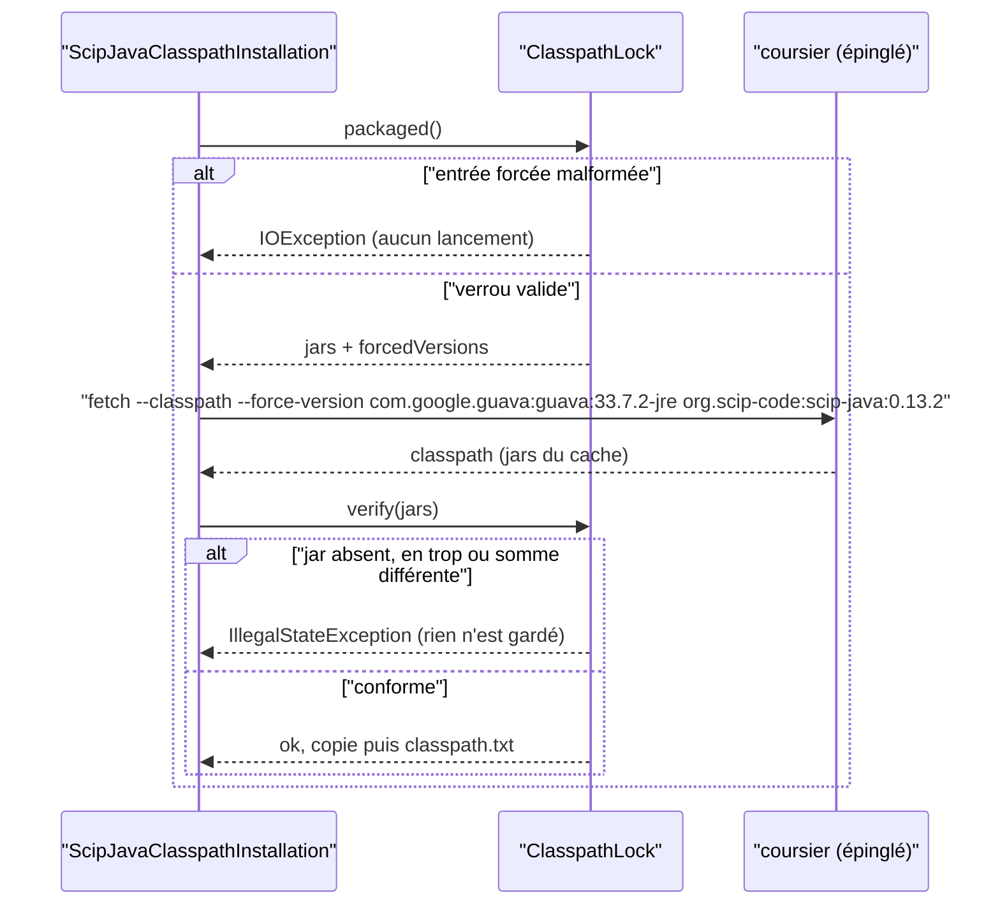

# Design

## Contexte

La motivation est dans `proposal.md` (Why). Le changement touche le seul module `minos-provider-scip` : sa ressource de verrou, la lecture du verrou et la commande de résolution de l'installation de scip-java. Il touche aussi deux scripts Python, celui de construction des outils embarqués et le gate du catalogue, ainsi que deux fichiers de données (verrou et dérogations). Aucune surface publique ne change. Plateformes : Linux pour l'installation réelle et l'indexation sous bubblewrap ; Windows pour la construction du paquet. scip-java y reste `BLOCKED` à l'exécution (SEC-0074).

## État vérifié au HEAD

Relu au commit `3cadc4ca` (branche `deps/forcer-guava-dans-le-classpath-de-scip-java`, partie de `develop`), le 2026-11-10.

| Fait | Preuve |
|---|---|
| [Existant vérifié] Le verrou épingle scip-java 0.13.2 et **70** jars (lignes 5 à 74 ; 70 occurrences de `"sha256"`), comme l'annoncent le registre et `supply-chain.md:179,193`. Le fichier fait 76 lignes. | `minos-provider-scip/src/main/resources/com/minos/adapter/scip/runtime/scip-java-classpath.lock.json:2-3,5-74` |
| [Existant vérifié] guava épinglé : `guava-33.6.0-jre.jar`, 3 064 793 octets, SHA-256 `dc573e1f…13b3`. Voisins qui pourraient bouger : `error_prone_annotations-2.41.0.jar` (l. 13), `failureaccess-1.0.3.jar` (l. 14), `jspecify-1.0.0.jar` (l. 23). Ni `listenablefuture` ni `j2objc-annotations` ne figurent au verrou. | `scip-java-classpath.lock.json:13,14,16,23` |
| [Existant vérifié] Origine de guava selon le registre : maven-core 3.9.16 et guice 5.1.0, tirés par `kotlin-scripting-dependencies-maven` 2.4.21 de scip-java. Les trois jars sont au verrou. Cette chaîne n'a **pas** été rejouée par une résolution (pas de Coursier sur le poste, aucune commande lancée). | `docs/architecture/risks/register.md:25` ; `scip-java-classpath.lock.json:17,31,39` |
| [Existant vérifié] **Aucun script ne génère le verrou.** `build-embedded-tools.py` résout (`fetch --classpath <coordonnée>`, sans forçage) puis **compare** au verrou. Son message d'erreur conseille `--update-classpath-lock`, mais `main()` ne déclare que `--platform`, `--output`, `--cache` et `--sbom`. Le verrou actuel a été produit à la main (mesure 2.1 de SUIVI, en 74 jars à l'époque de scip-java 0.13.1). | `scripts/release/build-embedded-tools.py:206-235` (fetch l. 215, vérification l. 233), `:183-195`, `:342-348` ; `docs/project/audits/2026-10-10/SUIVI.md:94` |
| [Existant vérifié] L'installation chez l'utilisateur résout par `coursier fetch --classpath org.scip-code:scip-java:0.13.2` et compare chaque jar au verrou avant de garder quoi que ce soit. Un guava 33.6.0 résolu contre un verrou en 33.7.2 ferait donc **échouer l'installation**. | `minos-provider-scip/src/main/java/com/minos/adapter/scip/runtime/install/ScipJavaClasspathInstallation.java:41-55` ; `ClasspathLock.java:89-111` |
| [Existant vérifié] `ClasspathLock.parse` lit `coordinate` et `jars` et ignore tout autre champ. Un champ `forcedVersions` ajouté au verrou ne casse pas un lecteur existant. | `ClasspathLock.java:56-74` |
| [Existant vérifié] Trois tests figent la commande exacte de résolution : ils deviendront rouges quand le forçage sera appliqué. | `ClasspathLockTest.java:138` ; `ManagedScipProviderRuntimeManagerRuntimeTest.java:138-139` ; `ManagedScipProviderRuntimeManagerTest.java:27-30` |
| [Existant vérifié] Aucun test ne fige le nombre de jars : seulement « plus de 10 ». | `ClasspathLockTest.java:109` |
| [Existant vérifié] Le gate du catalogue contrôle coordonnée, version, forme des entrées et présence du jar de scip-java. Il ne connaît aucun forçage. | `scripts/quality/check-tools-manifest.py:153-190` |
| [Existant vérifié] La veille interroge chaque jar du verrou comme paquet Maven. Le groupe de guava (`com.google.guava`) est déjà dans `CLASSPATH_GROUPS`. Une dérogation qui ne correspond plus à aucun constat **échoue** : la retirer est obligatoire dès que guava est monté. | `scripts/quality/check-embedded-tools-advisories.py:21,116,130,359-382` ; test `test_a_waiver_that_matches_no_finding_is_refused` (l. 782) |
| [Existant vérifié] La seule dérogation de la veille est `scip-java-classpath` / `GHSA-xxph-c9ww-hj94`, jusqu'au 2027-01-28. | `scripts/quality/embedded-tools-advisory-waivers.json:4-11` |
| [Existant vérifié] Le catalogue déclare le verrou sur l'entrée assemblée `scip-java-classpath` (`windows-x64`, recette `coursier-fetch`). L'installation Linux ne lit pas cette entrée : elle lit le verrou par sa ressource. | `embedded-tools.json:230-241` ; `ClasspathLock.java:33,47-54` |
| [Existant vérifié] La CI Linux installe scip-java par MINOS (`minos tools install scip-java`, Coursier épinglé vérifié par SHA-256). Elle indexe ensuite hors ligne, sous le bac à sable exigé, une fixture Maven de confiance. C'est la preuve d'indexation réelle attendue. | `.github/workflows/pr-ci.yml:401-409` ; `scripts/ci/qualify-linux-offline-maven-index.sh:92-109` |
| [Existant vérifié] Deux autres résolutions de scip-java ignorent le verrou : le repli du lanceur Windows sans `ClasspathFile` (`fetch --classpath $ScipCoordinate`) et le lanceur autonome de l'image Docker (`cs bootstrap`). | `scip-java-windows-runner.ps1:236-243,379-384` ; `docker/Dockerfile.mcp.release:264-272` |
| [Existant vérifié] Coursier déclare `forceVersion: List[String]`, `@ValueDescription("organization:name:forcedVersion")`, alias `-V`, dans les options de résolution que `fetch` partage. Son acceptation par le lanceur **épinglé** (commit `15f36c16…`) n'est pas mesurée. | `coursier/coursier`, `modules/cli/src/main/scala/coursier/cli/options/ResolutionOptions.scala:25-29` (branche `main`, lue le 2026-11-10) |
| [Existant vérifié] guava 33.7.2-jre existe sur Maven Central. Calculé localement sur le jar téléchargé : 3 057 659 octets, SHA-256 `b530942257fb935f8b2cfaa5f8eb5bd59c555fd8e8d01b8ce98912e077ea606c` (égal au `.sha256` publié), SHA-1 `e70def5b…0dbc` (égal au `.sha1` publié). | `https://repo.maven.apache.org/maven2/com/google/guava/guava/33.7.2-jre/` |
| [Existant vérifié] Entre guava-parent 33.6.0-jre et 33.7.2-jre, `jspecify` passe de 1.0.0 à 1.0.1 et `error_prone_annotations` de 2.47.0 à 2.50.0. `failureaccess` reste en 1.0.3, `j2objc` en 3.1. Le verrou garde aujourd'hui error_prone 2.41.0 (et non 2.47.0) : la résolution réelle dépend donc d'exclusions de l'arbre et ne se prédit pas sans Coursier. | POM `guava-parent-33.6.0-jre.pom`, `guava-parent-33.7.2-jre.pom` ; `scip-java-classpath.lock.json:13,23` |
| [Existant vérifié] Aucun `check-*.py` ne cite la commande de fetch ni `scipJavaFetchCommand`. Seul le script de construction la porte (l. 215). | `grep -rn "fetch.*--classpath\|scipJavaFetchCommand" scripts` |

Non mesuré : la résolution réelle avec `--force-version` (aucun Coursier lancé), le fonctionnement de scip-java 0.13.2 avec guava 33.7.2, et la liste exacte des jars voisins qui changeront.

## Écarts

| Écart | Source A | Source B | Suite proposée |
|---|---|---|---|
| L'option de régénération est conseillée mais n'existe pas | `build-embedded-tools.py:195` | `build-embedded-tools.py:343-347` | L'ajouter (tâche 2.2) |
| La règle « un jar du verrou ne se remplace pas seul » est écrite comme une impossibilité | `register.md:25`, `supply-chain.md:215` | Coursier `--force-version` | Nouvel ADR (D1) et texte proposé pour les fichiers partagés |
| Le repli Windows et le lanceur Docker résolvent scip-java sans verrou, donc sans forçage | `scip-java-windows-runner.ps1:237` ; `Dockerfile.mcp.release:268` | ADR BE-0065 § 12 | Décision du propriétaire (D6), hors colonne |
| La spec de référence décrit « Le plan d'indexation Linux, qui relance encore Coursier » comme hors capacité, alors que la fabrique ne résout plus par coordonnée | `openspec/specs/installation-des-providers/spec.md:4` | `ScipJavaProcessPlanFactory.java:37-41` | Signalé, non traité ici (le `## Purpose` ne fait pas partie du delta) |

## Exigences couvertes

- installation-des-providers › Une version forcée du classpath de scip-java est nominative et justifiée : D2, D3, « Persistance et intégrité ».
- installation-des-providers › L'installation de scip-java applique les versions forcées du verrou : D3, « Traitements et interactions ».
- installation-des-providers › Le verrou de scip-java se régénère par le script de construction avec ses versions forcées : D3, D4, « Traitements et interactions ».

## Objectifs et non-objectifs

Objectif : un forçage déclaré à un seul endroit (le verrou), lu par les deux résolveurs du dépôt (installation Java et script de construction) et contrôlé par le gate du catalogue. Non-objectifs : un mécanisme générique de substitution de jar, un forçage de version de scip-java lui-même, une résolution par coordonnée au moment de l'indexation.

## Responsabilités et frontières des composants

| Composant | Responsabilité | Change |
|---|---|---|
| `scip-java-classpath.lock.json` | Source unique : jars épinglés et `forcedVersions` | Données |
| `ClasspathLock` (`minos-provider-scip`, package `…runtime.install`) | Lit et valide `forcedVersions`, expose la liste | Code (hors colonne) |
| `ScipJavaClasspathInstallation.scipJavaFetchCommand` | Construit `fetch --classpath [--force-version m:v]… <coordonnée>` à partir du verrou | Code (hors colonne) |
| `build-embedded-tools.py` | Même commande ; `--update-classpath-lock` réécrit le verrou | Script (colonne) |
| `check-tools-manifest.py` | Refuse un forçage incomplet, en double ou non épinglé | Gate (hors colonne) |

La direction des dépendances (ARCH-0068) est inchangée : tout reste dans `minos-provider-scip` (adaptateur) et dans `scripts/`. Aucun nouveau package, aucune dépendance Maven.

## Modèle de domaine et invariants

Champ ajouté au verrou :

```json
"forcedVersions": [
  {"module": "com.google.guava:guava", "version": "33.7.2-jre",
   "advisory": "GHSA-xxph-c9ww-hj94",
   "reason": "R-29: guava 33.6.0-jre (maven-core 3.9.16, guice 5.1.0) is affected; fixed in 33.7.2, shipped by no scip-java release."}
]
```

Invariants vérifiables par le gate et par `ClasspathLock` :
1. `module` a la forme `organisation:nom` (deux segments non vides, sans espace) ; `version`, `advisory` et `reason` sont non vides.
2. Un module apparaît au plus une fois.
3. `<nom>-<version>.jar` figure dans `jars`.
4. Le module forcé n'est pas scip-java lui-même : le forçage corrige une dépendance transitive, pas la version du provider.
5. Champ absent ou liste vide : aucun forçage, comportement actuel.

## Traitements et interactions

Installation (Linux et poste Windows) : `ClasspathLock.packaged()` lit le verrou. Une entrée malformée lève une `IOException` **avant** tout lancement. `scipJavaFetchCommand(coursier, lock)` ajoute ensuite une option `--force-version` par entrée, dans l'ordre du verrou, avant la coordonnée. `fetchVerifiedClasspath` lance la commande, puis `lock.verify(jars)` compare comme aujourd'hui.

Construction : `build_classpath_tree` construit la même commande à partir du verrou chargé. Avec `--update-classpath-lock`, le script résout, contrôle que chaque module forcé est résolu à sa version (le jar `<nom>-<version>.jar` est présent), puis écrit le verrou par fichier temporaire et remplacement. Les jars sont triés par nom, la taille et le SHA-256 sont recalculés, `coordinate`, `version` et `forcedVersions` sont conservés. Sans l'option, il compare comme aujourd'hui.

Voir le diagramme « Qui applique le forçage, et quand le verrou refuse-t-il ? ».

## États et transitions

Non applicable : aucun cycle de vie nouveau. L'état « classpath installé » reste celui de « L'installation range une copie vérifiée du classpath de scip-java ».

## Contrats d'interface

- **Script** `scripts/release/build-embedded-tools.py` : option nouvelle `--update-classpath-lock` (booléenne, facultative). Code 0 : succès et verrou réécrit. Code 1 : `EMBEDDED TOOLS BUILD FAILED: <raison>` sur stderr, verrou intact. Sortie additive, sans changement des options existantes. Idempotent : rejouée sur une résolution identique, elle réécrit le même verrou, octet pour octet.
- **Format persisté** `scip-java-classpath.lock.json` : champ facultatif `forcedVersions` (additif). Les lecteurs existants l'ignorent (`ClasspathLock.java:56-74`, `check-tools-manifest.py:153-190`).
- **Commande Coursier** : `fetch --classpath --force-version <org>:<nom>:<version> … <coordonnée>`. Aucune sous-commande `launch` (« L'installation n'exécute pas scip-java pour en lire la version » reste vraie).
- CLI, API Java publique, MCP et goldens : inchangés.

## Persistance et intégrité

Le verrou reste la référence d'intégrité. Chaque jar, guava forcé compris, est comparé par taille et SHA-256 à l'installation, avant chaque plan d'indexation et à la construction du paquet. Le forçage ne retire aucune vérification. Il change seulement ce que Coursier résout, et le verrou continue de refuser tout écart.

## Transactions, concurrence et idempotence

`--update-classpath-lock` écrit un fichier temporaire voisin puis le renomme (`os.replace`). Un échec laisse le verrou d'origine. L'installation garde son répertoire partiel et sa bascule (`ScipJavaClasspathInstallation.java:120-149`).

## Sécurité et isolation

- Fail-closed : une entrée forcée malformée fait échouer l'installation avant Coursier. Un module forcé non résolu à sa version fait échouer la régénération. Un jar différent du verrou fait échouer l'installation comme aujourd'hui.
- Intégrité de ce qui est exécuté (règle 4) : guava 33.7.2 n'est exécuté qu'après la comparaison à la somme du verrou, calculée par le script depuis le cache Coursier. Elle est recoupée avec Maven Central (`b530942257fb…606c`).
- Aucun nouveau processus, aucun environnement nouveau. Les messages nomment le module ou le jar, jamais un chemin.
- La veille continue d'interroger guava, désormais en 33.7.2-jre.

## Erreurs et reprise

Messages en anglais, sans chemin : `the scip-java classpath lock is malformed` (entrée forcée invalide, message existant réutilisé) ; `the forced module com.google.guava:guava was not resolved at 33.7.2-jre` (script). Reprise : corriger le verrou ou relancer la régénération.

## Observabilité

`scip-java-install.log` contient déjà la commande lancée, désormais avec ses `--force-version`. La sortie de la veille cite `com.google.guava:guava 33.7.2-jre` parmi les paquets interrogés.

## Performance et mesure

Non applicable : une option de résolution de plus, sans effet mesurable à l'échelle d'une installation.

## Compatibilité, migration et retour arrière

Une installation existante (classpath en guava 33.6.0) ne se vérifie plus contre le nouveau verrou. `installedClasspathVerifies` renvoie faux et MINOS réinstalle, chemin existant (`ScipJavaClasspathInstallation.java:95-108`). Le paquet Windows est reconstruit avec le nouveau verrou. Retour arrière : revenir au commit précédent du verrou et rétablir la dérogation. Aucune donnée persistée côté utilisateur n'est migrée.

## Diagrammes

### Qui applique le forçage, et quand le verrou refuse-t-il ?

Type : sequenceDiagram · Portée : cible · Exigences : installation-des-providers › L'installation de scip-java applique les versions forcées du verrou ; › Le verrou de scip-java se régénère par le script de construction avec ses versions forcées



L'installation lit le forçage dans le verrou qui sert ensuite à la vérification. Le forçage et le contrôle ne peuvent donc pas diverger. Le script de construction suit le même déroulé. Avec `--update-classpath-lock`, il écrit le verrou au lieu de le comparer, après avoir contrôlé les versions forcées.

## Décisions

### D1 — Nouvel ADR plutôt qu'amendement de BE-0065

[Décision] Écrire un nouvel ADR, domaine `SEC` : `SEC-<n>-forcage-nominatif-d-une-dependance-du-verrou-de-scip-java.md`. Le numéro se lit dans l'index `docs/architecture/adr/README.md` au moment de la réalisation (le plus haut au `3cadc4ca` est 0079, soit 0080). BE-0065 § 12 reçoit une ligne de renvoi dans « References ». Raisons :
- BE-0065 est `Accepted` et consolide les ADR 0032 et 0040. La règle documentaire interdit de réécrire une décision acceptée (`.claude/rules/documentation.md`, ADR). Le forçage change le modèle de confiance : le verrou n'est plus le reflet exact de la résolution amont.
- C'est un choix entre options réelles (attendre scip-java, forcer, remplacer un jar à la main, retirer scip-java) et il engage durablement le catalogue et la veille.
- Domaine `SEC` : il relève de l'intégrité de la chaîne d'approvisionnement (règles 4 et 10 de `.claude/rules/securite.md`), comme SEC-0074.

- Ce n'est pas un amendement partiel au sens de `.claude/rules/adr.md` : BE-0065 § 12 reste vrai à la lettre. Le classpath résolu à l'installation est toujours comparé jar par jar au verrou. La décision nouvelle porte sur la façon de **produire** le verrou, que BE-0065 ne tranche pas. La règle « un jar ne se remplace pas seul » n'est écrite que dans `supply-chain.md` et le registre, pas dans un ADR. Aucun ADR consolidé n'est donc requis.
- L'ADR porte des `Do's and Don'ts` vérifiables, tenus par `check-tools-manifest.py`. Une règle Archgate compagnon (`.rules.ts`) qui lit le verrou est facultative : la tâche 3.4 la juge.

Alternative écartée : amender BE-0065 en place. Cela réécrirait une décision acceptée, ou exigerait un ADR consolidé qui remplace BE-0065 en entier, coût disproportionné.

Contenu de l'ADR : les trois conditions du propriétaire (listé avec sa raison dans le verrou déclaré par le catalogue ; vérifié par somme ; prouvé par une indexation Java réelle), un forçage par avis, un module nominatif, jamais scip-java lui-même, à retirer dès qu'une version de scip-java embarque la correction.

### D2 — Le forçage se déclare dans le verrou

[Proposition] `forcedVersions` vit dans `scip-java-classpath.lock.json`, que le catalogue déclare (`embedded-tools.json:237`). Les deux résolveurs le lisent déjà : l'installation Java par sa ressource, le script par `load_classpath_lock`. Il n'y a qu'une source, sans nouvelle lecture du catalogue côté Java. Alternative : un champ dans `embedded-tools.json`, sur l'entrée assemblée `scip-java-classpath`. Mais cette entrée est propre à `windows-x64`, et l'installation Linux ne la lit pas. Il faudrait étendre `EmbeddedToolsCatalog.Assembled` et dupliquer la donnée, ou la faire contrôler pour l'égalité. Conséquence : `embedded-tools.json` ne change pas, sauf sa phrase `description` si le propriétaire veut y voir le forçage nommé (voir Questions ouvertes, 1).

### D3 — Une seule forme de commande, construite depuis le verrou

[Décision] Ordre : `fetch`, `--classpath`, puis `--force-version <module>:<version>` par entrée dans l'ordre du verrou, puis la coordonnée. Le script et l'installation Java produisent la même liste d'arguments, testée des deux côtés. `ManagedScipProviderRuntimeManager.SCIP_JAVA_COORDINATE` reste la coordonnée.

### D4 — Forcer guava seul ; les jars voisins suivent la résolution

[Proposition] Seul `com.google.guava:guava` est forcé. Si la résolution fait aussi bouger `jspecify` (1.0.0 → 1.0.1) ou `error_prone_annotations`, le verrou régénéré l'enregistre. Le diff du verrou est relu jar par jar dans la PR et décrit dans la tâche 3.2. Aucun forçage de plus n'est ajouté pour garder les anciennes versions : ce serait forcer des modules sans avis, contraire au caractère nominatif. Le nombre de jars peut donc rester 70 ou changer. `supply-chain.md:179,193` cite 70 : à mettre à jour avec la valeur mesurée (texte proposé ci-dessous, à compléter).

### D5 — Point d'arrêt

[Décision du propriétaire] Si scip-java 0.13.2 échoue avec guava 33.7.2 (tests du module ou indexation réelle), on s'arrête. Le verrou, la dérogation et R-29 restent tels qu'au HEAD, et l'ADR passe `Rejected` avec la preuve de l'échec (tâche 4.3).

### D6 — Le repli Windows et le lanceur Docker

[Question] Deux résolutions hors verrou existent (voir « Écarts »). Options : (a) leur appliquer aussi le forçage, avec le lanceur Windows lisant le verrou et le Dockerfile recevant `--force-version` synchronisé par `sync-tools-manifest.py` ; (b) les laisser, en écrivant dans l'ADR qu'elles sont hors du verrou. Recommandation : (b) pour ce changement. Le repli Windows n'est atteint que sans classpath installé, alors que Windows est `BLOCKED`. L'image Docker n'exécute aucun provider. Le Dockerfile serait un autre changement. À trancher par le propriétaire.

## Qualification des capacités

- Forçage nominatif dans le verrou et gate : **qualifié** après les tâches 1 et 2 (tests Python et Java, Windows et Linux).
- Installation avec version forcée : **qualifiée** sous Linux par la CI (`pr-ci.yml:401-409`) ; sous Windows, la construction du paquet est qualifiée, l'exécution reste `BLOCKED` (SEC-0074).
- scip-java 0.13.2 avec guava 33.7.2 : **non qualifié** au HEAD. La preuve est l'indexation réelle de la tâche 4 ; sans elle, le changement s'arrête (D5).

## Risques et compromis

- [Risque] scip-java ou Kotlin scripting utilise une API de guava changée en 33.7 → indexation réelle obligatoire avant clôture, point d'arrêt D5.
- [Risque] Le lanceur Coursier épinglé n'accepte pas `--force-version` → tâche 2.1 le prouve d'abord. À défaut, la forme courte `-V` est essayée ; sinon arrêt.
- [Risque] La résolution fait bouger d'autres jars → D4, diff relu, veille rejouée.
- [Compromis] Le verrou ne reflète plus la résolution amont pure : c'est l'objet de l'ADR, et le forçage est daté et nominatif.

## Vérification

- Python : `python scripts/quality/test_check_tools_manifest.py`, `python scripts/release/test_build_embedded_tools.py`, `python scripts/quality/check-tools-manifest.py`, `python scripts/quality/check-embedded-tools-advisories.py --self-test`, `python .claude/scripts/run_gates.py --fast`.
- Java : `./mvnw -B -ntp -pl minos-provider-scip -am test`. Classes concernées : `ClasspathLockTest`, `ScipJavaClasspathInstallationTest`, `ManagedScipProviderRuntimeManagerTest`, `ManagedScipProviderRuntimeManagerRuntimeTest`, `EmbeddedToolsCatalogTest`. Jamais deux builds Maven en parallèle sur le poste.
- Régénération : `python scripts/release/build-embedded-tools.py --update-classpath-lock --output target/tools-regen` sous Windows (lanceur `windows-x64` embarqué). Puis la même commande sans l'option, qui doit réussir.
- Veille réelle : `python scripts/quality/check-embedded-tools-advisories.py`, qui exige le réseau (code 2 sans verdict si l'API OSV est injoignable).
- Indexation réelle : étape CI « Offline Maven index under the Linux sandbox » de la PR. Localement si WSL2 est préparé (recette `qualify-linux-offline-maven-index.sh`).
- Pas de scope JaCoCo spécifique : le code neuf de `minos-provider-scip` est jugé par SonarCloud (80 %), ses tests restent dans le module.

## Documentation durable à mettre à jour

- `docs/architecture/diagrams/capacites/installation-des-providers.md` : traçabilité des trois exigences ajoutées (hors colonne, requis par `check-capability-dossiers.py` à l'archivage).
- Nouvel ADR, index `docs/architecture/adr/README.md` et `docs/architecture/arc42/09-decisions.md` (hors colonne pour l'index et arc42).
- `docs/developer/supply-chain.md`, `docs/architecture/risks/register.md`, `docs/project/audits/2026-10-10/SUIVI.md` : fichiers partagés, texte proposé ci-dessous.

## Texte proposé pour les fichiers partagés

Ce texte n'est pas appliqué par ce changement. Le propriétaire, ou la session qui tient ces fichiers, le reporte.

**`docs/architecture/risks/register.md`, ligne R-29** (remplace la ligne actuelle) :

> | R-29 | Un avis OSV sur le classpath verrouillé de scip-java 0.13.2 (`scip-java-classpath.lock.json`, AUD-DEP-03) : `GHSA-xxph-c9ww-hj94` (guava 33.6.0-jre) | — | — | — | **Résolu le <date de fusion>** (changement OpenSpec `forcer-guava-dans-le-classpath-de-scip-java`, PR #<n>) | guava est forcé en 33.7.2-jre dans le verrou par un forçage nominatif ([ADR SEC-<n>](../adr/SEC-<n>-forcage-nominatif-d-une-dependance-du-verrou-de-scip-java.md)) : entrée `forcedVersions` avec l'avis et sa raison, somme SHA-256 vérifiée à l'installation et avant chaque indexation, indexation Java réelle sous bubblewrap prouvée par la CI Linux (run <id>). La dérogation de `embedded-tools-advisory-waivers.json` est retirée. Le forçage se retire dès qu'une version de scip-java embarque guava ≥ 33.7.2. |

**`docs/architecture/risks/register.md`, ligne R-30** : remplacer la colonne de statut par :

> **Accepté jusqu'au 2027-01-31** (dérogation du 2026-10-31, commit `9e9144b6`) ; demande de correction de l'avis préparée, en attente de soumission par le propriétaire (changement OpenSpec `forcer-guava-dans-le-classpath-de-scip-java`, design, section R-30).

et ajouter à la fin de la colonne de justification : « Revérifié le 2026-11-10 : l'archive `minimatch-3.1.5.tgz` du registre a le sha512 du verrou, et aucun fichier ne contient `firstPhasePreProcess`, `secondPhasePreProcess` ni `optimizationLevel` ; ces fonctions apparaissent en minimatch 7.0.0, `optimizationLevel` en 7.1.0. »

**`docs/developer/supply-chain.md`, « Traiter une alerte », point 3** : remplacer la dernière phrase par :

> Un avis sur un jar du classpath de scip-java se corrige d'abord en montant scip-java. Si aucune version ne l'embarque corrigé, un **forçage nominatif** est permis ([ADR SEC-<n>](../architecture/adr/SEC-<n>-forcage-nominatif-d-une-dependance-du-verrou-de-scip-java.md)). Il porte sur une seule dépendance transitive, jamais scip-java lui-même. Il est déclaré dans `forcedVersions` du verrou avec l'avis et sa raison, et contrôlé par `check-tools-manifest.py`. Le verrou est régénéré par `python scripts/release/build-embedded-tools.py --update-classpath-lock`, qui recalcule toutes les sommes, et une indexation Java réelle sous le bac à sable Linux le prouve. Le forçage se retire à la première version de scip-java qui embarque la correction. Un jar n'est jamais remplacé à la main.

**`docs/developer/supply-chain.md:179,193`** : remplacer « 70 jars » par le nombre mesuré après régénération (tâche 3.2).

**`docs/project/audits/2026-10-10/SUIVI.md`** : ajouter à la fin de la section de suivi courante :

> - **R-29, guava forcé dans le classpath de scip-java** (changement OpenSpec `forcer-guava-dans-le-classpath-de-scip-java`, PR #<n>, `<sha>`) : nouvel ADR SEC-<n> (forçage nominatif), verrou régénéré avec `com.google.guava:guava:33.7.2-jre` forcé (<N> jars, sommes recalculées), dérogation `GHSA-xxph-c9ww-hj94` retirée de `embedded-tools-advisory-waivers.json`, indexation réelle prouvée par la CI Linux (run <id>). **R-29 résolu.**
> - **R-30, demande de correction de l'avis GHSA-g3hv-75wg-m249 préparée** (même changement, design) : plage affectée proposée `>= 7.0.0, < 11.0.1`, preuve sur l'archive de minimatch 3.1.5 au sha512 du verrou. **En attente de soumission par le propriétaire** ; la dérogation `osv-scanner.toml` reste jusqu'au 2027-01-31.

## R-30 : demande de correction de l'avis GHSA-g3hv-75wg-m249

**Vérification refaite le 2026-11-10** (réseau disponible, dossier vide du scratchpad, aucune exécution du contenu) :
- `https://registry.npmjs.org/minimatch/-/minimatch-3.1.5.tgz` téléchargé. Son sha512, `sha512-VgjWUsnnT6n+NUk6eZq77zeFdpW2LWDzP6zFGrCbHXiYNul5Dzqk2HHQ5uFH2DNW5Xbp8+jVzaeNt94ssEEl4w==`, est **identique** à l'`integrity` du verrou (`scip-python-package-lock.json:588`).
- L'archive contient `LICENSE`, `README.md`, `minimatch.js` (1 005 lignes) et `package.json` (version 3.1.5). Aucun fichier ne contient `firstPhasePreProcess`, `secondPhasePreProcess` ni `optimizationLevel` (0 occurrence).
- Mêmes recherches sur d'autres archives du registre : 4.2.3, 5.1.6, 6.0.0 et 6.2.0 n'en contiennent aucune. 7.0.0 contient les deux fonctions sans `optimizationLevel`. 7.1.0, 7.2.0, 7.3.0, 7.4.0, 7.4.6, 8.0.0 et 9.0.0 contiennent les deux.

Texte proposé (en anglais, destiné au formulaire « Suggest improvements for this vulnerability » de `github/advisory-database`, ou à une PR sur `advisories/github-reviewed/…/GHSA-g3hv-75wg-m249/GHSA-g3hv-75wg-m249.json`) :

> **Title:** Narrow the affected range of GHSA-g3hv-75wg-m249 (minimatch): versions before 7.0.0 do not contain the vulnerable code
>
> **Summary.** GHSA-g3hv-75wg-m249 (CVE-2026-118764) currently lists every minimatch version below 11.0.1 as affected. The pattern amplification it describes lives in `firstPhasePreProcess` and `secondPhasePreProcess`, reached when `optimizationLevel >= 2`. That code does not exist in the 3.x line, so 3.x (and, as far as we checked, 4.x to 6.x) should not be reported as affected.
>
> **Evidence.**
> 1. `minimatch-3.1.5.tgz` as served by the npm registry (`https://registry.npmjs.org/minimatch/-/minimatch-3.1.5.tgz`, integrity `sha512-VgjWUsnnT6n+NUk6eZq77zeFdpW2LWDzP6zFGrCbHXiYNul5Dzqk2HHQ5uFH2DNW5Xbp8+jVzaeNt94ssEEl4w==`) ships `minimatch.js`, `package.json`, `README.md` and `LICENSE`. None of them contains `firstPhasePreProcess`, `secondPhasePreProcess` or `optimizationLevel`.
> 2. The same search over registry tarballs finds none of these identifiers in 4.2.3, 5.1.6, 6.0.0 or 6.2.0. Both functions first appear in 7.0.0, and the `optimizationLevel` option first appears in 7.1.0. Both are present in 7.1.0 through 9.0.0.
> 3. Reproduction: `npm pack minimatch@3.1.5 && tar -xzf minimatch-3.1.5.tgz && grep -rnE "firstPhasePreProcess|secondPhasePreProcess|optimizationLevel" package/` prints nothing; the same command on `minimatch@7.1.0` prints matches.
>
> **Requested change.** Replace the affected range `< 11.0.1` with `>= 7.0.0, < 11.0.1` (or, if the maintainers consider that the vulnerable behaviour requires the `optimizationLevel` option, `>= 7.1.0, < 11.0.1`). At minimum, exclude the 3.x line, which is still pulled by `glob` 7.x in many dependency trees and cannot reach 11.0.1 without a major upgrade of `glob`.
>
> **Impact of the change.** Consumers locked on minimatch 3.x through `glob` 7 currently have to carry a waiver for code they do not ship.

La plage `>= 7.0.0` ou `>= 7.1.0` est une proposition (Questions ouvertes, 3). La demande minimale du propriétaire, exclure la ligne 3.x, est satisfaite dans les deux cas.

## Traçabilité

| Exigence (capacité › titre) | Scénario | Conception ou diagramme | Tâche | Test ou preuve |
|---|---|---|---|---|
| installation-des-providers › Une version forcée du classpath de scip-java est nominative et justifiée | Verrou livré avec guava forcé | D2, Modèle de domaine | 3.1, 3.3 | `check-tools-manifest.py` (à écrire : assertion guava) |
| idem | Entrée forcée sans raison | Modèle de domaine, invariant 1 | 1.1, 1.2 | `test_check_tools_manifest.py` (à écrire) |
| idem | Jar forcé absent du verrou | Modèle de domaine, invariant 3 | 1.1, 1.2 | `test_check_tools_manifest.py` (à écrire) |
| installation-des-providers › L'installation de scip-java applique les versions forcées du verrou | Commande de résolution avec guava forcé | D3, diagramme | 2.3, 2.4 | `ClasspathLockTest` (à écrire) |
| idem | Verrou sans version forcée | D3 | 2.3, 2.4 | `ManagedScipProviderRuntimeManagerTest` (à adapter) |
| idem | Entrée forcée malformée | Sécurité et isolation, diagramme | 2.3, 2.4 | `ClasspathLockTest` (à écrire) |
| installation-des-providers › Le verrou de scip-java se régénère par le script de construction avec ses versions forcées | Régénération avec un faux Coursier | D3, D4 | 2.1, 2.2 | `test_build_embedded_tools.py` (à écrire) |
| idem | Module forcé non résolu à sa version | Transactions | 2.1, 2.2 | `test_build_embedded_tools.py` (à écrire) |
| idem | Construction sans régénération sur une résolution divergente | Traitements | 2.1 | `test_build_embedded_tools.py:117-132` (existant, à compléter du message) |
| Critère de sortie : indexation réelle | — | D5 | 4.1, 4.2 | CI Linux `pr-ci.yml:401-409` (manquante tant que la PR n'a pas tourné) |

## Questions ouvertes

Décisions du propriétaire, avec une recommandation. Aucune ne change les specs ni le découpage.

1. **Où le forçage est « listé dans le catalogue »** : (a) dans le verrou seul, que le catalogue déclare (recommandé, D2) ; (b) aussi dans `embedded-tools.json`, avec un contrôle d'égalité par le gate. Recommandation : (a). `embedded-tools.json` ne change alors que si l'on veut nommer le forçage dans sa `description`.
2. **Repli Windows et lanceur Docker** (D6) : recommandation (b), les laisser hors de ce changement et le dire dans l'ADR.
3. **Plage proposée à GitHub pour R-30** : `>= 7.0.0, < 11.0.1` (fonctions présentes, recommandé, le plus prudent) ou `>= 7.1.0, < 11.0.1` (option `optimizationLevel` présente). Le texte propose les deux, la première par défaut.
4. **Numéro d'ADR** : 0080 au `3cadc4ca`. Si un autre changement en cours (chg-A/B/C) prend aussi 0080, le premier fusionné le garde et l'autre relit l'index. Recommandation : réserver le numéro à la réalisation, pas maintenant.
5. **Jars voisins** (D4) : accepter que `jspecify` ou `error_prone_annotations` suivent la résolution (recommandé), ou les forcer à leur version actuelle. Le second choix est refusé par le caractère nominatif.
