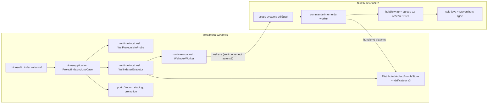
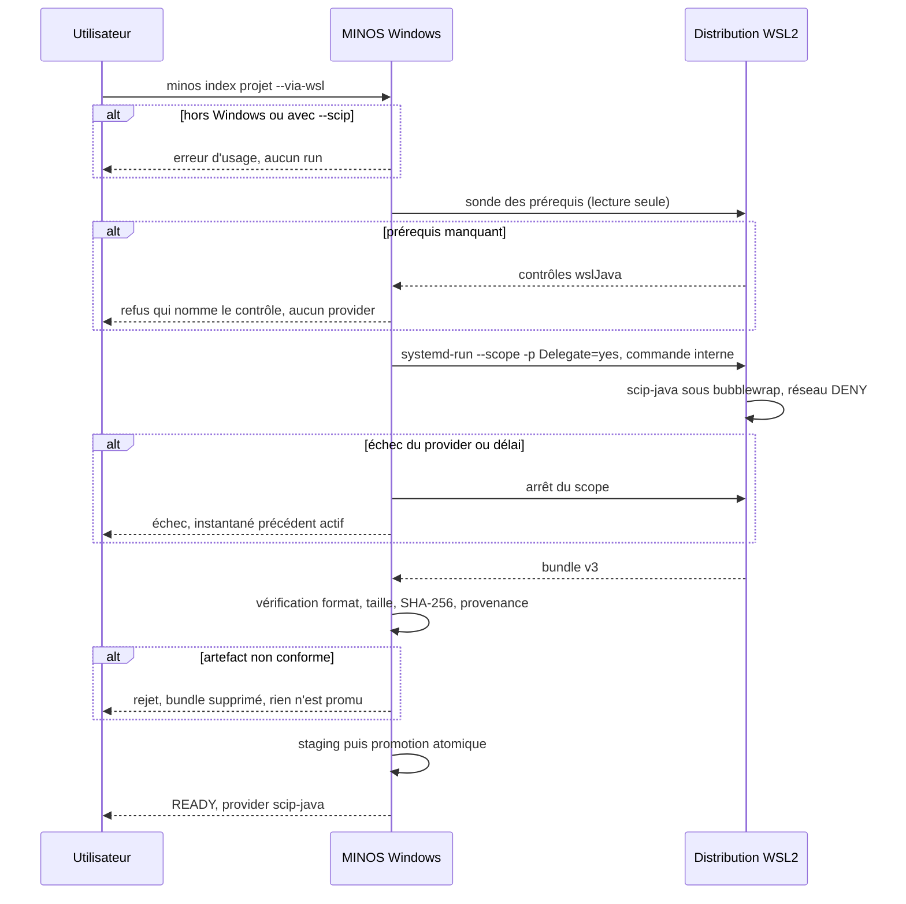
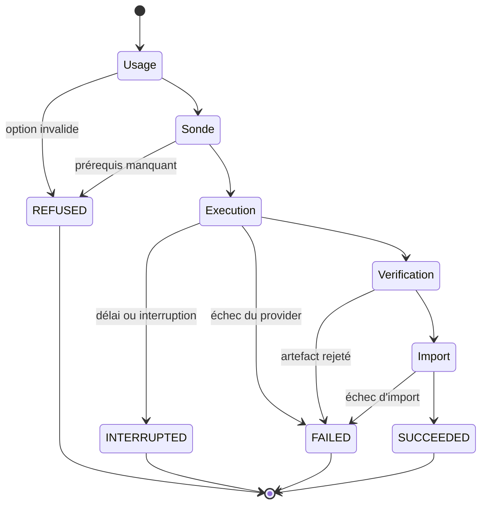

# Design

## Contexte

Motivation : voir `proposal.md` (Why). Sous Windows, MINOS confine les providers dans un conteneur AppContainer, et la chaîne scip-java n'y tourne pas (SEC-0074). Sous Linux, la même chaîne tourne sous bubblewrap et cgroup v2. Le 2026-11-07, une aide provisoire a montré qu'un poste Windows peut faire tourner cette chaîne Linux dans WSL2 avec le jar de son installation, puis importer le SCIP produit. Ce changement fait de cette démonstration une commande du produit, sans élargir le confinement.

## État vérifié au HEAD

HEAD relu : `54fff28d` (`develop`).

- [Existant vérifié] Le diagnostic Windows de scip-java dit qu'aucune voie n'existe : `minos-provider-scip/src/main/java/com/minos/adapter/scip/runtime/install/ManagedScipProviderRuntimeManager.java:100-102`. Le test qui le verrouille : `ManagedScipProviderRuntimeManagerToolchainTest.java:277`.
- [Existant vérifié] Sous Linux, l'installation de Coursier n'est pas automatisée : `ManagedScipProviderRuntimeManager.java:418` lève « install `cs` in PATH ». La recherche passe par `coursierExecutable()` (`:712-716`), qui retombe sur le `PATH`. Le catalogue épingle déjà le lanceur `linux-x64` avec son empreinte : `minos-provider-scip/src/main/resources/com/minos/adapter/scip/runtime/embedded-tools.json:101-115` (`embedded: false`).
- [Existant vérifié] Le contrat de worker est indépendant du provider : `minos-engine/src/main/java/com/minos/remote/DistributedIndexing.java:16-51` (`Worker`, `WorkerRequest`, `WorkerResponse`). Le manifeste versionné porte projet, portée, provider, réseau, taille et SHA-256 : `minos-engine/src/main/java/com/minos/remote/DistributedArtifactManifest.java:15-35`.
- [Existant vérifié] L'exécuteur côté coordinateur vérifie l'artefact dans le magasin borné avant import : `minos-runtime-local/src/main/java/com/minos/runtime/local/distributed/DistributedIndexerExecutor.java:72-93`, `DistributedArtifactBundleStore.java:163`. Il est lié à une matérialisation distante (`DistributedIndexerExecutor.java:147`, `:173-184` : dépôt canonique et commit) et ne vaut donc pas tel quel pour un projet local.
- [Existant vérifié] Le manifeste v1/v2 et `WorkerRequest` exigent un `sourceCommit` de 40 caractères hexadécimaux (SHA-1 Git) : `DistributedArtifactManifest.java:50-52`, `DistributedIndexing.java:40-42`. L'empreinte d'entrée d'un projet local est un SHA-256 de 64 caractères (`ReferenceFingerprint.java:26`).
- [Existant vérifié] Une seule orchestration d'indexation : `openspec/specs/decouverte-et-negociation/spec.md:101` (« Le produit n'a qu'une orchestration d'indexation »), portée par `minos-application/src/main/java/com/minos/application/indexing/ProjectIndexingUseCase.java:59`, qui délègue l'exécution à un `IndexerExecutor`.
- [Existant vérifié] La sélection du backend d'un provider local géré est distincte de celle du code non fiable distant : `WorkerSandboxBackends.strongestAvailableForManagedLocalProvider` (appelée par `minos-bootstrap/src/main/java/com/minos/bootstrap/LocalWorkerSandboxProbe.java:19` et `StrongOwnedProcessExecutors.java:55`) et `selectForUntrustedCode` (`WorkerSandboxBackends.java:41`), qui refuse par décision.
- [Existant vérifié] La borne d'un artefact SCIP est de 512 Mio : `minos-engine/src/main/java/com/minos/orchestration/IndexArtifactLimits.java:7`. Le SCIP de morpheus-engine fait 52 Mio.
- [Existant vérifié] L'indexation distante de code non fiable est fermée par décision ; la sélection du backend le rapporte (SEC-0070, décision 6 ; `minos-bootstrap/src/main/java/com/minos/bootstrap/LocalRemoteIndexingRuntime.java:46-90`).
- [Existant vérifié] Sous Linux, le cgroup délégué se découvre par la racine du processus ou par `MINOS_SANDBOX_CGROUP_ROOT` : `minos-runtime-local/src/main/java/com/minos/runtime/local/sandbox/LinuxCgroupJob.java:38-40`.
- [Existant vérifié] Le dépôt Maven désigné se lit dans `MINOS_SCIP_JAVA_MAVEN_REPOSITORY` : `minos-provider-scip/src/main/java/com/minos/adapter/scip/runtime/plan/ScipJavaMavenOffline.java:42`. Les refus de désignation (dossier personnel, `/mnt/<lecteur>/Users/<compte>`…) sont spécifiés dans `installation-des-providers`.
- [Existant vérifié] Les environnements en liste d'autorisation existent : `minos-runtime-local/src/main/java/com/minos/runtime/local/process/InstallationProcessEnvironment.java:19`. Le motif de secret unique `ProviderProcessEnvironment.isDeniedName` est privé au package (`ProviderProcessEnvironment.java:133`) ; la méthode publique qui l'applique est `sanitize(Map, Map)` (`:171`).
- [Existant vérifié] Coursier est câblé pour Windows seulement : `coursierArtifact()` lit l'entrée `windows-x64` et `coursierLauncherId()` code le préfixe `windows-x64-` (`ManagedScipProviderRuntimeManager.java:136-150`). L'entrée Linux est au format `gz`, sans `sizeBytes` (`embedded-tools.json:99-113`). Le job Linux télécharge son propre `cs` (`scripts/ci/qualify-linux-offline-maven-index.sh:92-107`) ; `check-tools-manifest.py` lit le catalogue.
- [Existant vérifié] La qualification hors ligne reconnaît le diagnostic Windows par son préfixe : `scripts/release/qualify-offline-install.ps1:212` (`'scip-java execution under the Windows AppContainer sandbox is not qualified*'`). Le texte apparaît aussi dans `docs/user/troubleshooting.md:9-11` et `docs/project/governance/STATUS.md:47`.
- [Existant vérifié] `index` n'accepte pas d'option de voie : `minos-cli/src/main/java/com/minos/cli/command/IndexCommand.java:24-25`. `doctor` a déjà une section par sujet (`workerSandbox`) : `minos-cli/src/main/java/com/minos/cli/command/DoctorCommand.java:101`, `:169`.
- [Existant vérifié] L'installation Windows livre un jar indépendant de la plateforme (`lib/minos.jar`, `scripts/release/build-windows-distribution.ps1:314`) ; le runtime Java embarqué ne vaut que pour Windows.
- [Existant vérifié] Mesures du 2026-11-07 sur le poste du propriétaire (Ubuntu en WSL2, bubblewrap 0.9.0, Maven 3.9.16, systemd actif, contrôleurs `cpuset cpu io memory hugetlb pids rdma`) : trois projets Maven indexés sous scope délégué ; jarvis et collection-manager importés et `READY` ; morpheus-engine refusé au plafond de 256 Mio (« 358914010 encoded bytes exceed the 268435456-byte limit »), plafond relevé par #671.

## Écarts

- **E1 — aide provisoire et SEC-0076.** L'aide peuple le dépôt Maven en lançant `mvn clean verify` avec réseau dans une copie du projet, hors du bac à sable. SEC-0076 interdit de le recommander. Le produit ne reprend pas cette étape (exigence « MINOS ne peuple pas le dépôt Maven désigné »).
- **E2 — aide provisoire et règle 8 de sécurité.** L'aide télécharge Coursier elle-même. Le produit l'obtient par le catalogue (exigence Coursier de `installation-des-providers`).
- **E3 — JDK des paquets Ubuntu.** SEC-0074 (Context) dit que le JDK des paquets Debian/Ubuntu échoue sur `java.security`. Les runs du 2026-11-07 ont réussi avec `/usr/lib/jvm/java-21-openjdk-amd64`. Non tranché : Q1, à mesurer pendant la qualification ; ni la spec ni l'ADR ne sont réécrits avant la mesure.
- **E5 — SEC-0074 et « un MINOS Linux dans WSL2 ».** La décision 3 parle d'un MINOS Linux dans la distribution ; le design y exécute le jar de l'installation Windows, piloté depuis Windows, sans installation Linux persistante. L'ADR 0079 dit explicitement que c'est une mise en œuvre de cette décision (tâche 1.1).
- **E4 — choix du JDK dans l'aide.** Elle préfère le JDK Ubuntu à Temurin, contre son propre message d'erreur. Sans objet pour le produit : le JDK du projet suit les règles existantes du plan scip-java.

## Exigences couvertes

| Exigence | Section |
|---|---|
| indexation-java-via-wsl › L'indexation via WSL n'est offerte que sous Windows | Contrats d'interface |
| indexation-java-via-wsl › Les prérequis de WSL sont vérifiés avant tout lancement d'indexation | Traitements, D5 |
| indexation-java-via-wsl › doctor rapporte la voie WSL sous Windows | Contrats d'interface, Observabilité |
| indexation-java-via-wsl › Le provider tourne dans la distribution sous le bac à sable Linux, réseau coupé | Sécurité, D4 |
| indexation-java-via-wsl › wsl.exe reçoit un environnement en liste d'autorisation | Sécurité, D6 |
| indexation-java-via-wsl › MINOS ne peuple pas le dépôt Maven désigné | Sécurité, E1 |
| indexation-java-via-wsl › L'artefact reçu de WSL est vérifié avant tout import | D2, D3, Persistance |
| indexation-java-via-wsl › Un artefact conforme est importé par la promotion atomique | Traitements, Transactions |
| indexation-java-via-wsl › Un run via WSL interrompu ne laisse rien tourner | États, Erreurs |
| indexation-java-via-wsl › Les sorties de la voie WSL ne contiennent aucun chemin absolu | Observabilité |
| installation-des-providers › scip-java sous Windows n'est pas déclaré prêt sans exécution qualifiée sous le bac à sable | D8 |
| installation-des-providers › Sous Linux, l'installation de scip-java installe Coursier depuis le catalogue | D7 |

## Objectifs et non-objectifs

- Objectif : aucune garantie de confinement n'est affaiblie ; le provider tourne sous le même backend Linux que sous Linux natif.
- Objectif : réutiliser le contrat de worker et la vérification d'artefact plutôt qu'un second transport.
- Non-objectif : faire tourner le stockage ou le MCP dans WSL. L'installation Windows reste la seule source de vérité de l'index.
- Non-objectif : un worker générique pour tout langage. Le worker WSL n'accepte que scip-java (la voie existe parce que seul scip-java est bloqué).

## Responsabilités et frontières des composants

[Proposition] Répartition, dans le sens `domain → engine → runtime/storage → adapters → application → surfaces` (ARCH-0068) :

| Composant | Module | Rôle |
|---|---|---|
| `IndexCommand` (option `--via-wsl`), `DoctorCommand` (section `wslJava`) | `minos-cli` | Analyse des options, rendu texte et JSON ; passe par un port de `minos-application`, sans nommer de type `com.minos.remote` (`frontieres-de-modules`). |
| `ProjectIndexingUseCase` (existant) | `minos-application` | Reste l'unique orchestration (préparation, exécution, promotion, rétention). La voie lui fournit un autre `IndexerExecutor` ; aucun second coordinateur. |
| Port de sélection de la voie (choix de l'exécuteur WSL, sonde des prérequis) | `minos-application` | Interface ; aucune dépendance d'adaptateur. |
| `WslPrerequisiteProbe`, `WslIndexerExecutor` (implémente `IndexerExecutor`), `WslIndexWorker` (implémente `DistributedIndexing.Worker`), vérificateur de provenance de la voie, construction de la commande `wsl.exe` | `minos-runtime-local`, nouveau package `com.minos.runtime.local.wsl` | Côté Windows : sonde, lancement, collecte et vérification du bundle. `DistributedIndexerExecutor` n'est pas réutilisé (il est lié à une matérialisation distante) ; `DistributedArtifactBundleStore` l'est. |
| Commande interne du worker (côté Linux) | `minos-cli` (point d'entrée), exécution par les fabriques de plan et les exécuteurs du provider géré | Dans la distribution : exécute le provider seul (plan scip-java, backend choisi par `strongestAvailableForManagedLocalProvider`), écrit le bundle v3. Aucun `ProjectIndexingUseCase`, aucune promotion ni rétention côté distribution. |
| Coursier `linux-x64` | `minos-provider-scip` | Installation depuis le catalogue. |
| Câblage | `minos-bootstrap` | Fournit l'exécuteur WSL et la sonde au cas d'usage. N'utilise ni `LocalRemoteIndexingRuntime` ni `remote index`. |

`minos-application` ne dépend d'aucun adaptateur ; `minos-cli` ne dépend de `minos-bootstrap` qu'en portée `runtime` (`minos-cli/pom.xml:38-43`). Aucun package n'est partagé entre deux modules. `minos-runtime-local` ne peut pas appeler les contrôles de scip-java (`minos-provider-scip` en dépend : cycle) ; la sonde dans la distribution passe donc par le jar (D5). L'import d'un SCIP vérifié passe par le port d'import existant, l'importeur vivant dans `minos-provider-scip`.

## Modèle de domaine et invariants

Aucun type de domaine nouveau. Le transport gagne un format de manifeste additif, `minos-distributed-artifact-v3` (D3), qui remplace la source distante (`sourceRepository`, `sourceCommit`) par une source locale : `sourceKind=LOCAL_WSL`, `projectFingerprint` (SHA-256, 64 caractères hexadécimaux). v1 et v2 restent inchangés. Invariants : un bundle contient exactement `manifest.properties` et `index.scip` ; empreinte et taille du manifeste égalent celles du fichier ; politique réseau `DENY` avec `networkDenyEnforced=true` ; un manifeste v3 n'est accepté que par l'exécuteur de la voie, et un v1/v2 jamais par lui.

## Traitements et interactions

Déroulé nominal et refus : voir le diagramme « Comment une indexation via WSL se déroule-t-elle, refus compris ? ».

1. `minos index <projet> --via-wsl` : refus d'usage hors Windows ou combiné à `--scip`. Sinon, `ProjectIndexingUseCase` prépare le run comme d'habitude, avec l'exécuteur WSL.
2. Sonde des prérequis (D5 : côté Windows puis dans la distribution, en lecture seule, sans provider). Tout `MISSING` refuse.
3. Copie de la requête du worker (fichier JSON, sans chemin Windows absolu) dans un dossier privé du run côté Windows, lu par la distribution par `/mnt/<lecteur>`.
4. `wsl.exe -d <distro> --exec systemd-run --user --scope -p Delegate=yes --quiet <java> -cp <jar> com.minos.cli.MinosLauncher <commande interne> <requête>`.
5. Dans la distribution : découverte du cgroup délégué, copie du projet dans l'espace du run, scip-java sous bubblewrap réseau `DENY` (backend du provider local géré), écriture du bundle v3 dans le dossier de sortie du run. Rien n'est promu ni retenu dans la distribution.
6. Côté Windows : `DistributedArtifactBundleStore.accept`, vérification de provenance de la voie (D3), puis retour de l'artefact au cas d'usage, qui l'importe par le port d'import et la promotion atomique existants.

## États et transitions

Voir le diagramme « Par quels états passe un run via WSL ? ». États terminaux : `SUCCEEDED`, `REFUSED` (prérequis ou usage, rien n'est lancé), `FAILED` (provider ou import), `INTERRUPTED` (délai ou interruption : scope arrêté par `systemctl --user stop <scope>`, artefact partiel supprimé).

## Contrats d'interface

- **CLI `index`** — options additives : `--via-wsl` (indicateur), `--wsl-distro <nom>` (texte, distribution par défaut de WSL si absent ; refusé sans `--via-wsl`). Incompatibles : `--scip`, `--dry-run` [Proposition : `--dry-run` combiné pourra être ajouté plus tard]. Sortie : la même que `index` (texte ou JSON), plus `"route": "wsl"` dans le JSON. Erreurs d'usage et refus de prérequis : les codes d'erreur existants du CLI.
- **CLI `doctor`** — section `wslJava` sous Windows. JSON :

```json
{"wslJava": {"distribution": "Ubuntu", "checks": [
  {"id": "wsl-version", "state": "OK"},
  {"id": "bubblewrap", "state": "MISSING", "action": "install bubblewrap in the distribution"}]}}
```

  Identifiants de contrôle : `wsl-version`, `systemd`, `cgroup-delegation`, `bubblewrap`, `minos-jvm`, `maven`, `project-jdk`, `maven-repository`. États : `OK`, `MISSING`, `UNKNOWN`. Le verdict `ready` de `doctor` n'en dépend pas : la voie est facultative.
- **Commande interne du worker** — [Proposition] nom `internal wsl-worker`, absente de `--help`, réservée à MINOS. Sa requête porte un champ `protocol` (`minos-wsl-worker-v1`) ; une version inconnue est refusée. Elle n'est pas une surface publique et peut changer avec la version du jar, car Windows et la distribution exécutent le même jar.

## Persistance et intégrité

- Requête et bundle vivent dans un dossier privé du run côté Windows, créé par les primitives d'E/S privées (`check-private-io.py`) ; la distribution y accède par `/mnt/<lecteur>`.
- Le bundle est accepté par le magasin vérifié existant puis supprimé après acceptation ou rejet, comme le fait `DistributedIndexerExecutor.java:104-109` (`release`, `Files.deleteIfExists`).
- L'espace de travail du run dans la distribution est sous le dossier personnel WSL de l'utilisateur, supprimé à la fin du run.
- Format de transport additif `minos-distributed-artifact-v3` (D3), éphémère : il ne survit pas au run. Aucun changement du stockage des instantanés.
- Le bundle est écrit par la distribution à travers `/mnt` (drvfs) : les droits POSIX que posent les primitives Linux n'ont pas de sens garanti sur NTFS. Le dossier est créé privé côté Windows avant le lancement ; le sens réel des droits est qualifié en tâche 6.2.

## Transactions, concurrence et idempotence

- Le verrou de mutation du projet existant est pris côté Windows pendant toute la voie : deux indexations du même projet ne se chevauchent pas.
- L'import reste atomique (staging puis promotion, ADR DATA-0006). Relancer après un échec repart d'un run neuf ; aucune reprise de run partiel par WSL [Proposition : la reprise d'ADR BE-0039 n'est pas offerte par la voie].

## Sécurité et isolation

- Le provider n'est lancé que sous le backend Linux bubblewrap et cgroup v2, réseau `DENY` ; aucun repli (exigence correspondante). Côté Windows, aucun octroi AppContainer nouveau, aucune élévation (SEC-0074, décision 4).
- `wsl.exe` est lancé depuis le répertoire système de Windows, jamais résolu par le `PATH` (même règle que Windows PowerShell 5.1). Son environnement suit une liste d'autorisation avec `WSLENV` vide (D6).
- Le dépôt Maven reste désigné et peuplé par l'utilisateur ; les refus de désignation existants s'appliquent dans la distribution (dont `/mnt/<lecteur>/Users/<compte>`).
- La requête du worker ne contient ni secret ni chemin Windows absolu ; le worker n'écrit que dans son dossier de sortie et son espace de run.
- Un dépôt Git du projet reste ouvert seulement par `GitIntelligenceService` (règle 5) ; la voie n'en ouvre aucun.
- Le propriétaire des fichiers sur `/mnt/<lecteur>` est un critère de qualification (SEC-0074, décision 3) : mesuré en tâche 6, pas présumé.

## Erreurs et reprise

- Usage : message actionnable qui nomme l'option.
- Prérequis : message qui nomme le contrôle `wslJava` et l'action.
- Provider ou import : diagnostic public existant des runs en échec (`surfaces-publiques` › « Un run d'indexation en échec donne une erreur actionnable sans chemin absolu »).
- Interne : message opaque.
- État après échec : instantané précédent actif, aucun bundle ni processus restant.

## Observabilité

- Journaux de la voie sur stderr, niveau WARNING sans chemin absolu ; la distribution est nommée par son nom WSL.
- Les journaux du provider restent dans le run de la distribution ; le diagnostic public cite leur nom de fichier, jamais leur chemin.
- `doctor` section `wslJava` (contrat ci-dessus).

## Performance et mesure

Aucun objectif chiffré : pas de source. Stratégie : mesurer en qualification (tâche 6) la durée de bout en bout et la part de chaque étape (sonde, provider, transfert, import) sur java-simple et sur un projet réel, et consigner les chiffres dans le dossier de capacité. Mesure indicative du 2026-11-07 : environ 5 minutes de provider pour morpheus-engine (1 477 fichiers).

## Compatibilité, migration et retour arrière

- Options et section additives ; sans `--via-wsl`, `index` est inchangé.
- Aucune migration d'installation ; aucune donnée persistée nouvelle.
- Retour arrière : retirer l'option ne laisse aucun état ; les instantanés importés restent lisibles.
- Le jar exécuté dans la distribution est celui de l'installation : pas de décalage de version entre coordinateur et worker.

## Diagrammes

### Quels composants participent à la voie, et dans quel système ?



Le provider ne tourne que dans la distribution, sous le backend Linux ; l'installation Windows ne fait que sonder, lancer, vérifier et importer. Illustre : « Le provider tourne dans la distribution… », « L'artefact reçu de WSL est vérifié… ».

### Comment une indexation via WSL se déroule-t-elle, refus compris ?



Illustre les exigences de prérequis, de vérification, de promotion et d'interruption.

### Par quels états passe un run via WSL ?



Seul `SUCCEEDED` change l'instantané actif. Illustre : « Un run via WSL interrompu ne laisse rien tourner », « Un artefact conforme est importé par la promotion atomique ».

## Décisions

### D1 — Commande du CLI

[Décision] Propriétaire, 2026-11-07 : option `--via-wsl` de `minos index`, plutôt qu'un script livré. Conséquence : surface CLI additive, intégrable plus tard par le plugin IntelliJ.

### D2 — Réutiliser le contrat de worker et le magasin vérifié

[Proposition] La voie est un `IndexerExecutor` (`WslIndexerExecutor`) fourni à l'unique orchestration `ProjectIndexingUseCase` (`decouverte-et-negociation` › « Le produit n'a qu'une orchestration d'indexation »). Il délègue à `WslIndexWorker`, qui implémente `DistributedIndexing.Worker`, et vérifie le bundle par `DistributedArtifactBundleStore` et un vérificateur de provenance propre à la voie. `DistributedIndexerExecutor` n'est pas réutilisé : il est lié à une matérialisation distante. Écarté : un import direct par `import-scip`, qui ne vérifie ni provenance ni politique réseau. La voie n'est pas l'indexation distante de SEC-0070 : la source est un projet local enregistré, et le provider tourne sur le poste sous le backend du provider local géré (`strongestAvailableForManagedLocalProvider`), comme `minos index` sous Linux natif ; elle ne passe jamais par `selectForUntrustedCode`, `LocalRemoteIndexingRuntime` ni `remote index`. L'ADR à écrire (tâche 1.1) la classe ainsi.

### D3 — Provenance d'un projet local : manifeste v3

[Proposition] Le manifeste v2 ne peut pas porter un projet local : `sourceCommit` doit être un SHA-1 Git de 40 caractères (`DistributedArtifactManifest.java:50-52`), et tronquer une empreinte SHA-256 est exclu. Un format additif `minos-distributed-artifact-v3` porte `sourceKind=LOCAL_WSL`, `projectFingerprint` (empreinte d'entrée du projet calculée par l'installation Windows avant le lancement, 64 caractères hexadécimaux) et `workerId=wsl:<distribution>`, sans `sourceRepository` ni `sourceCommit`. Le vérificateur de la voie compare projet, portée, empreinte, langage, provider et worker à la requête. v1 et v2 et leurs validations restent inchangés ; `DistributedIndexerExecutor` refuse v3, et le vérificateur de la voie refuse v1 et v2. `WorkerRequest` gagne de même une variante locale sans `sourceCommit`.

### D4 — Scope systemd délégué

[Proposition] Le worker démarre par `systemd-run --user --scope -p Delegate=yes`. La découverte de cgroup existante (`LinuxCgroupJob`) déplace le processus dans `minos-controller` et active `memory`, `pids`, `cpu`. Sans délégation, le backend refuse : aucun repli.

### D5 — Sonde des prérequis

[Proposition] Trois étapes en lecture seule, chacune arrêtant la sonde sur un `MISSING` : (1) côté Windows, `wsl.exe -l -v` (sortie UTF-16) donne les distributions et leur version ; (2) dans la distribution, une commande shell constante lit l'état de systemd et du bus utilisateur (`XDG_RUNTIME_DIR`), les contrôleurs délégables, `bwrap` et la présence d'une JVM 21, avant tout lancement du jar ; (3) le jar, en mode sonde de la commande interne, applique les contrôles Linux existants de scip-java (Maven 3.9.x lu sur disque, JDK du projet, dépôt désigné). L'étape 3 passe par le jar parce que `minos-runtime-local` ne peut pas appeler `minos-provider-scip`. La sonde ne lance ni Maven ni provider.

### D6 — Environnement de wsl.exe

[Proposition] Liste d'autorisation propre à la voie (`SystemRoot`, `WINDIR`, `TEMP`, `TMP`, `USERPROFILE`, `LOCALAPPDATA`, `PATH` réduit au répertoire système) filtrée par la méthode publique `ProviderProcessEnvironment.sanitize(Map, Map)`, qui applique le motif de secret unique (`isDeniedName` reste privé au package : règle 3 de `.claude/rules/securite.md`), et `WSLENV` vide. Les réglages de la voie (`MINOS_SCIP_JAVA_MAVEN_REPOSITORY` de la distribution, JDK du projet) passent dans la requête, pas par l'environnement Windows.

### D7 — Coursier sous Linux

[Proposition] `coursierArtifact()` et `coursierLauncherId()` choisissent l'entrée et le préfixe selon la plateforme (`windows-x64` ou `linux-x64`). Sous Linux, `ensureCoursier` acquiert l'archive `gz` par `PinnedArtifactSource` (téléchargement borné par `MAX_COURSIER_ARCHIVE_BYTES`, empreinte vérifiée sur l'archive), la décompresse avec une borne de taille, puis publie `cs` par fichier partiel et déplacement atomique, avec droits privés et bit d'exécution pour le seul propriétaire, sous `MINOS_HOME/tools/coursier/linux-x64-<commit court>/cs`. `cs` dans le `PATH` reste accepté : `scripts/ci/qualify-linux-offline-maven-index.sh` garde son téléchargement. `check-tools-manifest.py` est rejoué ; le catalogue n'est pas modifié.

### D8 — Diagnostic Windows

[Proposition] Le blocage natif reste. Le texte de `SANDBOXED_EXECUTION_NOT_QUALIFIED` ne change qu'après la qualification (tâche 6) : il garde mot pour mot son préfixe « scip-java execution under the Windows AppContainer sandbox is not qualified », que reconnaît `scripts/release/qualify-offline-install.ps1:212`, et remplace la suite par un renvoi à `minos index --via-wsl`. Avant, il reste inchangé, et aucune page utilisateur n'annonce la voie (capability-honest). L'archivage du changement, qui fait entrer ce texte dans la spec courante, attend la réussite de la tâche 6.2.

### ADR

[Proposition] ADR à écrire (prochain numéro au HEAD : 0079, domaine `security` ou `architecture` à trancher avec `/minos:adr`) : voie WSL2 de l'indexation Java depuis Windows, mise en œuvre de SEC-0074 décision 3 ; classement de la voie comme indexation locale et exécuteur de l'orchestration unique (D2) ; format de transport `minos-distributed-artifact-v3` (D3) ; contrats D4 à D6 ; limite : `networkDenyEnforced` déclaré par la distribution ; lecture de « un MINOS Linux dans WSL2 » (E5). Il complète SEC-0074 sans en changer les décisions, comme SEC-0076 ; SEC-0074 reçoit « Complété par ». Si la revue juge que la voie modifie la décision 3 elle-même, un ADR consolidé remplace SEC-0074 (`.claude/rules/adr.md`), sans changer specs ni tâches.

## Qualification des capacités

- `indexation-java-via-wsl` : **non supportée** au HEAD. **Partielle** après les tâches 1 à 5 (implémentée, testée hors poste réel). **Qualifiée** seulement après la tâche 6 : les cinq critères de SEC-0074 décision 3 prouvés et consignés.
- `installation-des-providers`, Coursier Linux : **qualifiée** après les tests de la tâche 3 sous Linux (CI `Verify (ubuntu-24.04)`).
- Windows natif : reste **non supporté** (`BLOCKED`).

## Risques et compromis

- [Risque] Configuration WSL de l'utilisateur variable (systemd désactivé, WSL1, `/mnt` monté sans métadonnées) → sonde exhaustive et actions dans `doctor` ; aucune configuration modifiée par MINOS.
- [Risque] Performance de `/mnt/<lecteur>` → le projet est copié une fois dans l'espace du run de la distribution ; mesure en tâche 6.
- [Risque] La CI ne dispose pas de WSL2 avec systemd → la qualification de bout en bout est une tâche **(manuelle)** sur poste Windows ; la CI couvre les parties Windows (commande, environnement, vérification) et Linux (worker, Coursier) séparément.
- [Compromis] Le dépôt Maven reste à peupler par l'utilisateur (SEC-0076) : capacité partielle assumée, documentée.
- [Risque] `systemd-run --user` lancé par `wsl.exe --exec` sans environnement peut échouer faute de `XDG_RUNTIME_DIR` ou de bus utilisateur → contrôlé par la sonde (D5, étape 2) ; mesuré en 6.1. Précédent de sonde systemd : `minos-intellij/src/main/java/com/minos/intellij/protocol/MinosStrongProcessLauncher.java:245-247` (à relire avant usage).
- [Risque] `networkDenyEnforced=true` est déclaré par la distribution ; l'installation Windows ne peut pas le prouver → la confiance repose sur le même jar exécuté des deux côtés et sur la sonde du backend ; l'ADR 0079 l'écrit comme limite.
- [Risque] Droits POSIX sur `/mnt` (drvfs) sans sens garanti → dossier créé privé côté Windows ; qualifié en 6.2.

## Vérification

- Tests Java à écrire (noms proposés) : `IndexCommandViaWslTest`, `DoctorCommandWslJavaTest` (`minos-cli`) ; `WslPrerequisiteProbeTest`, `WslCommandEnvironmentTest`, `WslIndexWorkerTest` (fausse distribution), `WslArtifactProvenanceTest` (`minos-runtime-local`) ; `ManagedScipProviderRuntimeManagerCoursierLinuxTest` et mise à jour de `ManagedScipProviderRuntimeManagerToolchainTest` (`minos-provider-scip`).
- Gates : `python .claude/scripts/run_gates.py --fast`, dont `check-module-boundaries.py`, `check-private-io.py`, `check-comment-language.py`, `check-ci-wiring.py` ; `check-capability-dossiers.py`, `check-current-docs.py`, `product-facts.py --check`.
- Scopes JaCoCo : modules `minos-runtime-local`, `minos-cli`, `minos-provider-scip` (seuil Sonar de 80 % sur le nouveau code, module par module).
- Qualification **(manuelle)** : `minos index <projet> --via-wsl` sur `fixtures/java/java-simple` et sur un projet réel, depuis une installation Windows construite depuis la branche ; preuves consignées dans le dossier de capacité.

## Documentation durable à mettre à jour

- Nouveau dossier `docs/architecture/diagrams/capacites/indexation-java-via-wsl.md` (vues ci-dessus, traçabilité, écarts E1 à E4), indexé dans `docs/architecture/diagrams/capacites/README.md`, et section « ## Documentation liée » de la spec après archivage.
- `docs/architecture/diagrams/capacites/installation-des-providers.md` (Coursier Linux, diagnostic Windows).
- `docs/user/troubleshooting.md` (section scip-java sous Windows), `docs/user/production-installation.md` (prérequis WSL2), après qualification seulement.
- Vue de déploiement arc42 (`docs/architecture/arc42/`) ; index des ADR et `09-decisions.md`.
- `STATUS.md`, `ROADMAP.md` à la clôture.

## Traçabilité

| Scénario | Conception | Tâche | Test ou preuve |
|---|---|---|---|
| Option refusée sous Linux | Contrats d'interface | 2.1, 2.2 | `IndexCommandViaWslTest` (à écrire) |
| Option combinée à --scip | Contrats d'interface | 2.1, 2.2 | `IndexCommandViaWslTest` (à écrire) |
| Distribution en WSL1 | D5 | 4.1, 4.2 | `WslPrerequisiteProbeTest` (à écrire) |
| bubblewrap absent | D5 | 4.1, 4.2 | `WslPrerequisiteProbeTest` (à écrire) |
| Aucune distribution WSL | D5 | 4.1, 4.2 | `WslPrerequisiteProbeTest` (à écrire) |
| Section complète | Contrats d'interface | 4.3 | `DoctorCommandWslJavaTest` (à écrire) ; 6.2 (manuelle) |
| Section absente sous Linux | Contrats d'interface | 4.3 | `DoctorCommandWslJavaTest` (à écrire) |
| Cgroup non délégué | D4 | 5.1, 5.2 | test du worker Linux (à écrire) ; 6.2 (manuelle) |
| Réseau du provider | Sécurité | 5.1, 5.2 | `WslIndexWorkerTest` (à écrire) ; 6.2 (manuelle) |
| Jeton présent dans l'environnement de MINOS | D6 | 4.4 | `WslCommandEnvironmentTest` (à écrire) |
| Dépôt non désigné | Sécurité, E1 | 5.1, 5.2 | test du worker Linux (à écrire) |
| Empreinte altérée | D2 | 5.3 | `WslArtifactProvenanceTest` (à écrire) |
| Projet différent | D3 | 5.3 | `WslArtifactProvenanceTest` (à écrire) |
| Indexation réussie | Traitements | 5.4 ; 6.2 | 6.2 (manuelle) |
| Échec après un index précédent | Transactions | 5.4 | `WslIndexWorkerTest` (à écrire) |
| Délai dépassé | États | 5.5 | `WslIndexWorkerTest` (à écrire) |
| Échec du provider dans la distribution | Observabilité | 5.5 | `WslIndexWorkerTest` (à écrire) |
| Doctor sous Windows | D8 | 6.4 | `ManagedScipProviderRuntimeManagerToolchainTest` (à modifier) |
| Indexation native refusée | D8 | 6.4 | `ManagedScipProviderRuntimeManagerToolchainTest` (à modifier) |
| Linux inchangé | D8 | 6.4 | `ManagedScipProviderRuntimeManagerToolchainTest` (existant) |
| Aucun cs dans le PATH | D7 | 3.1, 3.2 | `ManagedScipProviderRuntimeManagerCoursierLinuxTest` (à écrire) |
| Empreinte non conforme | D7 | 3.1, 3.2 | `ManagedScipProviderRuntimeManagerCoursierLinuxTest` (à écrire) |
| Hors ligne sans Coursier | D7 | 3.1, 3.2 | `ManagedScipProviderRuntimeManagerCoursierLinuxTest` (à écrire) |

## Questions ouvertes

- **Q1** — Le JDK des paquets Ubuntu fonctionne-t-il désormais dans le bac à sable (E3) ? Mesure en tâche 6.1 ; selon le résultat, consigner un écart dans SEC-0074 ou garder la règle. Ne change ni les specs ni les tâches.
- **Q2** — L'aide provisoire limite le worker aux cœurs 0 à 3 (`taskset -c 0-3`), sans raison écrite. À mesurer en qualification ; recommandation : ne pas reprendre la limite sans cause démontrée.
- **Q3** — Domaine de l'ADR (`security` ou `architecture`) : à trancher à l'écriture (tâche 1.1). Recommandation : `security`, comme SEC-0074 qu'il met en œuvre.
