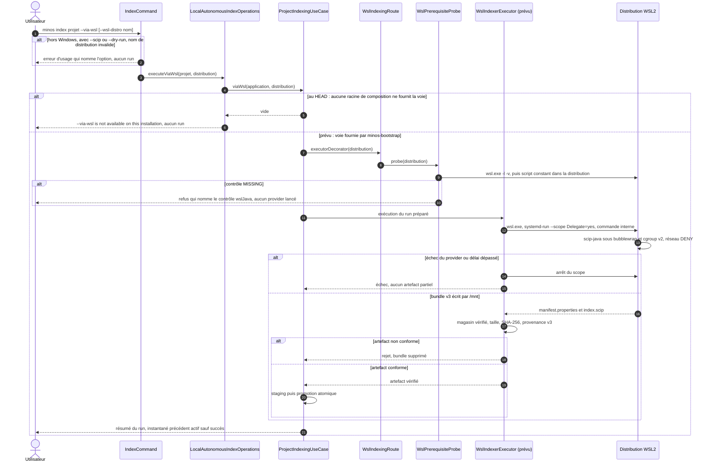

# Capacité `indexation-java-via-wsl` — brouillon du dossier durable

Spec proposée : [specs/indexation-java-via-wsl/spec.md](specs/indexation-java-via-wsl/spec.md) (delta du
changement `indexer-java-depuis-windows-par-wsl2`) · Conception : [design.md](design.md) · Relevé au commit
`6caa9226` (2026-11-08).

**Brouillon.** La capacité n'existe pas encore dans `openspec/specs/` : ce dossier vit dans le changement tant
que celui-ci n'est pas archivé. La tâche 7.2 le déplace dans `docs/architecture/diagrams/capacites/` sous le nom
`indexation-java-via-wsl.md`, l'indexe dans le README de ce répertoire et ajoute la section `## Documentation liée`
de la spec. La vue « états », la traçabilité et les écarts sont complétés par la tâche 5.6.

## Objet et périmètre

[Exigence proposée] Sous Windows, `minos index <projet> --via-wsl` fait tourner scip-java dans une distribution
WSL2, sous le bac à sable Linux (bubblewrap et cgroup v2, réseau `DENY`), puis importe un artefact vérifié par la
promotion atomique existante. Décisions : [SEC-0074](../../../docs/architecture/adr/SEC-0074-java-non-indexable-depuis-windows-voie-wsl2.md)
(décision 3) et [SEC-0079](../../../docs/architecture/adr/SEC-0079-indexation-java-depuis-windows-par-wsl2.md)
(`Accepted`). Hors périmètre : le peuplement du dépôt Maven (fait par l'utilisateur, SEC-0076), le stockage et le
MCP dans WSL, tout autre provider que scip-java.

**État au HEAD : non supportée.** L'option et ses refus d'usage existent ; aucune racine de composition ne fournit
la voie, si bien qu'une installation Windows refuse `--via-wsl` sans créer de run. La sonde des prérequis existe
mais n'est appelée par aucun code de production. Le worker Linux, le manifeste v3, `WslIndexerExecutor`, son
vérificateur et l'import sont **prévus** (groupe 5 des tâches). Aucune qualification n'est acquise : elle exige
la tâche 6.2.

## Vues

### Quels composants participent à la voie, lesquels existent au HEAD ?

Type : flowchart (vue de composants, non UML) · Portée : existant vérifié et cible (D2, D4 à D6) · Exigences :
« L'indexation via WSL n'est offerte que sous Windows », « Les prérequis de WSL sont vérifiés avant tout lancement
d'indexation », « wsl.exe reçoit un environnement en liste d'autorisation », « Le provider tourne dans la
distribution sous le bac à sable Linux, réseau coupé », « L'artefact reçu de WSL est vérifié avant tout import »

```mermaid
flowchart LR
  subgraph WIN["Installation Windows"]
    direction TB
    subgraph CLI["minos-cli"]
      IDX["IndexCommand : --via-wsl, --wsl-distro"]
      OPS["LocalAutonomousIndexOperations.executeViaWsl"]
      DOC["DoctorCommand : section wslJava (prévue, 4.3)"]
    end
    subgraph APP["minos-application"]
      UC["ProjectIndexingUseCase.viaWsl"]
      PORT["port WslIndexingRoute.executorDecorator"]
      ROOT["MinosApplicationComposer.wslIndexingRoute : vide par défaut"]
    end
    subgraph BOOT["minos-bootstrap"]
      WIRE["câblage de la voie (prévu)"]
    end
    subgraph RTL["minos-runtime-local : com.minos.runtime.local.wsl"]
      PROBE["WslPrerequisiteProbe"]
      RUN["ProcessWslCommandRunner"]
      ENV["WslCommandEnvironment"]
      EXEC["WslIndexerExecutor (prévu)"]
      WORKER["WslIndexWorker (prévu)"]
      VERIF["vérificateur de provenance v3 (prévu)"]
    end
    STORE["DistributedArtifactBundleStore (existant, réutilisé)"]
    IMPORT["port d'import, staging, promotion (existants)"]
  end
  subgraph WSL["Distribution WSL2"]
    direction TB
    SCOPE["systemd-run --user --scope, Delegate=yes (prévu)"]
    INNER["commande interne du worker (prévue)"]
    SANDBOX["bubblewrap + LinuxCgroupJob, réseau DENY (existants sous Linux)"]
    SCIP["scip-java, Maven hors ligne"]
  end
  IDX --> OPS --> UC
  UC --> ROOT
  ROOT -. "fournie par" .-> WIRE
  WIRE -.-> PORT
  PORT -.-> EXEC
  DOC -.-> PROBE
  PROBE --> RUN
  RUN --> ENV
  EXEC -.-> WORKER
  EXEC -.-> VERIF
  VERIF -.-> STORE
  UC --> IMPORT
  WORKER -. "wsl.exe du répertoire système" .-> SCOPE
  SCOPE -.-> INNER --> SANDBOX --> SCIP
  INNER -. "bundle v3 par /mnt" .-> STORE
  classDef planned stroke-dasharray: 5 5
  class DOC,WIRE,EXEC,WORKER,VERIF,SCOPE,INNER planned
```

Traits pleins et cadres pleins : code présent au HEAD ; pointillés : prévu. La voie n'est pas une seconde
orchestration : `ProjectIndexingUseCase.viaWsl` reprend l'unique cas d'usage et lui applique le décorateur
d'exécuteur que fournit le port `WslIndexingRoute`
(`minos-application/src/main/java/com/minos/application/indexing/ProjectIndexingUseCase.java:238-243`,
`minos-application/src/main/java/com/minos/application/WslIndexingRoute.java`). Le port est vide par défaut
(`minos-application/src/main/java/com/minos/application/MinosApplicationComposer.java:93-96`) et aucun module de
production ne le fournit encore : c'est ce qui rend la voie indisponible au HEAD.

La sonde (`minos-runtime-local/src/main/java/com/minos/runtime/local/wsl/WslPrerequisiteProbe.java:140`) suit les
trois étapes de D5 ; sa troisième étape, les contrôles du jar (Maven, JDK du projet, dépôt), passe par le point
d'extension `WslJarProbe`, rapporté `UNKNOWN` tant qu'aucune sonde du jar n'est fournie. `wsl.exe` est résolu dans
le seul répertoire système (`WslPrerequisiteProbe.java:103-125`) et lancé par `ProcessWslCommandRunner`, dont
l'environnement est remplacé par la liste d'autorisation de `WslCommandEnvironment` (`WSLENV` vide, filtrage par
`ProviderProcessEnvironment.sanitize`, D6). Côté Linux, le provider tournera sous le backend du provider local géré
(`WorkerSandboxBackends.strongestAvailableForManagedLocalProvider`,
`minos-runtime-local/src/main/java/com/minos/runtime/local/sandbox/WorkerSandboxBackends.java:150`), jamais sous
`selectForUntrustedCode` ni `LocalRemoteIndexingRuntime` (D2). `DistributedIndexerExecutor` n'est pas réutilisé :
il est lié à une matérialisation distante.

### Comment `minos index --via-wsl` se déroule-t-il aujourd'hui, et comment se déroulera-t-il ?

Type : sequenceDiagram (UML séquence) · Portée : existant vérifié (refus) et cible (déroulé prévu, design
« Traitements et interactions ») · Exigences : « L'indexation via WSL n'est offerte que sous Windows », « Les
prérequis de WSL sont vérifiés avant tout lancement d'indexation », « L'artefact reçu de WSL est vérifié avant tout
import », « Un artefact conforme est importé par la promotion atomique », « Un run via WSL interrompu ne laisse
rien tourner »

Le refus d'usage, l'appel du cas d'usage et la branche « au HEAD » sont du code présent : refus d'usage dans
`IndexCommand.validateWslRoute` (`minos-cli/src/main/java/com/minos/cli/command/IndexCommand.java:300-318`),
appel du cas d'usage dans `LocalAutonomousIndexOperations.executeViaWsl`
(`minos-cli/src/main/java/com/minos/cli/operations/LocalAutonomousIndexOperations.java:64-68`), refus
`VIA_WSL_UNAVAILABLE` (`minos-cli/src/main/java/com/minos/cli/operations/AutonomousIndexOperations.java:55`). Ils
sont verrouillés par `IndexCommandViaWslTest`, `IndexViaWslSideEffectsTest` et `WslIndexingRouteWiringTest`. La
branche « prévu » décrit la cible du design (D2 à D6) ; l'endroit exact où la sonde est appelée dans le décorateur
sera fixé par l'implémentation du groupe 5. Seul un artefact conforme change l'instantané actif.

## Suite du dossier

Ajouts de la tâche 5.6 : vue « états » d'un run via WSL, traçabilité exigence → preuve, écarts (E1 à E5 du
design). Ajouts de la tâche 6.2 : mesures et preuves de qualification. Déplacement et indexation : tâche 7.2.
