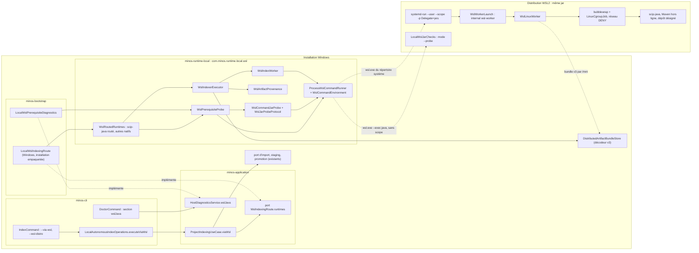
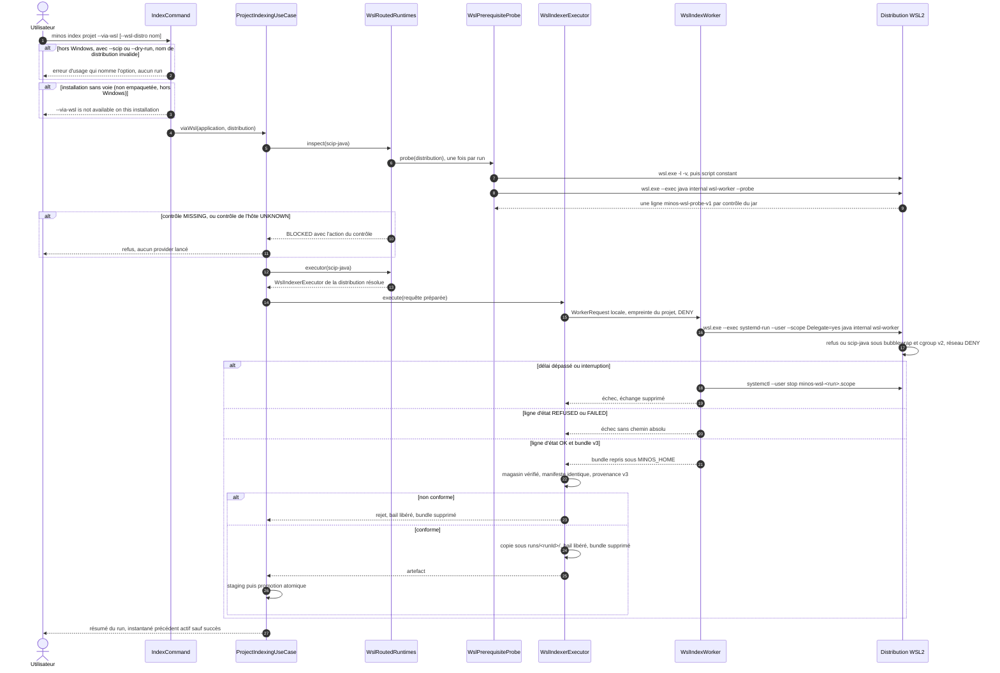
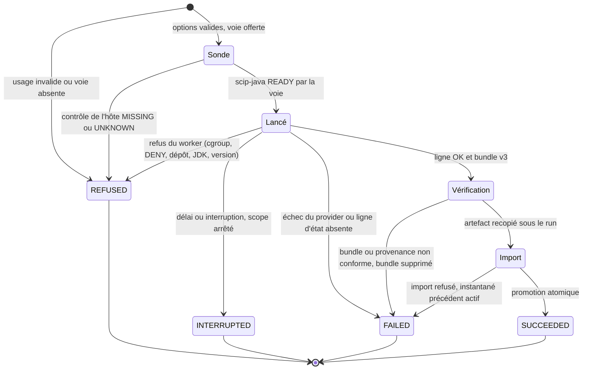

# Capacité `indexation-java-via-wsl` — brouillon du dossier durable

Spec proposée : [specs/indexation-java-via-wsl/spec.md](specs/indexation-java-via-wsl/spec.md) (delta du
changement `indexer-java-depuis-windows-par-wsl2`) · Conception : [design.md](design.md) · Fonctionnement pour les
contributeurs : [docs/developer/java-indexing-via-wsl.md](../../../docs/developer/java-indexing-via-wsl.md) ·
Relevé au commit `43724a2a` (2026-11-08).

**Brouillon.** La capacité n'existe pas encore dans `openspec/specs/` : ce dossier vit dans le changement tant
que celui-ci n'est pas archivé. La tâche 7.2 le déplace dans `docs/architecture/diagrams/capacites/` sous le nom
`indexation-java-via-wsl.md`, l'indexe dans le README de ce répertoire et ajoute la section `## Documentation liée`
de la spec. La tâche 6.2 y ajoute les mesures et preuves de qualification.

## Objet et périmètre

[Exigence proposée] Sous Windows, `minos index <projet> --via-wsl` fait tourner scip-java dans une distribution
WSL2, sous le bac à sable Linux (bubblewrap et cgroup v2, réseau `DENY`), puis importe un artefact vérifié par la
promotion atomique existante. Décisions : [SEC-0074](../../../docs/architecture/adr/SEC-0074-java-non-indexable-depuis-windows-voie-wsl2.md)
(décision 3) et [SEC-0079](../../../docs/architecture/adr/SEC-0079-indexation-java-depuis-windows-par-wsl2.md)
(`Accepted`). Hors périmètre : le peuplement du dépôt Maven (fait par l'utilisateur, SEC-0076), le stockage et le
MCP dans WSL, tout autre provider que scip-java.

**État au HEAD : partielle, non qualifiée.** La voie est implémentée de bout en bout : option du CLI, runtimes
routés fournis par `minos-bootstrap` sous Windows, sonde des prérequis, worker Linux dans un scope systemd
délégué, manifeste v3, vérification de provenance, recopie sous le run et import par la promotion atomique. Elle
n'est offerte que depuis une installation empaquetée (le jar exécuté par la distribution). Aucune exécution réelle
n'est prouvée : les tests utilisent une distribution simulée, et la qualification exige la tâche 6.2. Le
diagnostic natif de scip-java sous Windows ne cite pas encore la voie (tâches 6.3 et 6.4, après 6.2). Les
contrôles du jar (Maven, JDK du projet, dépôt) sont faits dans la distribution par le jar de l'installation, en mode
sonde de sa commande interne.

## Vues

### Quels composants participent à la voie, et dans quel module ?

Type : flowchart (vue de composants, non UML) · Portée : existant vérifié · Exigences : « L'indexation via WSL
n'est offerte que sous Windows », « Les prérequis de WSL sont vérifiés avant tout lancement d'indexation »,
« doctor rapporte la voie WSL sous Windows », « wsl.exe reçoit un environnement en liste d'autorisation », « Le
provider tourne dans la distribution sous le bac à sable Linux, réseau coupé », « L'artefact reçu de WSL est
vérifié avant tout import »

La voie n'est pas une seconde orchestration : `ProjectIndexingUseCase.viaWsl` construit l'unique cas d'usage avec
les runtimes que fournit le port `WslIndexingRoute`
(`minos-application/src/main/java/com/minos/application/indexing/ProjectIndexingUseCase.java:245-251`). Le port est
vide par défaut et `minos-bootstrap` le fournit sous Windows
(`minos-bootstrap/src/main/java/com/minos/bootstrap/DefaultMinosApplicationComposer.java:197-198`) par
`LocalWslIndexingRoute`, offert seulement quand le code s'exécute depuis le jar de l'installation
(`minos-bootstrap/src/main/java/com/minos/bootstrap/LocalWslIndexingRoute.java:68-74`). La route rend un
`WslRoutedRuntimes` (`LocalWslIndexingRoute.java:106-112`) : scip-java y est `READY` ou `BLOCKED` selon la sonde,
tout autre provider reste natif, et le `BLOCKED` natif de scip-java n'est jamais levé
(`minos-runtime-local/src/main/java/com/minos/runtime/local/wsl/WslRoutedRuntimes.java:81-114`).

Côté Linux, le même jar reçoit la commande interne `internal wsl-worker`, absente de l'aide
(`minos-cli/src/main/java/com/minos/cli/WslWorkerLaunch.java`), que `minos-bootstrap` relie à `WslLinuxWorker`
sous Linux seulement (`DefaultMinosApplicationComposer.java:206-224`). Le worker refuse avant tout lancement un autre
provider, un backend qui ne prend pas en charge le provider local géré ou n'applique pas `DENY`, et un scip-java
non prêt dans la distribution (`minos-runtime-local/src/main/java/com/minos/runtime/local/wsl/WslLinuxWorker.java:125-149`).
En mode `internal wsl-worker --probe`, le même jar applique les contrôles de scip-java de la distribution (Maven du
`PATH`, JDK du projet, dépôt désigné) sur les réglages MINOS du worker, sans lancer Maven, et écrit une ligne
`minos-wsl-probe-v1` par contrôle (`minos-bootstrap/src/main/java/com/minos/bootstrap/LocalWslJarChecks.java`).

### Comment `minos index --via-wsl` se déroule-t-il ?

Type : sequenceDiagram (UML séquence) · Portée : existant vérifié · Exigences : « L'indexation via WSL n'est offerte
que sous Windows », « Les prérequis de WSL sont vérifiés avant tout lancement d'indexation », « L'artefact reçu de
WSL est vérifié avant tout import », « Un artefact conforme est importé par la promotion atomique », « Un run via
WSL interrompu ne laisse rien tourner »

Les refus d'usage vivent dans `IndexCommand.validateWslRoute`
(`minos-cli/src/main/java/com/minos/cli/command/IndexCommand.java:300-320`) et le refus d'une installation sans
voie dans `LocalAutonomousIndexOperations.executeViaWsl`
(`minos-cli/src/main/java/com/minos/cli/operations/LocalAutonomousIndexOperations.java:64-68`). La sonde ne bloque
sur tout contrôle `MISSING`, et sur un contrôle de l'hôte `UNKNOWN`. Un contrôle du jar `UNKNOWN` (jar qui n'a pas
pu répondre) ne bloque pas
(`minos-runtime-local/src/main/java/com/minos/runtime/local/wsl/WslProbeReport.java:47-56`) : le worker applique
les mêmes contrôles dans la distribution avant de lancer le provider. Le lancement, le délai et l'arrêt du scope sont dans `WslIndexWorker`
(`minos-runtime-local/src/main/java/com/minos/runtime/local/wsl/WslIndexWorker.java:147-230`) ; la vérification, la
recopie et la libération du bail dans `WslIndexerExecutor`
(`minos-runtime-local/src/main/java/com/minos/runtime/local/wsl/WslIndexerExecutor.java:68-155`).

### Par quels états passe un run via WSL ?

Type : stateDiagram-v2 (UML états) · Portée : existant vérifié · Exigences : « Les prérequis de WSL sont vérifiés
avant tout lancement d'indexation », « L'artefact reçu de WSL est vérifié avant tout import », « Un artefact
conforme est importé par la promotion atomique », « Un run via WSL interrompu ne laisse rien tourner »

Seul `SUCCEEDED` change l'instantané actif. `REFUSED` regroupe les refus d'usage, de l'hôte et du worker : aucun
provider n'est lancé. `INTERRUPTED` arrête le scope par `systemctl --user stop`, qui termine tous les processus du
run, et supprime l'échange privé côté Windows (`WslIndexWorker.java:197-230`). Le worker Linux supprime le
répertoire de run de la distribution dans tous les cas (`WslLinuxWorker.java:117-121`) : la distribution ne garde
ni promotion ni rétention.

## Traçabilité

| Exigence | Scénarios couverts | Vue | Preuves | Statut |
|---|---|---|---|---|
| L'indexation via WSL n'est offerte que sous Windows | 2/2 | séquence | `minos-cli/src/test/java/com/minos/cli/command/IndexCommandViaWslTest.java#offWindowsTheOptionIsAUsageErrorThatNamesItBeforeReachingTheBackend`, `IndexCommandViaWslTest.java#theRouteIsNotCombinableWithAScipImportAndTheMessageNamesBothOptions`, `IndexCommandViaWslTest.java#theRouteIsNotCombinableWithADryRun`, `minos-cli/src/test/java/com/minos/cli/IndexViaWslSideEffectsTest.java#anInstallationWithoutTheRouteRefusesWithoutTouchingTheHome` | couverte |
| Les prérequis de WSL sont vérifiés avant tout lancement d'indexation | 3/3 au niveau de la sonde et de la route ; « aucun run créé » non asserté de bout en bout | composants, séquence, états | `minos-runtime-local/src/test/java/com/minos/runtime/local/wsl/WslPrerequisiteProbeTest.java#wsl1DistributionNamesVersion2AndLaunchesNothingInside`, `WslPrerequisiteProbeTest.java#bubblewrapAbsentIsMissingWithoutPath`, `WslPrerequisiteProbeTest.java#noWslExecutableNamesWsl2AndRunsNothing`, `WslPrerequisiteProbeTest.java#noDistributionInstalledNamesWsl2`, `minos-bootstrap/src/test/java/com/minos/bootstrap/LocalWslIndexingRouteTest.java#aDistributionWithoutBubblewrapBlocksScipJavaWithoutAnyPath`, `minos-runtime-local/src/test/java/com/minos/runtime/local/wsl/WslRoutedRuntimesTest.java#aRefusedRouteBlocksScipJavaWithItsActionAndBuildsNoExecutor`, `LocalWslIndexingRouteTest.java#aJarCheckMissingInTheDistributionBlocksScipJavaBeforeAnyRun`, `minos-runtime-local/src/test/java/com/minos/runtime/local/wsl/WslCommandJarProbeTest.java#theJarRunsItsProbeModeInTheDistributionWithoutShellOrScope`, `minos-bootstrap/src/test/java/com/minos/bootstrap/LocalWslJarChecksTest.java#eachScipJavaPrerequisiteBecomesItsOwnCheck` | partielle |
| doctor rapporte la voie WSL sous Windows | 1/2 sur l'hôte réel (section absente sous Linux) ; « section complète » prouvée sur une distribution simulée, sonde du jar comprise | composants | `minos-cli/src/test/java/com/minos/cli/command/DoctorCommandWslJavaTest.java#aDistributionWithEveryPrerequisiteListsEachCheckOk`, `DoctorCommandWslJavaTest.java#theRealHostHasNoWslJavaSectionUnderLinux`, `DoctorCommandWslJavaTest.java#theRealHostReportsEveryWslPrerequisiteUnderWindows`, `minos-bootstrap/src/test/java/com/minos/bootstrap/LocalWslPrerequisiteDiagnosticsTest.java#anUnexpectedProbeFailureReportsEveryCheckUnknownInsteadOfFailingDoctor`, `minos-runtime-local/src/test/java/com/minos/runtime/local/wsl/WslJarProbeProtocolTest.java#anActionThatNamesAPathIsReplacedByTheFixedActionOfItsCheck` | partielle (6.2) |
| Le provider tourne dans la distribution sous le bac à sable Linux, réseau coupé | 2/2 sur une distribution simulée et le bac à sable Linux de la CI | composants, états | `minos-runtime-local/src/test/java/com/minos/runtime/local/wsl/WslLinuxWorkerTest.java#withoutADelegatedCgroupTheProviderIsNotLaunched`, `WslLinuxWorkerTest.java#theProviderRunsUnderTheManagedSandboxWithDenyAndTheBundleIsV3`, `minos-engine/src/test/java/com/minos/remote/DistributedArtifactManifestTest.java#v3RejectsARemoteRevisionAMalformedFingerprintAndAnUnenforcedDeny` | partielle (exécution réelle : 6.2) |
| wsl.exe reçoit un environnement en liste d'autorisation | 1/1 | composants | `minos-runtime-local/src/test/java/com/minos/runtime/local/wsl/WslCommandEnvironmentTest.java#secretsAndInheritedWslenvNeverReachTheCommand`, `WslCommandEnvironmentTest.java#onlyTheRouteAllowlistIsKeptAndPathIsTheSystemDirectory`, `minos-runtime-local/src/test/java/com/minos/runtime/local/wsl/WslProcessCommandRunnerTest.java#returnsExitCodeAndStdoutWithTheRouteEnvironment` | couverte |
| MINOS ne peuple pas le dépôt Maven désigné | 1/1 | états | `minos-runtime-local/src/test/java/com/minos/runtime/local/wsl/WslLinuxWorkerTest.java#withoutADesignatedRepositoryTheWorkerRefusesByTheSettingAndRunsNoMaven`, `minos-provider-scip/src/test/java/com/minos/adapter/scip/runtime/install/ScipJavaProcessPlanFactoryToolchainTest.java#onLinuxWithoutADesignatedMavenRepositoryThePlanIsRefusedBeforeTheProjectIsStaged` | couverte |
| L'artefact reçu de WSL est vérifié avant tout import | 2/2 | séquence, états | `minos-runtime-local/src/test/java/com/minos/runtime/local/wsl/WslArtifactProvenanceTest.java#everyProvenanceFieldThatDiffersFromTheRequestRejectsTheBundle`, `WslArtifactProvenanceTest.java#aBundleWhoseArtifactDoesNotMatchItsManifestChecksumIsRejectedAndDeleted`, `WslArtifactProvenanceTest.java#remoteManifestsV1AndV2AreRefusedByTheWslRoute`, `minos-runtime-local/src/test/java/com/minos/runtime/local/distributed/DistributedIndexerExecutorProvenanceTest.java#aLocalV3ManifestOfTheWslRouteIsRejectedByTheRemoteExecutor` | couverte |
| Un artefact conforme est importé par la promotion atomique | 1/2 (échec d'import) ; « indexation réussie » avec `index-status` et `find-usages` réels exige 6.2 | séquence, états | `minos-runtime-local/src/test/java/com/minos/runtime/local/wsl/WslIndexWorkerTest.java#aConformingArtifactIsImportedByStagingAndPromotionAndNothingStaysInTheExchange`, `WslIndexWorkerTest.java#anImportThatFailsLeavesThePreviousSnapshotActive` | partielle (6.2) |
| Un run via WSL interrompu ne laisse rien tourner | 1/1 sur une distribution simulée (arrêt du scope commandé, non observé dans une vraie distribution) | séquence, états | `minos-runtime-local/src/test/java/com/minos/runtime/local/wsl/WslIndexWorkerTest.java#aWorkerPastItsTimeoutHasItsScopeStoppedAndLeavesNoArtifact`, `WslIndexWorkerTest.java#anInterruptedWorkerHasItsScopeStoppedAndKeepsTheInterruption` | partielle (6.2) |
| Les sorties de la voie WSL ne contiennent aucun chemin absolu | 1/1 | séquence | `minos-runtime-local/src/test/java/com/minos/runtime/local/wsl/WslIndexWorkerTest.java#aProviderFailureInTheDistributionIsReportedWithoutAnyAbsolutePath`, `WslIndexWorkerTest.java#statusLinesAreReadFromTheLastProtocolLineAndPathsAreWithheld` | couverte |

Les exigences de `installation-des-providers` modifiées par le changement relèvent du dossier
[installation-des-providers](../../../docs/architecture/diagrams/capacites/installation-des-providers.md) : Coursier
sous Linux y est tracé (tâche 3.3) ; le diagnostic Windows qui cite la voie attend les tâches 6.3 et 6.4.

## Écarts

- **E1 à E5** : voir le design. E1, E2 et E4 portent sur l'aide provisoire et sont sans objet pour le produit ;
  E3 (JDK des paquets Ubuntu) reste à mesurer en qualification (Q1) ; E5 est tranché par SEC-0079, décision 7.

## Suite

Mesures et preuves de qualification : tâche 6.2. Diagnostic natif qui cite la voie : tâches 6.3 et 6.4.
Déplacement et indexation du dossier : tâche 7.2.
