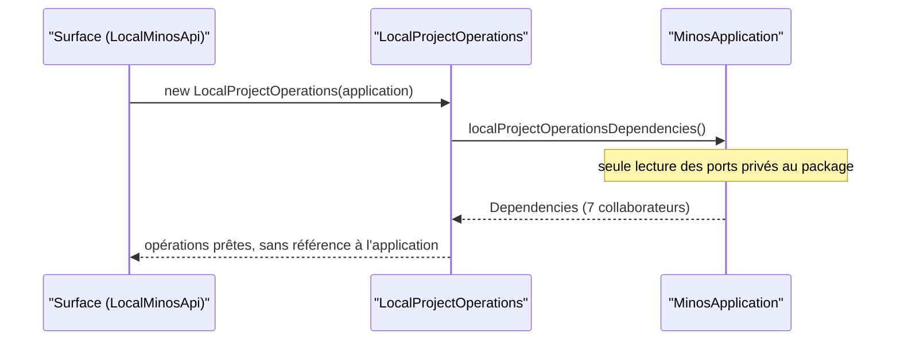
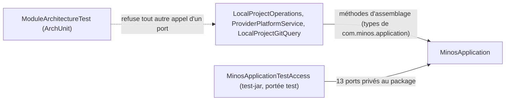

# Design

## Contexte

Motivation : voir `proposal.md` (Why). Le changement touche quatre classes du package `com.minos.application` (`minos-application`), la façade `MinosApplication`, leurs tests du même module, et `ModuleArchitectureTest` (`minos-app`). Aucune signature publique ne change, aucune sortie publique non plus. Windows et Linux : même code, sans branche de plateforme. Le test ArchUnit lit le bytecode compilé, identique sur les deux systèmes de la CI.

## État vérifié au HEAD

Relu au commit `75e10c68` (= `origin/main`, PR #819), le 2026-11-25.

| Fait | Preuve |
|---|---|
| `LocalProjectOperations` a deux constructeurs publics : `(Path home)`, qui ouvre et possède l'application, et `(MinosApplication)` | `minos-application/src/main/java/com/minos/application/LocalProjectOperations.java:47-48` |
| Le constructeur privé lit six accesseurs privés au package (`projectRegistry`, `snapshotStore`, `indexStateStore`, `scipArtifactImporter`, `retentionService`, `indexImportHistoryStore`) et le service public `projectInspectionService()` | `LocalProjectOperations.java:50-61` |
| `ProviderPlatformService` a un constructeur public à ports `(List<? extends IndexerProvider>, ProviderRuntimeManager)` ; `defaults(MinosApplication)` lit `providerCatalog()` et `providerRuntimeManager()` à chaque appel | `minos-application/src/main/java/com/minos/application/ProviderPlatformService.java:29-38` |
| Le catalogue est consulté à la demande, jamais figé à la composition | Javadoc `MinosApplication.java:288` |
| `LocalProjectGitQuery(MinosApplication)` est public et lit `gitIntelligence()` ; `LocalProjectGitQuery(GitIntelligence)` est privé au package | `minos-application/src/main/java/com/minos/application/LocalProjectGitQuery.java:16-22` |
| `LocalProjectSymbolQuery` a deux constructeurs publics : `(ProjectRegistry, CodeKnowledgeSnapshotStore)` et `(MinosApplication)`. Le second n'appelle que `projectQueryService()`, public | `minos-application/src/main/java/com/minos/application/LocalProjectSymbolQuery.java:25-32` ; `MinosApplication.java:317` |
| 18 méthodes d'instance de `MinosApplication` sont privées au package : `compositionRoot`, 6 du stockage, 8 de l'indexation, `gitIntelligence`, `indexImportHistoryStore`, `hostedControlPlaneService` | `MinosApplication.java:272`, `:275-281`, `:284-293`, `:312-314`, `:421` |
| `MinosApplicationTestAccess` relaie 13 d'entre elles. Les cinq autres (`gitIntelligence`, `providerCatalog`, `scipArtifactImporter`, `indexImportHistoryStore`, `hostedControlPlaneService`) n'ont pour lecteurs hors de la façade que les trois classes du constat, ou aucun lecteur | `minos-application/src/test/java/com/minos/application/MinosApplicationTestAccess.java` ; recherche de `<nom>()` dans `minos-*/src` |
| `hostedControlPlaneService()` n'a aucun appelant | recherche de `hostedControlPlaneService()` dans tout le dépôt : seule sa déclaration, `MinosApplication.java:421` |
| Hors de `MinosApplication`, seules les trois classes du constat appellent un accesseur privé au package (les appels homonymes de `MinosApplicationAssembler` visent `StorageBackend` et `MinosApplicationComposer`) | recherche des 18 noms dans `minos-application/src/main/java/com/minos/application/*.java` ; `MinosApplicationAssembler.java:61-109` |
| La façade assemble déjà les `Dependencies` des cas d'usage à partir de ses ports | `MinosApplication.java:350-417` (`indexingDependencies`) |
| ARCH-0087 § 2.2 : « Sa racine de composition et ses ports sont privés au package `com.minos.application` » ; § 2.1 : les cas d'usage reçoivent leurs `Dependencies` | `docs/architecture/adr/ARCH-0087-adaptateurs-embarques-et-facade-reduite.md:42-43` |
| A11 n'inspecte que les méthodes publiques de `MinosApplication` (types de retour) | `scripts/architecture/module_boundary_ratchets.py:37-43`, `:313-345` |
| `docs/user/java-api.md` donne ces points d'entrée comme remplaçants des accesseurs retirés : `new LocalProjectOperations(application)`, `ProviderPlatformService.defaults(application)`, `new LocalProjectGitQuery(application)` | `docs/user/java-api.md:357`, `:359`, `:361`, `:423`, `:425-426` ; `docs/user/release-notes/unreleased.md:34` |
| La spécification courante fixe la construction de la requête de symboles de l'API « à partir de `MinosApplication` par `LocalProjectSymbolQuery` » | `openspec/specs/frontieres-de-modules/spec.md:749-750` |
| `ModuleArchitectureTest` importe les classes de production de chaque module et connaît le module de chaque classe (`MODULE_BY_CLASS`) ; A17 lui interdit de redéclarer une table de politique | `minos-app/src/test/java/com/minos/app/architecture/ModuleArchitectureTest.java:48`, `:83-107` ; `openspec/specs/frontieres-de-modules/spec.md:1087-1088` |
| Aucun gate littéral de `scripts/` ne cite `LocalProjectOperations`, `ProviderPlatformService`, `LocalProjectGitQuery` ni `LocalProjectSymbolQuery` | recherche dans `scripts/**/*.py` et `scripts/**/*.json` (seule `MinosApplicationTestAccess` est citée : `check-module-boundaries.py:149`, `module_boundary_ratchets.py:42`, `:329`) |
| Aucun scope JaCoCo ne couvre ces classes ni `MinosApplication` | `scripts/quality/check-jacoco.py` : préfixes `com/minos/application/…` limités à `semantic/`, `Wsl`, `resolution/ProjectResolver`, `remote/`, `dynamic/`, `team/`, `export/`, `StorageBackends` |
| Le test de rétention de l'import ouvre une application complète par le `Builder` avec des doubles, pour exercer `LocalProjectOperations` | `minos-application/src/test/java/com/minos/application/LocalProjectOperationsRetentionTest.java:99`, `:137` |

### Appelants des points d'entrée (recherche textuelle, tous modules, hors `target/` et `.claude/worktrees/`)

| Point d'entrée | Production | Tests |
|---|---|---|
| `new LocalProjectOperations(MinosApplication)` | 1 : `minos-api/.../LocalMinosApi.java:96` | 6 sites dans 5 fichiers : `minos-application` 1 fichier (2), `minos-bootstrap` 1, `minos-cli` 3 fichiers (`ImportHistoryFailureTest` 2, `OwnedApplicationLifecycleTest:51`, `TeamCommandTest:70`) |
| `new LocalProjectOperations(Path)` | 0 | 2 : `minos-cli` (`LocalProjectOperationsM14StateTest:70`, `OwnedApplicationLifecycleTest:24`) |
| `ProviderPlatformService.defaults(MinosApplication)` | 4 sites dans 3 fichiers : `minos-api/.../LocalProviderPlatformApi.java:27`, `minos-cli/.../LocalAutonomousIndexOperations.java:72`, `:77`, `minos-mcp/.../MinosApplicationMcpBackend.java:85` | 5 sites dans 4 fichiers : `minos-app` 3 fichiers (4), `minos-bootstrap` 1 |
| `new ProviderPlatformService(providers, runtimes)` | 1 : `defaults` lui-même | 5 sites dans 2 fichiers (`minos-application` 4, `minos-bootstrap` 1) |
| `new LocalProjectGitQuery(MinosApplication)` | 1 : `minos-api/.../LocalMinosMultiRepositoryApi.java:43` | 1 : refus de `null`, `LocalProjectGitQueryTest.java:61` |
| `new LocalProjectGitQuery(GitIntelligence)` | 0 | 4 sites, `LocalProjectGitQueryTest` |
| `new LocalProjectSymbolQuery(MinosApplication)` | 1 : `minos-api/.../LocalMinosApi.java:97` | 1 : `minos-cli/.../TeamCommandTest.java:69` |
| `new LocalProjectSymbolQuery(ProjectRegistry, CodeKnowledgeSnapshotStore)` | 0 | 11 sites dans 7 fichiers (`minos-app` 3, `minos-bootstrap` 1, `minos-cli` 3), plus 2 sondes `scripts/m15/M15FinalQueryProbe.java:52` et `scripts/history/m15/M15RepeatedQueryProbe.java:56` |

`MinosApplicationTestAccess.` : 232 appels textuels dans les tests (l'audit en annonce 217 ; l'écart vient probablement du périmètre de recherche, non élucidé). Aucun build exécuté, aucune mutation Java reproduite : la consigne du sprint interdit `mvnw`.

## Écarts

| Écart | Source A | Source B | Suite proposée |
|---|---|---|---|
| E1 — `LocalProjectSymbolQuery` est citée comme puisant ses ports, alors qu'elle n'appelle que le service public `projectQueryService()`, et qu'elle a déjà un constructeur public à deux ports | `findings.json`, AUD-ARC-14, preuve | `LocalProjectSymbolQuery.java:25-32` | Aucun changement de comportement. Son constructeur `(MinosApplication)` délègue au constructeur privé (`this(application.projectQueryService())`), pour un seul chemin d'initialisation. Signatures conservées (D2) |
| E2 — L'audit liste six appels pour `LocalProjectOperations` ; il en oublie un septième, au service public `projectInspectionService()` | preuve de l'audit | `LocalProjectOperations.java:57` | Le service entre dans les `Dependencies` (D1), pour que la classe se construise sans application |
| E3 — L'action de l'audit est une alternative ouverte : dette écrite, cliquet ou injection | `findings.json`, action | — | D1 (injection) et D3 (cliquet sans table) recommandés ensemble, D4 en complément |
| E4 — L'action « injecter comme pour `ProjectIndexingUseCase` » laisse ouverte une suppression des constructeurs qui prennent l'application. Or `java-api.md` vient de les donner comme remplaçants publics, et la spécification courante exige que l'API construise sa requête de symboles « à partir de `MinosApplication` » | action de l'audit | `docs/user/java-api.md:357-361`, `:423-426` ; `openspec/specs/frontieres-de-modules/spec.md:749-750` | D2 : points d'entrée publics conservés, ils délèguent à la façade |
| E5 — Un « cliquet sur le nombre d'accesseurs privés au package » figerait un ensemble qui doit pouvoir changer : un nouveau port de la composition ajoute légitimement un accesseur relu par `MinosApplicationTestAccess` | action de l'audit | ARCH-0087 § 2.3 | D3 : le cliquet porte sur les **appelants** (aucune classe de production hors de la façade), pas sur le nombre |
| E6 — `hostedControlPlaneService()` n'a aucun appelant, hors des quatre classes du constat | `MinosApplication.java:421` | recherche dans tout le dépôt | D4 : supprimé dans le même groupe |
| E7 — Le dossier de capacité représente « `LocalProjectOperations`, `ProviderPlatformService` » comme lecteurs des ports privés au package | `docs/architecture/diagrams/capacites/frontieres-de-modules.md:98` | après ce changement, seule la façade lit ses ports | Mise à jour du dossier à la clôture (recouvrement avec `actualiser-le-dossier-des-frontieres-de-modules`, voir « Ordre ») |

## Exigences couvertes

- frontieres-de-modules › Les opérations locales reçoivent leurs collaborateurs et seule la façade lit ses ports — D1, D3.
- frontieres-de-modules › Les points d'entrée publics des opérations locales sont conservés — D2.
- frontieres-de-modules › Les ports sans lecteur sont retirés de la façade — D4.

## Objectifs et non-objectifs

Objectif : dans `com.minos.application`, seule `MinosApplication` lit ses ports, comme pour les cas d'usage ; les trois classes du constat se construisent et se testent sans application ouverte. Non-objectifs : changer une signature publique, réduire `MinosApplicationTestAccess`, toucher A11 ou le `test-jar` (changement `tenir-le-contrat-de-la-facade-par-le-garde`).

## Responsabilités et frontières des composants

- `MinosApplication` : seul lecteur de ses ports. Il assemble les collaborateurs de `LocalProjectOperations`, de `ProviderPlatformService` et de `LocalProjectGitQuery` par des méthodes privées au package. Leur type de retour est un type de `com.minos.application`, jamais un type du moteur. [Proposition]
- `LocalProjectOperations`, `ProviderPlatformService`, `LocalProjectGitQuery` : reçoivent leurs collaborateurs. Leurs points d'entrée publics prennent l'application et délèguent à la façade (D2). [Proposition]
- Direction ARCH-0068 inchangée. Aucune dépendance Maven ajoutée, aucun package nouveau, aucun cycle : tout reste dans `com.minos.application`.

## Modèle de domaine et invariants

- `LocalProjectOperations.Dependencies` : enregistrement privé au package, sept composantes, chacune requise non nulle et nommée dans la `NullPointerException` : registre, magasin de snapshots, magasin d'état, service d'inspection, importeur SCIP, service de rétention, historique d'import. Le résolveur de projet et `PublishedSnapshotRetention` restent dérivés dans le constructeur, comme au HEAD.
- Invariant : aucune classe de production autre que `MinosApplication` n'appelle une méthode non publique de `MinosApplication` qui rend un type de `minos-engine` ou `MinosApplicationComposer` (D3).
- `ProviderPlatformService.defaults(application)` lit le catalogue à chaque appel, comme au HEAD : la méthode d'assemblage de la façade ne met rien en cache.

## Traitements et interactions

Voir le diagramme de séquence. `new LocalProjectOperations(home)` ouvre l'application, demande les dépendances à la façade, puis garde l'application pour la fermer : propriété et ordre de fermeture inchangés.

## États et transitions

Sans objet : aucune classe ne gagne d'état. `LocalProjectOperations` possède ou non l'application, comme au HEAD.

## Contrats d'interface

Classes de `minos-application` (noms à confirmer à l'implémentation) :

- inchangés (D2) : `public LocalProjectOperations(Path)`, `public LocalProjectOperations(MinosApplication)`, `public static ProviderPlatformService defaults(MinosApplication)`, `public ProviderPlatformService(List<? extends IndexerProvider>, ProviderRuntimeManager)`, `public LocalProjectGitQuery(MinosApplication)`, `public LocalProjectSymbolQuery(MinosApplication)`, `public LocalProjectSymbolQuery(ProjectRegistry, CodeKnowledgeSnapshotStore)` ;
- ajoutés, privés au package : `LocalProjectOperations.Dependencies` et le constructeur `LocalProjectOperations(Dependencies)` ; dans `MinosApplication`, `localProjectOperationsDependencies()`, `providerPlatformService()` et `gitQuery()` (types de retour de `com.minos.application`) ;
- supprimés, privés au package (D4) : `MinosApplication.gitIntelligence()`, `providerCatalog()`, `scipArtifactImporter()`, `indexImportHistoryStore()`, `hostedControlPlaneService()`. Les champs et les contrôles de non-nullité du constructeur de `MinosApplication` (`:186-189`) restent.

`com.minos.api`, la CLI, le MCP, le protocole du plugin et NEXUS : aucun changement.

## Persistance et intégrité

Sans objet : aucun format ni écriture ne change. L'import SCIP garde son ordre : publication, état, rétention, historique.

## Transactions, concurrence et idempotence

Sans objet : les verrous de l'import (`importScipLocked`) ne changent pas.

## Sécurité et isolation

Sans effet sur le confinement, les secrets ou les E/S privées. Les ports restent privés au package : le changement réduit le nombre de lecteurs, il n'en ajoute aucun.

## Erreurs et reprise

Un collaborateur absent est refusé à la construction par `NullPointerException`, avec le nom de la composante (fail-closed, comme `ProjectIndexingUseCase.Dependencies`). Les messages publics ne changent pas.

## Observabilité

Inchangée : les journaux de `LocalProjectOperations` (`System.Logger`) gardent leurs messages.

## Performance et mesure

Sans effet mesurable : un enregistrement de plus par construction. Non mesuré.

## Compatibilité, migration et retour arrière

Compatibilité source et binaire des signatures publiques. Les suppressions de D4 portent sur des méthodes privées au package : elles ne touchent aucun code hors de `com.minos.application`. Retour arrière : revert du commit.

## Diagrammes

### Qui lit les ports de la façade après le changement ?

### Quelles méthodes non publiques de la façade restent, et qui les lit ?

## Décisions

Statut : toutes les décisions sont des propositions qui attendent l'accord du propriétaire, sauf mention contraire.

### D1 — Forme de l'injection [Proposition, recommandation]

Options :

- (a) un enregistrement `Dependencies` privé au package pour `LocalProjectOperations`, et les constructeurs à ports déjà présents pour `ProviderPlatformService` (public) et `LocalProjectGitQuery` (privé au package). La façade assemble par des méthodes privées au package ;
- (b) des méthodes publiques de façade, `application.projectOperations()`, `providerPlatform()` et `gitQuery()`, construites à la demande comme `knowledgeExport()` : une surface publique ajoutée ;
- (c) aucune injection, dette écrite au suivi.

Recommandation : **(a)**. C'est le motif de `ProjectIndexingUseCase.Dependencies` (ARCH-0087 § 2.1), sans nouvelle surface publique. Un enregistrement public nommerait sept ports du moteur dans une signature publique, ce que le changement `tenir-le-contrat-de-la-facade-par-le-garde` pourrait vouloir refuser. (b) double les points d'entrée documentés sans les retirer. (c) laisse le test de rétention dépendant d'une application complète.

### D2 — Sort des points d'entrée publics qui prennent l'application [Proposition, recommandation]

Options :

- (i) conservés, à l'identique, et délégués à la façade ;
- (ii) conservés et dépréciés, au profit de (b) ;
- (iii) retirés (**RUPTURE**).

Recommandation : **(i)**. `docs/user/java-api.md` les donne comme remplaçants des accesseurs retirés en 1.3.0 et dans la prochaine version, non encore publiée (`unreleased.md:34`). Les retirer contredirait une table de remplacement que les utilisateurs n'ont pas encore reçue. `MinosApplication` reste nommée par les contrats comme type opaque (`java-api.md`, section « Ruptures »). (iii) toucherait aussi trois fichiers de production de surfaces et une exigence courante (`spec.md:749-750`).

### D3 — Cliquet [Proposition, recommandation]

Options :

- (α) test ArchUnit dans `ModuleArchitectureTest` : aucune classe de production autre que `MinosApplication` n'appelle une méthode non publique de `MinosApplication` qui rend un type d'une classe de `minos-engine` (lu par `MODULE_BY_CLASS`) ou `MinosApplicationComposer`. Aucune table, donc rien à redéclarer au regard d'A17 ;
- (β) règle textuelle du garde Python (A11) qui cherche les appels des accesseurs dans les sources du package. Les homonymes sont nombreux (`selected.projectRegistry()`, `composer.gitIntelligence()` dans `MinosApplicationAssembler`), et l'appel chaîné `Objects.requireNonNull(application, …).gitIntelligence()` échappe à une recherche par variable ;
- (γ) cliquet sur le nombre d'accesseurs privés au package (18 au HEAD) : refusé, voir l'écart E5 ;
- (δ) aucun cliquet : dette tenue par la revue.

Recommandation : **(α)**. Le bytecode résout le receveur sans ambiguïté, et le module du type rendu vient de l'import déjà fait par le test. Le cliquet est à zéro dès la livraison. Si la constante du module moteur n'est pas lisible dans `ModuleBoundaryPolicy`, l'implémentation le signale avant d'écrire un littéral qu'A17 pourrait refuser. Limite : la règle ne tourne qu'avec `minos-app` compilé (job `Verify` de la CI), pas dans le job `invariants`.

### D4 — Accesseurs sans lecteur [Proposition, recommandation]

Après D1, `gitIntelligence()`, `providerCatalog()`, `scipArtifactImporter()` et `indexImportHistoryStore()` n'ont plus de lecteur hors de la façade. `hostedControlPlaneService()` n'en a déjà aucun. Options : les supprimer, ou les garder privés au package.

Recommandation : **supprimer**. La façade lit ses champs directement (`indexing.providerCatalog()`, `gitIntelligence`…). L'exigence courante « `gitIntelligence`, `providerCatalog`, `scipArtifactImporter` et `hostedControlPlaneService` SHALL ne plus être publics » (`spec.md:975`) reste vraie. La compilation du reactor prouve l'absence d'appelant.

### D5 — Trace dans ARCH-0087 [Question, attend le propriétaire]

ARCH-0087 § 2.2 dit les ports « privés au package » : toute classe du package peut les lire. D3 resserre la règle à la seule façade. Options :

- (a) une ligne « Mise en œuvre » (« Décision 2.1, opérations locales : changement `injecter-les-ports-des-operations-locales` ») et une ligne « Compliance and Enforcement » pour le test ArchUnit, en lisant le resserrement comme l'application de § 2.1 aux services du package ;
- (b) un ADR consolidé qui remplace ARCH-0087 et ajoute le Don't « lire un port de la façade hors de `MinosApplication` » (`.claude/rules/adr.md` : amendement partiel ⇒ ADR consolidé).

Recommandation : **(a)** si le propriétaire lit D3 comme une mise en œuvre de § 2.1. Sinon (b). Aucun ADR n'est écrit pendant la spécification : la tâche 3.3 l'applique.

### D6 — Ordre avec les changements du sprint 11 [Décision de forme]

- `tenir-le-contrat-de-la-facade-par-le-garde` (n°1) modifie `MinosApplication.java` (`projectIndexing(UnaryOperator)`), A11 et peut-être `MinosApplicationTestAccess`. **Fusionner n°1 d'abord**, puis rebaser ce changement : les conflits attendus sont textuels, dans la zone des accesseurs.
- `aligner-la-prose-de-la-facade-apres-le-sprint-10` (n°3) touche `java-api.md` et le Javadoc de classe de `MinosApplication`. Pas de recouvrement fonctionnel, car D2 laisse `java-api.md` exact. Ordre indifférent ; un rebase textuel est possible sur `MinosApplication.java`.
- `actualiser-le-dossier-des-frontieres-de-modules` (n°4) réécrit des libellés du même dossier de capacité. **Fusionner n°4 avant la clôture de ce changement**, qui ne touche ensuite que la vue `:98` et la traçabilité.

## Qualification des capacités

| Capacité | Qualification après le changement |
|---|---|
| Opérations locales construites sans application | qualifiée par les tests de `minos-application` (tâche 1.2) |
| Seule la façade lit ses ports | qualifiée par le test ArchUnit (tâche 2.1), sur le bytecode, dans le job `Verify` seulement |
| Points d'entrée publics inchangés | qualifiée par `javap` et les goldens de caractérisation (tâche 1.4) |

## Risques et compromis

- Le test ArchUnit ne tourne pas dans le job `invariants`. Une régression n'est vue qu'au `Verify`, ce qui reste un check exigé.
- Les deux constructeurs publics de `LocalProjectOperations` et de `LocalProjectSymbolQuery` restent, hors convention « constructeur unique ». Ce compromis est assumé par D2.

## Vérification

- Rouge : le test ArchUnit écrit avant la correction échoue au HEAD en nommant `LocalProjectOperations`, `ProviderPlatformService` et `LocalProjectGitQuery`, ainsi que les accesseurs appelés.
- Vert : `./mvnw -B -ntp -pl minos-application -am test`, puis `./mvnw -B -ntp -pl minos-app -am verify` (ArchUnit, goldens) ; `git diff --exit-code minos-app/src/test/resources/characterization/`.
- Mutation : sur une copie, `LocalProjectGitQuery` rappelle `application.gitIntelligence()` (accesseur rétabli) ; le test ArchUnit échoue en le nommant.
- Gates : `python scripts/architecture/check-module-boundaries.py` (A11, A17), `python scripts/architecture/test_check_module_boundaries.py`, `python scripts/quality/check-comment-language.py`, `python .claude/scripts/run_gates.py --fast`. Aucun scope JaCoCo. Couverture SonarCloud du nouveau code de `minos-application` ≥ 80 %, par des tests de ce module.

## Documentation durable à mettre à jour

- `docs/architecture/diagrams/capacites/frontieres-de-modules.md` : vue de la façade (`:98`) et lignes de traçabilité des trois exigences ajoutées.
- `docs/architecture/diagrams/capacites/analyse-git.md` : relire la vue de `LocalProjectGitQuery` (`:16`, `:34`), à mettre à jour seulement si elle montre la lecture de `gitIntelligence()`.
- ARCH-0087 selon D5.
- `docs/user/java-api.md` : aucune modification (D2) ; vérifier que les lignes `:357-361` et `:423-426` restent exactes.

## Traçabilité

| Exigence | Décision | Tâches | Preuve attendue |
|---|---|---|---|
| Les opérations locales reçoivent leurs collaborateurs et seule la façade lit ses ports | D1, D3 | 1.1-1.3, 2.1-2.3 | `LocalProjectOperationsDependenciesTest` (nom à confirmer), `LocalProjectGitQueryTest`, `ProviderPlatformServiceRuntimesTest`, `ModuleArchitectureTest#onlyTheFacadeReadsItsPorts` (nom à confirmer) |
| Les points d'entrée publics des opérations locales sont conservés | D2 | 1.4 | `javap -public` des quatre classes ; goldens de caractérisation inchangés ; test de délégation de `defaults` dans `minos-application` |
| Les ports sans lecteur sont retirés de la façade | D4 | 2.2 | `javap -p` de `MinosApplication` ; compilation du reactor |

## Questions ouvertes

- D5 : complément « Mise en œuvre » d'ARCH-0087, ou ADR consolidé ?
