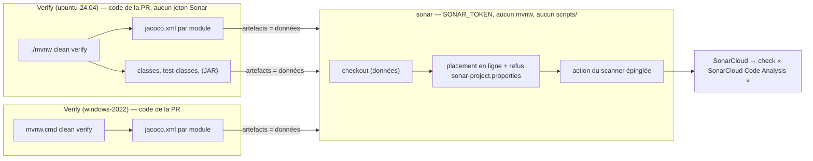

# Design

Changement d'outillage et de configuration CI : seules les sections Contexte, État vérifié, Écarts, Options, Décisions, Sécurité, Vérification et Traçabilité sont développées. Les autres sections du modèle sont « Non applicable : aucun code du produit, aucune surface publique, aucune donnée persistée n'est touché ; aucun module du reactor, donc aucune direction de dépendance ARCH-0068 en jeu ».

## Contexte

Motivation : `proposal.md` (Why). Fichiers touchés à l'implémentation : `.github/workflows/pr-ci.yml` (jobs `verify` et `sonar`), `scripts/quality/check-workflow-pins.py` et `scripts/quality/test_check_workflow_pins.py`, `docs/developer/supply-chain.md`, `docs/developer/quality-gates.md`, `.claude/rules/workflows-ci.md`, `docs/architecture/diagrams/capacites/controles-de-fusion.md`. Le job `sonar` s'exécute sur `ubuntu-24.04` ; le gate tourne dans le job `invariants` et localement sous Windows et Linux.

**Modèle de menace retenu.** Une PR d'une branche du dépôt est écrite par un collaborateur qui a déjà l'écriture : il peut modifier le workflow lui-même, aucun découpage de job ne l'empêche d'atteindre un secret. Le code visé par AUD-DEP-05 est celui qu'une PR **apporte sans être relu comme du code exécutable** : montée Dependabot d'une dépendance ou d'un plugin Maven, extension de build, configuration du wrapper. Les PR de forks ne reçoivent aucun secret (`pull_request`). La règle vise donc : aucun job qui reçoit un secret n'exécute de code du dépôt.

## État vérifié au HEAD

HEAD `535a50176` (`origin/main`, worktree `sprint10`). Lecture seule ; aucun workflow ni gate exécuté.

| Fait | Preuve |
|---|---|
| [Existant vérifié] `pr-ci.yml` est déclenché par `pull_request` (vers `main`), `push` (sur `main`) et `workflow_dispatch` ; permissions de workflow `contents: read` | `.github/workflows/pr-ci.yml:3-11` |
| [Existant vérifié] Quatre jobs : `vulnerability-scan` (réutilisable), `invariants`, `verify` (matrice Ubuntu 24.04 et Windows 2022), `sonar` | `pr-ci.yml:19`, `:49`, `:339-345`, `:567` |
| [Existant vérifié] `verify` lance `./mvnw … clean verify` (Unix) et `.\mvnw.cmd … clean verify` (Windows) sur l'arbre de la PR, puis publie `**/target/site/jacoco/jacoco.xml` dans l'artefact `jacoco-modules-${{ runner.os }}` (rétention 3 jours) ; aucune classe compilée n'est publiée | `pr-ci.yml:462-468`, `:481-484`, `:532-541` |
| [Existant vérifié] `verify` porte `DOCKERHUB_USERNAME` dans son `env:` de job et se connecte à Docker Hub avant de se déconnecter, avant tout code du dépôt (régime AUD-DEP-13) | `pr-ci.yml:348-349`, `:374-393` |
| [Existant vérifié] `sonar` : `needs: verify`, `if: !cancelled() && vars.SONAR_CI_ANALYSIS_ENABLED == 'true'`, `ubuntu-24.04`, sans `permissions:` propres (hérite `contents: read`) | `pr-ci.yml:567-572` |
| [Existant vérifié] `sonar` extrait `pull_request.head.sha` (`persist-credentials: false`), installe Java 21 avec `cache: maven`, télécharge les deux artefacts JaCoCo | `pr-ci.yml:574-602` |
| [Existant vérifié] `SONAR_TOKEN` est donné à l'étape de contrôle de présence (bash sans code du dépôt) et à l'étape d'analyse | `pr-ci.yml:608-618`, `:657-661` |
| [Existant vérifié] L'étape « Build the candidate without any secret » place les rapports puis lance `./mvnw -B -ntp -DskipTests -Djacoco.skip=true install` : plugins et processeurs de la PR s'exécutent sur ce runner et écrivent dans `~/.m2` | `pr-ci.yml:622-655` |
| [Existant vérifié] L'étape d'analyse lance `./mvnw … org.sonarsource.scanner.maven:sonar-maven-plugin:5.1.0.4751:sonar` avec hôte, organisation et projet en ligne de commande, puis compte les lignes `Importing N report(s)` contre le nombre de modules à rapport Linux | `pr-ci.yml:662-678` |
| [Existant vérifié] La dernière étape retire `~/.m2/repository/com/minos` (cache `setup-java`), après l'analyse : elle ne protège pas l'étape à jeton | `pr-ci.yml:680-685` |
| [Existant vérifié] `.mvn/` contient `wrapper/` et `maven.config` ; chaque invocation du wrapper lit ce dernier, qui vient de la PR | `.mvn/maven.config` |
| [Existant vérifié] Aucun `sonar-project.properties` dans l'arbre ; aucune propriété `sonar.*` dans les POM | `find . -name sonar-project.properties` vide ; recherche `sonar` dans `**/pom.xml` vide |
| [Existant vérifié] Le reactor a 14 modules ; un package appartient à un seul module (ARCH-0068) | `pom.xml:24-37` |
| [Existant vérifié] Le gate refuse une étape `run:` à secret d'`env:` qui lance `mvnw` ou `scripts/`, sauf `SECRET_WITH_REPOSITORY_CODE_KEPT`, dont la seule entrée est `("pr-ci.yml", "sonar", "SonarCloud CI-based analysis")` ; il refuse une phase du cycle de vie dans une étape listée et une entrée périmée | `scripts/quality/check-workflow-pins.py:140-151`, `:509-560`, `:563-570` |
| [Existant vérifié] Le gate ne regarde que l'étape : une étape à secret placée **après** une étape sans secret qui exécute du code du dépôt, dans le même job, n'est pas signalée | `check-workflow-pins.py:540-548` (boucle par étape, aucune vue du job) |
| [Existant vérifié] L'auto-test cite littéralement la table, l'étape et le job | `scripts/quality/test_check_workflow_pins.py:439-451`, `:738-834` |
| [Existant vérifié] Le check exigé `SonarCloud Code Analysis` est de source `application` ; aucun nom de job SonarCloud dans `.github/required-checks.json` | `.github/required-checks.json` |
| [Existant vérifié] `check-single-execution.py` compte les `mvnw … verify`, `check-jacoco.py`, `product-facts.py` et l'installation de la toolchain : le job `sonar` n'y figure pas | `scripts/quality/check-single-execution.py:47-50`, `:88-100` |
| [Existant vérifié] `check-ci-wiring.py` ne cite pas le job `sonar` ; le contexte d'application est compté sans job | `scripts/quality/check-ci-wiring.py` ; dossier `controles-de-fusion.md`, écart E5 |
| [Existant vérifié] Gates qui lisent `pr-ci.yml` : `check-workflow-pins.py`, `check-ci-wiring.py`, `check-single-execution.py`, `check-image-pins.py`, `check-compose-limits.py`, `check-jacoco.py`, `check-partial-result-consumers.py`, `check-twin-script-functions.py`, `check-current-docs.py`, `scripts/remediation/check-audit-remediation-v2.py`, `check-minos-01.py`, `check-p0-p2.py`, `.claude/scripts/run_gates.py` | `grep -rl pr-ci.yml scripts .claude/scripts` |
| [Existant vérifié] Aucune exigence courante sur l'analyse SonarCloud elle-même ; l'exigence `controles-de-fusion › Un secret n'accompagne pas la compilation du code d'une pull request` porte la liste fermée | `openspec/specs/controles-de-fusion/spec.md:589-626` |
| [Existant vérifié] Aucun ADR sur les secrets de CI ; prochain numéro d'ADR au-delà de 0087 | `docs/architecture/adr/` |

Non mesuré : toute exécution du job `sonar` sous une autre forme ; le journal réel du scanner ; le type et les droits du jeton ; la taille des classes et des bibliothèques à transmettre.

## Écarts

| Écart | Source A | Source B | Suite proposée |
|---|---|---|---|
| E1. Le correctif de la PR #749 sépare les **étapes**, pas les **jobs** : le build de la PR et l'étape à jeton partagent runner, `$HOME`, `~/.m2`, `.mvn/` | changement archivé, D1 | `pr-ci.yml:622-671` ; relevé du 2026-11-20 | Analyse dans un job qui n'exécute aucun code du dépôt (D1) |
| E2. La règle du gate est par étape ; le défaut est par job | `check-workflow-pins.py:540-548` | E1 | Règle par job, sans liste fermée (D2) |
| E3. L'action de l'audit (« analyse dans un job distinct qui n'exécute aucun code de la PR ») suppose qu'on puisse analyser sans compiler | action du constat | `Verify` ne publie pas les classes (`pr-ci.yml:532-541`) ; le scanner Java exige des binaires | `Verify (ubuntu-24.04)` publie les classes (D3) |
| E4. Un job qui n'exécute pas Maven ne résout pas les bibliothèques des modules | D1 | `sonar.java.libraries` attend des JAR | Transmettre les JAR de compilation ou analyser sans eux, selon la PR d'essai (D3) |
| E5. Le scanner autonome lit un `sonar-project.properties` de l'arbre analysé : la PR reprendrait la main sur la configuration (hôte, proxy) qui accompagne le jeton | comportement documenté du scanner CLI, non vérifié en ligne ici | arbre de la PR = données non fiables | Refus du fichier, paramètres dans le workflow (D4) |
| E6. Le contrôle « modules importés ≥ modules à rapport » compte des lignes de journal propres au plugin Maven (une ligne par module) | `pr-ci.yml:673-677` | le scanner autonome sur un projet unique peut écrire une seule ligne | Contrôle réécrit sur le format mesuré par la PR d'essai (tâche 2.1) ; il reste fail-closed |
| E7. La règle courante de `.claude/rules/workflows-ci.md` et `supply-chain.md` nomme `SECRET_WITH_REPOSITORY_CODE_KEPT` | `.claude/rules/workflows-ci.md`, `docs/developer/supply-chain.md:262-271` | D2 la supprime | Documentation réécrite (tâche 1.5) |

## Options

| Critère | A. Job distinct, scanner autonome sur sources, classes et rapports téléchargés | B. `workflow_run` après la CI, contexte de la branche par défaut | C. Exception écrite et acceptée (ADR) |
|---|---|---|---|
| Code de la PR exécuté avec le jeton | aucun : actions épinglées et scanner ; l'arbre, les classes et les XML sont des données | aucun si le job ne lance que le scanner ; le workflow vient de la branche par défaut, la PR ne peut pas le modifier | inchangé (modèle Maven, `.mvn/`, `~/.m2` de la PR) |
| Exposition supplémentaire | aucune | **plus large** : `workflow_run` donne les secrets du dépôt aux runs issus de forks ; artefacts d'un run de PR consommés dans un contexte privilégié (empoisonnement d'artefact) | aucune |
| Binaires Java (`sonar.java.binaries`) | classes de `Verify (ubuntu-24.04)` (mêmes classes que celles des rapports JaCoCo) | idem, par téléchargement inter-run (`actions: read`) | classes recompilées |
| Bibliothèques (`sonar.java.libraries`) | JAR transmis par `Verify` ou absents (analyse moins précise, avertissement du scanner) | idem | résolues par Maven |
| Couverture par module | 28 rapports placés dans leur module ; chemins de fichiers inchangés ; pas d'ambiguïté de résolution car un package n'a qu'un module (ARCH-0068) — à confirmer par la PR d'essai | idem | inchangée |
| Décoration de PR | détection automatique de l'événement `pull_request` par le scanner — à confirmer | paramètres `sonar.pullrequest.*` à passer à la main depuis l'événement déclencheur ; numéro de PR absent pour un fork | inchangée |
| Dependabot | inchangé (secret Dependabot) ; la montée de l'action du scanner est une montée d'action épinglée, relue | secrets du dépôt sans secret Dependabot, mais au prix de l'exposition ci-dessus | inchangé |
| Coût | plus rapide (plus de `install` des 14 modules) ; envoi des classes en plus | deux workflows, état de check retardé, téléchargement inter-run | nul |
| Statut d'AUD-DEP-05 | fermable | fermable, risque nouveau | reste partiel, accepté |

## Décisions

Décision du propriétaire du 2026-11-24 : les recommandations de ce design sont retenues.
### D1 — Option A : un job qui ne lance que le scanner

[Proposition, en attente du propriétaire] Le job `sonar` garde son identifiant et sa condition. Étapes : checkout du head de la PR (`persist-credentials: false`, profondeur complète pour l'historique SCM) ; contrôle de présence du jeton ; téléchargement des artefacts de `Verify` (rapports Linux et Windows, classes, bibliothèques si D3 les retient) ; placement des rapports et des classes dans leur module par un script **en ligne** du workflow (`bash` sans `scripts/`, sans `mvnw`) ; contrôle D4 ; analyse par une action du scanner épinglée par SHA, paramètres en ligne de commande. Plus de `setup-java` avec `cache: maven`, plus d'étape de purge de `~/.m2`. Recommandation : A, seule option qui ferme le constat sans élargir l'exposition. B est écartée (secrets donnés aux runs de forks, empoisonnement d'artefacts, décoration manuelle) ; C est le repli si la PR d'essai montre une perte d'analyse inacceptable.

[Question] Action du scanner : `sonarsource/sonarqube-scan-action` épinglée par SHA (le gate l'exige déjà) ou archive du scanner CLI téléchargée et vérifiée par empreinte SHA-256 dans le workflow. Recommandation : l'action, à une version sans avis de sécurité ouvert, vérifiés au moment de l'épinglage (non vérifiés ici) ; noter si l'action télécharge le scanner avec ou sans contrôle d'intégrité.

[Décision] Relevé à l'épinglage (2026-11-24, tâche 2.2) : `SonarSource/sonarqube-scan-action` **v8.5.1**, commit `70bad232163b09d998ea0707ee80c0ec80798c16` (`gh api repos/SonarSource/sonarqube-scan-action/commits/v8.5.1`, publiée le 2026-11-23). Avis publiés du dépôt (`gh api repos/SonarSource/sonarqube-scan-action/security-advisories`) : deux, tous deux corrigés bien avant la v8 (`GHSA-f79p-9c5r-xg88`, ≤ 5.3.0 ; `GHSA-5xq9-5g24-4g6f`, ≥ 4 et < 6) ; aucun avis ouvert sur la v8.5.1. Intégrité : l'action (`src/main/install-sonar-scanner.js` au commit épinglé) télécharge le scanner CLI 8.5.0.16571 puis vérifie sa **signature GPG** avant extraction, sauf `skipSignatureVerification: true` (non utilisé). Les arguments (`args`) sont découpés par `string-argv`, sans shell, et passés à `@actions/exec`.

### D2 — Règle par job, sans exception

[Décision] `check-workflow-pins.py`, pour un workflow dont le `on:` contient `pull_request` : un job dont une étape reçoit un `secrets.` par son `env:` d'étape, ou par le `with:` d'une action autre que `docker/login-action`, SHALL NOT contenir d'étape qui lance `mvnw`, un script de `scripts/` ou une action locale (`uses: ./…`). La table `SECRET_WITH_REPOSITORY_CODE_KEPT`, sa raison et le contrôle de phase disparaissent ; le contrôle des `env:` de job ou de workflow (seul `DOCKERHUB_USERNAME`) est conservé. `docker/login-action` reste régi par `DOCKER_LOGIN_KEPT` et la déconnexion (exigence AUD-DEP-13, inchangée) : sans cette exclusion, `verify` serait signalé alors que son jeton est retiré avant le code. Écarté : garder une liste fermée par job (aucun job n'en aurait besoin après D1, et une exception rouvrirait E1).

### D3 — Classes et bibliothèques publiées par `Verify (ubuntu-24.04)`

[Proposition] `Verify (ubuntu-24.04)` publie un artefact `sonar-binaries-Linux` (`**/target/classes/**`, `**/target/test-classes/**`, rétention 3 jours). Pour les bibliothèques, deux formes sont mesurées par la PR d'essai : (i) une étape **sans secret** de `Verify` copie les JAR des dépendances de compilation dans l'artefact ; (ii) aucune bibliothèque, analyse acceptée avec l'avertissement du scanner. Recommandation : (i) si l'artefact reste raisonnable et que l'écart d'anomalies remontées par rapport à l'analyse Maven est nul ou expliqué ; sinon (ii), écrit comme limite dans `supply-chain.md`. Les artefacts viennent d'un job qui a exécuté le code de la PR : le job `sonar` les traite comme des données (aucune exécution, aucune extraction hors du répertoire de travail).

[Décision] État à l'implémentation (2026-11-24), en attendant la PR d'essai (tâche 2.1) : forme **(ii)**. `Verify (ubuntu-24.04)` publie `sonar-binaries-Linux` restreint aux fichiers `.class` (`minos-*/target/classes/**/*.class`, `minos-*/target/test-classes/**/*.class`) ; aucune bibliothèque n'est transmise, limite écrite dans `supply-chain.md`. La forme (i) demanderait une invocation Maven de plus dans `Verify` (plugin de dépendances non épinglé dans le POM) : elle n'est ajoutée qu'après la mesure. Le job `sonar` désigne les modules par motifs `minos-*` (sources, binaires, rapports) et vérifie, sans secret, que le reactor du POM racine est exactement ces répertoires, chacun avec ses classes ; aucune donnée de la PR n'entre dans les arguments du scanner. E6 : le journal de l'action n'est pas lisible par une étape suivante ; le contrôle fail-closed porte, avant l'analyse, sur les rapports donnés au scanner (Linux présents, tous lus par ses motifs), et l'import réel reste à constater dans le journal de la CI (tâches 1.4, 2.1).

### D4 — Aucune configuration du scanner venue de la PR

[Décision] Le job `sonar` échoue si l'arbre extrait contient un fichier `sonar-project.properties`, à n'importe quelle profondeur, avant l'étape d'analyse ; hôte, organisation, projet, sources, binaires et rapports sont écrits dans le workflow. Le refus ne dépend pas de la priorité, non vérifiée ici, d'un argument de ligne de commande sur un fichier de l'arbre. Le dépôt n'en contient aucun aujourd'hui.

## Sécurité et isolation

Question à laquelle répond le diagramme : quel job reçoit le jeton, et quel code s'y exécute. Fail-closed : jeton absent, rapports Linux absents, classes absentes, fichier de configuration présent, rapports importés en nombre insuffisant → le job échoue. Windows : seul le job `verify` Windows est concerné (rapports, inchangé) ; le gate s'exécute sous les deux systèmes.

## Qualification

| Capacité | Statut visé | Preuve |
|---|---|---|
| Aucun job à secret d'un workflow `pull_request` n'exécute de code du dépôt | qualifiée par le gate | `check-workflow-pins.py` sur le dépôt réel et sur copies mutées |
| Analyse SonarCloud complète (anomalies, couverture Linux et Windows, décoration) sans Maven | partielle jusqu'à la PR d'essai | tâche 2.1 |

## Vérification

- Auto-test : `python scripts/quality/test_check_workflow_pins.py` (cas : job à secret qui lance `mvnw` dans une autre étape, job à secret qui lance `scripts/`, job à secret qui appelle une action locale, secret passé par `with:` à une action, `docker/login-action` non concerné, workflow sans `pull_request`, `env:` de job conservé).
- Gates : `python scripts/quality/check-workflow-pins.py`, `python scripts/quality/check-ci-wiring.py`, `python scripts/quality/check-single-execution.py`, `python scripts/quality/check-toolchain-baseline.py`, `python scripts/docs/check-current-docs.py`, `python .claude/scripts/run_gates.py`.
- CI (PR d'essai, puis PR du changement) : le job `sonar` est vert, importe la couverture de tous les modules à rapport, la PR est décorée et le check `SonarCloud Code Analysis` rend son verdict ; l'écart d'anomalies avec la dernière analyse Maven de `main` est relevé. Non vérifiable localement.
- Non vérifié par ce changement : une PR Dependabot (secret Dependabot).

## Traçabilité

| Exigence (capacité › titre) | Scénario | Conception | Tâche | Test ou preuve |
|---|---|---|---|---|
| controles-de-fusion › Un secret n'accompagne pas la compilation du code d'une pull request | Compilation avec le jeton d'analyse | D2 | 1.1 | `scripts/quality/test_check_workflow_pins.py` `SecretWithRepositoryCodeTest.test_the_analysis_token_given_to_a_compilation_is_refused` |
| idem | Étape hors liste qui reçoit un secret et lance un script du dépôt | D2 | 1.1 | `test_a_step_that_receives_a_secret_and_runs_a_script_of_the_repository_is_refused` |
| idem | Entrée de liste sans objet | D2 | 1.1 | `RepositoryTest.test_no_exception_list_for_a_secret_and_repository_code_is_declared` |
| idem | Identifiant Docker Hub au niveau du job | D2 | 1.1 | `test_the_docker_hub_identifier_may_stay_in_the_job_env` |
| idem | Job à secret qui compile dans une autre étape | D2 | 1.1, 1.3 | `test_a_job_that_compiles_in_another_step_than_the_one_with_the_secret_is_refused` ; copie mutée du vrai `pr-ci.yml` : `RepositoryTest.test_the_analysis_job_of_the_repository_runs_no_repository_code` |
| idem | Job à secret qui lance un script ou une action locale | D2 | 1.1, 1.3 | `test_a_job_that_runs_a_script_or_a_local_action_in_another_step_is_refused` |
| idem | Secret passé par `with:` | D2 | 1.1, 1.3 | `test_a_secret_passed_through_with_counts_as_given_to_the_job` |
| idem | Connexion à un registre | D2 | 1.1 | `test_a_registry_login_then_the_wrapper_is_left_to_the_registry_rule` ; `RepositoryTest.test_the_verify_job_of_the_repository_is_not_named_for_its_registry_login` |
| idem | Secret remonté au niveau du job | D2 | 1.1 | `test_a_secret_raised_to_the_job_or_to_the_workflow_is_refused` ; `RepositoryTest.test_the_token_moved_to_the_job_is_named` |
| idem | Workflow sans déclencheur pull_request | D2 | 1.1 | `test_a_workflow_that_no_pull_request_starts_is_not_concerned` |
| idem | Dépôt réel | D1, D2 | 1.2, 1.3, 2.1 | `python scripts/quality/check-workflow-pins.py` sur le dépôt (succès) ; run CI — **manquante** (tâches 1.4, 2.1) |
| controles-de-fusion › L'analyse d'une pull request ne lit aucune configuration du scanner venue de la pull request | Job d'analyse sans contrôle du fichier de configuration | D4 | 1.1, 1.3 | `ScannerConfigurationTest.test_an_analysis_job_without_the_refusal_is_refused` ; `RepositoryTest.test_the_analysis_job_of_the_repository_refuses_a_scanner_configuration` |
| idem | Hôte de l'analyse absent du workflow | D4 | 1.1, 1.3 | `ScannerConfigurationTest.test_an_analysis_step_without_its_host_is_refused_and_names_the_parameter` ; `RepositoryTest.test_the_analysis_step_of_the_repository_writes_its_host` |
| idem | Dépôt réel | D4 | 1.3, 1.4, 2.1 | gate sur le dépôt (succès) ; refus effectif du fichier par le job : simulation locale du script de l'étape, pas de run CI — **manquante** (tâches 1.4, 2.1) |

## Documentation durable à mettre à jour

`docs/developer/supply-chain.md` (section AUD-DEP-05 : job isolé, plus de risque résiduel Maven, limite éventuelle des bibliothèques, type du jeton), `docs/developer/quality-gates.md`, `.claude/rules/workflows-ci.md`, `docs/architecture/diagrams/capacites/controles-de-fusion.md` (à l'archivage).

## Questions ouvertes

- [Question] D1 : option A (recommandée), B ou C — décision du propriétaire.
- [Question] D1 : action du scanner ou CLI vérifié par empreinte.
- [Question] D3 : bibliothèques transmises ou non.
- [Question] Type du jeton SonarCloud (tâche manuelle 3.1).
