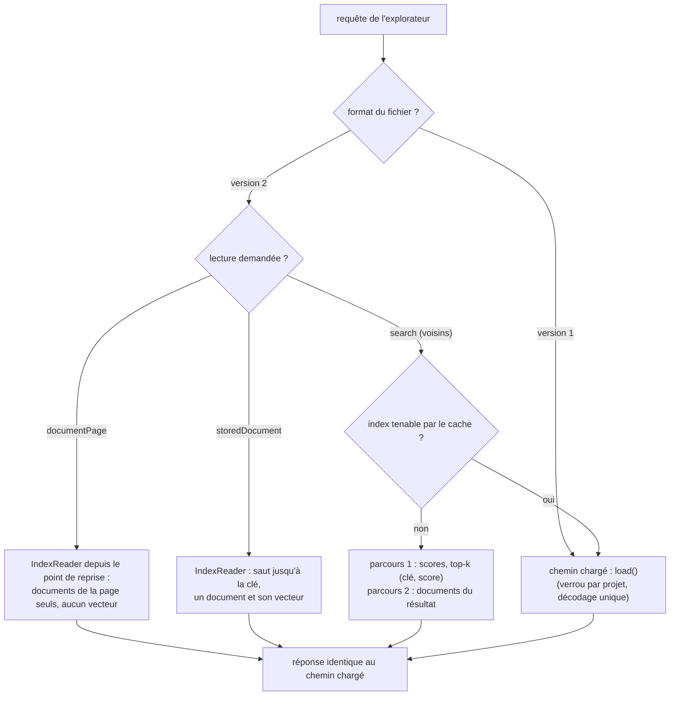

# Design

## Contexte

Motivation : voir `proposal.md` (Why). Le changement est limité à `FileSemanticVectorStore` (`minos-storage`, `com.minos.storage.local.store`), l'implémentation locale du port `SemanticVectorStore`. Les appelants sont `SemanticCorpusQueryService` (liste, détail, voisins de l'explorateur) et, pour `search`, les services de recherche sémantique. Le décorateur `ProjectMutationSemanticVectorStore` délègue déjà `documentPage`, `storedDocument`, `vectorPage` et `search` (`ProjectMutationSemanticVectorStore.java:49-70`).

Le store sait déjà lire le fichier sans le charger : `checksums` et `vectorPage` parcourent le fichier par un `IndexReader` qui saute ce qu'on ne lui demande pas, avec un point de reprise. Ce changement étend ce mécanisme aux lectures qui ne l'ont pas.

Prérequis non livré au HEAD : le banc de AUD-PERF-13 (sprint 1).

## État vérifié au HEAD

HEAD `89be3fb4`. Lecture du code seulement ; aucun index n'a été construit ni chargé.

| Fait | Preuve |
|---|---|
| Surcharges de lecture du store local : `load`, `metadata`, `checksums`, `vectorPage` ; ni `documents`, ni `documentPage`, ni `storedDocument`, ni `search` | `minos-storage/src/main/java/com/minos/storage/local/store/FileSemanticVectorStore.java:84`, `:152`, `:187`, `:220` |
| `documentPage` par défaut : `documents()` (donc `load()`), copie et tri de tous les documents pour une page | `minos-domain/src/main/java/com/minos/semantic/SemanticVectorStore.java:60-62`, `:86-105` |
| `storedDocument` par défaut : `load()` puis recherche linéaire | même fichier `:115-128` |
| `search` par défaut : `load()` puis balayage cosinus exact | même fichier `:190-223` |
| Les voisins appellent `storedDocument`, `search`, puis `metadata` | `minos-application/src/main/java/com/minos/application/semantic/SemanticCorpusQueryService.java:250-255` |
| La liste filtrée enchaîne des `documentPage` de 200 jusqu'à 2 000 documents lus | même fichier `:40`, `:47`, `:148`, `:166` |
| Cache pondéré de 256 Mio par défaut ; poids d'un vecteur compté à 8 octets par dimension | `FileSemanticVectorStore.java:60`, `:716` |
| `load` : recherche en cache sous verrou, puis décodage **hors verrou** ; deux lectures froides décodent deux fois | même fichier `:93-144` |
| `load` refuse l'index quand les vecteurs décodés dépassent 192 Mio, comptés à 8 octets par dimension | même fichier `:59`, `:134`, `:691-699` |
| Vecteurs écrits en `float`, relus en `double[]` | même fichier `:135-138`, `:646-654` |
| La synchronisation refuse de construire un index au-delà de 250 000 documents, de 192 Mio de contenu ou de 192 Mio de vecteurs comptés à 8 octets par dimension : le seuil de `load` est celui de la construction | `minos-application/src/main/java/com/minos/application/semantic/SemanticIndexBudget.java:15-19`, `:59-75` ; `SemanticIndexService.java:137-138` ; `SemanticDocumentFactory.java:73` |
| Poids d'une entrée de cache : 256 octets et `dimensions × 8` par document, plus le poids de six chaînes | `FileSemanticVectorStore.java:712-724` |
| Le budget de décodage est une constante privée ; le constructeur de test n'injecte que le plafond du cache | même fichier `:59`, `:75-81` |
| `vectorPage` compare l'empreinte du fichier avant et après l'ouverture et échoue s'il a été remplacé entre les deux ; aucun test n'atteint cette fenêtre | même fichier `:229-234` |
| Garantie testée au HEAD : une reprise après remplacement de l'index lit le nouvel index depuis son début | `minos-storage/src/test/java/com/minos/storage/local/store/FileSemanticVectorStoreStreamedReadsTest.java:76-89` |
| Fichier refusé au-delà de 384 Mio, à l'écriture comme à chaque lecture | même fichier `:57`, `:355`, `:537-541` |
| Fichier version 2 écrit en ordre de clé stable ; `vectorPage` refuse un fichier hors ordre et renvoie la version 1 au chemin chargé | même fichier `:322-324`, `:226-228`, `:293-295` |
| Un seul point de reprise par projet, tenu pour `vectorPage` | même fichier `:69`, `:253-268` |
| Compteurs observables : `cacheStats()` (succès, échecs de cache, évictions) | même fichier `:423-427` |
| Au délai de 30 s, le serveur annule la tâche (`pending.cancel(true)`) et répond 503 | `minos-explorer/src/main/java/com/minos/explorer/ExplorerServer.java:285-289` |
| Tests existants des lectures en flux et du contrat de lecture | `minos-storage/src/test/java/com/minos/storage/local/store/FileSemanticVectorStoreStreamedReadsTest.java`, `FileSemanticDocumentReadsContractTest.java` |
| Gates qui affirment des chaînes de ce fichier | `scripts/remediation/check-mne.py:80-83` ; `scripts/quality/check-semantic-retrieval-consistency.py:90-106` |
| Scope JaCoCo du fichier | `scripts/quality/check-jacoco.py:96` (`semantic-vector-store`, lignes 0,45, branches 0,20) |

**Non mesuré, non reproduit** : la latence d'une page, le tas alloué par un décodage, le nombre de décodages simultanés après un 503, la taille de contenu à partir de laquelle un index constructible dépasse le plafond du cache, et l'effet réel de `cancel(true)` sur un décodage en cours.

## Écarts

| Écart | Source A | Source B | Suite proposée |
|---|---|---|---|
| L'audit chiffre le défaut à « environ 30 000 documents » à 768 dimensions et au-delà ; la synchronisation ne construit pas plus de 32 768 documents à cette dimension | `findings.json` AUD-PERF-03, impact | `SemanticIndexBudget.java:15-19`, `:59-75` | Le domaine réel est un index constructible dont le poids en cache dépasse 256 Mio (vecteurs ≤ 192 Mio, plus chaînes et surcoût) : il existe, il est borné, et il est relu à chaque requête |
| `load` refuse un index au-delà du budget de décodage ; un tel fichier ne peut venir que d'une écriture hors synchronisation | `FileSemanticVectorStore.java:134`, `:691-699` | `SemanticIndexBudget.java:59-75` | Hors objectif : les lectures en flux ne dépendent pas de ce budget, mais ce cas n'est ni visé ni testé (la constante n'est pas injectable, `:59`, `:75-81`) |
| L'action couvre `documentPage` et `storedDocument` ; les voisins appellent aussi `search`, qui charge l'index. Le critère de sortie du sprint nomme le voisinage | `findings.json` AUD-PERF-03, action ; `sprints.md` sprint 4 | `SemanticCorpusQueryService.java:254` ; `SemanticVectorStore.java:196` | Exigence « les voisins sont classés sans retenir l'index », D3 |
| Un classement cosinus exact lit tous les vecteurs : « ne décode pas l'index vectoriel entier » ne peut pas valoir au pied de la lettre pour les voisins | `sprints.md` sprint 4, critère de sortie | exploration-semantique › Les voisins d'un document sont classés depuis son vecteur stocké | L'exigence porte sur la rétention (ni index ni contenus retenus), pas sur la lecture des vecteurs. À accepter par le propriétaire |
| L'action « garder les vecteurs en `float[]` en mémoire » touche `SemanticVector`, type du domaine en `double[]` | `findings.json` AUD-PERF-03, action | `minos-domain/src/main/java/com/minos/semantic/SemanticVector.java:47-48` | D4 : reporté (sprint 5) |
| L'audit écrit que « le travail continue en tâche de fond » après le délai ; le serveur demande l'annulation | `findings.json` AUD-PERF-03, preuve | `ExplorerServer.java:288` | Effet de l'interruption sur le décodage non vérifié ; hors périmètre (sprint 3) |
| Le scénario de référence de AUD-PERF-13, « index local de 100 000 documents à 768 dimensions », n'est pas constructible : 586 Mio de vecteurs à 8 octets par dimension contre un budget de 192 Mio ; écrit directement dans le store, il frôlerait le plafond de fichier (307 Mo de vecteurs sur 384 Mio) et `load` le refuserait | `findings.json` AUD-PERF-13, action | `SemanticIndexBudget.java:59-75` ; `FileSemanticVectorStore.java:57`, `:691-699` | Signalé au sprint 1 ; la mesure locale se fait sur des index constructibles (32 768 documents à 768 dimensions, 98 304 à 256) |
| « Fichier remplacé pendant la lecture → erreur » n'est pas la garantie observable de `vectorPage` : l'erreur ne couvre que la fenêtre entre l'empreinte et l'ouverture, qu'aucun test n'atteint ; ce qui est testé est la relecture du nouvel index depuis son début | `FileSemanticVectorStore.java:229-234` | `FileSemanticVectorStoreStreamedReadsTest.java:76-89` | L'exigence reprend la garantie testée (scénario « Index remplacé entre deux pages ») ; la fenêtre garde son contrôle, sans scénario |
| Un point de reprise unique par projet : deux parcours entrelacés (préparation et liste) se l'effacent et repartent du début du fichier | — | `FileSemanticVectorStore.java:253-268` | D2 : points de reprise distincts par type de lecture |

## Exigences couvertes

- exploration-semantique › En stockage local, une page de documents est lue sans charger l'index — D1, D2.
- exploration-semantique › En stockage local, le détail lit le seul document demandé — D1.
- exploration-semantique › En stockage local, les voisins sont classés sans retenir l'index — D3.
- exploration-semantique › Des lectures simultanées d'un index local que le cache tient ne le décodent qu'une fois — « Transactions, concurrence et idempotence ».

## Objectifs et non-objectifs

Objectif : qu'aucune requête de l'explorateur en stockage local n'ait besoin de l'index entier en mémoire. Non-objectifs : relever un plafond, changer le format du fichier, accélérer la recherche sémantique des index que le cache tient.

## Responsabilités et frontières des composants

Une seule classe de `minos-storage` change (et ses classes internes `IndexReader`, `VectorWalk`). Le port du domaine garde ses défauts, qui restent le chemin des stores simples et du format version 1. Aucune dépendance nouvelle : direction ARCH-0068 inchangée.

## Modèle de domaine et invariants

- Ordre : un fichier version 2 est en ordre strict de clé stable ; toute lecture en flux le vérifie en avançant et refuse un fichier qui ne l'est pas [Existant vérifié pour `vectorPage`, étendu].
- Identité : une lecture en flux se fait sur un fichier identifié par son empreinte (`FileStamp` : taille et date) ; un point de reprise ne vaut que pour l'empreinte qui l'a produit. Après un remplacement, la page est lue sur le nouvel index, depuis son début, avec ses métadonnées : jamais une page mixte. Le contrôle de la fenêtre entre empreinte et ouverture (`:229-234`) est repris tel quel.
- Équivalence : pour tout index, page, document et classement rendus en flux sont égaux à ceux du chemin chargé (mêmes valeurs `float` relues en `double`, même formule de score, même ordre de départage par clé stable).

## Traitements et interactions

Voir le diagramme. Page de documents : ouverture au point de reprise s'il suit la clé demandée, sinon au début ; les entrées antérieures à la clé sont sautées (chaînes et vecteur non décodés) ; les `limit` suivantes sont décodées sans leur vecteur. Détail : parcours qui saute jusqu'à la clé et s'arrête dès qu'une clé plus grande est lue. Voisins : un parcours calcule le score de chaque vecteur, décodé le temps du calcul, et garde les `limit` meilleurs (clé, score) ; un second parcours décode les seuls documents retenus.

## États et transitions

Non applicable.

## Contrats d'interface

API Java du port, inchangée : `documentPage(projectId, afterStableKey, limit)`, `storedDocument(projectId, stableKey)`, `search(projectId, query, limit, minimumScore)`, mêmes bornes et mêmes refus (`requireDocumentPageBounds`, dimensions différentes, score hors `[-1, 1]`). Les réponses HTTP de l'explorateur ne changent pas.

## Persistance et intégrité

Aucune écriture. Format du fichier (`index-v2.bin`) inchangé. Les plafonds par chaîne (`MAX_STRING_BYTES`) et de fichier s'appliquent à chaque lecture ; le budget de décodage (`DecodeBudget`, constantes inchangées et toujours présentes pour `check-mne.py`) s'applique à ce qu'une lecture décode réellement (une page, un document, les documents d'un résultat).

## Transactions, concurrence et idempotence

- Décodage complet : un verrou par projet autour de « absent du cache → décoder → publier dans le cache » ; les requêtes en attente relisent le cache à l'acquisition. Un index que le cache refuse (trop lourd) reste décodé par chaque appelant du chemin chargé : quatre requêtes simultanées le décodent toujours quatre fois, **en série** sous le verrou au lieu d'en parallèle. Le verrou y borne le pic de tas, pas le travail ; c'est le cas que les lectures en flux retirent à l'explorateur. L'exigence de décodage unique vaut pour un index que le cache tient.
- Points de reprise : par projet et par type de lecture (vecteurs, documents), protégés comme aujourd'hui ; un point de reprise qui ne suit pas la demande est ignoré, jamais faux.
- Aucune attente non bornée nouvelle : le verrou de décodage n'est tenu que pendant un décodage ; l'attente d'une requête de l'explorateur reste bornée par le délai du serveur.

## Sécurité et isolation

Lectures par `ConfinedFileOpener.openRegularFileNoFollowChannel` (primitive du gate `check-private-io.py`), comme `vectorPage`. Fail-closed : fichier hors ordre, tronqué, remplacé, ou dimensions incohérentes → erreur, sans résultat partiel. Messages avec le nom de feuille du fichier seulement (`leafName`), aucun chemin absolu.

## Erreurs et reprise

`IOException` existantes reprises telles quelles (« truncated semantic index », « semantic index is not in stable-key order », « semantic index was replaced while it was read; read it again »). Côté explorateur, un index remplacé entre deux pages reste le conflit existant.

## Observabilité

`cacheStats()` : le compteur d'échecs de cache sert de compteur de décodages complets dans les tests (une lecture en flux ne l'incrémente pas).

## Performance et mesure

Aucun objectif chiffré : aucune source. Stratégie :

1. **Avant** (sur `main`) : banc de AUD-PERF-13, stockage local, index construits par la synchronisation — un index sous le plafond du cache, et un index de 32 768 documents à 768 dimensions dont le contenu porte le poids en cache au-dessus de 256 Mio (le relever par `cacheStats()`) : latence p50/p95 des routes liste, liste filtrée, détail, voisins ; tas retenu ; quatre requêtes simultanées à froid.
2. **Après** : même banc, mêmes jeux.

Tailles des jeux. La synchronisation ne construit pas d'index au-delà de `SemanticIndexBudget.DEFAULT` (250 000 documents ; 192 Mio de vecteurs à 8 octets par dimension, soit 32 768 documents à 768 dimensions et 98 304 à 256). Le critère de sortie du sprint, « gain mesuré sur un index réel », n'est tenable qu'à ces tailles ; aucun jeu plus grand n'est demandé ici.
3. Consignation dans la PR et, par le propriétaire, dans `docs/project/audits/2026-11-15/SUIVI.md`.

Le coût d'un détail sans point de reprise est un saut séquentiel du fichier jusqu'à la clé : s'il domine la mesure, un index d'offsets en mémoire par empreinte de fichier est la suite, en [Question].

## Compatibilité, migration et retour arrière

Aucune migration ; les index existants sont lus tels quels, version 1 comprise (chemin chargé). Retour arrière : revenir au code précédent.

## Diagrammes

### Quel chemin sert chaque lecture locale de l'explorateur après le changement ?

Type : flowchart · Portée : cible proposée · Exigences : les quatre exigences ajoutées

Les nœuds `IndexReader` existent au HEAD pour `vectorPage` et `checksums` ; les trois branches de la version 2 sont la cible.

## Décisions

### D1 — Étendre le lecteur en flux existant plutôt qu'ajouter un index annexe [Proposition]

Choix : `documentPage` et `storedDocument` sur le modèle de `vectorPage`. Alternative écartée : fichier annexe d'offsets (nouveau format persisté, à publier atomiquement avec l'index). Alternative reportée : index d'offsets en mémoire, si la mesure le justifie.

### D2 — Un point de reprise par type de lecture [Proposition]

Choix : la reprise de la liste n'efface pas celle d'une préparation de projection en cours, et inversement. Compromis : deux utilisateurs qui paginent le même projet en même temps se partagent encore un point de reprise ; la lecture reste juste, seulement moins rapide.

### D3 — Voisins sans rétention seulement quand le cache ne peut pas tenir l'index [Proposition, décision du propriétaire attendue]

Choix : `search` garde le chemin chargé quand l'index tient dans le cache (un processus MCP ou CLI qui enchaîne les recherches garde son cache chaud) ; sinon il classe en flux. Le critère : l'index n'est pas tenu par le cache — entrée refusée à un chargement précédent du même fichier (mémorisée par empreinte), ou poids minimal lu sur l'en-tête (documents × (dimensions × 8 + 256) octets) déjà au-dessus du plafond. Conséquence à assumer : la recherche sémantique locale passe par le même `search` ; sur un index que le cache ne tient pas, elle prend le parcours sans rétention, avec le même résultat. Aucune taille d'index nouvelle n'en découle : la synchronisation borne toujours ce qui est construit. Alternative : limiter le changement à la liste et au détail et laisser les voisins au chemin chargé — le critère de sortie du sprint n'est alors pas tenu pour le voisinage. Recommandation : retenir D3.

### D4 — Vecteurs en `float[]` en mémoire : reporté [Décision du propriétaire attendue]

`SemanticVector` (domaine) garde ses valeurs en `double[]` et sert l'embedding, l'écriture, la recherche et les scores. Passer en `float[]` divise par deux le poids du cache mais change un type du domaine et peut déplacer des scores au dernier chiffre (goldens). Recommandation : le traiter avec AUD-PERF-04 (sprint 5), sur une mesure du tas.

## Qualification des capacités

`exploration-semantique`, stockage local : reste « livré, testé automatiquement sous Windows et Linux ». Pour un index constructible plus lourd que le plafond du cache, la liste, le détail et les voisins sont **partiels** tant que le banc ne les a pas mesurés. La taille maximale d'un index reste celle que la synchronisation construit ; ce changement n'en annonce aucune autre. Aucun comportement propre à une plateforme attendu ; le test de concurrence est rejoué sur les deux.

## Risques et compromis

- [Risque] un gate littéral casse sur une restructuration de la classe → conserver les chaînes affirmées par `check-mne.py` et `check-semantic-retrieval-consistency.py`, les rejouer à chaque tâche.
- [Risque] classement en flux différent du chemin chargé à égalité de score → même comparateur (score décroissant puis clé stable), test d'égalité stricte.
- [Risque] verrou par projet qui retient des requêtes derrière un décodage lent → attente bornée par le délai du serveur ; mesuré par le banc à quatre requêtes.
- [Risque] couverture du scope `semantic-vector-store` abaissée par le code neuf → tests dans la même tâche que le code.

## Vérification

- `FileSemanticDocumentReadsContractTest` et `FileSemanticVectorStoreStreamedReadsTest` étendus ; nouveau test de concurrence (quatre fils, rejoué 50 fois, sans `Thread.sleep` de synchronisation).
- Commande : `./mvnw -B -ntp -pl minos-storage -am test "-Dtest=FileSemantic*Test" "-Dsurefire.failIfNoSpecifiedTests=false"`.
- Gates : `scripts/remediation/check-mne.py`, `scripts/quality/check-semantic-retrieval-consistency.py`, `scripts/architecture/check-private-io.py`, `scripts/quality/check-comment-language.py`, `python .claude/scripts/run_gates.py --fast` ; scope JaCoCo `semantic-vector-store`.
- Non vérifiable sans le banc : latences et tas (manuel).

## Documentation durable à mettre à jour

`docs/architecture/diagrams/capacites/exploration-semantique.md` ; `docs/user/semantic-explorer.md` (comportement sur un gros index local, sans chiffre non mesuré) ; `docs/developer/indexing-and-storage.md` si la lecture de l'index sémantique y est décrite ; `docs/project/audits/2026-11-15/SUIVI.md` (propriétaire).

## Traçabilité

| Exigence (capacité › titre) | Scénario | Conception ou diagramme | Tâche | Test ou preuve |
|---|---|---|---|---|
| exploration-semantique › En stockage local, une page de documents est lue sans charger l'index | Index plus lourd que le plafond du cache | D1, diagramme | 2.1, 2.2 | `FileSemanticDocumentReadsContractTest` — à étendre |
| idem | Index remplacé entre deux pages | Invariants | 2.1, 2.2 | `FileSemanticVectorStoreStreamedReadsTest` — à étendre (modèle : `:76-89`) |
| idem | Fichier hors ordre | Invariants | 2.1, 2.2 | idem — à étendre |
| exploration-semantique › En stockage local, le détail lit le seul document demandé | Document présent ; Clé absente | D1 | 2.1, 2.3 | `FileSemanticDocumentReadsContractTest` — à étendre |
| exploration-semantique › En stockage local, les voisins sont classés sans retenir l'index | Même classement que l'index chargé | D3 | 3.1, 3.2 | test à écrire |
| idem | Dimensions différentes | Contrats | 3.1, 3.2 | test à écrire |
| exploration-semantique › Des lectures simultanées d'un index local que le cache tient ne le décodent qu'une fois | Quatre lectures froides simultanées ; Décodage en échec | Concurrence | 4.1, 4.2 | test de concurrence — à écrire |
| (mesure du sprint) | — | Performance et mesure | 1.2, 5.1 | sorties du banc — manquantes |

## Questions ouvertes

- D3 et D4 : décisions du propriétaire, recommandations ci-dessus.
- Index d'offsets en mémoire pour le détail : seulement si la mesure « après » le désigne.
- Seuil d'acceptation du gain, à fixer sur la mesure « avant ».
