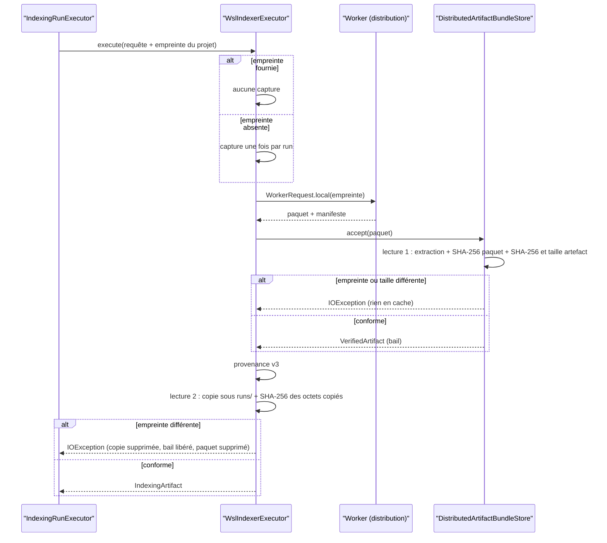

# Design

## Contexte

La voie WSL2 (ADR SEC-0079) exécute scip-java dans une distribution, reçoit un paquet `manifest.properties` +
`index.scip`, le fait accepter par `DistributedArtifactBundleStore`, vérifie sa provenance v3, puis copie l'artefact
sous `runs/<runId>/` où l'orchestration le confine comme tout artefact de provider. Motivation : voir `proposal.md`
(Why). Modules touchés : `minos-engine` (port d'exécution), `minos-runtime-local` (voie et magasin),
`minos-bootstrap` (câblage). Aucune surface publique.

## État vérifié au HEAD

HEAD `89be3fb4`. Lecture du code, aucun build ni test exécuté.

| Fait | Preuve |
|---|---|
| L'exécuteur capture l'empreinte du projet enregistré à chaque `execute` | `minos-runtime-local/src/main/java/com/minos/runtime/local/wsl/WslIndexerExecutor.java:73` |
| `execute` est appelé une fois par cible | `minos-engine/src/main/java/com/minos/orchestration/IndexingRunExecutor.java:307-308`, `:336-344` |
| L'orchestration mémorise une empreinte par scope et réutilise l'empreinte de référence pour le scope racine | `IndexingRunExecutor.java:325-335` ; `minos-engine/src/main/java/com/minos/orchestration/ReferenceFingerprint.java:24-27` |
| `capture(racine)` est exactement `captureScope(racine, "")` | `minos-engine/src/main/java/com/minos/incremental/ProjectFingerprintService.java:60-62` |
| La voie reçoit un service d'empreintes neuf, distinct de celui de l'orchestration | `minos-bootstrap/src/main/java/com/minos/bootstrap/LocalWslIndexingRoute.java:137-138` |
| L'empreinte sert de jeton de provenance : recopiée par la distribution dans le manifeste, comparée à la requête, composante de la clé de cache | `minos-runtime-local/src/main/java/com/minos/runtime/local/wsl/WslLinuxWorker.java:167-171` ; `WslArtifactProvenance.java:36` ; `DistributedArtifactBundleStore.java:613-630` |
| La requête d'exécution a neuf composants et trois constructeurs de commodité (huit, six et quatre arguments) | `minos-engine/src/main/java/com/minos/orchestration/IndexingRuntimePorts.java:236-246`, `:279`, `:295`, `:306` |
| Le constructeur canonique à neuf arguments est appelé directement hors du moteur | `WslLinuxWorker.java:154-156` ; `WslArtifactProvenanceTest.java:183-184` ; `WslIndexWorkerTest.java:240` ; `PreLaunchPathAuthorizationTest.java:127`, `:148` ; `minos-engine/src/test/java/com/minos/remote/DistributedIndexingWorkerRequestTest.java:73` |
| Avant `accept`, le manifeste du paquet reçu est lu en parcourant toutes les entrées du zip | `minos-runtime-local/src/main/java/com/minos/runtime/local/wsl/WslIndexWorker.java:172` ; `DistributedArtifactBundleStore.java:507-529` |
| Acceptation : extraction (lecture 1), empreinte de l'artefact extrait (lecture 2), empreinte du paquet (lecture 3) | `DistributedArtifactBundleStore.java:184`, `:191`, `:206` |
| L'entrée de cache n'est rehachée que si son manifeste est égal à celui reçu (court-circuit) | `DistributedArtifactBundleStore.java:544-547` |
| Copie sous le run par tampon de 8 Kio (lecture 4) puis relecture de la cible (lecture 5) | `WslIndexerExecutor.java:136-147`, `:152-156` |
| La cible est créée par création exclusive durcie | `WslIndexerExecutor.java:137` (`PrivateLocalStorage.createPrivateOutputStream`) |
| Côté distribution : empreinte pour le manifeste, puis empreinte de contrôle, puis écriture dans le paquet (trois lectures) | `WslLinuxWorker.java:171`, `:172` ; `DistributedArtifactBundleStore.java:128`, `:144-146` |
| `bundleSha256` et `cacheHit` sont rendus par l'indexation distante | `DistributedArtifactBundleStore.java:735-741` ; `scripts/quality/check-remote-distributed-consistency.py:160` |
| `WslIndexerExecutor` n'a pas de classe de test propre ; il est exercé par `WslArtifactProvenanceTest` | `minos-runtime-local/src/test/java/com/minos/runtime/local/wsl/WslArtifactProvenanceTest.java:74` |
| L'ADR de la voie demande de vérifier, recopier, libérer le bail, supprimer le paquet, sans imposer une relecture | `docs/architecture/adr/SEC-0079-indexation-java-depuis-windows-par-wsl2.md:76`, `:103` |

Non mesuré : durée des lectures sur un artefact réel ; taux de succès du cache sur la voie.

## Écarts

| Écart | Source A | Source B | Suite proposée |
|---|---|---|---|
| L'audit propose de porter « l'empreinte de scope déjà calculée (`CheckpointMaterial`) ». La voie utilise l'empreinte du **projet enregistré**, pas celle du scope : pour une cible hors racine, les deux valeurs diffèrent | `findings.json`, AUD-PERF-07, action | `WslIndexerExecutor.java:73` ; `ProjectFingerprintService.java:64-75` | Porter l'empreinte du projet (scope racine), jamais celle d'un sous-scope (D1) |
| L'empreinte de référence n'est réutilisable que si le service du run est celui qui l'a capturée ; sinon l'orchestration n'a pas d'empreinte racine pour une cible hors racine | `ReferenceFingerprint.java:24-27` | action de l'audit | Repli : une capture par run dans la voie (D2) |
| « Le même octet est haché deux fois dans le même répertoire privé » : vrai pour `:191` puis `:152` ; faux pour `:546`, qui vérifie un **autre fichier** (entrée de cache d'une acceptation antérieure) | `findings.json`, AUD-PERF-08, impact | `DistributedArtifactBundleStore.java:203-207`, `:531-551` | Garder la vérification de l'entrée réutilisée ; ne pas appliquer cette partie de l'action |
| Le critère de sortie du sprint (« au plus deux fois ») ne tient donc que sur le chemin nominal | `sprints.md`, sprint 6 | idem | L'exigence le dit ; le cas identique ajoute une lecture, gardée pour l'intégrité |
| L'audit ne compte pas la lecture du manifeste qui précède `accept` : six lectures côté Windows au HEAD (sept sur entrée identique), trois après le changement | `findings.json`, AUD-PERF-08, titre | `WslIndexWorker.java:172` ; `DistributedArtifactBundleStore.java:513-523` | Hors périmètre : elle détecte une entrée de manifeste dupliquée et fournit le manifeste comparé en `WslIndexerExecutor.java:80` ; l'exigence borne le décompte à « entre l'acceptation et le retour » |
| L'audit ne compte pas les trois lectures côté distribution | `findings.json`, AUD-PERF-08, preuve | `WslLinuxWorker.java:171-172` ; `DistributedArtifactBundleStore.java:128`, `:144-146` | Vérifier pendant l'écriture du paquet (deux lectures) |
| L'artefact rendu est relu ensuite par le point de contrôle et par l'import | `minos-engine/src/main/java/com/minos/orchestration/ExecutionCheckpoints.java:49-69` | critère de sortie | Hors périmètre : commun à tous les providers |
| Le Javadoc de `copyUnderRun` promet une relecture de la copie | `WslIndexerExecutor.java:115-118` | D3 | Javadoc à aligner dans la tâche de correction |

## Exigences couvertes

- indexation-java-via-wsl › La voie WSL réutilise l'empreinte du projet connue de l'indexation — D1, D2, « Traitements et interactions ».
- indexation-java-via-wsl › L'artefact de WSL est lu au plus deux fois entre l'acceptation du paquet et son retour —
  D3, D4, D6.
- indexation-java-via-wsl › Le paquet produit dans la distribution est vérifié pendant son écriture — D5.

## Objectifs et non-objectifs

Objectif : même garantie d'intégrité, moins de lectures. Non-objectifs : changer le format du paquet ou du manifeste,
changer la politique du cache, toucher aux empreintes de l'orchestration.

## Responsabilités et frontières des composants

- `minos-engine` : `IndexingExecutionRequest` porte un composant facultatif ; `IndexingRunExecutor` le renseigne.
  Aucune dépendance nouvelle.
- `minos-runtime-local` : `WslIndexerExecutor` consomme le composant ; `DistributedArtifactBundleStore` calcule les
  empreintes en flux. Le magasin reste dans son package `distributed`, non exporté (A10 inchangée).
- `minos-bootstrap` : câblage inchangé dans sa forme (`LocalWslIndexingRoute.java:137-138`).

Direction `engine → runtime` respectée (ARCH-0068) : le moteur ne nomme aucun type du runtime.

## Modèle de domaine et invariants

- `IndexingExecutionRequest.registeredProjectFingerprint` : `Optional<String>` ; présent, il vaut 64 caractères
  hexadécimaux en minuscules (même règle que `WslWorkerRequest.java:74-75`) ; sinon `IllegalArgumentException`.
- Invariant : la valeur fournie est celle du scope racine du projet enregistré, capturée par le service du run.
- Le composant s'ajoute en dixième position du constructeur canonique. Une surcharge à neuf arguments, de même
  signature que le canonique actuel, délègue avec `Optional.empty()`, comme les trois constructeurs de commodité :
  `WslLinuxWorker.java:154-156` et les tests qui appellent la forme à neuf arguments compilent sans changement.

## Traitements et interactions

Voir le diagramme. Refus : empreinte mal formée (construction de la requête), empreinte ou taille différente du
manifeste (acceptation ou copie), provenance différente (inchangé).

## États et transitions

Non applicable : aucun cycle de vie nouveau ; le bail et le paquet gardent leur libération sur les deux issues, par
le `catch` qui libère puis relance et par la libération qui suit le succès (`WslIndexerExecutor.java:87-92`).

## Contrats d'interface

- Port Java interne `IndexingRuntimePorts.IndexingExecutionRequest` : composant ajouté, facultatif, additif.
- `DistributedArtifactBundleStore.accept(Path)` et `createBundle(...)` : signatures et messages d'erreur inchangés.
- Fil `WslWorkerRequest` et manifeste v3 : inchangés (`WslWorkerRequest.java:60-63`).

## Persistance et intégrité

Aucun format persisté ne change. Empreintes comparées au manifeste après le changement :

| Contrôle | Avant | Après |
|---|---|---|
| Taille de l'artefact extrait = manifeste | `:187-190` | conservé (compteur de l'extraction) |
| SHA-256 de l'artefact extrait = manifeste | relecture `:191` | calculé sur les octets écrits pendant l'extraction (D3) |
| SHA-256 du paquet (`bundleSha256`) | relecture `:206` | calculé pendant la lecture du paquet, flux lu jusqu'à sa fin |
| Entrée de cache identique revérifiée | `:546` | conservé |
| SHA-256 de la copie sous le run = manifeste | relecture `:152` | calculé sur les octets copiés ; taille de la cible contrôlée après fermeture (D3) |
| Provenance v3 | `WslArtifactProvenance.verify` | inchangé |

## Transactions, concurrence et idempotence

Inchangé : bande de verrou par clé puis bail (`DistributedArtifactBundleStore.java:197-202`). L'empreinte du paquet
est désormais calculée avant la prise du bail ; elle ne dépend pas du bail. Reprise d'un run : la cible est supprimée
puis recréée (`WslIndexerExecutor.java:133-134`), inchangé.

## Sécurité et isolation

- Fail-closed conservé : toute différence d'empreinte ou de taille lève une `IOException`, supprime la copie, libère
  le bail et supprime le paquet.
- Ordre vérification → usage : l'artefact n'est déplacé vers le cache qu'après comparaison au manifeste ; la copie
  n'est rendue qu'après comparaison.
- Calculer l'empreinte pendant l'extraction lie l'empreinte aux octets **effectivement écrits**, sans fenêtre entre
  l'écriture et une relecture ; le dossier d'extraction est privé et créé par MINOS
  (`DistributedArtifactBundleStore.java:181`).
- L'empreinte fournie par l'orchestration reste « calculée par l'installation Windows avant le lancement »
  (SEC-0079, l. 62). Elle n'est pas un contrôle des sources : la distribution ne la recalcule pas.
- E/S par les primitives existantes (`ConfinedFileOpener`, `PrivateLocalStorage`) ; aucune entrée ajoutée à
  `private-io-allowlist.json`.

## Erreurs et reprise

Messages existants conservés (« transported artifact checksum does not match its manifest », « WSL artifact copy does
not match its verified checksum », « distributed worker artifact checksum does not match its manifest »). Aucun chemin
absolu.

## Observabilité

Non applicable : aucun journal ni diagnostic ajouté. Le compteur d'ouvertures est une couture de test, absente du
chemin de production.

## Performance et mesure

Aucun objectif chiffré : l'audit n'a pas mesuré. Stratégie : compter les lectures (tests) ; mesure de durée
facultative sur un artefact synthétique de 256 Mio, acceptation puis copie, avant et après, sous Windows —
[Question] non bloquante, à joindre à la PR si elle est faite.

## Compatibilité, migration et retour arrière

Additif. Retour arrière : revenir au commit précédent ; aucune donnée persistée à migrer, le cache reste lisible dans
les deux sens.

## Diagrammes

### Combien de fois l'arbre et l'artefact sont-ils lus pour une cible, après le changement ?

Type : sequenceDiagram · Portée : cible proposée · Exigences : indexation-java-via-wsl › La voie WSL réutilise
l'empreinte du projet connue de l'indexation ; › L'artefact de WSL est lu au plus deux fois entre l'acceptation du
paquet et son retour

Deux lectures de l'artefact entre l'acceptation et le retour sur le chemin nominal (la lecture du manifeste par le
worker, antérieure et inchangée, n'est pas représentée) ; zéro hachage de l'arbre par la voie quand l'orchestration fournit
l'empreinte.

## Décisions

### D1 — La requête porte l'empreinte du projet enregistré, pas celle du scope

[Proposition] `IndexingRunExecutor` renseigne le composant avec `rootScopeFingerprint` quand il est présent, sinon
avec l'empreinte du scope racine s'il l'a déjà capturée pour ce run (`context.scopeFingerprints`), sinon vide.
Alternative écartée : porter `CheckpointMaterial` (action de l'audit) — pour un scope hors racine la valeur change de
sens et la clé de cache avec elle.

### D2 — Repli : une capture par run dans la voie

[Proposition] Sans empreinte fournie, `WslIndexerExecutor` capture une fois et mémorise pour le `runId` et la racine
enregistrée. Alternative écartée : faire capturer la racine par l'orchestration pour toute cible — cela ajouterait un
hachage aux runs sans voie WSL.

### D3 — Empreinte des octets écrits, à l'extraction et à la copie

[Proposition — décision du propriétaire attendue] La décision porte sur les deux relectures de même nature : celle de
l'artefact extrait (`DistributedArtifactBundleStore.java:191`) et celle de la copie sous le run
(`WslIndexerExecutor.java:152`). Dans les deux cas, le manifeste serait comparé aux octets **écrits** au lieu des
octets **relus du disque**.

- **A (recommandée)** : SHA-256 calculé pendant l'extraction sur les octets écrits dans le dossier d'extraction, et
  pendant la copie sur les octets lus de l'entrée de cache ; taille du fichier écrit contrôlée après fermeture dans
  les deux cas. Les deux fichiers sont créés par création exclusive durcie dans un dossier privé : ce qui y est écrit
  est ce qui a été haché. Une modification ultérieure du fichier n'est couverte ni par cette option ni par les
  relectures actuelles, qui précèdent elles aussi l'usage. Ce que l'option ne détecte plus : une divergence entre
  les octets remis au système de fichiers et ceux qu'il rend à la relecture.
- **B** : garder les deux relectures (`:191`, `:152`) et ne fusionner que l'empreinte du paquet avec l'extraction.
  Quatre lectures sur le chemin nominal ; le critère de sortie du sprint (« au plus deux ») n'est pas atteint, et
  l'exigence correspondante est à réécrire avant l'implémentation.
- **C** : option A pour la copie seule, relecture de l'extraction conservée : trois lectures ; même réécriture de
  l'exigence.

### D4 — La vérification d'une entrée de cache réutilisée est conservée

[Décision de conception] L'action de l'audit (« ne pas rehacher l'entrée de cache ») n'est pas appliquée : l'entrée
est un fichier d'une acceptation antérieure. Coût réel faible : le manifeste (dont `startedAt`, `completedAt`) doit
être égal, ce qui n'arrive pas quand un run relance la cible.

### D5 — Le paquet est vérifié pendant son écriture

[Proposition] `createBundle` calcule l'empreinte pendant le transfert vers le paquet et échoue avant publication si
elle diffère du manifeste ; le fichier temporaire est supprimé par le `finally` existant
(`DistributedArtifactBundleStore.java:151-153`).

### D6 — Compteur d'ouvertures en couture de test

[Proposition] Couture package-private du magasin et de l'exécuteur (même forme que `startForTest`,
`ProviderWriteQuotaSupervisor.java:90-97`), sans point d'entrée public. Alternative écartée : gate littéral sur le source
(GEN-0043 : ancrer sur la structure, pas sur des chaînes).

### ADR

SEC-0079 : compléter « Mise en œuvre » (empreinte du run réutilisée, empreintes en flux, contrôles conservés). Aucun
ADR nouveau : pas de choix structurant, la décision 3 de SEC-0079 est inchangée.

## Qualification des capacités

`indexation-java-via-wsl` : qualification inchangée (voir son dossier). Les exigences ajoutées sont **qualifiées**
par tests unitaires indépendants de la plateforme ; aucune exécution réelle de la voie n'est requise ni affirmée.

## Risques et compromis

- [Risque] Empreinte du paquet fausse si le flux n'est pas lu jusqu'à sa fin (répertoire central du zip) →
  test d'égalité avec le SHA-256 du fichier, déjà affirmé par `check-remote-distributed-consistency.py` pour
  l'indexation distante.
- [Risque] Sites d'appel du record cassés → constructeurs de commodité conservés.
- [Risque] Conflit de fusion avec le scope JaCoCo du sprint 1 → ce changement ne touche pas `check-jacoco.py`.
- [Risque] Le changement `tracer-les-echecs-internes-des-surfaces` (sprint 3) ajoute une exigence à la même capacité
  et touche `WslLinuxWorker` → ici, exigences `ADDED` aux titres distincts seulement, et une seule ligne de
  `WslLinuxWorker` modifiée (construction de la requête) ; le second fusionné se rebase.

## Vérification

- Tests : `WslIndexerExecutorTest` (nouveau), `WslArtifactProvenanceTest`, `DistributedArtifactBundleStoreTest`,
  `DistributedIndexerExecutorProvenanceTest`, test du record dans `minos-engine`.
- Commandes : `./mvnw -B -ntp -pl minos-runtime-local -am test`, puis `./mvnw -B -ntp -pl minos-bootstrap -am test`
  (jamais en parallèle).
- Gates : voir `proposal.md` (Impact).
- Non vérifiable localement : la voie réelle exige une distribution WSL2 préparée ; rejeu manuel facultatif.

## Documentation durable à mettre à jour

`docs/architecture/diagrams/capacites/indexation-java-via-wsl.md` (exigences ajoutées, séquence) ; ADR SEC-0079
(« Mise en œuvre »).

## Traçabilité

| Exigence (capacité › titre) | Scénario | Conception ou diagramme | Tâche | Test ou preuve |
|---|---|---|---|---|
| indexation-java-via-wsl › La voie WSL réutilise l'empreinte du projet connue de l'indexation | Deux cibles avec l'empreinte fournie | D1, diagramme | 1.1, 1.2 | `WslIndexerExecutorTest` — à écrire |
| idem | Deux cibles sans empreinte fournie | D2 | 1.1, 1.2 | `WslIndexerExecutorTest` — à écrire |
| idem | Empreinte fournie mal formée | Modèle de domaine | 1.1, 1.2 | test du record — à écrire |
| idem | Manifeste qui porte une autre empreinte | Sécurité | 1.3 | `WslArtifactProvenanceTest` — existant, à rejouer |
| indexation-java-via-wsl › L'artefact de WSL est lu au plus deux fois entre l'acceptation du paquet et son retour | Chemin nominal compté | D3, D6 | 2.1, 2.2 | `WslIndexerExecutorTest` — à écrire |
| idem | Artefact du paquet différent de son manifeste | Persistance et intégrité | 2.1, 2.2 | `DistributedArtifactBundleStoreTest` — à compléter |
| idem | Entrée de cache altérée entre l'acceptation et la copie | D3 | 2.1, 2.2 | `WslIndexerExecutorTest` — à écrire |
| idem | Entrée de cache déjà présente à l'identique | D4 | 2.1 | `DistributedArtifactBundleStoreTest` — à compléter |
| indexation-java-via-wsl › Le paquet produit dans la distribution est vérifié pendant son écriture | Artefact conforme à son manifeste | D5 | 3.1 | `DistributedArtifactBundleStoreTest` — existant |
| idem | Artefact modifié après le calcul du manifeste | D5 | 3.1 | garde verte au HEAD (`DistributedArtifactBundleStore.java:128`), à garder verte ; absence de `.bundle-*.tmp` à affirmer |
| idem | Source lue une seule fois par la fabrication | D5, D6 | 3.1 | `DistributedArtifactBundleStoreTest` — à écrire (2 ouvertures au HEAD) |

## Questions ouvertes

- D3 : option A, B ou C (recommandation : A). Attendue avant la tâche 2.2.
- Mesure de durée sur un gros artefact : facultative, non bloquante.
