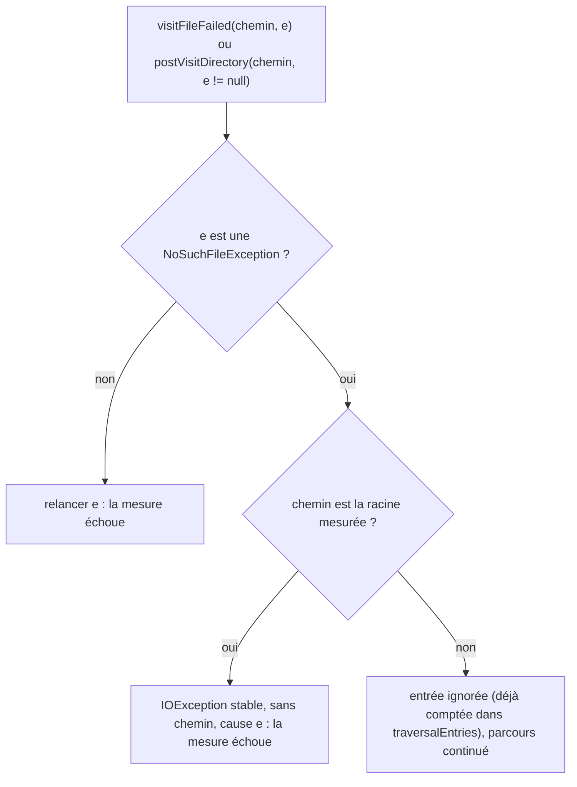

# Design

## Contexte

Motivation : voir `proposal.md` (Why). Le changement touche `RemoteCloneBudget` et sa classe interne `TreeMeter` (`minos-integration-git`, paquet `com.minos.integration.git`) et leur test. Il ne change aucune dépendance entre modules (ARCH-0068 inchangé) ni aucune surface publique. Windows et Linux sont concernés, avec une différence de comportement du JDK sur les fichiers supprimés pendant un parcours (écart 2).

## État vérifié au HEAD

Relu au commit `535a50176` (PR #804), dans le worktree `.claude/worktrees/sprint10`.

| Fait | Preuve |
|---|---|
| `checkpoint()` contrôle le délai, rend une mesure vide si la racine n'existe pas (`Files.exists`, liens suivis), puis parcourt la racine par `Files.walkFileTree(destination, meter)` sans suivre les liens | `minos-integration-git/src/main/java/com/minos/integration/git/RemoteCloneBudget.java:36-43` |
| `visitFileFailed` contrôle le délai, compte une entrée parcourue, contrôle les cardinalités, puis appelle `tolerateVanishedEntry(failure)` sans regarder le chemin | `RemoteCloneBudget.java:76-83` |
| `postVisitDirectory` appelle `tolerateVanishedEntry` pour toute erreur, racine comprise | `RemoteCloneBudget.java:85-89` |
| `tolerateVanishedEntry` est statique, ne reçoit que l'exception et ne relance que ce qui n'est pas une `NoSuchFileException` ; sa Javadoc justifie le cas d'une entrée (« a lock file ») | `RemoteCloneBudget.java:116-122` |
| Introduit par le commit `31ce126c7` (PR #800) ; avant, `visitFileFailed` relançait toute erreur | `git show 31ce126c7 -- .../RemoteCloneBudget.java` |
| Les autres refus du budget portent des messages stables sans chemin (« remote repository exceeds the configured clone … limit ») | `RemoteCloneBudget.java:70`, `:104-112`, `:16` |
| Tests existants : `tolerateVanishedEntry` appelé directement (`:21-34`), `visitFileFailed` et `postVisitDirectory` appelés avec des exceptions fabriquées sur des chemins **hors** de la racine mesurée (`root.resolve("gc.log.lock")`, `root`, alors que la racine est `root/repository`) (`:36-64`), un arbre stable mesuré par `checkpoint()` (`:70-81`). Aucun parcours réel où une entrée disparaît, aucune racine absente | `minos-integration-git/src/test/java/com/minos/integration/git/RemoteCloneBudgetTest.java:17-82` |
| Appelants : mesure pendant le clone par le moniteur de progression (erreur mémorisée puis relancée) et après extraction | `minos-integration-git/src/main/java/com/minos/integration/git/JGitRemoteGitClient.java:87`, `:162-173`, `:89-90` |
| Appelants : mesure de l'entrée temporaire avant publication, revalidation d'une entrée du cache (toute exception rend l'entrée inutilisable), mesure des entrées pendant l'éviction (toute exception rend le candidat invalide, taille 0) | `minos-integration-git/src/main/java/com/minos/integration/git/JGitRemoteRepositoryMaterializer.java:235`, `:279` et `:285-287`, `:339-346` |
| Une éviction qui ne peut pas supprimer un candidat invalide (bail d'éviction tenu ailleurs) échoue : « remote cache limits cannot be satisfied … » | `JGitRemoteRepositoryMaterializer.java:358-373` |
| `CloneBudget` est une sous-classe de compatibilité de `RemoteCloneBudget` | `JGitRemoteRepositoryMaterializer.java:475-480` |
| Précédent du dépôt : le superviseur de quota n'ignore une `NoSuchFileException` que hors de la racine (`!file.equals(root)`) et traite à part la disparition de la racine | `minos-runtime-local/src/main/java/com/minos/runtime/local/workspace/ProviderWriteQuotaSupervisor.java:33-36`, `:227-231`, `:260-263` |
| Le message public d'un échec de `remote materialize` passe par `PublicErrorMessages.sanitize` | `minos-cli/src/main/java/com/minos/cli/command/RemoteIndexCommand.java:68-70` ; `minos-cli/src/main/java/com/minos/cli/CliCommandSupport.java:225-232` (chemin du fichier : `grep -rl "class CliCommandSupport" minos-cli/src/main`) |
| Gates littéraux qui lisent `RemoteCloneBudget.java` : `maxBytes`, `maxFiles`, `maxDirectories`, `maxTraversalEntries`, `cloneTimeout`, `Files.walkFileTree`, `enforceTimeout` | `scripts/quality/check-remote-distributed-consistency.py:47`, `:64-66` |
| idem : `files > maxFiles`, `directories > maxDirectories`, `traversalEntries > maxTraversalEntries`, `Files.walkFileTree` | `scripts/remediation/check-post-mne.py:89`, `:161-163` |
| idem : fichier témoin du `checkedAdd` qui lève ; l'auto-test attend exactement un helper contrôlé dans le fichier et mute le message « remote cache byte counter overflow » | `scripts/quality/check-bounded-helpers.py:278`, `:331-350` |
| Aucun gate ne cite `tolerateVanishedEntry` ; `check-post228-hardening.py:34` cite `failure instanceof NoSuchFileException` mais dans `ProviderWriteQuotaSupervisor.java` | recherche dans `scripts/` |
| Le scope JaCoCo `m25-remote-distributed-indexing` couvre `JGitRemoteRepositoryMaterializer*` (donc `JGitRemoteRepositoryMaterializer$CloneBudget`) mais aucun préfixe ne couvre `RemoteCloneBudget` | `scripts/quality/check-jacoco.py:211-232` |
| Aucune exigence de `openspec/specs/` ne spécifie le budget du clone ; `analyse-git` porte la matérialisation distante (`:146`, `:166`) ; le dossier durable décrit le moniteur de budget (vue V2) ; SEC-0083 mentionne « le même moniteur de budget » sans règle de disparition | `openspec/specs/analyse-git/spec.md:146-183` ; `docs/architecture/diagrams/capacites/analyse-git.md:67-97` ; `docs/architecture/adr/SEC-0083-filtres-git-a-la-materialisation-d-un-depot-distant.md:38`, `:83` |
| Aucun changement actif au moment de la création (`openspec list` : « No active changes found ») | commande exécutée le 2026-11-24 |

Sonde exécutée (fichier source autonome lancé par `java`, scratchpad de session, JDK 24.0.1 — pas le JDK 21 de la baseline), visiteur qui journalise chaque événement de `Files.walkFileTree` :

| Cas | Windows 10 (NTFS) | Linux (WSL Ubuntu, `/tmp`) |
|---|---|---|
| Racine absente | `visitFileFailed(<racine>, NoSuchFileException)` | idem |
| Racine avec répertoires `a` et `b`, le second supprimé dans `preVisitDirectory` du premier (5 essais) | `pre <racine>`, `pre a`, `post a`, `visitFileFailed(b, NoSuchFileException)`, `post <racine>` (5/5) | idem (5/5) |
| Racine avec un répertoire et deux fichiers, fichiers supprimés pendant la visite du répertoire | le fichier non encore visité est rendu par `visitFile` (attributs du listage en cache), **aucun échec** | le fichier non encore visité échoue par `visitFileFailed(NoSuchFileException)` |

Non reproduit : la sonde javac de l'audit sur la classe elle-même (`TreeMetrics[bytes=0, files=0, directories=0, traversalEntries=1]`) ; elle découle directement de `:76-83` et du premier cas de la sonde ci-dessus. Non mesuré : la disparition de la racine **pendant** son listage (événement `postVisitDirectory(<racine>, exception)`), non provoquée de façon déterministe ; le comportement sous JDK 21 (la sonde a tourné sous JDK 24) ; un parcours sur un système de fichiers autre que NTFS et ext4 de WSL.

## Écarts

| Écart | Source A | Source B | Suite proposée |
|---|---|---|---|
| 1. L'action ne vise que `visitFileFailed` ; `postVisitDirectory` tolère aussi une `NoSuchFileException` sur la racine (racine supprimée pendant son listage) | `findings.json`, AUD-SEC-11, action | `RemoteCloneBudget.java:85-89` | D2 : refuser la racine aux deux endroits |
| 2. L'action propose « un répertoire dont un frère est supprimé pendant la marche » ; un **fichier** frère supprimé ne produit aucun échec sur Windows (attributs en cache) | même action | sonde, cas 3 | D4 : le frère supprimé est un répertoire ; un fichier ne sert pas de preuve multiplateforme |
| 3. L'action attend une `IOException` pour la racine absente ; `checkpoint()` rend une mesure vide pour une racine absente **avant** le parcours (`Files.exists`), si bien qu'un test par `checkpoint()` sur une racine absente reste vert au HEAD | même action | `RemoteCloneBudget.java:38` | D4 et D5 : le rouge passe par `Files.walkFileTree` avec le compteur du budget ; le contrôle d'existence reste |
| 4. Relancer la `NoSuchFileException` d'origine exposerait le chemin absolu de la racine dans le message ; les autres refus du budget ont un message stable | action (« attendu : IOException ») | `RemoteCloneBudget.java:70`, `:104-112` ; règle de sécurité 7 | D3 : message stable, cause attachée |
| 5. Une racine qui serait un lien symbolique est mesurée comme une seule entrée (parcours sans suivi des liens) ; une racine lien pendante rend une mesure vide (`Files.exists` suit les liens) | audit (question de la demande) | `RemoteCloneBudget.java:38-40` | hors périmètre : les racines mesurées sont créées par MINOS sous le cache privé ; question ouverte |
| 6. Les tests existants de `visitFileFailed` et `postVisitDirectory` utilisent des chemins hors de la racine mesurée ; avec un critère « strictement sous la racine » ils deviendraient des refus | `RemoteCloneBudgetTest.java:40`, `:52`, `:60-63` | action (« entrées sous la racine ») | D1 : critère d'égalité avec la racine ; les tests passent leurs chemins sous la racine pour la lisibilité |
| 7. `RemoteCloneBudget` n'est dans aucun scope JaCoCo alors qu'il porte un contrôle fail-closed | `scripts/quality/check-jacoco.py:211-232` | règle de sécurité 1 | D6 |

## Exigences couvertes

- analyse-git › La mesure du budget d'un clone distant échoue quand sa racine disparaît — D1 à D4, « Traitements et interactions », « Vérification ».

## Objectifs et non-objectifs

Objectif : qu'aucune disparition de la racine pendant le parcours ne produise une mesure valide. Non-objectifs : changer la tolérance d'une entrée sous la racine, le contrôle d'existence préalable, les seuils, l'éviction ou la publication du cache.

## Responsabilités et frontières des composants

- `RemoteCloneBudget` connaît la racine mesurée (`destination`) ; `TreeMeter`, classe interne non statique, y a accès et décide seul de la tolérance. [Proposition]
- Les appelants (`JGitRemoteGitClient`, `JGitRemoteRepositoryMaterializer`) ne changent pas : ils traitent déjà toute `IOException` du budget comme un échec ou une entrée inutilisable. [Existant vérifié]

## Modèle de domaine et invariants

Invariant : une mesure rendue sans exception porte sur une racine qui existait pendant tout le parcours ; une entrée ignorée a toujours été comptée parmi les entrées parcourues (`traversalEntries`), jamais parmi les fichiers ou répertoires.

## Traitements et interactions

Voir le diagramme « Que fait le compteur quand un chemin disparaît ? ». Déroulé : à chaque `visitFileFailed(chemin, e)`, le compteur contrôle le délai, compte l'entrée et les cardinalités, puis : si `e` n'est pas une `NoSuchFileException`, il la relance ; si `chemin` est la racine, il lève une `IOException` stable avec `e` pour cause ; sinon il continue. `postVisitDirectory(répertoire, e)` applique la même règle quand `e` n'est pas nul.

## États et transitions

Non applicable : le compteur n'a pas d'autre état que ses quatre compteurs.

## Contrats d'interface

Aucune méthode publique ne change. `tolerateVanishedEntry` (statique, paquet) prend le chemin en plus de l'exception, ou devient une méthode d'instance de `TreeMeter` ; ses deux tests directs sont adaptés. Aucun gate ne cite son nom.

## Persistance et intégrité

Non applicable : aucune donnée écrite.

## Transactions, concurrence et idempotence

Une éviction concurrente (autre processus) qui supprime une entrée du cache pendant que `evict` la mesure faisait jusqu'ici rendre une mesure partielle d'un candidat valide ; après le changement, la mesure échoue et le candidat devient invalide (`JGitRemoteRepositoryMaterializer.java:344-346`). Si ce candidat ne peut pas être supprimé (bail tenu ailleurs), `evict` échoue (`:371-373`). Le même résultat existe déjà au HEAD quand l'entrée disparaît avant `readProperties` (`:340`) : la fenêtre s'élargit à la durée de la mesure, sans nouvel état incohérent. [Proposition] accepter ce comportement fail-closed (risques).

## Sécurité et isolation

Règle 1 (fail-closed) rétablie sur la racine. Règle 7 : le message de l'échec ne contient pas de chemin (D3) ; la cause d'origine n'est pas rendue sur une sortie publique, qui passe de toute façon par `PublicErrorMessages.sanitize`. Aucun processus, aucun environnement, aucune E/S nouvelle.

## Erreurs et reprise

Message proposé, au présent et sans chemin : « remote repository clone root disappeared while it was measured » (texte exact laissé à l'implémentation, testé sans chemin absolu). Pendant le clone, l'erreur est mémorisée par le moniteur et relancée après `call()` (`JGitRemoteGitClient.java:88-90`) ; le répertoire temporaire est supprimé par le `finally` du matérialiseur (`JGitRemoteRepositoryMaterializer.java:249-250`).

## Observabilité

Non applicable : aucun journal ajouté ; l'échec est visible par le message de l'exception.

## Performance et mesure

Une comparaison `Path.equals` par échec de parcours, sur le chemin d'erreur seulement : sans effet mesurable. Non mesuré.

## Compatibilité, migration et retour arrière

Aucune donnée ni sortie ne change pour un arbre stable. Retour arrière par revert.

## Diagrammes

### Que fait le compteur quand un chemin disparaît ?

Type : flowchart (non UML) · Portée : cible proposée · Exigences : analyse-git › La mesure du budget d'un clone distant échoue quand sa racine disparaît

Le diagramme répond à la question du constat : seule la branche « non racine » continue. Dans `visitFileFailed`, le comptage et les contrôles de délai et de cardinalité précèdent ce choix (inchangé).

## Décisions

### D1 — Critère de racine : égalité avec la racine mesurée [Proposition, recommandation]

- (A) **recommandée** : refuser quand `chemin.equals(destination)`, comme `ProviderWriteQuotaSupervisor.java:261`. `Files.walkFileTree` rend la racine sous l'objet `Path` de départ, l'égalité est donc exacte sur les deux systèmes ; les entrées rendues par le parcours sont toutes sous la racine.
- (B) tolérer seulement si `chemin.startsWith(destination) && !chemin.equals(destination)` : plus proche de la lettre de l'action, mais n'ajoute rien pour un parcours réel et transforme en refus les chemins hors racine des tests existants (écart 6).

Les tests existants passent leurs chemins sous la racine mesurée dans les deux cas, pour la lisibilité.

### D2 — La racine est refusée dans `visitFileFailed` et dans `postVisitDirectory` [Proposition, recommandation]

Recommandé : même règle aux deux endroits (écart 1). Écarté : traiter `visitFileFailed` seul, qui laisserait passer une racine supprimée pendant son listage.

### D3 — Message stable sans chemin, cause attachée [Proposition, recommandation]

Recommandé : `new IOException("<message stable>", failure)`. Écarté : relancer la `NoSuchFileException`, dont le message est le chemin absolu de la racine (écart 4).

### D4 — Preuves : parcours réels par `Files.walkFileTree` avec le compteur du budget [Proposition, recommandation]

- Racine absente : `Files.walkFileTree(racineAbsente, budget.new TreeMeter())` lève une `IOException` (déterministe, sonde cas 1). Le test ne passe pas par `checkpoint()`, dont le contrôle d'existence rend une mesure vide (écart 3).
- Entrée qui disparaît : la racine contient deux répertoires ; un visiteur de test délègue chaque événement au compteur et, à la première visite d'un sous-répertoire, supprime l'autre (ordre de listage indifférent). Attendu : aucune exception, `traversalEntries` compte le répertoire disparu, `directories` ne le compte pas. Sonde : 5/5 sur Windows et Linux. Le test vérifie aussi que le compteur a bien reçu l'échec du répertoire supprimé, pour ne jamais passer à vide.
- Racine en fin de listage : appel direct de `postVisitDirectory(racine, NoSuchFileException)` (non provocable de façon déterministe par un parcours réel).
- Écarté : un point d'injection dans `checkpoint()` (code de production modifié pour le seul test) ; un fichier frère supprimé (écart 2).

### D5 — Le contrôle d'existence préalable reste [Proposition, recommandation]

`checkpoint()` est appelé par le moniteur de progression pendant le clone, éventuellement avant que JGit ait créé le répertoire de destination (non vérifié dans JGit) ; une racine absente avant le parcours reste une mesure vide. Les appelants qui exigent une racine la contrôlent ensuite (`validateCheckout`, `readProperties`, `Files.isDirectory`, `JGitRemoteRepositoryMaterializer.java:274`). Écarté : lever aussi dans ce cas, qui risquerait de faire échouer un clone légitime.

### D6 — `RemoteCloneBudget` entre dans le scope JaCoCo `m25-remote-distributed-indexing` [Proposition, à trancher par le propriétaire]

Recommandé : ajouter le préfixe `com/minos/integration/git/RemoteCloneBudget` au scope (`scripts/quality/check-jacoco.py:212-220`), sans plancher par classe, après mesure sur les rapports CI. Alternative : laisser hors scope (SonarCloud juge le nouveau code à 80 %) et nommer l'écart dans le dossier de capacité. C'est une modification de gate faite à l'implémentation, pas pendant la spécification.

Aucun ADR : la règle est locale à une classe et suit un précédent du dépôt (`ProviderWriteQuotaSupervisor`).

## Qualification des capacités

- Refus de la racine disparue : qualifiable par `RemoteCloneBudgetTest` sur Windows et Linux (CI `Verify (windows-2022)` et `Verify (ubuntu-24.04)`) ; non qualifiée tant que la PR n'a pas tourné.
- Tolérance d'une entrée sous la racine par un parcours réel : idem ; prouvée pour un répertoire, pas pour un fichier sur Windows (le JDK ne signale pas l'échec).
- Racine disparue pendant son listage : partielle (test par appel direct seulement).

## Risques et compromis

- [Risque] Une éviction concurrente fait échouer une matérialisation qui réussissait avec une mesure partielle → atténuation : comportement fail-closed voulu, reprise par une nouvelle requête ; même résultat déjà possible au HEAD (section concurrence).
- [Risque] Le test de parcours réel dépend de l'ordre et de la mise en cache du JDK → atténuation : suppression de « l'autre » répertoire quel que soit l'ordre, et assertion que l'échec a bien été reçu ; sonde 5/5 sur les deux systèmes (JDK 24).
- [Risque] Un helper nommé `checked*` ajouté au fichier ferait échouer l'auto-test de `check-bounded-helpers.py` (un seul attendu) → ne pas en ajouter.

## Vérification

- Rouge : nouveaux tests de `RemoteCloneBudgetTest` (racine absente par parcours réel, racine en fin de listage) en échec au HEAD ; test du répertoire disparu vert au HEAD (caractérisation).
- Correction : `./mvnw -B -ntp -pl minos-integration-git -am test "-Dtest=RemoteCloneBudgetTest" "-Dsurefire.failIfNoSpecifiedTests=false"` vert, puis le module entier.
- Gates : `python scripts/quality/check-remote-distributed-consistency.py` et `--self-test`, `python scripts/remediation/check-post-mne.py`, `python scripts/quality/check-bounded-helpers.py` et `--self-test`, `python scripts/quality/check-comment-language.py`, `python .claude/scripts/run_gates.py`.
- JaCoCo : scope `m25-remote-distributed-indexing` (avec ou sans D6) sur les rapports CI Linux et Windows.
- Non vérifiable localement de façon complète : le comportement Linux natif hors WSL (CI `Verify (ubuntu-24.04)`).

## Documentation durable à mettre à jour

- `docs/architecture/diagrams/capacites/analyse-git.md` : ligne de traçabilité de l'exigence ajoutée (après archivage), écart E6 si D6 est écartée, question sur la racine lien (écart 5).
- Javadoc de `tolerateVanishedEntry` (`RemoteCloneBudget.java:116-119`), en anglais : dire que seule une entrée sous la racine est ignorée.
- Aucune page `docs/user/` ni `docs/developer/` ne décrit cette règle ; STATUS et ROADMAP ne citent pas le constat.

## Traçabilité

| Exigence (capacité › titre) | Scénario | Conception ou diagramme | Tâche | Test ou preuve |
|---|---|---|---|---|
| analyse-git › La mesure du budget d'un clone distant échoue quand sa racine disparaît | Racine absente au moment du parcours | D1, D3, D4 ; diagramme | 1.1, 1.2, 1.3 | `RemoteCloneBudgetTest` (à écrire) ; CI Windows et Linux manquante |
| idem | Racine qui disparaît à la fin de son listage | D2, D3 | 1.1, 1.2 | `RemoteCloneBudgetTest` (à écrire, appel direct) |
| idem | Répertoire sous la racine qui disparaît pendant un parcours réel | D4 | 1.1, 1.2, 1.3 | `RemoteCloneBudgetTest` (à écrire) ; sonde du 2026-11-24 (Windows, WSL) |
| idem | Autre erreur d'accès à une entrée | inchangé | 1.2 | `RemoteCloneBudgetTest#aFileThatCannotBeReadFailsTheWalk` (existant, chemin à placer sous la racine) |
| idem | Arbre stable | inchangé | 1.2 | `RemoteCloneBudgetTest#aStableTreeIsMeasured` (existant) |
| — | — | D6 | 2.1, 2.2 | décision du propriétaire manquante |

## Questions ouvertes

- Racine lien symbolique (écart 5) : faut-il refuser une racine mesurée qui est un lien ? Recommandation : non dans ce changement (racines créées par MINOS sous le cache privé), à reprendre si un appelant mesure un jour un chemin fourni de l'extérieur.
- D1 à D6 : décisions du propriétaire attendues, chacune avec sa recommandation ; aucune ne change les specs.
