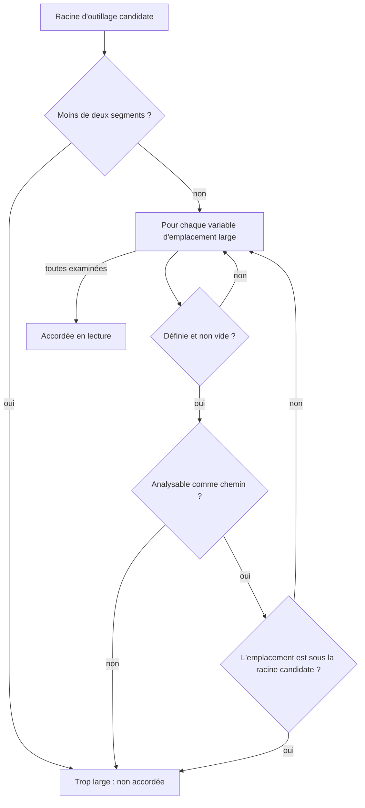

# Design

## Contexte

Motivation : `proposal.md` (Why). Module touché : `minos-runtime-local`, classes `com.minos.runtime.local.process.ProviderProcessEnvironment` et `com.minos.runtime.local.sandbox.WindowsAppContainerWorkerSandboxBackend`. Aucune surface publique. AUD-SEC-05 vaut sur Windows et Linux ; AUD-QUA-05 ne s'exécute que sous Windows.

## État vérifié au HEAD

HEAD `89be3fb4`. Lecture du code ; aucun build ni test exécuté.

| Fait | Preuve |
|---|---|
| [Existant vérifié] `sanitize` garde une variable héritée si `isSafeInheritedKey(key)` ; aucun appel à `isDeniedName` | `minos-runtime-local/src/main/java/com/minos/runtime/local/process/ProviderProcessEnvironment.java:171-185` |
| [Existant vérifié] `applyForTrustedLauncher` garde une variable héritée si elle figure dans `TRUSTED_LAUNCHER_KEYS` ; même absence | `ProviderProcessEnvironment.java:147-161` |
| [Existant vérifié] `putDeclared` applique `!isDeniedName(key)` aux seules variables déclarées | `ProviderProcessEnvironment.java:188-194` |
| [Existant vérifié] La javadoc affirme « The pattern wins over every list: the inherited allowlists never contain such a name » | `ProviderProcessEnvironment.java:129-132` |
| [Existant vérifié] Trois listes héritées : `COMMON_SAFE_INHERITED_KEYS` (20), `WINDOWS_SAFE_INHERITED_KEYS` (35), `TRUSTED_LAUNCHER_KEYS` (16) ; 71 entrées, 0 correspondant au motif | `ProviderProcessEnvironment.java:21-42`, `:45-81`, `:98-115` ; décompte par script |
| [Existant vérifié] Le motif : fragments `token`, `secret`, `password`, `key`, `credential` ; préfixes `minos_`, `github_`, `npm_` ; exception `npm_config_cache` | `ProviderProcessEnvironment.java:118-124`, `:133-140` |
| [Existant vérifié] `InstallationProcessEnvironment.apply` retire déjà du résultat entier tout nom à motif | `minos-runtime-local/src/main/java/com/minos/runtime/local/process/InstallationProcessEnvironment.java:47-48` |
| [Existant vérifié] `isOverBroadGrant` lit `System.getenv(key)` pour 11 clés, intercepte `RuntimeException` et continue ; rend `false` en fin de boucle | `minos-runtime-local/src/main/java/com/minos/runtime/local/sandbox/WindowsAppContainerWorkerSandboxBackend.java:715-726`, `:763-775` |
| [Existant vérifié] Son seul appelant n'accorde pas la racine quand la garde ou `isWindowsSystemRoot` répond vrai | `WindowsAppContainerWorkerSandboxBackend.java:738-756` |
| [Existant vérifié] `isWindowsSystemRoot` fait `Path.of(systemRoot)` sans interception | `WindowsAppContainerWorkerSandboxBackend.java:777-782` |
| [Existant vérifié] Tests existants de l'environnement | `minos-runtime-local/src/test/java/com/minos/runtime/local/process/ProviderProcessEnvironmentTest.java`, `ProviderProcessEnvironmentAllowlistTest.java`, `ProviderProcessEnvironmentDeclaredSecretsTest.java`, `InstallationProcessEnvironmentTest.java` |
| [Existant vérifié] Planchers JaCoCo concernés | `scripts/quality/check-jacoco.py:182` (`ProviderProcessEnvironment` : ligne 0,70, branche 0,20), `:208` (`WindowsAppContainerWorkerSandboxBackend`) |

Non mesuré : la couverture actuelle des branches des deux classes ; l'existence, sur un poste réel, d'une valeur de variable que `Path.of` refuse sous Windows (le test utilise un caractère interdit).

## Écarts

| Écart | Source A | Source B | Suite proposée |
|---|---|---|---|
| E1. L'audit propose « ou un test qui parcourt les trois listes » comme alternative au filtre dans le code | action d'AUD-SEC-05 | la règle 3 dit « exclus même s'ils figurent dans une liste » : c'est un comportement, pas une propriété des données | Faire les deux : filtre dans le code (D1) et test des listes |
| E2. La garde lit `System.getenv` en dur : le cas « variable illisible » n'est pas testable sans modifier l'environnement de la JVM de test | `WindowsAppContainerWorkerSandboxBackend.java:766` | l'audit demande « un test unitaire » | Surcharge de portée paquet qui reçoit le lecteur d'environnement (D3), sur le modèle de `LinuxBubblewrapWorkerSandboxBackend.isOverBroadToolchainRoot(Path, Path)` (`LinuxBubblewrapWorkerSandboxBackend.java:579`) |
| E3. Site oublié par l'audit : `isWindowsSystemRoot` analyse `SystemRoot` sans protection ; une valeur illisible lève une exception dont le message reprend la valeur | `WindowsAppContainerWorkerSandboxBackend.java:780` | règle 7 (aucun chemin absolu dans un message) | Même traitement que la garde (D2) |
| E5. L'octroi lui-même n'est pas observable par un test unitaire : `addToolchainHomeReadRoot` est `private static`, lit l'environnement réel et exige un répertoire existant | `WindowsAppContainerWorkerSandboxBackend.java:738-756` | scénarios de l'exigence | Les scénarios jugent la **réponse** des deux prédicats (garde et racine système) par la couture D3 ; le lien réponse → non-octroi est le code existant de la ligne 754, relu, et reste couvert par les tests de plan existants sous Windows |
| E4. L'audit laisse le choix entre « juger trop large » et « refuser le plan » | action d'AUD-QUA-05 | Linux refuse le plan pour une racine trop large (`confinement-code-non-fiable › Une racine d'outillage trop large est refusée avant le lancement`) ; Windows n'accorde pas la racine et poursuit | D2 : garder le comportement Windows existant (racine non accordée) |

## Exigences couvertes

- `installation-des-providers › Une variable héritée à motif de secret n'atteint ni un provider ni un lanceur` : D1.
- `confinement-code-non-fiable › Un emplacement large illisible fait refuser l'octroi d'une racine d'outillage sous Windows` : D2, D3.

## Objectifs et non-objectifs

Objectif : que les deux contrôles tiennent par le code. Non-objectifs : changer les listes, le motif, ou la sémantique Windows d'une racine trop large (non accordée, plan poursuivi).

## Responsabilités et frontières des composants

Non applicable : deux classes existantes du même module, aucune dépendance ajoutée (ARCH-0068 respectée).

## Modèle de domaine et invariants

Invariant 1 : pour tout environnement produit par `sanitize`, `apply` ou `applyForTrustedLauncher`, aucun nom ne satisfait `isDeniedName`. Invariant 2 : la garde Windows répond « trop large » dès qu'un de ses emplacements de référence est défini et non comparable.

## Traitements et interactions

Non applicable : pas de nouvelle interaction ; deux prédicats renforcés.

## États et transitions

Non applicable : aucun cycle de vie.

## Contrats d'interface

Aucune surface publique. Interne : `ProviderProcessEnvironment.sanitize` et `applyForTrustedLauncher` gardent leur signature (`sanitize` est `public`, appelé par `InstallationProcessEnvironment.java:41`). La garde gagne une surcharge de portée paquet prenant un lecteur d'environnement (`java.util.function.UnaryOperator<String>` ou équivalent) ; la méthode existante délègue avec `System::getenv`.

## Persistance et intégrité

Non applicable : rien n'est écrit.

## Transactions, concurrence et idempotence

Non applicable : fonctions pures.

## Sécurité et isolation

Règles 1, 3 et 7 de `.claude/rules/securite.md`. La valeur d'une variable illisible n'apparaît dans aucun message : l'exception d'analyse est absorbée par la garde, qui répond par un booléen. Toute autre `RuntimeException` n'est plus masquée : elle fait échouer la construction du plan (fail-closed), ce qui révèle un bogue au lieu de l'ouvrir.

## Erreurs et reprise

Racine d'outillage non accordée : comportement Windows existant (le provider n'a pas accès à cette racine ; l'échec éventuel est celui du provider, déjà diagnostiqué). Aucun nouvel état.

## Observabilité

Non applicable : pas de journal ajouté. [Question] voir « Questions ouvertes ».

## Performance et mesure

Non applicable : un appel de prédicat par variable héritée.

## Compatibilité, migration et retour arrière

Aucun effet sur un poste conforme au HEAD (0 entrée de liste à motif ; variables d'emplacement valides). Retour arrière : retirer les deux contrôles ; rien de persistant.

## Diagrammes

### Que décide la garde Windows pour chaque emplacement de référence ?

Type : flowchart · Portée : cible proposée · Exigences : `confinement-code-non-fiable › Un emplacement large illisible fait refuser l'octroi d'une racine d'outillage sous Windows`

Seule la branche « non analysable » change : elle rejoignait la boucle, elle mène au refus.

## Décisions

### D1 — Le motif est appliqué dans les deux boucles héritées

[Décision] `sanitize` et `applyForTrustedLauncher` ajoutent `!isDeniedName(key)` à leur condition ; la javadoc de `isDeniedName` est corrigée pour dire que le code l'applique. Un test paramétré parcourt les trois listes et échoue sur une entrée à motif ; un second prouve le filtre du code par une liste injectée (accès de portée paquet aux listes, ou surcharge de test recevant la liste). Écarté : le test seul (E1).

### D2 — Variable illisible : l'octroi est jugé trop large — **arbitrage de l'axe Sécurité demandé par l'audit**

[Proposition] `catch (InvalidPathException)` puis `return true` dans la garde ; `isWindowsSystemRoot` répond `true` dans le même cas. Alternative : refuser tout le plan par `IllegalStateException` nommant la variable (parité avec Linux). Recommandation : **juger trop large**. C'est le comportement Windows déjà en place pour une racine trop large, il ne crée pas de nouveau mode d'échec de l'indexation, et il reste fail-closed (rien n'est accordé). La parité de message avec Linux relèverait d'un changement de comportement distinct.

### D3 — Lecteur d'environnement injecté pour la garde

[Décision] Surcharge de portée paquet ; `WindowsOverBroadGrantGuardTest` l'appelle sans dépendre de l'environnement réel. La décision pure s'exécute sur Windows et Linux (analyse de chemin : le test choisit une valeur refusée par `Path.of` sur la plateforme courante, par exemple un caractère nul). Écarté : modifier l'environnement de la JVM de test (non portable, effets de bord sur les autres tests).

## Qualification des capacités

`installation-des-providers` et `confinement-code-non-fiable` : **qualifiées** pour ces deux exigences quand leurs tests sont verts sur `Verify (ubuntu-24.04)` et `Verify (windows-2022)`. La garde n'est appelée en production que sous Windows.

## Risques et compromis

- [Risque] Une variable d'emplacement réellement mal formée sur un poste retire l'accès à la racine du JDK du projet → l'indexation échoue là où elle passait ; c'est le sens du fail-closed, et le diagnostic du provider existe déjà.
- [Risque] `equalsIgnoreCase` sous Windows : `isDeniedName` compare en minuscules avec `Locale.ROOT` (`ProviderProcessEnvironment.java:134`), cohérent avec les listes insensibles à la casse.

## Vérification

- Tests : `ProviderProcessEnvironmentInheritedSecretsTest` (nouveau), `WindowsOverBroadGrantGuardTest` (nouveau) ; restent verts sans changement d'attente : `ProviderProcessEnvironmentTest`, `ProviderProcessEnvironmentAllowlistTest`, `ProviderProcessEnvironmentDeclaredSecretsTest`, `InstallationProcessEnvironmentTest`, `WindowsAppContainerWorkerSandboxBackendTest`, `WindowsAppContainerSandboxPlanTest`.
- Commande : `./mvnw -B -ntp -pl minos-runtime-local -am test` (Windows : `mvnw.cmd`, arguments `-D` cités).
- Gates : `python scripts/quality/check-jacoco.py` (scopes de `ProviderProcessEnvironment` et de `WindowsAppContainerWorkerSandboxBackend`, après `verify`, sur leur plateforme), `python scripts/quality/check-comment-language.py`, `python .claude/scripts/run_gates.py --fast`.
- Non vérifiable localement sous Linux : l'effet de la garde dans un plan AppContainer réel.

## Documentation durable à mettre à jour

`docs/architecture/diagrams/capacites/installation-des-providers.md` et `confinement-code-non-fiable.md` (exigences ajoutées, traçabilité) ; `.claude/rules/securite.md` règle 3 (le motif s'applique aux variables héritées, déclarées et aux listes).

## Traçabilité

| Exigence (capacité › titre) | Scénario | Conception ou diagramme | Tâche | Test ou preuve |
|---|---|---|---|---|
| installation-des-providers › Une variable héritée à motif de secret n'atteint ni un provider ni un lanceur | Entrée de liste à motif de secret | D1 | 1.1, 1.2 | `ProviderProcessEnvironmentInheritedSecretsTest` — à écrire |
| idem | Listes du dépôt | D1 | 1.1 | même test — à écrire |
| idem | Variable ordinaire héritée | D1 | 1.2 | `ProviderProcessEnvironmentAllowlistTest` (existant) |
| confinement-code-non-fiable › Un emplacement large illisible fait refuser l'octroi d'une racine d'outillage sous Windows | Variable de profil non analysable | D2, D3, diagramme | 2.1, 2.2 | `WindowsOverBroadGrantGuardTest` — à écrire |
| idem | Racine système non analysable | D2 (E3) | 2.1, 2.2 | même test — à écrire |
| idem | Variables analysables | D3 | 2.1 | même test — à écrire |
| idem | Variable absente ou vide | D3 | 2.1 | même test — à écrire |

## Ordre de fusion

Le changement `relever-les-planchers-de-la-frontiere-des-providers` (AUD-TST-03, autre sprint) relève le plancher de branches de la même classe `ProviderProcessEnvironment` (`scripts/quality/check-jacoco.py:182`). Celui-ci se fusionne **d'abord** : il ajoute les branches (`!isDeniedName` dans deux boucles) et les tests qui les couvrent ; le relèvement du plancher se mesure ensuite sur ce code. Dans l'ordre inverse, le plancher relevé serait mesuré sur une classe qui gagne aussitôt deux branches, et devrait être remesuré.

## Questions ouvertes

- [Question] Journaliser (niveau fin, nom de la variable seul, jamais sa valeur) le fait qu'un emplacement large était illisible ? Recommandation : non dans ce lot ; à reprendre avec la journalisation des refus du confinement si un cas réel apparaît.
