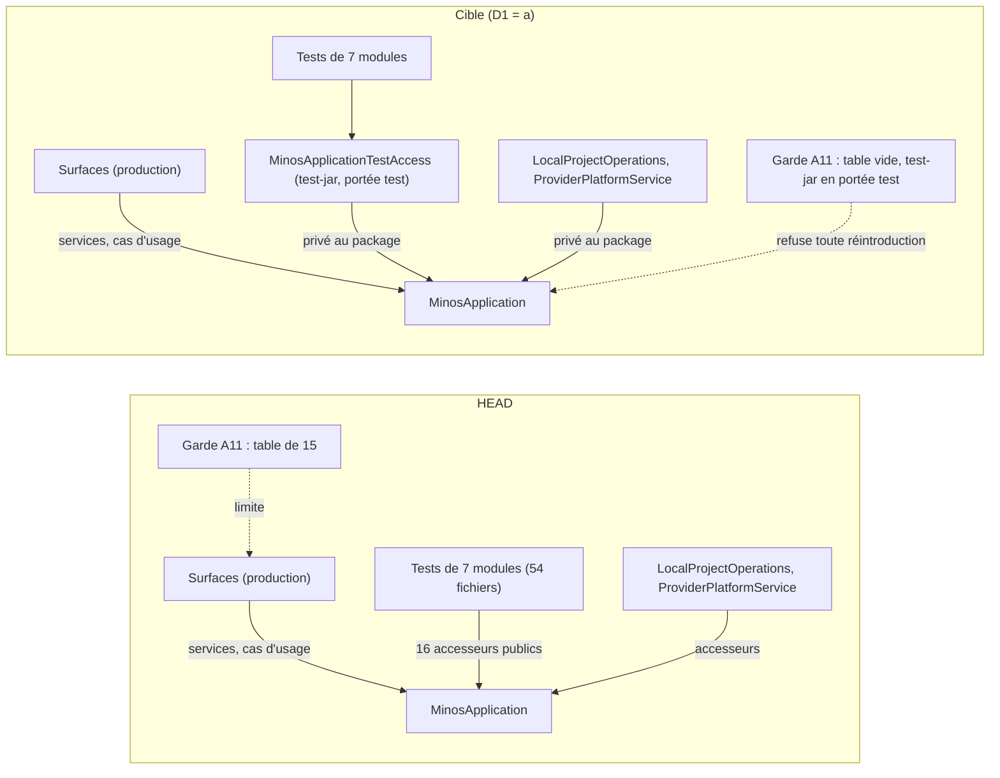
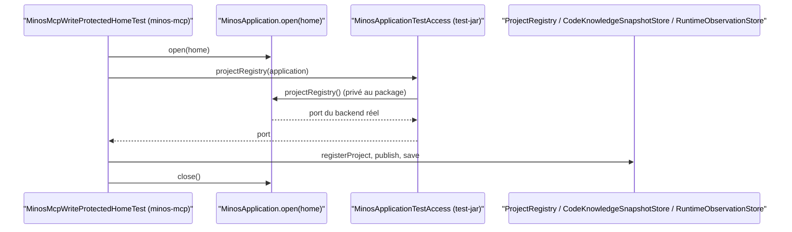

# Design

## Contexte

Motivation : voir `proposal.md` (Why). Le changement reprend le groupe 4, reporté, d'`injecter-les-collaborateurs-des-cas-d-usage` (archive `openspec/changes/archive/2026-11-19-injecter-les-collaborateurs-des-cas-d-usage/`, tâches 4.1 à 4.5). Il touche la façade `MinosApplication`, le `pom.xml` de `minos-application` et de sept modules consommateurs, les tests de ces modules, le garde A11 et la documentation de rupture. Aucune sortie publique ne change. Windows et Linux : même comportement.

## État vérifié au HEAD

Relu au commit `535a50176` (`origin/main`).

| Fait | Preuve |
|---|---|
| 41 méthodes publiques d'instance avant `Builder` : identité 2, `compositionRoot()`, stockage 7, indexation 8 (dont `indexerRegistry(String)`), requêtes 9, sémantique 6, cas d'usage 5, `teamControlPlane()`, `close()` | `minos-application/src/main/java/com/minos/application/MinosApplication.java:264-424`, `Builder` à `:447` |
| `compositionRoot()` est publique et rend `MinosApplicationComposer` | `MinosApplication.java:271` |
| 15 accesseurs publics rendent un type de `minos-engine`, tous listés | `scripts/architecture/module_boundary_ratchets.py:43-59` ; `MinosApplication.java:274-280` (sauf `semanticVectorStore`), `:283-288`, `:293-296` |
| Le garde lit ces accesseurs dans la source et compte 15 | `module_boundary_ratchets.py:149-175`, `:301-327` ; `scripts/architecture/test_check_module_boundaries_ratchets.py:348` (`assertEqual(15, …)`) |
| Le commentaire de la table dit que les accesseurs « servent les cas d'usage des sous-packages » : ces cas d'usage reçoivent leurs `Dependencies` depuis le 2026-11-19 | `module_boundary_ratchets.py:38-42` ; `MinosApplication.java:401-418` |
| L'entrée `runtimeObservationStore` est dite « gardée pour un seul test » ; trois fichiers de test l'appellent | `module_boundary_ratchets.py:55` ; `MinosMcpWriteProtectedHomeTest.java:118`, `MinosApplicationTest.java:74`, `:323`, `MinosApplicationWiringTest.java:52` |
| Aucune surface de production n'atteint la racine de composition (`COMPOSITION_ROOT_USE`) ni n'appelle un accesseur typé moteur | `module_boundary_ratchets.py:298`, `:318-326` ; recherche au HEAD |
| Appelants de production des 16 méthodes : deux fichiers, tous deux dans `com.minos.application` | `minos-application/src/main/java/com/minos/application/LocalProjectOperations.java:53`, `:55`, `:56`, `:59` ; `ProviderPlatformService.java:37` |
| `MinosApplication` lit la racine de composition par son champ, jamais par `compositionRoot()` | `MinosApplication.java:199`, `:342`, `:372`, `:383-385`, `:410` |
| Trois accesseurs n'ont aucun appelant hors de la classe : `incrementalIndexingPlanner()`, `invalidationService()` ; `indexerRegistry(String)` n'est lu que par `this::indexerRegistry` | `MinosApplication.java:285-286`, `:296`, `:415` ; recherche au HEAD |
| `compositionRoot()` : 7 appels dans 5 fichiers de test, dont un du package `com.minos.application` | `minos-app/.../ProviderCatalogPortTest.java:26` ; `minos-application/.../WslIndexingRouteWiringTest.java:40`, `:42` ; `minos-bootstrap/.../DefaultMinosApplicationComposerTest.java:63` ; `minos-bootstrap/.../scalability/SnapshotScalabilityBenchmark.java:258`, `:291` ; `minos-cli/.../operations/LocalRemoteIndexOperationsRefusalTest.java:49` |
| ArchUnit ne tient pas les accesseurs : `ModuleArchitectureTest` applique la liste bytecode des types du moteur par surface et interdit aux surfaces de compiler contre la racine de composition | `minos-app/src/test/java/com/minos/app/architecture/ModuleArchitectureTest.java:72-79`, `:164-171` |
| `minos-application` ne publie pas de `test-jar` ; `minos-bootstrap` en publie un, consommé par `minos-cli` et `minos-mcp` | `minos-application/pom.xml:42-57` ; `minos-bootstrap/pom.xml:79-91` |
| Le garde fusionne les déclarations d'un même module (jar et `test-jar`) en gardant la portée la plus forte, sans lire `<type>` | `scripts/architecture/check-module-boundaries.py:102-118` |
| Deux refus antérieurs d'un `test-jar`, pour sortir une classe sans appelant de production | `scripts/architecture/module_boundary_packages.py:35-37`, `:42-43` |
| Le `test-jar` de `minos-application` ne doit pas transporter l'enregistrement `IcaclsTestAccessControl` | `minos-application/pom.xml:47-53` |
| Précédent : quatre accesseurs de `MinosApplication` rendus non publics en 1.3.0, documentés comme rupture d'une classe interne | `docs/user/java-api.md:402-413` |
| La même page dit que « les contrats publics ne nomment que `com.minos.api.*` et `com.minos.application.MinosApplication` » ; `LocalMinosApi` a un constructeur public qui prend `MinosApplication` | `docs/user/java-api.md:441-442` ; `minos-api/src/main/java/com/minos/api/LocalMinosApi.java:72` |
| ARCH-0087 est `Proposed` ; sa décision 1 est mise en œuvre et tranchée par le propriétaire le 2026-11-19, sa décision 2 propose le retrait en une version et le `test-jar` | `docs/architecture/adr/ARCH-0087-adaptateurs-embarques-et-facade-reduite.md:10`, `:30-44`, `:82-85` ; `docs/project/audits/2026-11-15/SUIVI.md:112-113`, `:181`, `:202` |
| La spec de référence annonce 15 accesseurs, et un scénario d'A11 suppose `app.snapshotStore()` public | `openspec/specs/frontieres-de-modules/spec.md:992-995`, `:606-609` |
| Gates littéraux concernés : `runtimeObservationStore()` exigé dans `MinosApplication.java` ; `compositionRoot.remoteRepositoryMaterializer(` et `compositionRoot.remoteIndexingRuntime(` (champ) exigés dans le même fichier ; `MinosApplicationTest.java` et trois tests M28 lus par deux gates | `scripts/quality/check-runtime-dynamic-consistency.py:104-105` ; `scripts/quality/check-remote-distributed-consistency.py:182-184` ; `scripts/quality/check-vertical-decomposition-consistency.py:71`, `:143-157` ; `scripts/remediation/check-p0-p2.py:155-156`, `:226-230` |
| Aucun scope de `check-jacoco.py` ne cite `MinosApplication` | `scripts/quality/check-jacoco.py:79`, `:330` (seules lignes qui citent `com/minos/application/`) |

### Appelants des 16 méthodes, par module (tests et production)

Recherche au HEAD dans `minos-*/src/{main,test}/java` (plugin exclu), pour les fichiers qui nomment `MinosApplication`, d'un appel `.nom(` ou `::nom` sur une variable déclarée `MinosApplication`, `application`, `app` ou `self.get()`. Les appels homonymes d'autres types (`StorageBackend.projectRegistry()`, champs `stores.*`, `indexing.*`) sont exclus.

| Module | Fichiers | Appels | Dont `compositionRoot()` | À migrer |
|---|---|---|---|---|
| `minos-application` (production, package `com.minos.application`) | 2 | 5 | 0 | non (même package) |
| `minos-application` (test, package `com.minos.application`) | 1 | 4 | 2 | non (même package) |
| `minos-api` (test) | 6 | 20 | 0 | oui |
| `minos-app` (test) | 7 | 25 | 1 | oui |
| `minos-bootstrap` (test) | 13 | 99 | 3 | oui |
| `minos-cli` (test) | 12 | 39 | 1 | oui |
| `minos-explorer` (test) | 2 | 5 | 0 | oui |
| `minos-mcp` (test) | 12 | 24 | 0 | oui |
| `minos-nexus` (test) | 2 | 4 | 0 | oui |
| **Total** | **57** | **225** | **7** | **54 fichiers, 216 appels** |

Par méthode : `projectRegistry` 75, `snapshotStore` 59, `fingerprintStore` 27, `indexStateStore` 13, `fingerprintService` 11, `providerRuntimeManager` 8, `compositionRoot` 7, `discoveryService` 6, `retentionService` 5, `runtimeObservationStore` 5, `indexerDescriptors` 3, `snapshotStager` 3, `snapshotPromoter` 3, `incrementalIndexingPlanner` 0, `invalidationService` 0, `indexerRegistry` 0. Aucun appel par `MinosApplication::nom`. Aucune source de production de `minos-api`, `minos-cli`, `minos-mcp`, `minos-explorer`, `minos-nexus`, `minos-app` ou `minos-bootstrap` n'en appelle une.

Fichiers à migrer : `minos-api` — `AdvancedCodeIntelligenceApiContractTest`, `LocalMinosApiResumeStatusTest`, `M28VerticalAdvancedApiTest`, `MinosApiUsageErrorTest`, `SemanticCodeIntelligenceApiContractTest`, `SemanticExplorationApiContractTest` ; `minos-app` — `M24PolyglotProviderTest`, `ProgramGraphSourceStateLimitationSurfaceTest`, `ProviderCatalogPortTest`, `IncrementalIndexingRealFixtureTest`, `McpAuthorEmailGuardTest`, `A2CompositionCharacterizationTest`, `A2SurfaceCharacterizationTest` ; `minos-bootstrap` — `DefaultMinosApplicationComposerTest`, `ResumableRunFixtures`, `ApplicationCacheMeasurement`, `MinosApplicationTest`, `MinosApplicationWiringTest`, `ProgramGraphPerformanceQualificationTest`, `SnapshotScalabilityBenchmark`, `HybridCorpusWeightTest`, `HybridRankingCorpus`, `M23SemanticProviderConfigurationTest`, `SemanticHybridIntelligenceTest`, `SemanticProjectionMeasurementTest`, `SemanticSyncConsistencyTest` ; `minos-cli` — `CliInternalFailureTraceTest`, `IndexDryRunSideEffectsTest`, `IndexPlanCaptureOrderTest`, `IndexViaWslSideEffectsTest`, `LazyWiringGuardTest`, `M28VerticalProgramGraphCliTest`, `NoResumeIndexingTest`, `RetentionFailureAfterIndexTest`, `SemanticProjectionCommandLineTest`, `LocalRemoteIndexOperationsIntegrationTest`, `LocalRemoteIndexOperationsRefusalTest`, `RemoteIndexingUseCases` ; `minos-explorer` — `IndexedHome`, `SemanticExplorerBenchmark` ; `minos-mcp` — `M28VerticalProgramGraphMcpTest`, `MinosApplicationMcpBackendM17Test`, `MinosMcpArchitectureGraphSingleDiscoveryTest`, `MinosMcpIndexStatusWithoutDiscoveryTest`, `MinosMcpModuleFilterRefusalTest`, `MinosMcpProjectReferenceErrorTest`, `MinosMcpProjectRootExposureTest`, `MinosMcpReadOnlyHomeTest`, `MinosMcpRelationshipLimitationsTest`, `MinosMcpUsageErrorTest`, `MinosMcpWriteProtectedHomeTest`, `ProviderProfilesKeyOrderTest` ; `minos-nexus` — `NexusExportServiceTest`, `NexusSemanticSignalServiceTest`.

Non mesuré : le décompte est textuel ; un appel sur une variable nommée autrement (paramètre de méthode utilitaire, champ) peut lui échapper. La compilation du reactor après retrait est la preuve exhaustive (tâche 3.4). Aucun build exécuté pendant la spécification.

## Écarts

| Écart | Source A | Source B | Suite proposée |
|---|---|---|---|
| E1 — Le report du groupe 4 n'est porté par aucune décision acceptée | `SUIVI.md:113` (« reporté, décision du propriétaire du 2026-11-19 ») | ARCH-0087 `Proposed` (`:10`) ; `.claude/rules/adr.md` (« un `Proposed` non porté par un changement en cours est archivé `Rejected` ») | D1 tranché, puis ARCH-0087 passe `Accepted` sous la forme de l'option retenue (D5) |
| E2 — Le commentaire de la table dit que les accesseurs servent les cas d'usage des sous-packages | `module_boundary_ratchets.py:38-42` | Les cas d'usage reçoivent leurs `Dependencies` (`MinosApplication.java:401-418`) ; seuls des tests et deux classes du package les appellent | Groupe 1, quelle que soit D1 |
| E3 — L'entrée `runtimeObservationStore` est dite gardée « pour un seul test » | `module_boundary_ratchets.py:55` | Trois fichiers de test l'appellent | Groupe 1 (commentaire), puis retrait (groupe 3) |
| E4 — L'audit propose « package-private (ou supprimer) » | `findings.json`, AUD-ARC-02, action | 13 des 16 méthodes ont des appelants de test hors du package ; trois n'ont aucun appelant | D2 (accès de test) pour les 13 ; D3 (suppression ou `private`) pour les trois |
| E5 — L'audit propose de donner au test l'accès à `runtimeObservationStore` « par le Builder » | action de l'audit | `MinosMcpWriteProtectedHomeTest` et deux tests de `minos-bootstrap` lisent le magasin d'une application ouverte par `open` sur le backend réel ; le `Builder` injecte, il ne relit pas ce que l'assembleur a choisi | D2 : même accès de test que les autres ports |
| E6 — Le régime de `MinosApplication` est ambigu | `docs/user/java-api.md:404` (« classe interne », rupture documentée) | `docs/user/java-api.md:441-442` (« les contrats publics ne nomment que `com.minos.api.*` et `MinosApplication` ») ; `LocalMinosApi.java:72` | D5 : la page dit que `MinosApplication` est nommée par les contrats comme type opaque (`open`, `builder`, constructeurs `Local*Api`), et que ses accesseurs sont internes |
| E7 — Le garde ne lit pas le type d'une dépendance | `check-module-boundaries.py:114-117` | ARCH-0087 § 2.3 (« admis en portée `test` seulement ») ; `SUIVI.md`, « Restes de la spécification » (lecture du type `test-jar` non tranchée) | D4 : le garde lit `<type>` et refuse le `test-jar` de `minos-application` hors portée `test` |
| E8 — Deux scénarios de la spec de référence supposent des accesseurs réels publics | `openspec/specs/frontieres-de-modules/spec.md:606-609` (`app.snapshotStore()`), `:992-995` (« 15 accesseurs ») | Après retrait, le garde ne voit plus `snapshotStore` comme accesseur public : la compilation échoue, pas A11 (même cas que l'écart E8 du dossier `docs/architecture/diagrams/capacites/frontieres-de-modules.md:186`) | Exigences modifiées par ce changement : scénarios sur un arbre de test ; 0 accesseur |
| E9 — Le diagramme de la composition partagée liste `providerRuntimeManager()` | `docs/developer/public-surfaces.md:11-26` | accesseur retiré du public | Groupe 4 (documentation) |
| E10 — Le scénario « Façade réduite au HEAD » exclut de la sortie de `javap -public` « aucun type de `com.minos.orchestration` » ; l'exigence ne vise que le type de retour | `specs/frontieres-de-modules/spec.md` (scénario) ; `javap` à l'implémentation : aucune des 16 méthodes, mais `projectIndexing(UnaryOperator<IndexingRuntimePorts$IndexerExecutor>)`, méthode de cas d'usage hors périmètre (« inchangées ») dont le paramètre nomme un type du moteur | `MinosApplication.java` (`projectIndexing(UnaryOperator<IndexerExecutor>)`) | Constaté à l'implémentation, non corrigé : le cas d'usage et le `Builder` restent hors périmètre ; à l'archivage, lire le scénario sur les types de retour, ou ouvrir un changement pour le paramètre |

## Exigences couvertes

- frontieres-de-modules › La façade ne rend ni type du moteur ni racine de composition — D1, D3, D4.
- frontieres-de-modules › Les tests lisent un port de l'application par un accès de test — D2, D4.
- frontieres-de-modules › Le retrait des accesseurs de la façade ne change aucune sortie publique — « Vérification ».
- frontieres-de-modules › Les accesseurs de MinosApplication typés moteur sont tenus par un cliquet (modifiée) — D4.
- frontieres-de-modules › Un accesseur de MinosApplication appelé par une surface compte comme un usage du type rendu (modifiée) — D4, E8.

## Objectifs et non-objectifs

Objectif : une surface ou un module de contrat qui tient un `MinosApplication` n'atteint, par lui, que des services applicatifs, des cas d'usage et des types JDK ou du domaine ; la règle se vérifie par la compilation et par un cliquet à zéro. Non-objectif : réduire le `Builder`, changer un service ou un cas d'usage, toucher à `com.minos.api`.

## Responsabilités et frontières des composants

- `com.minos.application.MinosApplication` : garde ses ports en interne ; les classes de son package (`LocalProjectOperations`, `ProviderPlatformService`, `LocalProjectGitQuery`…) les lisent par les accesseurs privés au package. [Proposition]
- Accès de test (D2) : une classe des sources de test de `minos-application`, dans le package `com.minos.application` (nom proposé : `MinosApplicationTestAccess`), qui relaie les accesseurs privés au package. Elle appartient au module qui possède le package (A3 respectée) et n'existe dans aucun jar livré. [Proposition]
- Modules consommateurs : déclarent le `test-jar` de `minos-application` en portée `test`, ce qui double une arête permise (`minos-application` est déjà une dépendance de compilation des sept modules). Direction ARCH-0068 inchangée : aucune arête de production ajoutée, retirée ni inversée.
- Garde A11 : seule source de la règle côté sources ; `ModuleArchitectureTest` reste la vue bytecode des types du moteur par surface, non concernée.

## Modèle de domaine et invariants

Invariant visé : l'ensemble des méthodes publiques d'instance de `MinosApplication` dont le type de retour nomme un type de `minos-engine` ou `MinosApplicationComposer` est vide. Il est lu dans la source par le garde, jamais écrit dans le garde.

## Traitements et interactions

Aucun traitement ne change : les accesseurs rendent les mêmes instances, seule leur visibilité change. L'accès de test délègue sans copie.

## États et transitions

Non applicable.

## Contrats d'interface

Classe interne `com.minos.application.MinosApplication` :

- privées au package (**RUPTURE**) : `compositionRoot()`, `projectRegistry()`, `snapshotStore()`, `indexStateStore()`, `fingerprintStore()`, `runtimeObservationStore()`, `retentionService()`, `discoveryService()`, `fingerprintService()`, `providerRuntimeManager()`, `indexerDescriptors()`, `snapshotStager()`, `snapshotPromoter()` ;
- supprimées ou privées (**RUPTURE**, D3) : `incrementalIndexingPlanner()`, `invalidationService()`, `indexerRegistry(String)` ;
- inchangées : `home()`, `storageBackendId()`, `semanticVectorStore()`, les neuf services de requête, les six services sémantiques, les cinq méthodes de cas d'usage, `teamControlPlane()`, `close()`, `open`, `builder` et le `Builder`.

Remplacements à documenter dans `docs/user/java-api.md` : les cas d'usage de la façade (`projectIndexing()`, `remoteIndexing()`, `knowledgeExport()`), les services de requête, `ProviderPlatformService.defaults(application)` pour les runtimes, `new LocalProjectOperations(application)` pour l'import et la rétention ; pour un hôte qui gérait lui-même le stockage, `StorageBackends.open(configuration)` puis `MinosApplication.builder(home).storageBackend(backend)`, qui garde la référence aux magasins.

`com.minos.api`, la CLI, le MCP, le protocole du plugin et NEXUS : aucun changement.

## Persistance et intégrité

Non applicable : aucune donnée écrite ni format modifié.

## Transactions, concurrence et idempotence

Non applicable : les accesseurs rendent des champs finals ; aucune synchronisation ne change.

## Sécurité et isolation

Réduire la façade retire aux surfaces l'accès technique aux ports de persistance et à la racine de composition, que seule une table à cliquet tenait. L'accès de test n'existe dans aucun jar livré : le test de packaging du groupe 2 le prouve sur le jar ombré. Fail-closed inchangé.

## Erreurs et reprise

Non applicable : aucun chemin d'erreur ne change.

## Observabilité

Non applicable.

## Performance et mesure

Non applicable.

## Compatibilité, migration et retour arrière

Option recommandée (D1 = a) : un seul temps fusionnable, après le groupe 1 qui ne change que des commentaires et des preuves. Un code tiers migre selon la table de `docs/user/java-api.md` ; les notes de la prochaine version (`docs/user/release-notes/unreleased.md`) annoncent la rupture. Retour arrière : annuler la PR, qui rétablit la visibilité, la table du garde et les tests.

Option (b) : deux temps — dépréciation `@Deprecated(since = "<prochaine version>", forRemoval = true)` des 16 méthodes avec la même table de remplacement, puis retrait dans la version suivante. Les tests restent sur les accesseurs dépréciés pendant le premier temps ou migrent d'emblée.

Option (c) : aucun changement de code hors commentaires et des trois accesseurs sans appelant (D3) ; la table passe de 15 à 13 entrées.

## Diagrammes

### Qui atteint un port de l'application, avant et après ?

Type : flowchart · Portée : existant et cible · Exigences : frontieres-de-modules › La façade ne rend ni type du moteur ni racine de composition ; frontieres-de-modules › Les tests lisent un port de l'application par un accès de test

### Comment un test d'une surface prépare-t-il ses données après le retrait ?

Type : sequenceDiagram · Portée : cible · Exigences : frontieres-de-modules › Les tests lisent un port de l'application par un accès de test

## Décisions

Décision du propriétaire du 2026-11-24 : les recommandations de ce design sont retenues.
### D1 — Sort de `compositionRoot()` et des 15 accesseurs typés moteur [Proposition, attend le propriétaire ; objet d'ARCH-0087 § 2]

| Option | Appelants à migrer | Tests à déplacer | Gates littéraux | Effet sur ARCH-0087 |
|---|---|---|---|---|
| (a) Retrait en une version, rupture documentée | 54 fichiers de test, 216 appels ; aucun de production | aucun : les tests restent dans leur module et passent par l'accès de test (D2) ; un test de l'accès de test s'ajoute dans `minos-application` | table vidée, `test_check_module_boundaries_ratchets.py:348` (15 → 0), deux scénarios de la spec ; `check-runtime-dynamic-consistency.py:104-105` reste vert (le texte `runtimeObservationStore()` demeure) | décision 2 inchangée, passage `Accepted` |
| (b) Dépréciation pendant une version, puis retrait | les mêmes, en deux temps | idem | table inchangée au premier temps ; au second, comme (a) | décision 2.2 réécrite (« déprécié en N, retiré en N+1 ») avant `Accepted` ; un second changement porte le retrait |
| (c) Report écrit, statu quo sous cliquet | aucun | aucun | commentaire de la table corrigé ; D3 retire deux ou trois entrées | décision 2.2 et 2.3 réécrites (« accesseurs publics tenus par A11 ; retrait ouvert par un changement dédié quand… ») avant `Accepted` ; le constat se ferme avec réserve |

Recommandation : **(a)**. `MinosApplication` n'est pas l'API Java versionnée (`com.minos.api` l'est) ; aucune source de production hors du package n'appelle ces méthodes ; le précédent de 1.3.0 existe (`docs/user/java-api.md:402-413`) ; MINOS ne publie pas ses modules dans un dépôt Maven (`docs/user/java-api.md`, section « Adaptateurs de stockage dans un seul artefact »), ce qui réduit l'intérêt d'une période de dépréciation. (b) double le travail pour un public tiers que rien n'atteste. (c) ferme le constat sans réduire la surface et garde un cliquet dont le commentaire doit être tenu à jour à la main.

### D2 — Forme de l'accès de test [Proposition, attend le propriétaire]

Options : (i) classe `MinosApplicationTestAccess` dans `minos-application/src/test/java/com/minos/application/`, publiée par `maven-jar-plugin:test-jar`, consommée en portée `test` par les sept modules ; (ii) sans `test-jar` : les tests ouvrent eux-mêmes le stockage (`StorageBackends.open`, dont `StorageBackend` expose les sept magasins) et l'injectent par `MinosApplication.builder(home).storageBackend(...)`, et les assertions d'identité du câblage (`MinosApplicationTest`, `MinosApplicationWiringTest`, `A2CompositionCharacterizationTest`) sont réécrites en tests de comportement.

Recommandation : **(i)**, conforme à ARCH-0087 § 2.3. La migration est mécanique (un appel `application.x()` devient `MinosApplicationTestAccess.x(application)`), garde les assertions d'identité qui prouvent le câblage de production depuis `open`, et ne touche pas aux scopes JaCoCo. (ii) supprime le `test-jar` mais change le chemin d'ouverture de plusieurs dizaines de tests (`open` ne serait plus exercé avec les mêmes données) et perd des preuves de câblage. Les deux refus antérieurs d'un `test-jar` (`module_boundary_packages.py:35-37`, `:42-43`) visaient à sortir une classe sans appelant de production pour une ligne de liste ; ici le `test-jar` conditionne le retrait de 16 méthodes publiques.

Le `test-jar` exclut `src/test/platform-access-control` (déjà hors de `target/test-classes`, `minos-application/pom.xml:47-53`) et toute déclaration de service de test.

### D3 — Accesseurs sans appelant [Proposition]

`incrementalIndexingPlanner()` et `invalidationService()` sont supprimés (aucun appelant) ; `indexerRegistry(String)` devient privé (seul `this::indexerRegistry` le lit). Une suppression ne laisse aucune ligne modifiée à couvrir dans `minos-application`, ce qui ménage le seuil SonarCloud du nouveau code. Cette décision vaut sous les trois options de D1.

### D4 — Garde A11 [Proposition]

`MINOS_APPLICATION_ENGINE_ACCESSORS` devient vide, son commentaire est réécrit (cliquet à zéro : toute réintroduction échoue) ; `minos_application_accessors` reste. Le garde refuse en plus : une méthode publique d'instance de `MinosApplication` dont le type de retour est `MinosApplicationComposer` ; une déclaration du `test-jar` de `minos-application` hors portée `test` (lecture de `<type>`, sans changer la fusion des portées pour A2). `COMPOSITION_ROOT_USE` (`module_boundary_ratchets.py:298`) et `ENGINE_TYPES_NAMED_BY_SURFACE` sont conservés. `ModuleArchitectureTest` n'est pas modifié.

### D5 — ADR et documentation de rupture [Décision de forme]

Aucun nouvel ADR : ARCH-0087 couvre la décision. Le propriétaire le fait passer `Accepted` sous la forme de l'option retenue (décision 1 inchangée, déjà mise en œuvre) ; « Mise en œuvre » cite ce changement ; ARCH-0057 reçoit une entrée « Mise en œuvre » au point 6. `docs/user/java-api.md` reçoit une section de rupture avec la table de remplacement, et la phrase de `:441-442` est précisée : `MinosApplication` est nommée par les contrats comme type opaque, ses accesseurs sont internes (E6).

### D6 — Ordre avec les changements actifs [Décision de forme]

`decrire-le-garde-de-frontieres-decoupe` (actif, AUD-ARC-12) modifie ARCH-0087 (emplacement des listes) et le dossier `frontieres-de-modules.md`. Ce changement fusionne après lui et rebase ses deux fichiers ; aucun autre changement actif ne touche `MinosApplication.java` ni la table A11.

## Qualification des capacités

Aucune capacité produit nouvelle ni retirée : qualifiée à l'identique. Windows et Linux : le retrait est une visibilité Java et une règle du garde Python, sans branche par système ; les tests à migrer s'exécutent sur les deux jobs `Verify`, la voie WSL2 (`IndexViaWslSideEffectsTest`, `WslIndexingRouteWiringTest`) reste propre à Windows dans son comportement, et son test hors Windows vérifie l'absence de voie.

## Risques et compromis

- [Risque] Volume : 54 fichiers dans sept modules → migration mécanique en une tâche par module, preuve par la compilation de tout le reactor (`./mvnw -B -ntp verify`).
- [Risque] SonarCloud juge le nouveau code module par module : les lignes de visibilité modifiées de `MinosApplication` comptent comme nouveau code de `minos-application` → test de `MinosApplicationTestAccess` dans `minos-application` qui exerce chaque accesseur relayé ; D3 supprime plutôt que modifier les accesseurs sans appelant.
- [Risque] Gates littéraux qui lisent des tests migrés (`check-vertical-decomposition-consistency.py`, `check-p0-p2.py`) → les chaînes exigées (`MinosApplication.open`, `CONTROL_FLOW`, `new LocalAdvancedCodeIntelligenceApi(application)`…) ne nomment aucun accesseur ; rejouer les deux gates.
- [Risque] Un `test-jar` qui transporterait un enregistrement de service de test ferait trouver deux implémentations à un consommateur → exclusion vérifiée par le test de packaging.
- [Compromis] L'accès de test donne aux tests un accès aux ports : c'est voulu, et absent des jars livrés.

## Vérification

- Tests : `MinosApplicationTestAccessTest` (nouveau, `minos-application`) ; test de packaging (absence de la classe d'accès dans le jar ombré `target/minos-code-intelligence-*-all.jar` et dans le jar de `minos-application`) ; `MinosApplicationTest`, `MinosApplicationWiringTest`, `MinosMcpWriteProtectedHomeTest`, `LocalRemoteIndexOperationsRefusalTest`, `ProviderCatalogPortTest`, `DefaultMinosApplicationComposerTest`, `A2CompositionCharacterizationTest`, `A2SurfaceCharacterizationTest`, `ModuleArchitectureTest`.
- Gates : `check-module-boundaries.py` et `python -m unittest scripts/architecture/test_check_module_boundaries.py scripts/architecture/test_check_module_boundaries_ratchets.py` ; `check-runtime-dynamic-consistency.py`, `check-remote-distributed-consistency.py`, `check-hosted-control-plane-consistency.py`, `check-semantic-retrieval-consistency.py`, `check-vertical-decomposition-consistency.py`, `check-p0-p2.py`, `check-comment-language.py`, `check-ci-wiring.py`.
- JaCoCo : `check-jacoco.py` sur le rapport agrégé (aucun scope ne cite `MinosApplication`).
- Commandes : `./mvnw -B -ntp verify` (tout le reactor, sans `clean`), `git diff --exit-code minos-app/src/test/resources/characterization/`, `python .claude/scripts/run_gates.py`.

## Documentation durable à mettre à jour

`docs/user/java-api.md` (rupture, régime de `MinosApplication`) ; `docs/user/release-notes/unreleased.md` ; `docs/developer/public-surfaces.md` (diagramme de la composition partagée) ; `docs/architecture/diagrams/capacites/frontieres-de-modules.md` (vue de la façade, traçabilité des exigences ajoutées et modifiées, écart E8) ; ARCH-0087 et ARCH-0057 ; index `docs/architecture/adr/README.md` et `docs/architecture/arc42/09-decisions.md` (statut d'ARCH-0087) ; `docs/project/audits/2026-11-15/SUIVI.md`.

## Traçabilité

| Exigence (capacité › titre) | Scénario | Conception ou diagramme | Tâche | Test ou preuve |
|---|---|---|---|---|
| frontieres-de-modules › La façade ne rend ni type du moteur ni racine de composition | Façade réduite au HEAD | D1, D3, flowchart | 3.1, 3.4 | `check-module-boundaries.py` (« 0 public accessor(s) ») ; `scripts/architecture/test_check_module_boundaries_ratchets.py#test_the_real_application_exposes_no_engine_accessor` ; `minos-application/src/test/java/com/minos/application/MinosApplicationTestAccessTest.java#theFacadeKeepsEveryRelayedPortPackagePrivate` |
| idem | Racine de composition réintroduite refusée | D4 | 2.1, 3.3 | `scripts/architecture/test_check_module_boundaries_ratchets.py#test_a_public_composition_root_is_refused_and_a_package_private_one_accepted` |
| idem | Accesseur typé moteur réintroduit refusé | D4 | 2.1, 3.3 | `scripts/architecture/test_check_module_boundaries_ratchets.py#test_an_engine_accessor_reintroduced_with_an_empty_table_is_refused` |
| frontieres-de-modules › Les tests lisent un port de l'application par un accès de test | Jar livré sans accès de test | D2, Sécurité | 2.2, 3.2 | `minos-app/src/test/java/com/minos/packaging/ApplicationTestAccessPackagingIT.java#neitherTheApplicationJarNorTheShadedJarCarriesTheTestAccess`, `#theTestJarOfTheApplicationCarriesTheTestAccessAndNoService` |
| idem | Test d'une surface sur un home protégé | D2, séquence | 3.2 | `minos-mcp/src/test/java/com/minos/mcp/MinosMcpWriteProtectedHomeTest.java` ; `minos-application/src/test/java/com/minos/application/MinosApplicationTestAccessTest.java#everyRelayReturnsTheInstanceTheApplicationWasBuiltWith` |
| idem | Accès de test hors portée de test refusé | D2, D4 | 2.1, 3.3 | `scripts/architecture/test_check_module_boundaries.py#test_the_test_jar_in_another_scope_is_refused_with_module_type_and_scope`, `#test_the_test_jar_in_test_scope_is_accepted`, `#test_the_real_poms_declare_the_test_jar_in_test_scope` |
| frontieres-de-modules › Le retrait des accesseurs de la façade ne change aucune sortie publique | Goldens inchangés ; Refus distant conservé | Vérification | 3.4 | caractérisation, `LocalRemoteIndexOperationsRefusalTest` |
| frontieres-de-modules › Les accesseurs de MinosApplication typés moteur sont tenus par un cliquet (modifiée) | Table vide au HEAD ; Entrée ajoutée refusée ; refus existants | D4 | 3.3 | `scripts/architecture/test_check_module_boundaries_ratchets.py#test_the_real_list_matches_the_real_application`, `#test_an_entry_added_to_the_empty_table_is_refused`, `#test_an_entry_without_a_public_accessor_is_refused`, `#test_a_surface_reaching_the_composition_root_is_refused` |
| frontieres-de-modules › Un accesseur de MinosApplication appelé par une surface compte comme un usage du type rendu (modifiée) | trois scénarios sur arbre de test | D4, E8 | 3.3 | `test_check_module_boundaries_ratchets.py#test_an_accessor_called_without_naming_the_type_is_refused`, `#test_a_method_reference_counts_as_a_use` |

## Questions ouvertes

- D1 et D2 : décisions du propriétaire attendues avant le groupe 2 (recommandations : D1 = a, D2 = i).
- Nom de la classe d'accès de test : `MinosApplicationTestAccess` (fixé à l'implémentation).
- Dossier de capacité : `check-capability-dossiers.py` refuse une ligne de traçabilité qui nomme une exigence absente de la spec de référence ; les lignes des trois exigences ajoutées entrent dans `docs/architecture/diagrams/capacites/frontieres-de-modules.md` à l'archivage (preuves ci-dessus), la vue de la façade réduite et les deux exigences modifiées y sont dès l'implémentation.
