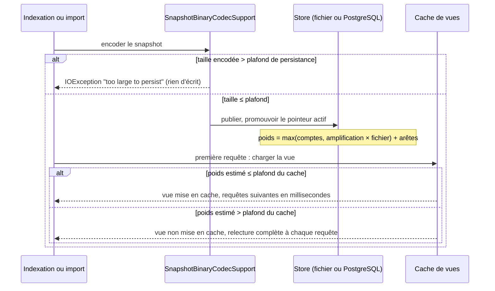
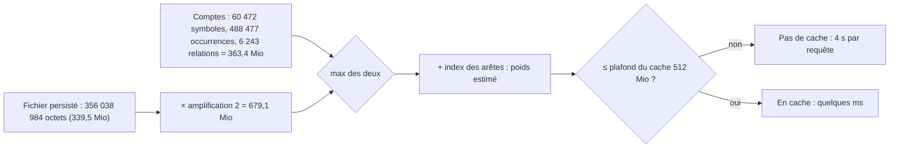

# Design

## Contexte

[Existant vérifié] Un snapshot de connaissance est lu entièrement en tas pour répondre aux requêtes ; le cache des vues actives est borné par un poids estimé (`persistance-snapshots › Le poids d'une vue en cache compte ses index dérivés`). Deux plafonds, aujourd'hui couplés par construction, bornent un gros projet : le plafond de persistance (256 Mio) refuse l'écriture, le plafond du cache (512 Mio) refuse la mise en cache d'une vue dont le poids estimé le dépasse. Le motif de la proposition (`proposal.md`, Why) est la mesure du 2026-11-07 sur `morpheus-engine` : persistable seulement si le premier plafond est relevé, puis 4 s par requête parce que le second refuse la vue.

Modules : `minos-storage` (codec, deux stores), `minos-engine` (vue de lecture), `minos-bootstrap` (banc). Surfaces publiques : additif. Plateformes : le comportement est celui de la JVM, identique sous Windows et Linux.

## État vérifié au HEAD

Relevé sur `develop` `3149d30f`.

| Fait | Preuve |
|---|---|
| Plafond de persistance de 256 Mio, partagé par le codec fichier et PostgreSQL | `minos-storage/src/main/java/com/minos/storage/codec/SnapshotBinaryCodecSupport.java:87` |
| Refus avant toute écriture, message de tailles seules | `SnapshotBinaryCodecSupport.java:253-258` ; test `minos-storage/src/test/java/com/minos/storage/local/store/PersistedSnapshotLimitTest.java:31-32` |
| Plafond du cache de vues du store fichier : 512 Mio ; amplification 2 | `minos-storage/src/main/java/com/minos/storage/local/store/FileSymbolSnapshotStore.java:44`, `:54` |
| Poids estimé = max(somme des comptes, 2 × taille persistée) + index des arêtes | `FileSymbolSnapshotStore.java:362-372` ; `minos-engine/src/main/java/com/minos/store/SnapshotReadView.java:53` |
| Même formule et même plafond sous PostgreSQL | `minos-storage/src/main/java/com/minos/storage/postgresql/snapshot/PostgresCodeKnowledgeSnapshotStore.java:58`, `:60`, `:472-481` |
| La décision 7 et la section Risques de l'ADR DATA-0066 portent le plafond de 256 Mio et l'aveu des 300 Mo du reactor | `docs/architecture/adr/DATA-0066-port-de-connaissance-et-persistance-des-snapshots.md:37`, `:88` |
| Amplification mesurée : 1,14 fois le fichier sur le corpus réel de MINOS (114 Mo), 1,41 à 1,46 sur le corpus synthétique | ADR 0047 archivé (`docs/architecture/adr/archive/0047-snapshot-pagine-ou-mappe-et-table-de-chaines.md`, section Mise en œuvre), test `QueryViewWeightTest` |
| Le banc de montée en charge lit le plafond du codec | `minos-bootstrap/src/test/java/com/minos/bootstrap/scalability/SnapshotScalabilityBenchmark.java:362` |
| Le même plafond borne aussi la lecture : un fichier de plus de 256 Mio est refusé à la lecture (« snapshot payload exceeds persisted byte limit ») | `SnapshotBinaryCodecSupport.java:412-417` ; `BoundedInputStream` aux lignes 105, 158, 170, 216, 266, 306, 317, 353, 368 ; PostgreSQL : `PostgresCodeKnowledgeSnapshotStore.java:304`, `:399` |
| Le facteur 2 s'applique à tous les formats, sans lire `formatVersion` | `FileSymbolSnapshotStore.java:362-372` ; écart E4 du dossier `docs/architecture/diagrams/capacites/persistance-snapshots.md:154` |
| Le plafond est une constante `static final` et `requirePersistable` est statique ; seul le plafond du cache du store fichier est injectable | `SnapshotBinaryCodecSupport.java:87`, `:253` ; `FileSymbolSnapshotStore.java:76-80` ; `PostgresCodeKnowledgeSnapshotStore.java:58`, `:60` (privées) |
| Le gate `check-mne.py` exige la chaîne `MAX_PERSISTED_SNAPSHOT_BYTES = 256L * 1024L * 1024L`, `QUERY_VIEW_PERSISTED_AMPLIFICATION`, `saturatingMultiply(Files.size(snapshot)` et `estimateWeight(metadata, payloadBytes)` ; il est exécuté par la CI | `scripts/remediation/check-mne.py:84`, `:86`, `:88` ; `.github/workflows/pr-ci.yml:235` |
| Les fixtures et tests de taille lisent le plafond : fixture `oversized` (34 symboles de 8 M caractères, environ 272 Mo) | `minos-storage/src/test/java/com/minos/storage/codec/PersistedSizeFixtures.java`, `SnapshotEncodedSizeTest.java`, `SnapshotCodecV3Test.java`, `PersistedSnapshotLimitTest.java:72` |
| Aucun réglage de tas dans `docker/`, `packaging/`, `scripts/install/` ; conteneur MCP à 3 Gio | recherche `Xmx`/`MaxRAM` ; `docker/compose-mcp.prod.yaml:13` ; `docs/user/docker-runtime.md:380` |

Mesures du 2026-11-07 (jar jetable, plafond de persistance à 1 Gio, aucun fichier du dépôt modifié ; `morpheus-engine` : 60 472 symboles, 488 477 occurrences, 6 243 relations). Trois tailles désignent le même projet : 358 914 010 octets est l'encodage refusé au plafond de 256 Mio (indexation sous WSL, premier essai) ; 363 206 863 octets est le fichier persisté par la seconde indexation sous WSL ; 356 038 984 octets est le fichier produit par l'import du SCIP sous Windows. La cause exacte de l'écart (chemins, horodatages, ordre) n'est pas établie [Question non bloquante].

| Mesure | Résultat |
|---|---|
| Fichier SCIP | 54 374 683 octets |
| Snapshot persisté | 356 038 984 octets (339,5 Mio) ; 363 206 863 octets lors de l'indexation sous WSL |
| `import-scip` | 11 s |
| Poids estimé de la vue, amplification 2 | 679,1 Mio (> 512 Mio : refusée par le cache) |
| Même, amplification 1,5 | 509,3 Mio, hors index des arêtes : sur la limite |
| Même, amplification 1,25 | 424,4 Mio |
| Trois requêtes MCP sur le snapshot de 356 Mo (tas 1 Go, puis 2 Go) | 4 559, 4 295, 4 374 ms ; 4 507, 3 960, 3 717 ms |
| Trois requêtes sur un snapshot de 73 Mo (`collection-manager`) | 1 143, 7, 5 ms |
| Requête CLI à froid, tas de 512 Mo à 2 Go | 5,6 à 6,2 s, aucune erreur mémoire |

**Non mesuré** : le tas retenu par la vue de `morpheus-engine` ; le pic de décodage ; `import-scip` sous un tas de 512 Mo (conteneur d'administration à 2 Gio) ; le comportement du store PostgreSQL pour un payload de 356 Mo ; le coût disque de la rétention de plusieurs snapshots de cette taille.

## Écarts

| Écart | Source A | Source B | Suite proposée |
|---|---|---|---|
| La spec dit que l'amplification est « mesurée », le code applique une constante de 2 | `persistance-snapshots › Un snapshot de la taille de ce dépôt est admis au cache de vues` | `FileSymbolSnapshotStore.java:54` (`2L`) | Mesurer sur un corpus de plus de 300 Mio et poser l'amplification retenue (D2) |
| Le plafond de persistance n'est dans aucune exigence de la spec, seulement dans l'ADR et le code | `openspec/specs/persistance-snapshots/spec.md` | `SnapshotBinaryCodecSupport.java:87` | Exigences ajoutées (« Un snapshot de plus de 256 Mio est persisté jusqu'au plafond de persistance » et « Un snapshot au-delà du plafond de persistance est refusé sans rien écrire ») |
| Aucune page `docs/user/` ne dit la taille de projet indexable | `docs/user/` | refus observé du 2026-11-07 | Page ou section à écrire (groupe 3) |
| La spec garde « l'amplification prudente d'origine » pour un format non mesuré ; le code applique 2 à tous les formats, sans distinguer V1, V2 et V3 | `persistance-snapshots › Le poids estimé d'une vue ne sous-évalue pas le tas qu'elle retient` (scénario « Format non mesuré ») | `FileSymbolSnapshotStore.java:362-372` ; écart E4 du dossier de capacité | D2 : l'amplification mesurée ne vaut que pour le format courant (V3) ; V1 et V2 gardent 2 ; le code lit `formatVersion` (tâche 2.4) |
| Le plafond borne la lecture comme l'écriture : relever le plafond puis le rétablir rend illisible un snapshot publié au-delà de l'ancien | `SnapshotBinaryCodecSupport.java:412-417` | texte initial du design (corrigé) | Retour arrière décrit dans « Compatibilité » ; tâche 1.1 prouve la lecture par un test |

## Exigences couvertes

- `persistance-snapshots › Un snapshot de plus de 256 Mio est persisté jusqu'au plafond de persistance` : D1.
- `persistance-snapshots › Un snapshot au-delà du plafond de persistance est refusé sans rien écrire` : D1.
- `persistance-snapshots › Le plafond du cache de vues couvre tout snapshot persistable` : D2.
- `persistance-snapshots › Un snapshot de la taille de ce dépôt est admis au cache de vues` : D2.
- `persistance-snapshots › Le poids estimé d'une vue ne sous-évalue pas le tas qu'elle retient` : D2.

## Objectifs et non-objectifs

- **Objectif** : qu'un snapshot de l'ordre de 350 Mo soit persisté et reste en cache, sans régresser les projets plus petits.
- **Non-objectifs** : nouveau format (V4), snapshot mappé, dimensionnement du conteneur, budget sémantique, voie WSL2.

## Responsabilités et frontières des composants

Aucune dépendance ajoutée ; la direction `domain → engine → runtime/storage` (ADR 0068) est respectée : `minos-storage` porte les plafonds et lit l'amplification, `minos-engine` n'est touché que si le poids des arêtes change (non prévu). Le banc vit dans `minos-bootstrap` (tests).

## Modèle de domaine et invariants

- Invariant I1 : taille encodée ≤ plafond de persistance, sinon refus sans écriture (existant, plafond changé).
- Invariant I2 : plafond du cache ≥ plafond de persistance × amplification (nouveau, test).
- Invariant I3 : poids estimé ≥ tas retenu mesuré, pour chaque format lisible (existant, étendu à un corpus de plus de 300 Mio).

## Traitements et interactions

### Comment une vue est-elle admise au cache après la publication d'un gros snapshot ?

Type : sequenceDiagram · Portée : cible · Exigences : `persistance-snapshots › Un snapshot de plus de 256 Mio est persisté jusqu'au plafond de persistance`, `persistance-snapshots › Un snapshot au-delà du plafond de persistance est refusé sans rien écrire`, `persistance-snapshots › Un snapshot de la taille de ce dépôt est admis au cache de vues`

Le second refus est celui observé : 679,1 Mio contre 512 Mio. D1 et D2 déplacent les deux seuils ensemble ; la branche « non mise en cache » reste, pour une vue réellement trop lourde.

## États et transitions

Non applicable : aucun cycle de vie nouveau ; la publication atomique et le pointeur actif sont inchangés.

## Contrats d'interface

[Existant vérifié] Format persisté : inchangé (V3, magic `0x4D4E5359`), aucune migration. Erreur de refus : IOException, message `knowledge snapshot is too large to persist: <octets> encoded bytes exceed the <plafond>-byte limit (<plafond en Mio>); nothing was written`, vérifié par `PersistedSnapshotLimitTest.java:31-32` ; le texte « 256 MiB » du message devient celui du nouveau plafond, le préfixe reste. CLI, API Java et MCP : additifs, aucune option nouvelle.

## Persistance et intégrité

Inchangé : empreinte SHA-256 du contenu, publication avant promotion du pointeur, lecture authentifiée en un parcours (DATA-0066, points 4, 5 et 9). Un snapshot de 340 Mio garde ces garanties. [Question] PostgreSQL stocke le payload dans une colonne binaire : la limite de la colonne et le coût d'un payload de 356 Mo ne sont pas mesurés (tâche 1.4).

## Transactions, concurrence et idempotence

Inchangé. Un snapshot plus gros allonge la fenêtre d'écriture avant promotion ; le fichier partiel n'est jamais promu (DATA-0066, point 5).

## Sécurité et isolation

Le message de refus ne contient que des tailles (`.claude/rules/securite.md`, point 7) ; l'exigence le garde. Aucun nouveau lancement de processus, aucun secret.

## Erreurs et reprise

Au-delà du nouveau plafond : même refus actionnable qu'aujourd'hui, état d'index inchangé, indexation à reprendre ou projet à réduire (la page `docs/user/` du groupe 3 le dit). Erreur mémoire en tas : non traitée par ce changement (voir Risques).

## Observabilité

Le rapport du banc consigne, pour chaque corpus, la taille persistée, le poids estimé, le tas retenu mesuré et leur rapport (scénario « Corpus de plus de 300 Mio persistés »). Aucun nouveau journal.

## Performance et mesure

Source : mesures du 2026-11-07 ci-dessus. Objectif [Proposition] : sur le snapshot de 356 Mo, les requêtes suivant la première répondent en moins de 100 ms (cache), contre 4 s aujourd'hui ; seuil final à fixer après la tâche 1.3. Commande de mesure : sonde MCP STDIO à trois appels sur un `MINOS_HOME` temporaire (`mcp_latency.py`) et banc `benchmarks/scalability/run-scalability-benchmark.ps1`.

## Compatibilité, migration et retour arrière

Additif. Un snapshot déjà persisté reste lisible ; le poids estimé des snapshots V3 existants baisse (amplification de 2 à 1,25), ce qui ne peut que les admettre au cache. [Existant vérifié] Le plafond borne aussi la lecture (`SnapshotBinaryCodecSupport.java:412-417`) : retour arrière, un snapshot de plus de 256 Mio publié sous le nouveau plafond n'est plus lisible une fois les constantes remises. Le retour arrière suppose donc qu'aucun snapshot de cette taille n'ait été publié, ou qu'il soit réindexé ensuite ; la tâche 1.1 prouve ce comportement par un test.

## Diagrammes

### Pourquoi la vue de `morpheus-engine` n'est-elle pas mise en cache aujourd'hui ?

Type : flowchart · Portée : existant vérifié · Exigences : `persistance-snapshots › Un snapshot de la taille de ce dépôt est admis au cache de vues`

C'est l'amplification forfaitaire qui rend la vue lourde (679,1 Mio), pas la somme des comptes (363,4 Mio, à 1,02 fois le tas retenu mesuré). Avec 1,25 le poids tombe à 424,4 Mio, hors index des arêtes, sous le plafond de 512 Mio : la vue est admise sans relever le plafond du cache (D2).

## Décisions

### D1 — Plafond de persistance à 400 Mio

[Proposition, révisée par les mesures du 2026-11-07] Le plafond passe de 256 à 400 Mio, pour les deux stores. Justification : le plus gros snapshot mesuré fait 339,5 Mio, soit 18 % de marge sous 400 Mio ; à 400 Mio et avec l'amplification de D2, le poids estimé d'une vue (500 Mio) tient sous le plafond du cache actuel (512 Mio), donc aucun relèvement du cache ni du tas n'est nécessaire. Alternatives écartées : 512 Mio (le poids estimé de 640 Mio exigerait de relever le cache) ; 1 Gio (coût mémoire d'un cache à 1,5 Gio sans besoin mesuré) ; garder 256 Mio (refuse deux projets réels de 1 500 fichiers) ; format V4 d'abord (réduit le fichier à environ 0,35 fois, mais pas le tas : voir D3). Compromis : un tas et un disque plus gros pour les projets concernés ; un snapshot publié sous le nouveau plafond devient illisible si le plafond est rétabli (section Compatibilité). ADR justifié (filtre de `.claude/rules/adr.md`) : choix entre options réelles (1 Gio, V4, statu quo), portée sur deux stores, un format persisté et la mémoire du serveur, et retour arrière coûteux (snapshots illisibles) ; l'ADR consolidé `DATA-0078` (qui remplace `DATA-0066`) remplace donc la décision 7 et les Risques, au lieu d'un simple changement de constante.

### D2 — Amplification mesurée, plafond du cache couplé

[Proposition, révisée par les mesures du 2026-11-07] L'amplification de 2 est remplacée par 1,25 et le plafond du cache reste à 512 Mio. Justification : le poids estimé est le plus grand de la somme des comptes et du produit de l'amplification par le fichier ; la somme des comptes couvre déjà les deux corpus mesurés (1,02 fois le tas retenu réel de `morpheus-engine`, 1,45 fois celui du corpus synthétique), et le tas retenu réel vaut 1,05 à 1,14 fois le fichier, donc 1,25 laisse une marge d'au moins 10 % sur un corpus réel. L'invariant I2 devient : 400 Mio × 1,25 = 500 Mio ≤ 512 Mio. Limite connue : un corpus riche en relations (le synthétique : 669 Mio de somme des comptes) garde un poids estimé au-dessus du plafond du cache quelle que soit l'amplification ; sa vue n'est pas mise en cache et se recharge à chaque requête (voir Risques). Alternatives écartées : garder 1,5 et relever le cache à 768 Mio (la mesure montre que la somme des comptes suffit à protéger le cas synthétique, donc 1,5 coûterait de la mémoire sans protection supplémentaire) ; relever seulement le plafond du cache (garde une surestimation de 2 fois sans besoin). Si une mesure ultérieure donne un tas retenu supérieur à 1,25 fois le fichier sur un corpus réel, l'amplification suit. Deux précisions : (1) l'amplification mesurée ne vaut que pour le format courant (V3) ; V1 et V2 gardent 2, ce qui impose que le code lise `formatVersion` (écart E4) ; (2) le facteur 2 couvre aussi, selon le commentaire du code (`FileSymbolSnapshotStore.java:47-53`), une chaîne UTF-16 de caractères à deux octets : avant de poser 1,25, rejouer `QueryViewWeightTest` avec `-Dminos.queryViewWeight.print=true` (corpus ascii, latin1, cjk, mixte) : les 1,41 à 1,47 mesurés sur le corpus synthétique sont couverts par la somme des comptes, mais le test doit le prouver pour chaque vocabulaire, y compris les caractères à deux octets. Les trois valeurs (plafond de persistance, amplification, plafond du cache), aujourd'hui dupliquées dans trois fichiers, viennent d'une source unique pour que l'invariant I2 se teste. ADR : `DATA-0078` consolidé (remplace `DATA-0066`), écrit en tâche 3.1.

### D3 — Ne pas livrer le format V4 dans ce changement

[Proposition] Le format V4 divise le fichier par environ 3 mais laisse le tas inchangé (le dédoublonnage des chaînes à la lecture le fait déjà) ; le rapport tas/fichier monterait vers 3 et le poids estimé ne baisserait pas. Il ne règle donc pas l'admission au cache. Il garde son déclencheur (taille sur disque, ADR 0047). `morpheus-engine` est consigné comme donnée d'entrée de ce déclencheur.

### D4 — Dimensionnement du tas hors du changement

[Décision] Le changement ne modifie pas les fichiers Compose. Il consigne dans le banc le tas maximal de la JVM mesurée, et recommande un changement `distribution-docker` : mesuré, une vue de 372 Mo se charge dans 512 Mo de tas, mais deux vues chargées en même temps échouent sous 640 Mo ; le tas par défaut d'un conteneur de 3 Gio (768 Mio) supporte donc une vue en cache et pas deux chargements simultanés.

## Qualification des capacités

- Persister et mettre en cache un snapshot de 340 Mio : **non supportée aujourd'hui** (refus à 256 Mio) ; **partielle** après le groupe 1 (store fichier, JVM de bureau, mesures du 2026-11-07) ; **qualifiée** seulement après la tâche 1.4 (PostgreSQL) et la décision sur le tas du conteneur.
- Projets au-delà du nouveau plafond : non supportés, refus actionnable.
- Windows et Linux : même comportement ; mesuré ici sous Windows (JDK 21).

## Risques et compromis

- Mesuré : plusieurs vues non mises en cache chargées en même temps (requêtes concurrentes sur un corpus riche en relations, ou sur un snapshot au-dessus du plafond du cache) coûtent 372 Mo de tas chacune et font échouer un tas de 640 Mo à deux chargements → limiter les chargements simultanés d'une vue non admise (exigence à proposer au propriétaire, question ouverte) ; le cache à 512 Mio et les autres caches (graphe de programme 256 Mio, corpus hybride 256 Mio, vecteurs 256 Mio) restent sous le tas par défaut de 3 Gio seulement si le tas est relevé (changement `distribution-docker`).
- Un pic de décodage supérieur au tas retenu pourrait provoquer une erreur mémoire à l'import sous un conteneur d'administration de 2 Gio → tâche 1.3, mesure sous `-Xmx512m`.
- Coût disque : un snapshot de 340 Mio par projet, plus la rétention → tâche 1.5, mesure de la rétention.
- Retour arrière : un snapshot publié sous le nouveau plafond devient illisible si le plafond est rétabli → décrit en Compatibilité, test en tâche 1.1.
- Tests qui écrivent plus de 300 Mio sur disque : durée et disque sur les runners Windows et Linux → exclus de `verify` par défaut, mesurés en tâche 1.2.

## Vérification

- Tests existants à adapter : `PersistedSnapshotLimitTest` (message figé à la ligne 32 et plafond à la ligne 72), `PostgresCodeKnowledgeSnapshotStoreTest` (message figé à la ligne 197), `SnapshotEncodedSizeTest`, `SnapshotCodecV3Test`, `PersistedSizeFixtures` (fixture `oversized`, environ 272 Mo, qui n'est plus « au-delà » sous un plafond de 512 Mio), `QueryViewWeightTest`.
- Changement de production annoncé : le plafond de persistance et le plafond du cache deviennent injectables (constructeur ou paramètre de test) et lus depuis une source unique ; sans cela, le test « au-delà du plafond » demanderait un fichier de plus de 512 Mio.
- Tests à écrire : admission au cache d'une vue de plus de 300 Mio (deux lectures, un chargement) ; invariant I2 sur les deux stores ; corpus de plus de 300 Mio pour I3 ; publication entre 256 Mio et le plafond sur les deux stores ; relecture d'un snapshot de plus de 256 Mio ; lecture refusée au-delà du plafond ; amplification 2 conservée pour V1 et V2.
- Banc : `benchmarks/scalability/run-scalability-benchmark.ps1` étendu à un corpus de plus de 300 Mio (généré, non versionné). Les tests qui écrivent plus de 300 Mio sur disque ne sont pas lancés par `verify` par défaut (profil ou propriété), pour ne pas alourdir les runners Windows et Linux ; durée et disque mesurés en tâche 1.2.
- Gates : `scripts/remediation/check-mne.py` (chaînes `MAX_PERSISTED_SNAPSHOT_BYTES = 256L * 1024L * 1024L`, `QUERY_VIEW_PERSISTED_AMPLIFICATION`, `saturatingMultiply(Files.size(snapshot)`, `estimateWeight(metadata, payloadBytes)`, lignes 84, 86 et 88) à mettre à jour dans la même tâche que le code ; `check-audit-remediation-v2.py` (nom seul, ligne 142) et `check-mnd.py` (nom `MAX_QUERY_CACHE_WEIGHT_BYTES`, ligne 100) à rejouer ; `check-current-docs.py`, `product-facts.py --check`, `check-capability-dossiers.py`, `run_gates.py --fast` ; scopes JaCoCo `storage-codec-and-state` (`scripts/quality/check-jacoco.py:27`) et celui de `minos-engine` sur Linux et Windows.
- Non vérifiable en local : PostgreSQL géré avec un payload de 356 Mo (Docker nécessaire) ; le comportement dans le conteneur MCP de 3 Gio.

## Documentation durable à mettre à jour

- `docs/architecture/diagrams/capacites/persistance-snapshots.md` : vues du plafond, de l'amplification et de l'invariant.
- `docs/user/` : taille de projet indexable et réponse au-delà (page à désigner à la tâche 3.2) ; `docs/user/docker-runtime.md:380` (« le cache l'estime à deux fois cette taille et se plafonne à 512 Mio » et « au moins quatre fois le poids estimé »).
- `docs/project/governance/STATUS.md:61`, `:121`, `:268` et `docs/project/governance/ROADMAP.md:74`, qui citent le plafond de 256 Mio.
- ADR `DATA-0066` (consolidé), index `docs/architecture/adr/README.md`, `docs/architecture/arc42/09-decisions.md`.
- `docs/developer/` : mesure du banc ; `docs/project/governance/STATUS.md` (limites de l'indexation Java).

## Traçabilité

| Exigence (capacité › titre) | Scénario | Conception ou diagramme | Tâche | Test ou preuve |
|---|---|---|---|---|
| persistance-snapshots › Un snapshot de plus de 256 Mio est persisté jusqu'au plafond de persistance | Snapshot de plus de 256 Mio sous le plafond | D1 ; diagramme de séquence | 2.1, 2.2 | `SnapshotPersistenceCeilingTest` (fichier), `PostgresCodeKnowledgeSnapshotStoreLimitsTest` (PostgreSQL, Docker) ; plafonds abaissés en test |
| persistance-snapshots › Un snapshot de plus de 256 Mio est persisté jusqu'au plafond de persistance | Relecture d'un snapshot de plus de 256 Mio | D1 ; `SnapshotBinaryCodecSupport.java:412-417` | 1.1, 2.1 | `SnapshotReadCeilingTest`, `SnapshotPersistenceCeilingTest` |
| persistance-snapshots › Un snapshot au-delà du plafond de persistance est refusé sans rien écrire | Snapshot au-delà du plafond | D1 ; `PersistedSnapshotLimitTest.java:31-32` | 2.1, 2.2 | `PersistedSnapshotLimitTest` (fichier), `PostgresCodeKnowledgeSnapshotStoreTest` (PostgreSQL) |
| persistance-snapshots › Le plafond du cache de vues couvre tout snapshot persistable | Invariant respecté | D2 | 2.3 | `SnapshotLimitsTest`, `FileSymbolSnapshotStoreLimitsTest`, `PostgresCodeKnowledgeSnapshotStoreLimitsTest` |
| persistance-snapshots › Le plafond du cache de vues couvre tout snapshot persistable | Plafond de cache réduit sous l'invariant | D2 | 2.3 | `SnapshotLimitsTest`, `FileSymbolSnapshotStoreLimitsTest`, `PostgresCodeKnowledgeSnapshotStoreLimitsTest` (cas d'échec nommant les trois valeurs) |
| persistance-snapshots › Un snapshot de la taille de ce dépôt est admis au cache de vues | Snapshot de plus de 64 Mio persistés | D2 | 2.4 | non reproduit à cette taille : `FileSymbolSnapshotStoreCacheTest` (20 fichiers) et les tests d'admission à plafonds abaissés |
| persistance-snapshots › Un snapshot de la taille de ce dépôt est admis au cache de vues | Snapshot de plus de 300 Mio persistés | D2 ; diagramme de décision | 2.4 | `FileSymbolSnapshotStoreViewAdmissionTest`, `PostgresCodeKnowledgeSnapshotStoreViewAdmissionTest` (plafonds abaissés en test) ; mesure réelle de 339,5 Mio : `LargeSnapshotMeasurement`, `docs/developer/indexing-and-storage.md` (pas un test de `verify`) |
| persistance-snapshots › Un snapshot de la taille de ce dépôt est admis au cache de vues | Vue plus lourde que le plafond | D2 | 2.4 | `FileSymbolSnapshotStoreViewAdmissionTest`, `PostgresCodeKnowledgeSnapshotStoreViewAdmissionTest` |
| persistance-snapshots › Le poids estimé d'une vue ne sous-évalue pas le tas qu'elle retient | Estimation comparée au tas retenu | D2 | 2.4 | `QueryViewWeightTest` (estimé/retenu de 1,53 à 1,57 ; porté par la somme des comptes) |
| persistance-snapshots › Le poids estimé d'une vue ne sous-évalue pas le tas qu'elle retient | Corpus de plus de 300 Mio persistés | D2 ; mesure du groupe 1 | 1.3, 2.4 | mesure `LargeSnapshotMeasurement` du 2026-11-07 (1,05 réel, 1,47 synthétique), pas de test de `verify` à cette taille |
| persistance-snapshots › Le poids estimé d'une vue ne sous-évalue pas le tas qu'elle retient | Format non mesuré | D2 (V1 et V2 gardent 2) ; écart E4 | 2.4 | `FileSymbolSnapshotStoreViewAdmissionTest` (V1 et V2), `PostgresCodeKnowledgeSnapshotStoreViewAdmissionTest` (V2) |

### Preuves manquantes et restes

- **Snapshot de plus de 64 Mio, scénario « Snapshot de plus de 64 Mio persistés »** : non reproduit à cette taille en test ; les tests d'admission abaissent les plafonds. Une mesure réelle existe (339,5 Mio, `docs/developer/indexing-and-storage.md`).
- **Scénario « Corpus de plus de 300 Mio persistés »** : prouvé par la mesure `LargeSnapshotMeasurement` du 2026-11-07 (tas retenu 1,05 fois le fichier, estimation portée par la somme des comptes), pas par un test de `verify` : un test à cette taille alourdirait les runners Windows et Linux.
- **Sonde MCP sur `morpheus-engine` après import (tâche 2.5)** : manuelle, à faire avec le jar construit.
- **Tâches 1.3 (import sous `-Xmx512m`, pic de décodage, rejeu de `QueryViewWeightTest` par vocabulaire) et 1.5 (disque de la rétention)** : ouvertes ; la valeur de la rétention (environ 1 Gio par projet de cette taille) est calculée, non mesurée.
- **Exigences ADDED** (« Un snapshot de plus de 256 Mio est persisté jusqu'au plafond de persistance », « Un snapshot au-delà du plafond de persistance est refusé sans rien écrire », « Le plafond du cache de vues couvre tout snapshot persistable ») : leurs lignes de traçabilité entrent dans le dossier de capacité à l'archivage, quand elles rejoignent la spec de référence.
- **Bornage des chargements simultanés d'une vue non mise en cache** : exigence à proposer, hors de ce changement ; mesuré, deux vues simultanées échouent sous 640 Mo.
- **Linux** : non mesuré.

## Questions ouvertes

- Valeurs finales : plafond de persistance (recommandation 400 Mio), amplification (1,25), plafond du cache inchangé à 512 Mio : à valider par le propriétaire (mesures du groupe 1 faites le 2026-11-07).
- Chargements simultanés d'une vue non mise en cache : borner leur nombre (par un verrou ou un sémaphore) pour éviter l'épuisement du tas ; nouvelle exigence à proposer, non incluse dans ce changement. Recommandation : l'ajouter, car la mesure montre une erreur mémoire à deux chargements simultanés.
- Tas du conteneur MCP : recommandation de traiter par un changement `distribution-docker` si la tâche 1.3 montre que le tas par défaut est insuffisant.
- Format V4 : recommandation de ne pas le déclencher pour ce besoin.
