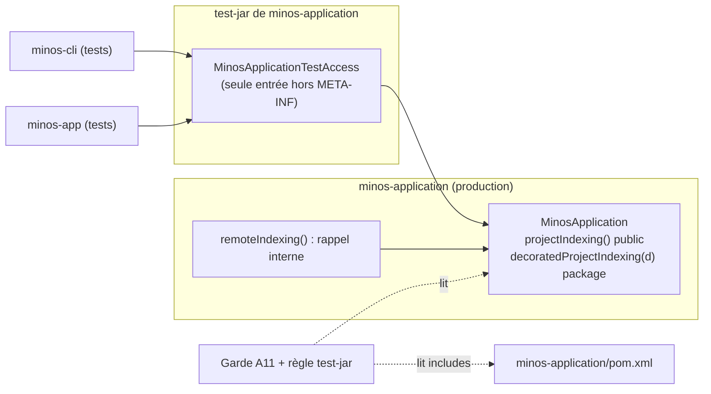

# Design

## Contexte

Motivation : voir `proposal.md` (Why). Le changement touche une règle du garde de frontières (A11) et une règle de POM (A2, portée du `test-jar`), une méthode de la façade `MinosApplication`, la classe d'accès de test et un IT d'empaquetage. Aucune surface publique ne change de sortie. Modules : `minos-application` (production et tests), `minos-cli` et `minos-app` (tests). Plateformes : Windows et Linux.

## État vérifié au HEAD

Relu au commit `75e10c681` (PR #819), branche `docs/openspec-audit-2026-11-15-sprint11`.

| Fait | Preuve |
|---|---|
| `projectIndexing(UnaryOperator<IndexerExecutor>)` est publique et construit un cas d'usage à chaque appel ; `IndexerExecutor` est importé de `com.minos.orchestration.IndexingRuntimePorts` (`minos-engine`) | `minos-application/src/main/java/com/minos/application/MinosApplication.java:35`, `:358-361` |
| Seul appelant de production : le rappel de `remoteIndexing()`, dans le même fichier | `MinosApplication.java:384-386` |
| Appelants de test : `RemoteIndexingUseCases.java:21` (`minos-cli`), `IncrementalIndexingRealFixtureTest.java:67` (`minos-app`), `UseCaseFacadeTest.java:66` (`minos-application`, même package) | recherche de `projectIndexing(` dans `minos-*/src` |
| La méthode n'existe pas dans 1.3.0 ; elle vient du commit `76afac5ed` (groupe 4 d'`injecter-les-collaborateurs-des-cas-d-usage`) | `git show v1.3.0:minos-application/…/MinosApplication.java` ; `git log -S` |
| `docs/user/java-api.md` la donne comme remplaçant public de neuf accesseurs retirés | `docs/user/java-api.md:358` |
| `PUBLIC_METHOD` capture modificateurs, type de retour et nom ; `public_instance_methods` garde les méthodes d'instance de profondeur 1 (types imbriqués exclus) | `scripts/architecture/module_boundary_ratchets.py:125-143` |
| `minos_application_accessors` ne résout que le texte du type de retour (`returned`) ; les paramètres ne sont jamais lus | `module_boundary_ratchets.py:166-199` |
| `check_minos_application_accessors` refuse un accesseur hors table, un type rendu différent, une méthode qui rend `MinosApplicationComposer` et une surface qui atteint la racine de composition | `module_boundary_ratchets.py:311-342` |
| Les méthodes du `Builder` public (`public static final class Builder`) reçoivent des ports du moteur : `projectRegistry(ProjectRegistry)`, `providerRuntimeManager(ProviderRuntimeManager)`, `snapshotLifecycle(SnapshotStager, SnapshotPromoter)`… ; en production, seules des classes de `minos-application` l'appellent ; 51 fichiers de test l'utilisent | `MinosApplication.java:446-592` ; recherche de `MinosApplication.builder` |
| Le constructeur de `MinosApplication` est privé au package | `MinosApplication.java:156` |
| `MinosApplicationTestAccess` relaie chaque accesseur sous le même nom ; `MinosApplicationTestAccessTest` exige que les relais publics soient exactement `RELAYED` et qu'aucune méthode publique de la façade ne porte un nom de `RELAYED` | `minos-application/src/test/java/com/minos/application/MinosApplicationTestAccess.java:18-35` ; `MinosApplicationTestAccessTest.java:95-109` |
| `test-jar` de `minos-application` : une exécution `maven-jar-plugin`, une seule inclusion, la classe d'accès | `minos-application/pom.xml:44-62` (`:58`) |
| `check_application_test_jar_scope` lit `<type>test-jar</type>` et `<scope>` des dépendances, jamais la configuration du plugin | `scripts/architecture/check-module-boundaries.py:148-162` |
| `ApplicationTestAccessPackagingIT` vérifie la présence de la classe, l'absence de `META-INF/services/…`, et l'absence de la classe dans le jar du module et dans le jar ombré | `minos-app/src/test/java/com/minos/packaging/ApplicationTestAccessPackagingIT.java:28-47` |
| L'IT est exécuté par failsafe, chemins des trois jars passés en propriétés système | `minos-app/pom.xml:78-79` |
| Sept modules déclarent le `test-jar` de `minos-application`, tous en portée `test` | `minos-{api,app,bootstrap,cli,explorer,mcp,nexus}/pom.xml` |
| Les exigences courantes formulent le contrat par le type de retour (« dont le type de retour nomme ») et ne disent rien du contenu du `test-jar` | `openspec/specs/frontieres-de-modules/spec.md:1509-1543` |
| ARCH-0087 § 2.2 : « ne déclare aucune méthode publique d'instance qui **rend** un type de `minos-engine` » ; § 2.3 et Don't : « seule classe du `test-jar` », « y publier une autre classe » interdit | `docs/architecture/adr/ARCH-0087-adaptateurs-embarques-et-facade-reduite.md:43-44`, `:62` |
| ARCH-0057, point 6 : « `MinosApplication` ne rend publiquement ni sa racine de composition ni aucun type de `minos-engine` » | `docs/architecture/adr/ARCH-0057-finaliser-les-frontieres-hexagonales.md:66` |
| Gates littéraux qui lisent `MinosApplication.java` : aucun ne cite `projectIndexing` ; `check-remote-distributed-consistency.py` exige `compositionRoot.remoteRepositoryMaterializer(` et `compositionRoot.remoteIndexingRuntime(` | `scripts/quality/check-remote-distributed-consistency.py:182-184` ; `check-hosted-control-plane-consistency.py:106`, `check-runtime-dynamic-consistency.py:104`, `check-semantic-retrieval-consistency.py:86-97`, `scripts/remediation/check-p0-p2.py:149` |
| Aucun scope de `scripts/quality/check-jacoco.py` ne nomme `MinosApplication` ni `MinosApplicationTestAccess` | recherche dans `check-jacoco.py` |

### Mutations rejouées

Le 2026-11-25, sur une copie du HEAD (`git archive`) dans le scratchpad de la session, une mutation à la fois, `python scripts/architecture/check-module-boundaries.py` exécuté dans la copie. Ligne de base : 0.

| Mutation (copie) | Garde |
|---|---|
| `public void leakParam(com.minos.registry.ProjectRegistry r) {}` ajouté à `MinosApplication` | 0 |
| `public void leakParam2(ProjectRegistry r) {}` (type importé) | 0 |
| Témoin : `public ProjectRegistry leakReturn() { return null; }` | **1** (A11 nomme `leakReturn` et `registry.ProjectRegistry`) |
| `<include>` remplacé par `com/minos/application/**` | 0 |
| seconde inclusion `**/*.class` ajoutée | 0 |
| `<includes>` supprimé (tout `target/test-classes` publié) | 0 |

Non mesuré : le contenu réel du `test-jar` construit (en particulier les entrées `META-INF/maven/…` ajoutées par défaut par `maven-jar-plugin`) et le comportement de l'IT sur un `test-jar` élargi : aucun build Maven n'a été lancé.

## Écarts

| Écart | Source A | Source B | Suite proposée |
|---|---|---|---|
| La promesse « façade sans port du moteur » est plus forte que ce que le garde prouve : un paramètre typé moteur passe A11 | ARCH-0057:66 ; `java-api.md:349` (titre de la rupture) | `module_boundary_ratchets.py:166-199` ; mutations | D1, D2 |
| L'option (c) de l'audit (« ajouter `projectIndexing(UnaryOperator)` à `MinosApplicationTestAccess` ») casse `MinosApplicationTestAccessTest` telle quelle : le relais porte le nom de l'accesseur, et `projectIndexing()` reste publique sous le même nom | `findings.json`, AUD-ARC-13, action | `MinosApplicationTestAccessTest.java:95-109` | D1 : l'accesseur privé au package prend un nom distinct, `decoratedProjectIndexing` |
| L'action (c) seule ne ferme pas le trou : la prochaine méthode publique à paramètre moteur passerait de nouveau | `findings.json`, AUD-ARC-13 | mutations `leakParam` | D1 retient (c) **et** (b) |
| `java-api.md:358` cite `projectIndexing(executorDecorator)` comme remplaçant public | `docs/user/java-api.md:358` | D1 | tâche 1.5 |
| L'audit cite `ProjectInspectionService.view(RegisteredProject)` ; au HEAD la méthode s'appelle `statusView` | `findings.json`, AUD-ARC-13, preuve | `ProjectInspectionService.java:140` | nom corrigé ; D4 |
| L'audit compte 7 modules consommateurs du `test-jar` : confirmé | `findings.json`, AUD-SEC-12 | sept POM | — |
| L'action de l'audit pour AUD-SEC-12 propose l'IT **ou** le garde : l'IT ne tourne qu'au `verify` complet (long, jobs `Verify`), le garde à chaque PR en quelques secondes ; aucun des deux ne couvre seul une seconde exécution `test-jar` ou une ressource de test publiée | `findings.json`, AUD-SEC-12, action | `minos-app/pom.xml:78-79` ; `check-module-boundaries.py:148-162` | D3 : les deux, chacun avec son périmètre |
| Les exigences courantes ne portent ni les paramètres ni le contenu du `test-jar` | `spec.md:1509-1543` | ARCH-0087 § 2.3 | deux exigences modifiées, une ajoutée |

## Exigences couvertes

- frontieres-de-modules › La façade ne rend ni type du moteur ni racine de composition — exigence modifiée ; D1, D2, D4.
- frontieres-de-modules › Les tests lisent un port de l'application par un accès de test — exigence modifiée ; D1 (relais `decoratedProjectIndexing`).
- frontieres-de-modules › Le test-jar de l'application ne publie que la classe d'accès — D3.

## Responsabilités et frontières des composants

Direction inchangée (ARCH-0068) : `minos-application` dépend de `minos-engine`, les surfaces de `minos-application`. Le rappel de l'indexation distante reste interne au package `com.minos.application`. Les tests des autres modules atteignent la variante décorée par `MinosApplicationTestAccess`, comme les ports (ARCH-0087 § 2.3).

## Décisions

### D1 — `projectIndexing(decorator)` devient privée au package, et A11 lit les paramètres [Proposition, recommandation : (c) et (b)]

Options de l'audit :

- (a) écrire dans ARCH-0087 que le contrat porte sur les types de retour et justifier `projectIndexing(decorator)` ;
- (b) étendre A11 aux types de paramètres ;
- (c) rendre la méthode privée au package et la relayer par `MinosApplicationTestAccess`.

Recommandation : (c) puis (b). La méthode n'a aucun appelant de production hors du package et n'existait pas en 1.3.0 : la retirer du public avant la prochaine version n'est une rupture pour aucune version publiée. Un hôte externe ne peut de toute façon pas fournir un `UnaryOperator<IndexerExecutor>` sans nommer le moteur. Une fois (c) fait, (b) est un cliquet à zéro sans table : la prochaine méthode publique à paramètre moteur rougit.

Nom : l'accesseur privé au package s'appelle `decoratedProjectIndexing(UnaryOperator<IndexerExecutor>)`, et le relais `MinosApplicationTestAccess.decoratedProjectIndexing(MinosApplication, UnaryOperator<IndexerExecutor>)`. Garder `projectIndexing` comme nom casserait la règle « un relais porte le nom d'un accesseur non public » de `MinosApplicationTestAccessTest`, puisque `projectIndexing()` reste publique.

Option (a) écartée : elle réduirait le contrat sous ce qu'ARCH-0057:66 et `java-api.md` annoncent, et toucherait le texte d'une décision acceptée (ARCH-0087 § 2.2).

### D2 — Périmètre de la règle des paramètres : le corps de `MinosApplication`, sans le `Builder` [Proposition, recommandation]

La règle lit les méthodes publiques déclarées au niveau du corps de `MinosApplication`, d'instance **et** statiques, et ses constructeurs publics. Un paramètre dont le type nomme un type de production de `minos-engine` (import simple, nom qualifié, argument de type, type imbriqué rapporté à son type de tête, comme pour le type de retour) ou `MinosApplicationComposer` fait échouer A11 en nommant la méthode, le paramètre et le type. Commentaires et littéraux ignorés.

Le `Builder` imbriqué reste hors de la règle : c'est la surface de personnalisation de la composition (ARCH-0042, « valeurs par défaut du `Builder` »), qui reçoit des ports du moteur par conception. Il ne **rend** aucun port : il construit l'application. Le garde l'exclut déjà par la profondeur (`public_instance_methods`). La documentation de la règle le dit.

Options écartées : (b') inclure le `Builder`, ce qui obligerait à le retirer ou à le lister ; (b'') méthodes d'instance seulement, ce qui laisserait une méthode statique publique à paramètre moteur.

### D3 — Contenu du `test-jar` : le garde et l'IT, chacun sur sa couche [Proposition, recommandation]

- **Garde** (job `invariants`, chaque PR) : une fonction de règle de POM lit `minos-application/pom.xml`. Elle exige une seule exécution du but `test-jar` de `maven-jar-plugin`, dont `<includes>` contient exactement une inclusion, `com/minos/application/MinosApplicationTestAccess.class`, et sans `<excludes>`. Un `<includes>` absent, élargi, complété, ou une seconde exécution `test-jar` échouent, avec le chemin du POM et la valeur trouvée. La règle est appelée par `check_pom_rules` (ou `run_rules`) et entre d'office dans `MainWiringTest`, dont la liste est dérivée des `check_*`.
- **IT** (`verify`, jobs `Verify` Ubuntu et Windows) : `ApplicationTestAccessPackagingIT` affirme que l'ensemble des entrées fichiers du `test-jar` hors de `META-INF/` vaut exactement `{com/minos/application/MinosApplicationTestAccess.class}`, en plus de l'absence de service. Le contrôle porte sur le jar réellement produit : il couvre aussi une configuration héritée ou un autre plugin qui ajouterait des entrées.

Options écartées : IT seul (ne tourne qu'au `verify` complet, rien au job `invariants`) ; garde seul (ne voit pas le jar produit).

### D4 — Services et cas d'usage rendus par la façade : hors du périmètre de la règle [Décision du propriétaire attendue, recommandation : hors périmètre]

`ProjectInspectionService.statusView(RegisteredProject)`, `ProjectIndexingUseCase.execute(…, IndexingResumePolicy)` et les records `Preparation` et `Outcome` (dix composants typés moteur) sont publics. Les étendre à la règle demanderait de revoir plusieurs services et leurs tests, pour un gain faible : l'**usage** d'un type du moteur par une surface est déjà tenu par A11 côté consommateur, sous deux vues, l'import ou le nom qualifié (`engineTypesNamedBySurface`) et le bytecode (`engineTypesUsedBySurfaceBytecode`, `ModuleArchitectureTest`), qui voit aussi un appel chaîné ou un `var`.

Recommandation : le contrat de la façade porte sur les **signatures de `MinosApplication`** (retours et paramètres) ; les signatures des services restent sous le cliquet côté surface. ARCH-0087 « Mise en œuvre » le dit en une phrase (tâche 4.2). Option : un constat séparé pour les services, si le propriétaire veut un contrat « aucune signature publique de `minos-application` ne nomme le moteur ».

## Vérification

- Rouge du garde : sur une copie (scratchpad), les mutations de « Mutations rejouées » restent vertes au HEAD ; avec la règle des paramètres et la règle du `test-jar` dans la copie, chacune rend le code 1 en nommant la méthode ou la valeur de `<includes>`. Les cas sont écrits dans `test_check_module_boundaries_ratchets.py` (paramètres) et `test_check_module_boundaries.py` (`test-jar`), arbres temporaires.
- Rouge au HEAD du garde réel : avant la correction D1, la nouvelle règle rougit sur le dépôt en nommant `projectIndexing` et `orchestration.IndexingRuntimePorts`.
- Rouge de l'IT : sur une branche locale non poussée, `<include>` élargi à `com/minos/application/**`, `./mvnw -B -ntp -pl minos-app -am verify "-Dit.test=ApplicationTestAccessPackagingIT"` échoue en listant les entrées en trop ; restauré, il passe. Coût : un `verify` de `minos-app` et de ses amonts (long ; jamais deux builds Maven en parallèle sur le poste).
- Correction : `MinosApplicationTestAccessTest` et `UseCaseFacadeTest` verts (`./mvnw -B -ntp -pl minos-application -am test`), `RemoteIndexingUseCases` compilé et ses tests verts (`-pl minos-cli -am test`), `IncrementalIndexingRealFixtureTest` vert (`-pl minos-app -am verify`).
- Gates : voir `proposal.md`, Impact.
- Windows et Linux : garde en Python standard, sans branche de plateforme ; l'IT tourne dans les deux jobs `Verify`. Aucune différence de comportement attendue.

## Documentation durable à mettre à jour

- `docs/developer/quality-gates.md:86` : A11 refuse aussi un paramètre typé moteur ; le `Builder` est hors règle ; la règle du `test-jar` lit `<includes>`.
- `docs/user/java-api.md:358` : retirer `projectIndexing(executorDecorator)` de la liste des remplaçants (recouvrement avec `aligner-la-prose-de-la-facade-apres-le-sprint-10`, ligne voisine 359).
- ARCH-0087 : « Compliance and Enforcement » (nouvelle règle, IT renforcé) et « Mise en œuvre » (périmètre D4, AUD-ARC-13 et AUD-SEC-12) ; décision inchangée (tâche 4.2, validation du propriétaire).
- `docs/architecture/diagrams/capacites/frontieres-de-modules.md` : traçabilité des deux exigences modifiées et de l'exigence ajoutée, à l'archivage.

## Recouvrements

- `injecter-les-ports-des-operations-locales` (AUD-ARC-14) : touche aussi `MinosApplication.java` (assemblage des `Dependencies` de `LocalProjectOperations`) et `ModuleArchitectureTest`. Hunks distincts ; le second fusionné rebase.
- `aligner-la-prose-de-la-facade-apres-le-sprint-10` (AUD-ARC-15, AUD-QUA-08) : Javadoc de classe de `MinosApplication.java:66` (ce changement touche `:358-361`) et `docs/user/java-api.md:359` (ce changement touche `:358`). Ordre conseillé : la prose d'abord (documentaire, sans dépendance), puis ce changement, qui rebase sur deux lignes voisines.

## Traçabilité

| Constat | Exigence | Décision | Tâches | Preuve exécutée (2026-11-25, poste Windows) | Preuve manquante |
|---|---|---|---|---|---|
| AUD-ARC-13 | frontieres-de-modules › La façade ne rend ni type du moteur ni racine de composition | D1, D2, D4 | 1.1-1.6 | mutations `leakParam`, `leakParam2` (garde vert), témoin `leakReturn` (garde rouge), sur copie ; règle écrite (`minos_application_engine_parameters`), cinq variantes refusées, `Builder` et signature privée au package acceptés (`test_check_module_boundaries_ratchets.py`, 81 tests) ; garde rouge sur le dépôt avant 1.3 en nommant `projectIndexing`, `executorDecorator` et `orchestration.IndexingRuntimePorts`, vert après ; `javap -public` sans `IndexerExecutor` ; `-pl minos-application -am test` vert (580 tests du dernier module) | jobs `Verify` et `Static invariants` en CI (3.1) |
| AUD-ARC-13 | frontieres-de-modules › Les tests lisent un port de l'application par un accès de test | D1 | 1.3-1.4 | relais `decoratedProjectIndexing` dans `RELAYED`, `MinosApplicationTestAccessTest` et `UseCaseFacadeTest` (cas d'usage neuf à chaque appel) verts ; `RemoteIndexingUseCases` (tests `*RemoteIndex*` de `minos-cli`) et `IncrementalIndexingRealFixtureTest` verts par `-pl minos-app -am verify` filtré | `verify` complet en CI (3.1) |
| AUD-SEC-12 | frontieres-de-modules › Le test-jar de l'application ne publie que la classe d'accès | D3 | 2.1-2.5 | trois mutations de `<includes>` (garde vert) sur copie ; règle `check_application_test_jar_content` (cas élargi, complété, absent, vide, `<excludes>`, seconde exécution, exécution dans un profil, POM réel), couverte par `MainWiringTest` ; `<include>` élargi à `com/minos/application/**` : garde rouge et `ApplicationTestAccessPackagingIT` rouge en listant les entrées en trop, puis vert sur le POM restauré ; entrées réelles du `test-jar` : la classe d'accès, `META-INF/MANIFEST.MF`, `META-INF/maven/com.minos/minos-application/pom.xml` et `pom.properties` | IT sous Linux et Windows en CI (3.1) |
