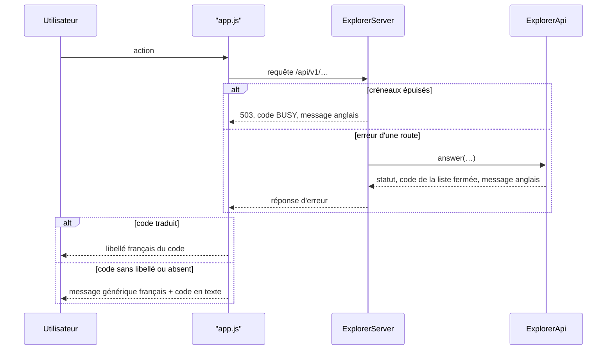

# Design

## Contexte

Motivation : voir `proposal.md` (Why). Trois surfaces sérialisent les mêmes énumérations de `minos-application` : l'API HTTP de `minos-explorer` (contrat `/api/v1/`), l'API Java `com.minos.api.SemanticExplorationApi` et la CLI `minos semantic projection`. La page `app.js` consomme l'API HTTP. Le changement fige l'existant, fixe la règle de langue et fait traduire les erreurs par la page.

## État vérifié au HEAD

Commit relu : `89be3fb4` (`main`).

| Fait | Preuve |
|---|---|
| État de projection en français : `ABSENTE`, `PRETE`, `PERIMEE`, `ECHOUEE` | `minos-application/src/main/java/com/minos/application/semantic/SemanticProjectionService.java:177` |
| Refus de préparation en anglais (`INDEX_NOT_READY`, `NO_DOCUMENT_OF_THE_SELECTED_KINDS`, `MEMORY_BUDGET_EXCEEDED`…) | `SemanticProjectionService.java:180-183` |
| Divergence en français : `IDENTIQUE`, `DIFFERENTE`, `SOURCE_INTROUVABLE`, `NON_COMPARABLE` | `minos-application/src/main/java/com/minos/application/semantic/SemanticCorpusQueryService.java:456` |
| Mode de recherche et nature de score en anglais | `SemanticCorpusQueryService.java:574`, `:592` |
| État d'index en anglais : `DISABLED`, `NO_ACTIVE_SNAPSHOT`, `MISSING`, `STALE`, `READY` | `minos-application/src/main/java/com/minos/application/semantic/SemanticIndexService.java:266` |
| Version du contrat HTTP : `"1"`, préfixe `/api/v1/` ; « an incompatible change publishes a new prefix beside this one » | `minos-explorer/src/main/java/com/minos/explorer/ExplorerContract.java:6-10` |
| L'API HTTP sérialise par `.name()` | `minos-explorer/src/main/java/com/minos/explorer/ExplorerApi.java:192`, `:205`, `:266`, `:298` |
| Une erreur est `{"error": {"code", "message"}}` | `ExplorerApi.java:74-76` |
| Codes émis par l'API : `NOT_FOUND`, `METHOD_NOT_ALLOWED`, `DOCUMENT_NOT_FOUND`, `INDEX_CHANGED`, codes de `ProjectResolver.ErrorCode`, `INVALID_REQUEST`, `INTERNAL_ERROR` | `ExplorerApi.java:111-138` ; `minos-application/src/main/java/com/minos/application/resolution/ProjectResolver.java:26` |
| Codes émis par le serveur : `NOT_FOUND` (`:255`), `INVALID_REQUEST` (`:260`), `UNSUPPORTED_MEDIA_TYPE` (`:265`), `BUSY` (trois sites : `:269`, `:283`, `:293`), `TIMEOUT` (`:289`), `INTERNAL_ERROR` (`:296`) | `minos-explorer/src/main/java/com/minos/explorer/ExplorerServer.java:255-296` |
| La nature de document (`SYMBOL`, `FILE`, `CHUNK`) est sérialisée par `.name()` pour les points de la projection | `minos-explorer/src/main/java/com/minos/explorer/ExplorerApi.java:266` ; `minos-domain/src/main/java/com/minos/semantic/SemanticDocumentKind.java:4` |
| Les causes de péremption que la page traduit sont des éléments du champ `limitations`, liste de chaînes produite par les services applicatifs | `minos-explorer/src/main/resources/com/minos/explorer/web/app.js:22-25` ; `ExplorerApi.java:156`, `:174`, `:193`, `:212`, `:246` |
| Les refus de garde (hôte, origine, jeton) ne portent que le statut 401 ou 403, sans corps de raison | `minos-explorer/src/main/java/com/minos/explorer/RequestGuard.java:29-31` |
| Messages d'erreur de l'API en anglais ; page de refus en français | `ExplorerServer.java:269`, `:283`, `:289` ; `:58-62` |
| La page construit l'erreur avec `error.message` et l'affiche dans le bandeau | `minos-explorer/src/main/resources/com/minos/explorer/web/app.js:97-99`, `:117-124` |
| La page traduit déjà états et divergences par des tables | `app.js:20-35`, `:464-466` |
| La CLI sérialise l'état de projection, le documente dans son aide et référence la constante `State.PRETE` dans son code | `minos-cli/src/main/java/com/minos/cli/command/SemanticProjectionCommand.java:38`, `:101`, `:118` |
| Tests qui affirment déjà des valeurs françaises | `minos-api/src/test/java/com/minos/api/SemanticExplorationApiContractTest.java`, `minos-cli/src/test/java/com/minos/cli/SemanticProjectionCommandLineTest.java`, `minos-explorer/src/test/java/com/minos/explorer/ExplorerProjectionRoutesTest.java`, `ExplorerRoutesTest.java`, `WebResourcesContentTest.java` |
| Documents qui citent ces valeurs | `docs/user/semantic-explorer.md`, `docs/developer/semantic-explorer.md`, `docs/user/cli.md` |
| `minos-explorer` n'est dans aucune release : 0 commit sous `v1.3.0`, 11 depuis | `git log --oneline v1.3.0 -- minos-explorer` ; `git log --oneline v1.3.0..HEAD -- minos-explorer` |

Non mesuré : aucun test exécuté. L'inventaire des codes d'erreur est celui du `89be3fb4` ; les changements du sprint 3 (`fiabiliser-la-surface-de-l-explorateur`, `distinguer-l-erreur-d-usage-de-l-echec-interne`) modifient les erreurs de l'explorateur et se fusionnent avant : la liste fermée se relève après eux (tâche 1.1).

## Écarts

| Écart | Source A | Source B | Suite proposée |
|---|---|---|---|
| L'audit demande de « faire porter aux erreurs un `code` stable » : le champ existe déjà sur toute réponse d'erreur de l'API ; ce qui manque est une liste tenue et une page qui s'en sert | `findings.json` (AUD-QUA-03) | `ExplorerApi.java:74-76` | Liste fermée par test ; traduction côté page |
| L'audit propose de renommer les constantes dans v1 « avant que le contrat ne soit consommé ailleurs » ; trois surfaces versionnées les sérialisent, et le contrat annonce qu'un changement incompatible publie un nouveau préfixe | `findings.json` (AUD-QUA-03) | `ExplorerContract.java:6` ; règle des surfaces additives | D1 : pas de renommage dans v1 |
| L'audit ne cite que l'API HTTP et l'API Java ; la CLI sérialise aussi l'état de projection et le nomme dans son aide | `findings.json` (AUD-QUA-03) | `SemanticProjectionCommand.java:38`, `:101`, `:118` | Le test de contrat couvre les trois surfaces |
| L'audit cite `app.js:99` et `:124` comme affichage ; `:99` construit l'erreur, `:124` l'affiche | `findings.json` (AUD-QUA-03) | `app.js:97-124` | Les deux sites changent |
| Les causes de péremption et les autres éléments de `limitations` ne sont pas une énumération du contrat : c'est une liste ouverte de chaînes, que chaque service complète | `app.js:22-25` | `ExplorerApi.java:156` | Hors de la table des valeurs figées ; leur libellé dans la page est couvert par `executer-le-front-de-l-explorateur-en-test` (sprint 1) |
| Les causes de péremption et les autres éléments de `limitations` ne sont pas une énumération du contrat : c'est une liste ouverte de chaînes, que chaque service complète | `app.js:22-25` | `ExplorerApi.java:156` | Hors de la table des valeurs figées ; leur libellé dans la page est couvert par `executer-le-front-de-l-explorateur-en-test` (sprint 1) |
| Les refus 401 et 403 n'ont pas de code : la page les reconnaît au statut | `RequestGuard.java:29-31` | `app.js:91-94` | Inchangé (ne rien révéler de la raison est voulu) ; hors de la liste fermée |

## Exigences couvertes

- `exploration-semantique` › Les valeurs d'énumération du contrat v1 de l'explorateur sont figées : D1, D2.
- `exploration-semantique` › Toute erreur de l'API de l'explorateur porte un code d'une liste fermée : D3.
- `exploration-semantique` › La page de l'explorateur traduit le code d'erreur : D4.

## Objectifs et non-objectifs

Objectifs : une règle écrite ; un contrat v1 qui ne peut plus dériver sans édition visible ; aucune phrase anglaise dans la page. Non-objectifs : traduire les messages de diagnostic du serveur ; publier v2 ; toucher aux énumérations.

## Responsabilités et frontières des composants

Direction des dépendances (ARCH-0068) inchangée. La liste fermée des codes est une constante de `minos-explorer` (visibilité package) : l'API et le serveur y prennent leurs codes au lieu de littéraux épars, y compris les trois codes repris de `ProjectResolver.ErrorCode`. Les tables de libellés vivent dans `app.js`. Aucune dépendance nouvelle.

## Modèle de domaine et invariants

Non applicable : aucune énumération modifiée. Invariant ajouté par test : l'ensemble des valeurs sérialisées par champ est égal à la table du test de contrat.

## Traitements et interactions

Voir le diagramme : une erreur traverse l'API avec son code ; la page choisit le libellé.

## États et transitions

Non applicable.

## Contrats d'interface

Contrat HTTP v1, réponse d'erreur (inchangé dans sa forme) :

```json
{"error": {"code": "BUSY", "message": "too many requests at once; retry"}}
```

- `error.code` : chaîne, requise, valeur de la liste fermée. Compatibilité : additive (un code peut s'ajouter ; aucun ne disparaît ni ne change de sens dans v1).
- `error.message` : chaîne, requise, anglais, diagnostic destiné à un développeur ; non stable, jamais affichée par la page.
- Refus 401 et 403 : statut seul, sans code (inchangé).

Contrats exécutables existants à compléter plutôt qu'à recopier : `SemanticExplorationApiContractTest`, `SemanticProjectionCommandLineTest`, `ExplorerRoutesTest`, `ExplorerProjectionRoutesTest`.

## Persistance et intégrité

Non applicable : l'état de projection sérialisé n'est pas persisté sous ces noms par ce changement. À confirmer en 1.1 : si une valeur française est écrite dans un fichier de projection publié, elle entre dans la table du test au même titre.

## Transactions, concurrence et idempotence

Non applicable.

## Sécurité et isolation

Le code reçu d'une réponse est inséré dans la page comme texte (`textContent`), jamais comme balisage, même s'il est inconnu. `error.message` n'est plus affiché : une cause qui y fuirait par erreur n'atteindrait plus l'écran. Les exigences existantes sur l'absence de chemin absolu dans les réponses restent applicables au champ.

## Erreurs et reprise

Le comportement de reprise de la page sur 409 (`INDEX_CHANGED`) est conservé ; il se décide désormais sur le code et non sur le seul statut [Proposition], à condition de garder le même effet pour un 409 sans code.

## Observabilité

Non applicable.

## Performance et mesure

Non applicable.

## Compatibilité, migration et retour arrière

Aucune valeur, aucun champ ne change : un client écrit contre v1 continue de fonctionner. Retour arrière par revert ; aucun état persistant.

## Diagrammes

### Qui choisit le texte qu'un utilisateur lit quand une requête échoue ?

Type : sequenceDiagram · Portée : cible · Exigences : `exploration-semantique` › Toute erreur de l'API de l'explorateur porte un code d'une liste fermée ; › La page de l'explorateur traduit le code d'erreur



Le serveur ne produit aucun texte destiné à l'utilisateur ; la page ne lit que le code.

## Décisions

### D1 — Langue des constantes : anglais pour le neuf, v1 figé

Statut : [Proposition], à trancher par le propriétaire. ADR à écrire (domaine ARCH, prochain numéro libre à l'écriture) : « Langue des constantes des contrats publics ».

Le sujet passe le filtre des ADR : choix entre options réelles, qui contraint durablement trois surfaces publiques, coûteux à inverser une fois une release publiée.

| Option | Contenu | Coût | Avis |
|---|---|---|---|
| A | Règle écrite : anglais pour toute constante nouvelle ; les huit valeurs françaises de v1 restent, en liste close ; leur forme anglaise sort avec le prochain contrat incompatible, quel qu'en soit le motif | faible, strictement additif | **recommandée** |
| B | A, plus un contrat v2 publié maintenant (`/api/v2/` aux valeurs anglaises par table de correspondance dans la surface, v1 servi à côté ; valeurs additionnelles pour l'API Java et la CLI) | double surface à tester et à documenter pour une surface non encore livrée | possible, non spécifiée ici |
| C | Renommer dans v1 avant la première release qui contient l'explorateur | faible, mais contraire à la règle « versionnées et additives » ; touche trois contrats | seulement sur décision explicite du propriétaire, écrite dans l'ADR ; l'état vérifié (aucune release ne contient `minos-explorer`) est le seul argument en sa faveur |

Les specs de ce changement sont vraies sous A et sous B. Sous C, l'exigence « valeurs figées » serait à réécrire avant `/opsx:apply`.

### D2 — Un test de contrat par surface, une table par champ

Statut : [Décision] de conception. Chaque test compare l'ensemble des valeurs de l'énumération (`values()`) à une table littérale du test, champ par champ : ajout, retrait et renommage échouent. Champs couverts : état d'index, état de projection, divergence, refus de préparation, mode de recherche, nature de score, nature de document (`SemanticDocumentKind`). Le champ `limitations` est exclu : liste ouverte de chaînes. Un renommage d'énumération se propage à ses usages (la CLI référence `State.PRETE`) : le test de contrat est ce qui échoue une fois le dépôt recompilé, pas la compilation. Champs couverts : état d'index, état de projection, divergence, refus de préparation, mode de recherche, nature de score, nature de document (`SemanticDocumentKind`). Le champ `limitations` est exclu : liste ouverte de chaînes. Un renommage d'énumération se propage à ses usages (la CLI référence `State.PRETE`) : le test de contrat est ce qui échoue une fois le dépôt recompilé, pas la compilation. La liste close des huit valeurs françaises est une table à part, de taille affirmée. Les tests vivent dans le module de la surface (`minos-explorer`, `minos-api`, `minos-cli`).

### D3 — Les codes d'erreur sortent d'une liste unique

Statut : [Décision] de conception. Une énumération de `minos-explorer` (visibilité package) porte les codes, et la fabrique des réponses d'erreur ne reçoit que ce type : une réponse hors liste ne compile pas, aucun test n'a donc à la chercher. Le test de contrat compare les valeurs de l'énumération à une table littérale (un code renommé, retiré ou ajouté échoue) et vérifie que chaque valeur de `ProjectResolver.ErrorCode` a son code de même nom.

### D4 — La page traduit par table, avec repli

Statut : [Décision] de conception. Table `ERROR_LABELS` dans `app.js`, à côté des tables existantes ; `report` choisit le libellé par code ; repli générique « La requête a échoué (code …). ». Les tests du front (`minos-explorer/src/test/js/`, harnais du sprint 1) tiennent la table des codes et échouent pour un code sans libellé, comme ils le font pour les états.

## Qualification des capacités

`exploration-semantique` : qualifiée pour les trois exigences, sous Windows et Linux (tests Java dans les jobs `Verify` ; tests du front dans le job `invariants`, selon le sprint 1). Tant que le harnais du sprint 1 n'est pas fusionné, l'exigence de traduction n'est vérifiable que par recherche textuelle : **partielle** dans cet intervalle.

## Risques et compromis

- [Risque] Trois changements éditent `app.js` (sprint 1 : harnais et gestion du presse-papiers ; sprint 4 : carte ; celui-ci : erreurs) → ordre de fusion : sprint 1, puis sprint 4, puis ce changement, qui ne touche que `api`, `report` et une table ; rebase sans recouvrement de fonctions attendu avec le sprint 4.
- [Risque] Le sprint 3 (`fiabiliser-la-surface-de-l-explorateur`, `distinguer-l-erreur-d-usage-de-l-echec-interne`) ajoute ou requalifie des erreurs de l'explorateur → il se fusionne avant ; la liste fermée est relevée sur le `main` du moment (tâche 1.1).
- [Compromis] Le contrat v1 reste bilingue : c'est le prix d'une surface additive ; la règle écrite empêche que l'écart grandisse.

## Vérification

- `./mvnw -B -ntp -pl minos-explorer -am test`, puis `-pl minos-api -am test "-Dtest=SemanticExplorationApiContractTest" "-Dsurefire.failIfNoSpecifiedTests=false"` et `-pl minos-cli -am test "-Dtest=SemanticProjectionCommandLineTest" "-Dsurefire.failIfNoSpecifiedTests=false"` (avec `"-Dsurefire.failIfNoSpecifiedTests=false"`), l'un après l'autre.
- `python scripts/quality/check-explorer-front.py` (sprint 1) ; `python .claude/scripts/run_gates.py --fast`.
- Non vérifiable localement : rien, une fois le sprint 1 fusionné.

## Documentation durable à mettre à jour

ADR nouveau et son entrée dans `docs/architecture/adr/README.md` et `docs/architecture/arc42/09-decisions.md` ; `docs/user/semantic-explorer.md` (codes d'erreur et leur sens) ; `docs/developer/semantic-explorer.md` (règle de langue, liste fermée, tables de libellés) ; dossier `docs/architecture/diagrams/capacites/exploration-semantique.md`.

## Traçabilité

| Exigence (capacité › titre) | Scénario | Conception ou diagramme | Tâche | Test ou preuve |
|---|---|---|---|---|
| exploration-semantique › Les valeurs d'énumération du contrat v1 de l'explorateur sont figées | Dépôt réel | D2 | 1.2 | tests de contrat des trois surfaces : à écrire |
| idem | Constante renommée dans v1 | D2 | 1.2 | à écrire (mutation consignée) |
| idem | Valeur française ajoutée | D2 | 1.2 | à écrire |
| exploration-semantique › Toute erreur de l'API de l'explorateur porte un code d'une liste fermée | Route inconnue | D3, diagramme | 2.1 | `ExplorerRoutesTest` : à compléter |
| idem | Code renommé | D3 | 2.1 | à écrire (mutation consignée) |
| idem | Code de résolution de projet non repris | D3 | 2.1 | à écrire |
| exploration-semantique › La page de l'explorateur traduit le code d'erreur | Serveur occupé | D4, diagramme | 3.1, 3.2 | test du front : à écrire |
| idem | Code inconnu de la page | D4 | 3.1, 3.2 | à écrire |
| idem | Code de la liste sans libellé | D4 | 3.1 | à écrire |

## Questions ouvertes

- D1 : option A (recommandée), B ou C. Attendue du propriétaire avant l'implémentation.
